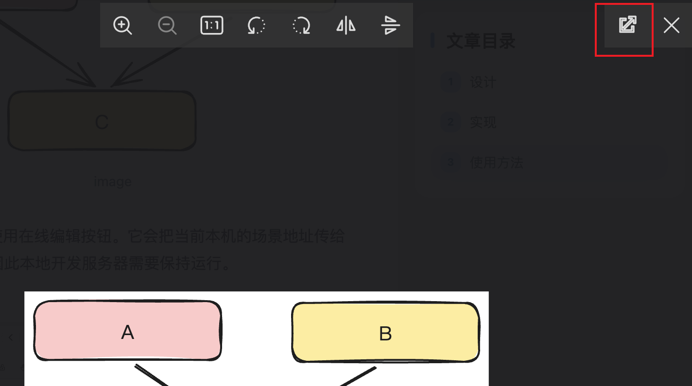
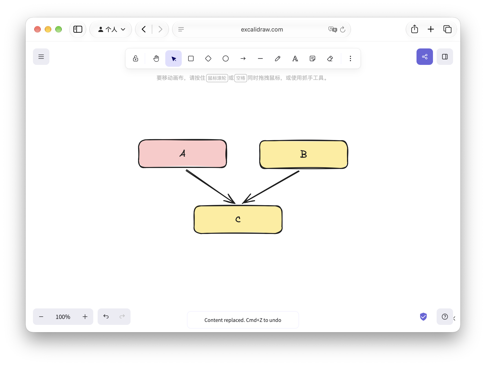

Excalidraw 很适合画架构图、流程图和随手笔记，但普通图片在博客中无法继续编辑。这里为文章加入 `.excalidraw` 文件支持：博客展示静态预览，原始文件仍保留在仓库中。

## 设计

每张图由两份资源组成：仓库内的 `.excalidraw` 原文件，以及构建时生成的 SVG 预览图。两份资源的地址都会带上场景内容的哈希。

- 文章页只加载 SVG，因此阅读页面保持轻量。
- 点击预览会进入现有的图片浏览器，可缩放、拖拽和全屏查看。
- 图片浏览器右上角的“在 Excalidraw 中编辑”按钮会打开官网，并加载本站发布的原始场景文件。

在线编辑后的内容需要手动下载并替换仓库中的 `.excalidraw` 文件，再提交发布。

## 实现

Markdown 处理阶段识别以 `.excalidraw` 结尾的图片地址，并将它替换为生成 SVG 的地址。构建过程会同时发布原始 JSON 文件，供 Excalidraw 官网读取。场景内容更新后，哈希和资源地址会同步变化，因此浏览器会加载新的预览图。

原始场景文件设置了跨域响应头，只允许 `https://excalidraw.com` 读取；预览图和原始文件都会使用长期缓存。

## 使用方法

将原始文件放在文章目录中。例如本篇文章的目录结构如下：

```text
excalidraw/
├── index.md
└── test.excalidraw
```

随后像插入普通图片一样引用它：

```md

```

下面是实际效果：


在浏览窗口，点击右上角的「在Excalidraw中编辑」按钮，既可跳转至官方编辑器查看或编辑该图。



它会把当前本机的场景地址传给 Excalidraw 官网，因此本地开发服务器需要保持运行。


