## 数组Array

> [!NOTE]  和切片的辨别
> 切片在申明的时候，`[]`内部都是空的，如：`[]int`。
> 而数组的话，`[]`内部需要填入大小或`...`

```go
var arr1 [3]int

arr2 := [2]int{1,2}

arr3 := [...]int{1,2,3,4} //自动推导数组大小
```

### 初始化

#### 上限推导

`[3]int{1,2,3}`和`[...]int{1,2,3}`在运行时完全等价，但编译器的处理方式完全不同：
- `[3]int{1,2,3}`：在**类型检查阶段**进行类型验证
- `[...]int{1,2,3}`：在**语法分析阶段**推导长度，在**类型检查阶段**完成类型确定。

#### 数组初始化的底层实现

- **小于4个元素**：直接在栈上分配并初始化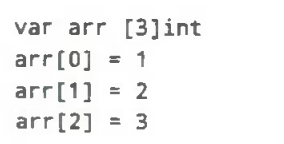
- （堆优化）**大于等于4个元素**：将数据放在静态只读区（通常是 `.rodata` 段），运行时复制到栈/堆。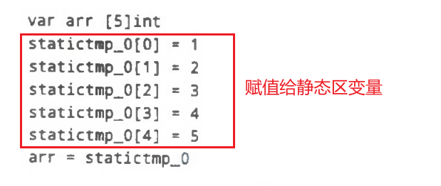

好处：
1. **减少代码大小**
    - 避免为每个大数组字面量生成大量初始化指令
    - 相同字面量可以共享静态数据 
    - 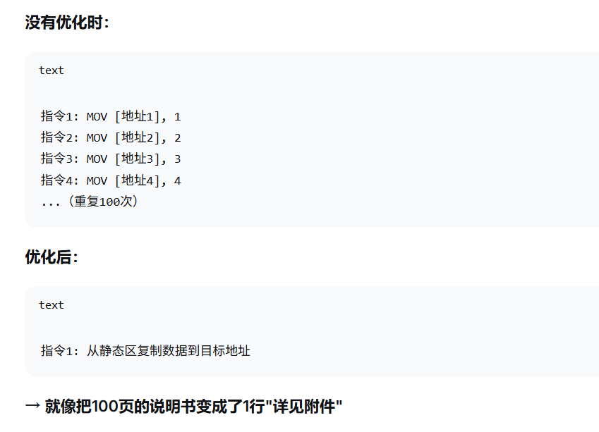
2. **提高缓存效率**
    - 静态数据在只读段（可以被更好地缓存和共享）
    - 只读特性让CPU缓存更有效
3. **启动性能**
    - 对于全局变量，数据已经在二进制文件中，无需运行时计算

| 场景      | 没有优化    | 有优化               |
| ------- | ------- | ----------------- |
| 编译1MB数组 | 生成1MB指令 | <mark>生成几KB指令+1MB数据</mark> |
| 程序启动    | 逐个初始化   | <mark>直接内存映射</mark>        |
| 缓存效率    | 指令缓存被挤占 | <mark>数据可共享可预测</mark>      |

### 访问和赋值

> [!NOTE]  
> 编译器不仅会在“编译期间”发现一些简单的**越界错误**，并且插入**用于检测数组上限的函数**`runtime.panicIndex()`，
> 还会在“运行阶段”通过该函数保证不会发生越界。

数组的寻址还是赋值，均在编译阶段完成，没有运行时的参与。
## 切片Slice

```go
[]int
[]interface{}
```

编译阶段仅仅确定元素类型。

数据结构（标准库对外导出的结构）（自1.21起弃用）
```go
// reflect.SliceHeader
struct SliceHeader struct{
	Data uintptr
	Len int
	Cap int
}
```
- Data是指向数组的指针；
- Len是当前切片的长度；
- Cap是当前切片的容量，即**Data数组的大小**（分配的总空间）。

> [!TIP] Go 1.23
> 运行时/编译器内部实现仍然为`runtime.slice`。（结构与上面相同，只不过使用`unsafe.Pointer`而非`uintptr`）
> 
> 构造/解构切片 由`reflect.SliceHeader` **改用** unsafe库的`unsafe.Slice` / `unsafe.SliceData` / `unsafe.String*`

> [!NOTE]  切片的所有操作都依赖运行时
> 数组对运行时依赖**很低**，切片对运行时依赖**很高**。
> 
> |特性|数组|切片|
|---|---|---|
|**内存分配**|编译时确定|运行时动态分配|
|**长度管理**|编译时常量|运行时变量|
|**容量管理**|固定不变|运行时动态扩容|
|**边界检查**|编译时可优化|必须运行时检查|
|**逃逸分析**|容易栈分配|经常堆分配|
|**函数传参**|值拷贝|引用传递(header拷贝)|

- 需要**性能可预测、编译时优化** → 数组
- 需要**动态大小、运行时灵活** → 切片

### 初始化

> 按照自下而上的顺序

#### 1. 使用下标`[0:N]`

> [!IMPORTANT]  
> 这是所有初始化方法中最底层的！是最原始也是最接近汇编语言的。

```go
arr := [3]int{1,2,3}
slice := arr[:]
```
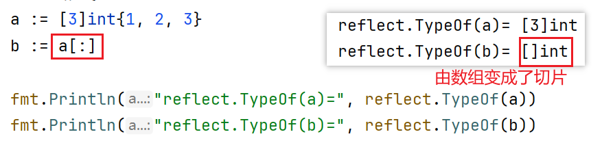

`slice := arr[:]`（可以指定下标范围）在编译阶段被转化为了：
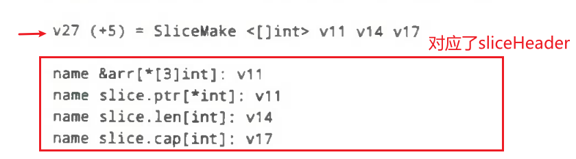
SliceMake操作会接收4个参数创建新的切片：元素类型、数组指针、切片大小和容量

> [!WARNING]  这并不是拷贝
> 使用下标初始化切片**不会复制**原数组或原切片中的数据，而只会创建一个指向原数组的切片结构体，所以修改新切片的数据也会修改原切片。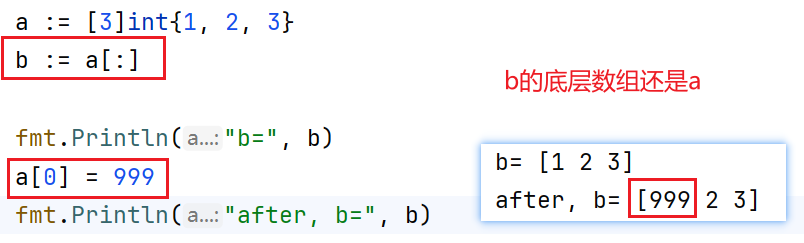

#### 2. 使用字面量
```go
slice := []int{1,2,3}
```

在编译阶段被转化为：
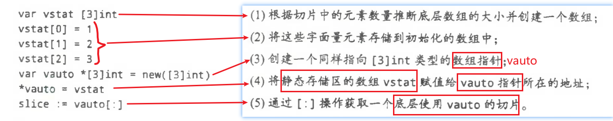
1. 推断底层数组大小 → `[3]int`
2. 字面量存储到初始化数组
3. 创建数组指针  
4. 静态区数组赋值给自动变量
5. 通过`[:]`获取切片

1、2、4就是数组创建的过程。

#### 3. 使用make关键字
```go
slice := make([]int,3,4)
```
在编译阶段，会对应到`OMAKESLICE`节点，分为两种处理方式：

##### （1）**小切片+不逃逸**
不逃逸指的是该切片在代码的使用中没有发生逃逸
会改写为：
```go
var arr [4]int
slice := arr[:3]
```

小切片和不逃逸共同决定了其为：**栈分配**。
- 不逃逸：其生命周期被编译器证明只在当前函数/协程栈帧内，于是编译器就让它走更便宜的栈路径。
- 小：**过大对象**不适合放栈，goroutine 的“栈”会按需增长，会引发扩容，就产生了搬迁成本。

##### （2） **其他情况**
改为对于`runtime.makeslice`的调用，保持/降解为**运行时分配**，并且是分配到**堆区**。

**“小”是怎么判定的？**
`isSmallMakeSlice` 的经典实现（早期版本示例）要求 `len`、`cap` 都是常量，且 `cap < (1<<16)/elemWidth`（大约以 **64 KiB** 为阈值，按元素大小折算），否则不算“小”。

这解释了为什么“大切片”即使不逃逸也不会走栈内改写：

### 访问元素

切片操作都在编译期间完成：
- `len(slice)`和`cap(slice)`**可能**会直接替换为切片的长度或容量（不需要在运行时获取）。
- 访问切片元素可能会在编译期间转换为对地址的直接访问。
- 会将`range`关键字的遍历替换为形式更简单的循环。

### 追加与扩容

```go
s := []int{1,2,3}

//不覆盖原变量
_ = append(s,1,2,3)

//覆盖原变量
s = append(s,1,2,3)
```

按照是否覆盖原变量，在编译阶段分为两种处理流程：

#### 1. 不覆盖原切片
```go
_ = append(s,1,2,3)
```

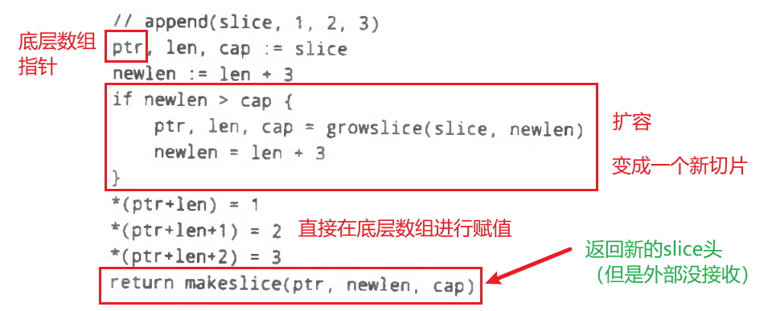


> [!NOTE]  注意
> 使用`growslice()`扩容之后，返回的是一个指向新底层数组的切片头。
> 且其`len`依然**等于**旧`len`。


#### 2. 覆盖原切片
```go
s = append(s,1,2,3)
//类似于
//tmp := append(s,1,2,3)
//_ = tmp
```
- 调用 runtime.growslice（如果需要）
- 得到一个新的 slice header
- 丢弃这个 header
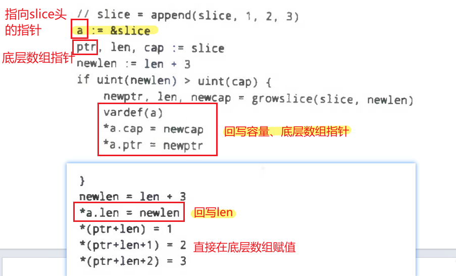

#### 3. 扩容细节

> 以下为`runtime.growslice()`函数的实现细节
> 分为两步：确定大致容量、内存对齐。

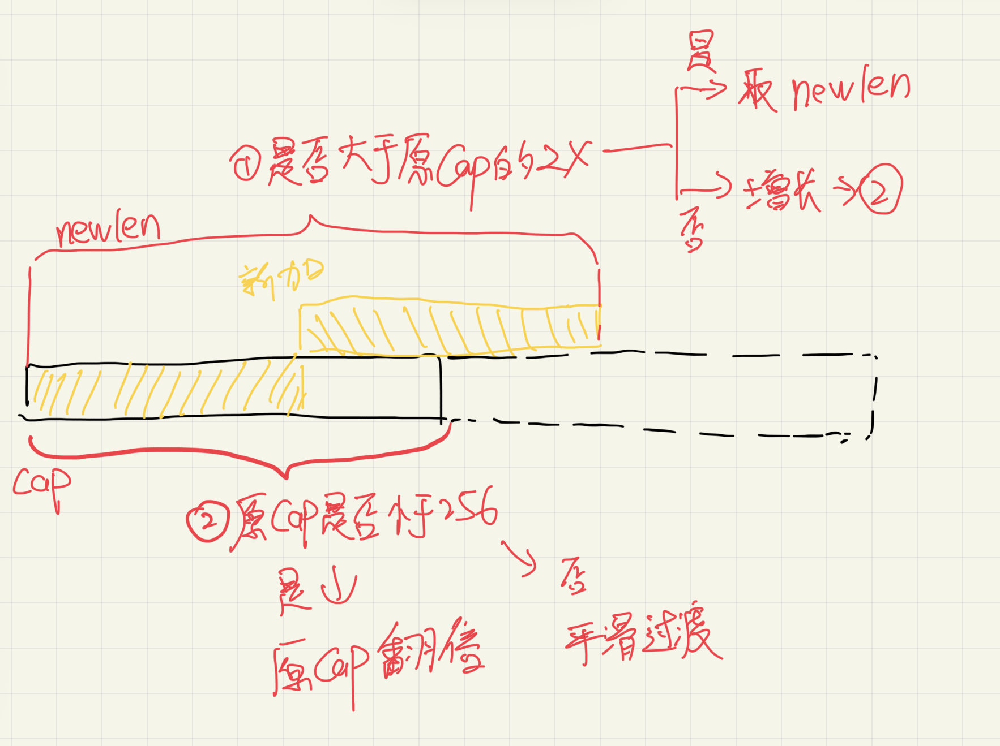
##### （1）确定大致容量
- 如果 append 后的总长度 `newLen > 2 × oldCap`，候选新容量直接取 `newLen`
- 否则（`newLen <= 2 × oldCap`）
	- 如果 `oldCap < 256`，候选容量扩大为原来的 2 倍，直到 `newcap >= newLen`；
	- 如果 `oldCap >= 256`，则通过
$$
newcap += (newcap + 3*256) >> 2
$$
	循环增长，直到 `newcap >= newLen`。这种算法使扩容倍率从约 **2 倍平滑过渡到 1.25 倍**.

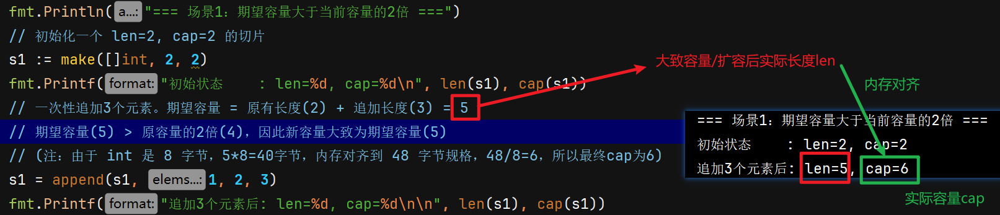

##### （2）内存对齐

当数组元素所占用字节大小为1、2或8的整数倍时，就会使用`runtime.roundupsize`进行内存对齐。

好处是：可以提高内存分配效率并减少碎片。

将上一步的“大致容量”，向上取整到`class_to_size`数组中的数字。
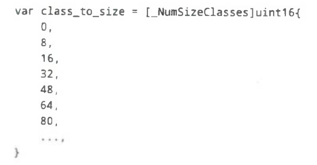

案例：
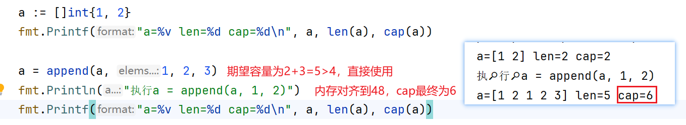

##### （3）新底层数组初始化
这里这句描述的意思，其实是概括了 `runtime.growslice` 做“**扩容后新底层数组的初始化**”两件事里用到的两个底层原语：

1. **计算占用内存**。若内存溢出则崩溃
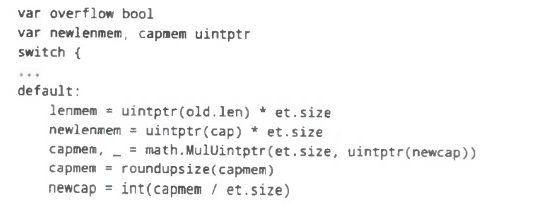

2. **把新数组中【未被旧元素覆盖】的那一段清零**：
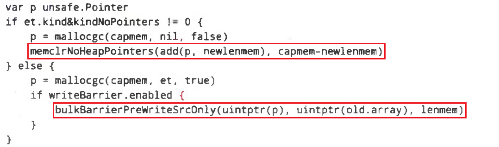
- `growslice` 的注释明确写着：拷贝完旧数据后，**“新增区间 `[oldLen, newLen)`（对含指针元素会清零）需要由调用方初始化；而尾部区间 `[newLen, newCap)` 一律清零”**。这样可以保证新 backing array 的“未使用容量”不含垃圾值，尤其不含**悬挂指针**。
- 若元素类型**不含指针**（no-pointer / noscan 类型），清零可以用更快的 **`runtime.memclrNoHeapPointers`**：它一次性将一段内存设为 0，且不触发写屏障（因为这里**不可能**写入堆指针）。官方说明强调：**只有在调用者能保证目标区域不含堆指针**时才能使用它；否则应走 `typedmemclr`。
- 若元素类型**含指针**，清零就要走带写屏障的路径（`typedmemclr`/bulk barrier），保证 GC 能正确追踪/不存在“误扫描到垃圾指针”的风险。这也是注释里特地强调“指针元素会被清零”的原因。相关写屏障与 `typedmemclr` 的实现见 `mbarrier.go`。

2. **把旧切片的内容复制到新数组前段**
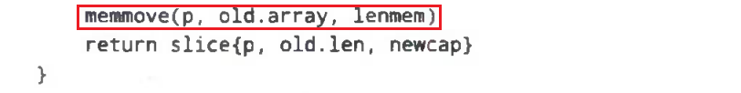
- 复制使用的是 `memmove`（或等价路径），语义上允许源/目标重叠，比 `memcpy` 更安全。`growslice` 先分配新 backing array（容量至少 `newLen`），再把旧区间 `[0, oldLen)` 拷到新数组的起始处。
- 历史变更里也能看到编译器/运行时在 `growslice` 里针对含指针类型优化了复制方案：通过**批量写屏障 + `memmove`** 替代逐元素的 `typedmemmove`，以减少屏障开销、提升性能。


> [!NOTE]  写屏障
> **写屏障（write barrier）**是垃圾回收器在“程序仍在改动指针”的同时保持正确性的关键钩子：在**每次把一个指针写入内存**（例如把对象 A 的字段设为指向对象 B）时，插入一小段屏障代码，用来**告知 GC 这次写入**，从而维护三色标记等不变式，避免把仍可达的对象误回收。
> （GC章节应该会学到）


### 复制切片
```go
func copy(dst, src []Type) [int]
```

> [!NOTE]  二者区别并不大
> 两条路最后都以`memmove`收尾，都会将整块内存复制到目标内存区域中。
> 差别在于**是否进入 runtime 以及是否需要写屏障**

#### 1. 编译时（编译器固化/内联）
典型触发：
- **元素无指针**（noscan），且编译器能证明只需字节搬运。
- 某些固定规模或典型模式（如 `make+copy`）被优化规则命中，可直接生成更低层的代码序列。

如果copy不是在运行时调用的，`copy(a,b)`会被转为：
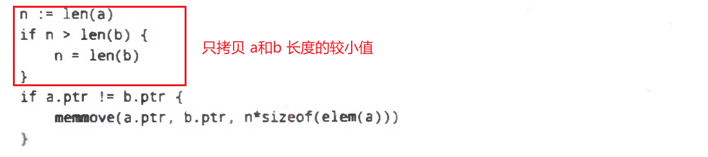

**为什么必须取较小值：**
- 若按 `len(src)` 盲拷贝而 `dst` 更短，会 **越界写** 目标；
- 若按 `len(dst)` 盲拷贝而 `src` 更短，会 **越界读** 源；
- 因此只能拷贝两者都“安全”的那一段，即 `min(len(dst), len(src))`。这也是规范明确写出的行为：`copy` 的返回值就是这个最小值。
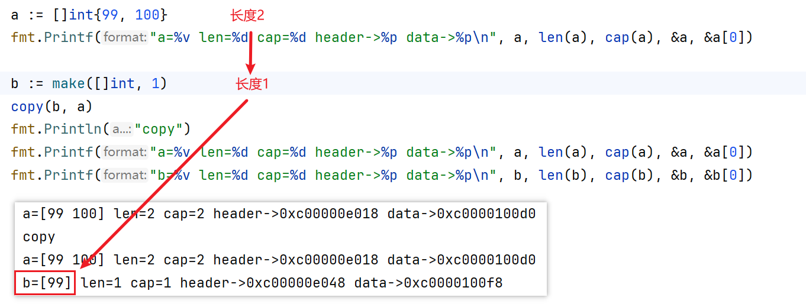

特点总结：
- **直接生成 `memmove`**（或少量指令）而**不经 runtime**，这样后端还能对 `memmove` 做平台级优化（如内联、寄存器搬运、阈值分支等），减少一次函数调用和屏障成本。GCCGo 的补丁就明确写道：“对非指针切片的 `copy`，不要调 runtime，**直接用 `__builtin_memmove`**”。
- Go 官方编译器也有类似的优化：例如识别 `m := make([]T, x); copy(m, s)` 并重写为**一次分配+一次 `memmove`**（指针自由的 `T` 时可避免清零和涂灰），而非“先 make 再 runtime 复制”。
- 是否走这条路由由 **SSA 降解/优化** 决定（具体规则视版本与平台而变）。

#### 2. 运行时（通过 runtime 调用）
典型触发：
- **元素类型含指针**（需要 GC 写屏障语义）。
- 处于 **`reflect`** 等需要运行时类型信息的路径（`reflect.Value.SetBytes/Copy` 就直接调 `typedslicecopy`）

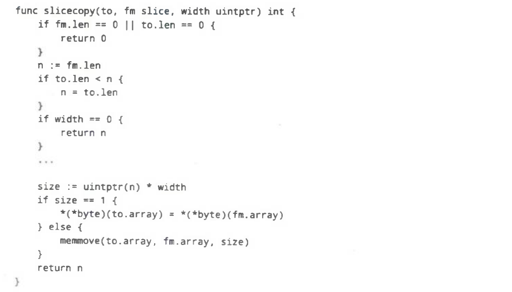

特点总结：
- 入口是 **`runtime.typedslicecopy`**（通用、带类型描述），或 **`runtime.slicecopy`**（元素“无指针”/pointer-free 的优化版）。它们内部都先取 `n = min(len(dst), len(src))`，随后调用 **`memmove`** 做实际字节搬运。
- 对**含指针元素**的切片拷贝，会配合**批量写屏障**（bulk barrier），以维护并发 GC 的三色不变式；这也是 `typedslicecopy` 存在的主要原因之一。相关的写屏障逻辑在 `runtime/mbarrier.go`。
- `memmove` 是汇编级实现，能正确处理**重叠区间**（选择向前/向后搬运），并对不同大小做分段优化。