## 哈希表：Go `map` 的实现与 Swiss Table

> [!NOTE] 核心问题
> 哈希表如何在键冲突存在时，仍以接近常数的代价完成查找、插入、删除与增长？

> [!NOTE] Demo
> [在 Go Playground 观察哈希过程](https://go.dev/play/p/9egLv-KWD2I)

Go 1.24 将内建 `map` 的底层实现切换为 Swiss Table。旧实现以桶链解决冲突；新版采用开放寻址，将冲突元素继续放入后续的组（group），并以控制字节批量筛选候选键。

> [!NOTE] 实现版本与阅读方式
> 本文以 Go 1.24 引入的 Swiss Table 为主线。语言规范保证 `map` 的可观察语义；字段布局、探测细节和迭代器协作属于当前运行时实现，后续版本可能调整。文中的结构体用于阅读源码，不是稳定 API。

> [!TIP] 先建立一张“路线图”
> 把一次 `m[key]` 想成查快递：哈希值先把 key 路由到一张 **table**，再确定从哪个 **group** 开始找；每个 group 有 8 个槽位。运行时先查看轻量的**控制字节**，筛出可能匹配的槽位，最后才读取并比较完整 key。遇到空槽即可结束；删除有时会留下墓碑，使查找继续向后，直到后续增长时被清理。

### 目录

- [数据结构](#数据结构)
- [哈希过程](#哈希过程)
- [Swiss-table-的不变式](#swiss-table-的不变式)
- [可扩展哈希：globalDepth 与 localDepth](#可扩展哈希globaldepth-与-localdepth)
- [基本操作](#基本操作)
- [迭代range](#迭代range)
- [扩容](#扩容)
- [总结](#总结)

### 数据结构：先看层次，再看字段

#### 桶链式哈希表（Go 1.23 及以前）

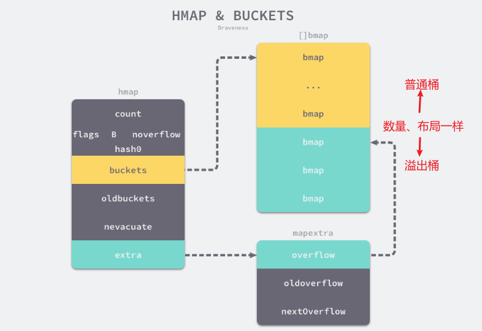

```go
// hmap哈希表结构 runtime.hmap
type hmap struct {
	count     int
	flags     uint8
	B         uint8
	noverflow uint16
	hash0     uint32

	buckets    unsafe.Pointer
	oldbuckets unsafe.Pointer
	nevacuate  uintptr

	extra *mapextra
}
// 额外字段
type mapextra struct {
	overflow    *[]*bmap
	oldoverflow *[]*bmap
	nextOverflow *bmap
}
```
其中：
- `count` 表示当前哈希表中的元素数量
- `B` 表示桶数量的以 2 为底的对数，因此 `len(buckets) == 2^B`；
- `hash0` 是哈希的种子，它能为哈希函数的结果引入随机性，这个值在创建哈希表时确定，并在调用哈希函数时作为参数传入；
- `oldbuckets` 是扩容期间保存旧桶数组的字段；翻倍增长时其桶数为当前 `buckets` 的一半，同尺寸增长时两者桶数相同；

桶的结构如下：
```go
//桶结构（运行时） runtime.bmap
type bmap struct {
    topbits  [8]uint8
    keys     [8]keytype
    values   [8]valuetype
    pad      uintptr
    overflow uintptr
}
```
> [!IMPORTANT] 桶内布局
> 每个 `bmap` 最多容纳 8 个键值对。哈希值的**低 `B` 位**用于定位桶；高位截取出的 `tophash` 存入 `topbits`，用于桶内的快速预筛选。桶满后，元素会进入 overflow bucket。


读取过程：
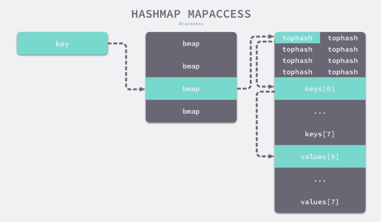


#### Swiss Table 哈希表（Go 1.24+）


先忽略结构体字段，Swiss Table 的层次只有三层：

```text
map
└── directory（大 map 才需要；负责选 table）
    └── table（独立完成一次开放寻址查找）
        └── group × N（每组 8 个 key/value 槽位 + 8 个控制字节）
```

可以把 `directory` 看作“分流目录”，把 `table` 看作一间独立的小仓库，把 `group` 看作仓库中一次检查的 8 个货位。理解这三层之后，再看字段就能知道每个字段服务于哪一步。

> [!TIP] 三个数字先记住
> - 每个 group 有 **8** 个槽位；
> - 多组 table 的平均装载阈值约为 **7/8**；
> - 当前实现中，单张 table 的槽位容量上限为 **1024**，之后通过分裂继续增长。

##### 源码字段：用于追踪实现

**哈希表结构**（教学化简后的源码字段视图）
```go
// 对应 internal/runtime/maps.Map（编译器侧 mirror 见 reflectdata/map.go）
type Map struct {
    used   uint64        // 当前已用槽位数（全局）
    seed   uintptr       // 哈希种子（防 DoS）

    dirPtr unsafe.Pointer // 指向 directory（若使用多表）
    dirLen int            // 目录项个数

    globalDepth uint8   // 目录使用的全局前缀位数
    globalShift uint8   // 把 H1 右移多少位用于选表（实现细节）

    writing bool        // 并发安全的内部标志
    tombstonePossible bool // 是否已产生墓碑（影响触发 rehash）

    clearSeq uint64     // 清空用的世代计数（迭代协作）
}
```

`dirPtr` 指向 table 目录。较小的 map 可直接使用单个 group，此时无需常规目录。

**表结构**（教学化简后的源码字段视图）
```go
// 对应 internal/runtime/maps/table.go
type table struct {
    used       uint16 // 已占用槽（含“满”槽）
    capacity   uint16 // 总槽位数（= 组数 * 8；始终为 2 的幂）
    growthLeft uint16 // 距离下一次 rehash 还能插入多少个“空槽”
    localDepth uint8  // 本表局部前缀位数（<= globalDepth）
    index      int    // 本表在目录中的起始索引（可能被多次引用）

    groups groupsReference // 组数组（连续内存）
}
```

`groups` 指向连续的组数组；组数为 2 的幂，便于通过位运算完成取模。

**组结构**（逻辑布局）
```go
// 逻辑布局（编译器侧 mirror）：
type group struct {
    ctrl  uint64                 // 8 个控制字节打包（64bit）
    slots [8]struct{ key K; elem V } // 每槽 key/elem（必要时变为间接指针）
}

// 运行时包装（便于位运算与按偏移寻址）：
type ctrlGroup uint64 // 8 个 ctrl 字节拼成的 64 位
type groupReference struct {
    data unsafe.Pointer // 指向 group 起始（先 ctrl，再 slots）
}
type groupsReference struct {
    data       unsafe.Pointer // 指向 group 数组首
    lengthMask uint64         // 组数-1（为 2^n -1，便于 & 取模）
}
```

控制字节`ctrl`如：
```go
empty   = 1000 0000 (0x80)
deleted = 1111 1110 (0xFE)   // 墓碑
full    = 0hhh hhhh          // 高位 0 + 低 7 位为 h
```


### 哈希过程

> [!TIP]
> 本节及后续操作均以 Go 1.24+ 的 Swiss Table 实现为背景。

#### 先用一次查找串起整个过程

假设执行 `v, ok := m["go"]`。运行时先对 `"go"` 和 map 的种子求哈希，得到 `h`。随后它按以下顺序工作：

1. 用 `h` 的高位前缀通过 directory 选中一张 table。
2. 用 `h` 的剩余部分确定起始 group；若发生冲突，继续访问后续 group。
3. 在每个 group 中先比较 8 个控制字节，找出“指纹相同”的少数候选槽位。
4. 只对候选槽位读取完整 key 并比较；找到 `"go"` 即命中。
5. 某个 group 出现 `empty` 时，查找结束：`"go"` 不在这张 table 中。

下面的 H1、H2、探测序列和控制字节，分别解释上述第 1～5 步。**从未超过 8 项的小 map** 走专门的小表路径：`dirPtr` 直接指向唯一的 group，直接扫描即可；本节重点讲有常规 table 的路径。

在常见的 64 位、非 Wasm 构建中，一次哈希得到 64 位整数 `h`，运行时将其划分为两部分：

- **H1（高 57 位）**：用于定位起始组并生成**探测序列**（probe sequence）。
- **H2（低 7 位）**：写入**控制字节**（control byte），充当快速筛选用的指纹。每组有 8 个控制字节，打包为一个 64 位控制字；一次匹配可并行比较 8 个槽位的 H2。只有 H2 命中的槽位才需要完整的键相等比较。若组中存在 `empty`，查找可提前判定为未命中。

```text
64 位 hash h
┌──────────────────────── H1：高 57 位 ────────────────────────┬─ H2：低 7 位 ─┐
│ hash 的最高 globalDepth 位 → directory 选 table │ H1 → 起始 group / probe │ 写入 ctrl │
└───────────────────────────────────────────────────────────────┴───────────────┘
```

这是帮助理解的位分工图。directory 具体取多少位由 `globalDepth`、`globalShift` 和平台实现决定；复习时只需记住：**哈希最高位负责选 table，H1 负责组内探测，H2 负责组内预筛选。**

组（group）是 Swiss Table 的最小探测单位。

#### 1. 用 H1 生成探测序列
假设某张表有 **16 组**（每组 8 槽），所以 `groupMask = 16-1 = 0x0F`。  
某键的哈希（与种子混合后）记为 `h`。
1. **目录选表**（可略）：用 `H1` 的更高位前缀选中这张表。
2. **起始组 g0**：`g0 = (H1 & groupMask)`
    - 例子：`H1 = 0x6D3A …`，`H1 & 0x0F = 0x0A (=10)`，所以从 **第 10 组**开始。
3. **探测序列**（组二次探测）：每走一步，增量加一。这样既能避开已满的 group，又能在组数为 2 的幂时遍历整张 table：
```go
g0 = 10
g1 = (10 + 1) & 0x0F = 11
g2 = (10 + 1 + 2) & 0x0F = 13
g3 = (10 + 1 + 2 + 3) & 0x0F = 0
...
```
也就是说，偏移量依次为 `0, 1, 3, 6, ...`，第 `i` 次探测可记为 `gᵢ = (g0 + i(i+1)/2) & groupMask`。组数为 2 的幂时，这条序列能够覆盖整张 table；这里将它作为实现保证记忆即可。

- **`globalDepth`（全局深度）**：当前 directory 使用的哈希位数，决定目录大小。
- **`localDepth`（局部深度）**：某张 table 用于区分自身的哈希位数。
- **`groupMask`（组掩码）**：等于 table 内 `group 数量 - 1`。由于组数为 2 的幂，可用位与运算定位起始 group。

#### 2. 用 H2 进行组内匹配

每个槽位对应一个控制字节，且控制字节始终处于三种状态之一：`empty`、`deleted` 或 `full(H2)`。其中只有满槽 `full(H2)` 携带该键的 7 位指纹；空槽和墓碑是保留状态。

到达某一组 `g` 后，做两件事：
1. **候选筛选**：`matchH2(H2)`——把 8 个控制字节与目标 H2 并行比对，得出 8 位 **候选位图**（哪些槽可能存着这个键）。
    - 对候选槽，再逐个做“键相等”精比对；命中则返回。
2. **可早停判断**：`matchEmpty()`——检查这 8 个控制字节里是否存在 **empty(0x80)**。
    - **若存在 empty**，说明**这条探测路径上可以“遇空即止”**；本次查找可直接判定“表内无此键”，**不必继续探测后续组**。

例如，目标 `H2 = 0x23`，第 1、6 号槽的控制字节都是 `full(0x23)`，则候选位图为 `0100_0010`（最低位对应第 0 号槽）。运行时只需再比较第 1、6 号槽里的完整 key。

> [!CAUTION] 为什么 `empty` 可以早停？
> 插入和查找使用**同一条探测序列**。插入时，键会落在这条路径遇到的第一个可写位置。因此，查找走到一个 `empty` 时，目标键若存在，早已在此之前被找到。`deleted` 表示这里曾放过键，后面仍可能有因冲突而继续前进的键，所以必须继续探测。

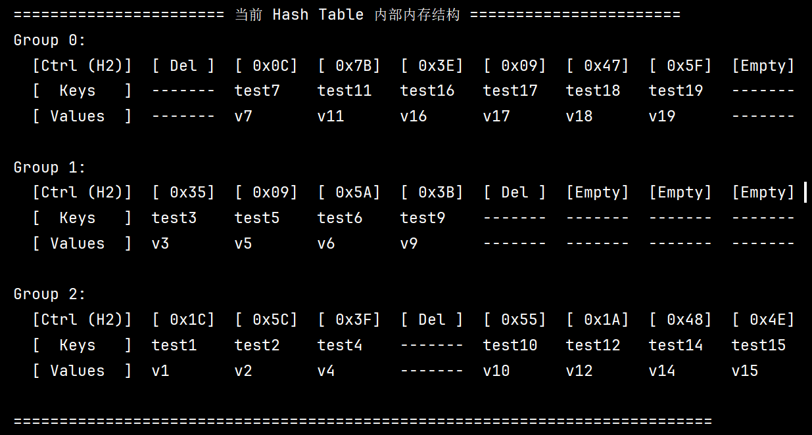
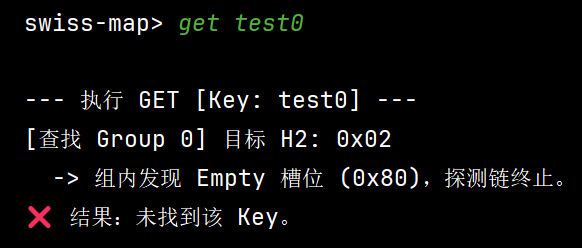
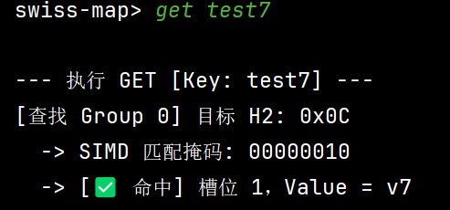
### Swiss Table 的不变式

> 对于任意已存入表的键 `k`，从起始组 `g0(k)` 沿探测序列到达其所在槽位之前，不会出现能够使查找提前结束的 `empty`。路径上可以出现 `full`，也可能出现 `deleted`。

插入算法（包括 rehash 时“像新插入一样重排”）保证了这一点：
- 当把 `0x23` 插入表且 `g0=5` 时，算法会在探测路径上选择第一个可写槽位；运行时优先保留 `empty`，必要时复用 `deleted`；
- 因此**不可能**跳过 `ctrl5` 中的 empty 而把它放在下一组 `ctrl6`。

### 可扩展哈希：`globalDepth` 与 `localDepth`
一张 table 最多容纳 1024 个元素。map 变大后，运行时不把所有元素搬进一张更大的总表，而是让 directory 把哈希空间分给多张 table。`globalDepth` 和 `localDepth` 记录“目录目前把键空间切得多细”。

可以把它理解为快递分拣：`globalDepth` 表示总分拣目录使用多少位地址；`localDepth` 表示某一个分拣区实际细分到多少位。尚未分裂的 table 可以被多个相邻目录项共同指向。

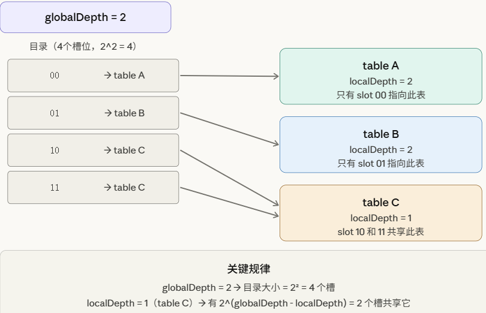
#### globalDepth
`globalDepth` 是**整个哈希表目录的深度**，决定目录（directory）的大小：
```
目录槽位数 = 2^globalDepth
```

查找某个 key 时，运行时取哈希值的**高位前缀**索引 directory，找到对应的 table 指针。以下伪代码省略 `globalShift` 与平台位宽等布局细节：
```go
// 伪代码
slot := highestBits(hash, globalDepth)
t := directory[slot]
```

当某张 table 满到需要分裂时，`localDepth == globalDepth` 表示目录没有更多路由位可用。运行时先将目录翻倍（`globalDepth++`），再分裂该 table；若 `localDepth < globalDepth`，现有目录已经有可复用的路由位，只需更新指向这张 table 的部分目录项。

---

#### localDepth

`localDepth` 是**每个 table 自身的深度**，表示这张 table 实际使用了哈希值的高位前缀中的几位来区分自己。它有一个重要推论：

```
指向同一个 table 的目录槽位数 = 2^(globalDepth - localDepth)
```

- `localDepth == globalDepth`：恰好 **1 个**目录槽指向它，这个 table 是"独占"的
- `localDepth < globalDepth`：有 **多个**目录槽共享它，这个 table 尚未被充分分裂

---

#### 具体案例：从空表到分裂

下面用一个完整的演进过程说明两者如何配合。案例中的 `00`、`01` 等均表示供 directory 使用的**哈希高位前缀**；选中 table 后，运行时仍用 H1 的另一部分在 table 内定位 group。

初始状态（globalDepth = 0）

```
目录大小 = 1，只有 slot [0]
directory[0] → table A (localDepth=0)
```

所有 key 都去 table A，它接受所有哈希值（0 位区分）。

---

table A 满了，需要分裂

因为 `localDepth(0) == globalDepth(0)`，必须先扩目录：

```
globalDepth: 0 → 1，目录大小: 1 → 2

directory[0] → table A' (localDepth=1)   ← 哈希最高 1 位 = 0
directory[1] → table B  (localDepth=1)   ← 哈希最高 1 位 = 1
```

原 table A 的键按新增的**高位路由位**重新分配到 A' 或 B，并在新 table 内重新建立各自的探测位置。

---

table A' 又满了，分裂（但 table B 没满）

此时 `localDepth(A') = 1 == globalDepth = 1`，再次需要扩目录：

```
globalDepth: 1 → 2，目录大小: 2 → 4

directory[00] → table A'' (localDepth=2)  ← 高 2 位 = 00
directory[01] → table C   (localDepth=2)  ← 高 2 位 = 01
directory[10] ─┐
directory[11] ─┘ → table B (localDepth=1，共享连续目录项)
```

注意 **table B 没有分裂**，它的 `localDepth` 仍为 1，所以 `directory[10]` 和 `directory[11]` 都指向它（`2^(2-1) = 2` 个槽共享）。同一张 table 被多个目录项引用时，这些目录项在当前实现中连续排列。


### 基本操作

三种操作共享同一条主线：**先定位 table，再按 group 探测，最后通过控制字节缩小完整 key 比较的范围**。差异只出现在“找到键”或“遇到可写槽位”之后。

> [!NOTE]  对nil Map进行读写
> Highlights information that users should take into account, even when skimming.

#### Get（查找）

**目标**：以尽量少的随机访存快速判定命中或未命中。

> [!NOTE] 把 Get 看成两次筛选
> 查找某个 key 时，控制字节先回答“8 个槽里哪些值得打开看看”；完整 key 比较再回答“候选槽里是否真的是这个 key”。大多数槽位会在第一步被排除。

**流程：**
1. **哈希并选表**：对 key 取 `h`，用 H1 的前缀（结合 `globalDepth/globalShift`）从目录选中**一张表**。
2. **构造探测序列**：用 H1 和表的组数得到覆盖所有组的**二次探测序列 `probeSeq`**。起始组由 H1 确定，后续步长递增。
3. **逐组并行筛选**：对探测序列的每个组：
    - 取组的 64 位控制字，做 `matchH2(H2)` 得到“**候选满槽位**”位图；再做 `matchEmpty()` 检测**是否有空槽**（有空槽意味着沿该探测方向“遇空即止”：这条路径上不可能再出现目标键，可**提前返回未命中**）。
    - 对候选位逐一做“**键相等**”精比对；命中即返回槽指针。
    - 在 amd64 上，控制字匹配可使用 SIMD 指令；其他架构使用相应的位运算实现。

**为什么这样做：** 控制字节紧凑地放在一起，运行时可先批量判断“是否值得加载 key/elem”，从而减少无谓的 cache miss；“遇空即止”让未命中查找尽早结束。Go 官方 blog 的流程描述与源码注释一致。

> [!NOTE]  SIMD
> **SIMD（Single Instruction, Multiple Data）**是一种**数据级并行**：用一条指令同时处理多份数据（比如 8 个字节一起比较）。Swiss Table 的“控制字节并行匹配”（一次匹配 8 个槽的 H2 / empty / deleted）非常适合用 SIMD/按位技巧来实现，所以在 amd64 等架构上能把组内筛选做得很快。

---
#### Put（插入/更新）

**目标**：在较高装载因子（约 **7/8**）下维持快速查询与较短的探测路径。

插入先完成一次查找。这样可以区分两种结果：找到同一个 key 时覆盖值；走到空槽时才真正插入新键。

**流程：**
1. **与 Get 前半相同**：哈希、选表、构造探测序列。
2. **先找已存在**：每到一组先 `matchH2(H2)`，若某候选槽 key 相等，直接**覆盖值**返回（更新路径）。
3. **找插入位**：用 `matchEmptyOrDeleted()` 识别可写槽。探测时会记录遇到的第一个 `deleted`；到达含 `empty` 的 group、确认键不存在后，优先复用已记录的墓碑，否则使用该空槽。随后写入 key/elem，并将控制字节设为 `full(H2)`。
4. **记账与阈值**：表维护 `used` 和 `growthLeft`（距离阈值还可插入多少“真空位”）；当“满槽+墓碑”逼近阈值（设计为平均每组保留≈1 空槽），触发**rehash**。

**为什么：** 运行时在整张 table 中维持约 `7/8` 的平均装载阈值，相当于平均每组保留约一个空槽；具体 group 可以全满。空槽让查找能够早停。墓碑维持探测链连通性，却会降低早停概率，因此会计入后续增长的阈值。

| 名称 | 复习时的含义 |
| --- | --- |
| `used` | 当前 `full` 槽的数量，也就是实际元素数 |
| `full + deleted` | 已占用或被墓碑占住的槽位数；它决定探测会有多长 |
| `growthLeft` | 距离装载阈值还剩多少插入预算；墓碑留在表中时，这个预算不会因删除而完全恢复 |

> [!NOTE] “墓碑”存在的意义
> 一句话总结：**墓碑保持原有探测链连通**，从而维持“遇空即停”的正确性。
> 
> 删除的平均时间复杂度为 `O(1)`。运行时只需更新控制字节与槽位内容，无需重排后续元素。

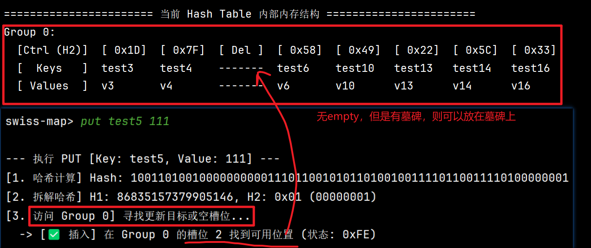

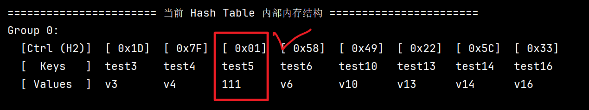

---

#### Delete（删除）

删除看似只要“把槽位清空”，却需要先回答一个问题：后面的冲突键会不会依赖这个位置继续探测？这正是墓碑存在的原因。

**流程：**
1. **哈希并选表**  
    计算 `h = hash(k, seed)`，用 **H1**（高位前缀）从目录选择目标表，并生成该键的**二次探测序列**。
2. **逐组查找目标槽**  
	若没找到，则该次删除为 **no-op**（兼容 Go 语义：删不存在的键不会报错）。
3. **命中后更新槽位状态**
    命中槽位 `s` 后：
    - 若所在 group 仍有其他 `empty`，控制字节可改为 `empty`；若 group 原本全满，则改为 **`deleted (0xFE)`**（墓碑）。墓碑保留探测链的连通性。
    - **清理键/值存储**（重要的 GC 语义）：
        - 间接存放的 key/elem 只需清空指针；底层对象随后可被 GC 回收。
        - 含指针的内联 key 会清零，借此断开引用；无指针的内联 key 无需为了 GC 清零。
        - elem 会清零；这既断开可能存在的引用，也满足复合赋值等实现语义。
    - **计数更新**：已占用槽计数 `used` 减一。若留下墓碑，空槽数量没有增加，`growthLeft` 也不会因此回升；这正是墓碑会拖慢后续查找的原因。
4. **后续增长**
    删除本身不发起 rehash。后续插入发现 `growthLeft` 耗尽时，会先清理可安全转换的墓碑；空间仍不足时，运行时通过增长或分裂分配新 table，并只重插 `full` 槽位，从而消除剩余墓碑。

**为什么需要墓碑？**

设键 A 先占用某个 group 的槽位，键 B 与 A 冲突后被放入后续 group。若删除 A 时把它所在的**原本全满 group**直接改出一个 `empty`，查找 B 会在这里提前结束，永远走不到后续 group。

- 因此，在一个原本全满的 group 中，删除槽位要标为 `deleted`，保持探测链可继续向后走。
- 若当前 group 原本已经有其他 `empty`，查找本来就会在该 group 停止；被删除的位置可直接标为 `empty`。
- 把槽改为 **`deleted`** 可以“占位但不匹配”：
    - 查找时不会把它当命中（`matchH2` 不会命中 `deleted`），
    - 也**不会触发早停**（`deleted` 不等于 `empty`），
    - 使得后面的元素仍能被继续探测到。
- 代价是：墓碑会**降低早停概率**、加长探测路径；所以需要**周期性的 rehash**来“扫墓碑”。

**与迭代（range）的配合**：
- Go 允许在**同一 goroutine** 的迭代期间删除键。迭代器尚未到达的键若被删除，后续不会产出；未经同步的并发 map 访问仍然不合法。
- 如果迭代期间触发 rehash 或表分裂，迭代器会在需要时**到新表重查**：尚未到达且已删除的候选键会被跳过，尚未到达且已修改的键返回到达时可见的最新值；新增键依照 Go 语义可能出现，也可能被跳过。

**与插入（Put）的互动：以 `empty` 确认不存在，再复用先前的 `deleted`**
- 之后的插入会用 `matchEmptyOrDeleted()` 找**可写槽**：
    - 查找途中记录第一个 `deleted`；
    - 在 `empty` 处确认键不存在后，优先复用这个 `deleted`；若此前没有墓碑，才使用 `empty`。
- `empty` 负责终止探测，`deleted` 负责维持探测链并可被后续插入回收。

---
#### 扩容

新版 Go `map` 不是把整个 map 当成一个大哈希表来扩，而是把它拆成多个较小的 Table。每个 Table 自己负责一部分 hash 区间，Map 上层通过 Directory 找到目标 Table。

插入新元素时，先在对应 Table 里找位置。Table 的可用空间由负载因子控制，接近上限后，如果之前有删除留下的 tombstone，会先尝试**清理这些 tombstone**，看看能不能腾出空间。

如果还是放不下，就进行 **rehash**：
- （方式一：Grow）当 Table 还比较小时，直接把**组容量扩大一倍**，然后把原来的有效元素重新计算位置，插入到新的 Table 中。这个过程中 tombstone 不会被带过去，相当于顺便做了一次整理。
- （方式二：Split）单个 Table 最大增长到 1024 个 slot。达到这个大小后，再需要扩容时，不会继续变成 2048，而是**把这个 Table 拆成两个 Table**。原来的元素根据 hash 的下一位被重新分流到两个 Table 中。
Table 拆分后，上层 Directory 会更新映射关系。如果现有 Directory 已经能区分这两个新 Table，就只修改相关目录项；如果区分不了，Directory 自身再扩大一倍。

所以整个机制可以概括成：

```text
Table 空间不足
    ↓
先清理 tombstone
    ↓
仍然不足
    ↓
Table < 1024
    → 容量翻倍并重新放置元素

Table = 1024
    → 拆成两个 Table
    → 按 hash 前缀重新分流
    → 必要时扩大 Directory
```

本质上是：

**小范围内靠 Table 翻倍扩容，规模变大后靠 Table 分裂扩容；只处理有压力的那部分 Table，而不是一次重建整个 Map。**


> [!NOTE] 图示说明
> 下图用于理解表分裂与重排。Swiss Table 在单张 table 内同步搬迁元素；旧 table 会由迭代器暂时持有，以满足迭代期间修改 map 的语义。

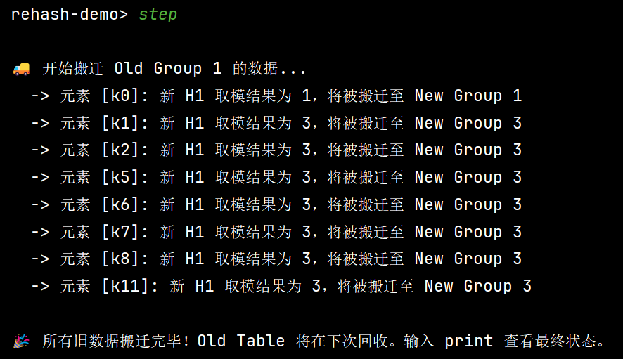

---

#### 并发
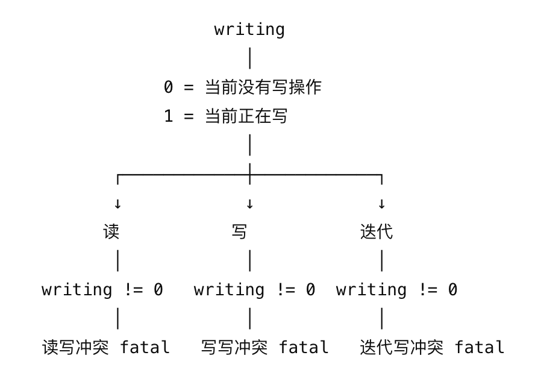

赋值、修改、`delete`、`clear` 都属于写操作，会在开始检查并设置writing字段。

#### 迭代（range）

运行时处理 map 迭代的核心原则可以概括为一句话：

**旧 Table 决定“按什么顺序找 key”，当前 Table 决定“这个 key 现在是否存在、value 是什么”。**

这条规则贯穿 `Iter.Init`、`Iter.Next` 以及扩容后的重查逻辑。

假设迭代器正准备从旧 Table 返回 key `A`，此时 map 发生 grow 或 split，`A` 已经被重新放到了新的 Table 中。迭代器不会切换到新 Table 重新开始扫描，而是继续从旧 Table 得到“下一个候选 key 是 A”，随后再到当前 map 中重新查找 `A`：

```text
旧 Table
   ↓
按原来的遍历轨迹找到 key A
   ↓
去当前 Table 重新查 A
   │
   ├─ A 已删除 → 跳过
   └─ A 仍存在 → 返回当前最新 value
```

这样既能保持原来的遍历进度，又不会因为 rehash 后元素位置发生变化而重新扫描整个新布局。

##### 1. 迭代器如何推进

一次：

```go
for k, v := range m {
    ...
}
```

底层由 `maps.Iter` 维护遍历状态。

初始化 `Iter.Init` 时，主要做几件事：

- 记录当前 map 和类型信息；
- map 为空时直接结束；
- 生成 `entryOffset` 和 `dirOffset`，随机化 Table 内和 Directory 的遍历起点；
- 记录当前的 `globalDepth`、`clearSeq` 等状态。

随后每次 `Next` 都尝试找到下一项：
```text
Directory
   ↓
选择一个 Table
   ↓
扫描 Table 中的 Group
   ↓
读取 control word
   ↓
找出 full slot
   ↓
取得 key / value
```

一个 Group 有 8 个 slot。迭代器通过 control word 一次判断这 8 个槽中哪些是有效元素，从而跳过 empty 和 tombstone，只处理 `full` 的槽。

如果当前 Group 已经扫描完，就进入下一个 Group；Table 扫描结束后，再继续下一个 Directory 项。

同一个 Table 可能被多个连续的 Directory 项引用，因此迭代器会跳过这些重复目录项，避免同一张 Table 被扫描多次。

##### 2. 迭代期间发生删除

如果某个尚未返回的 key 被删除，之后即使旧 Table 中还能找到这个 key 的历史位置，迭代器也会到当前 map 中重新确认。

如果发现 key 已经不存在，就直接跳过：

```text
旧 Table 找到 A
   ↓
当前 map 查询 A
   ↓
不存在
   ↓
不返回 A
```

因此，**在轮到某个 key 之前将其删除，该 key 不会再被本次迭代返回。**

##### 3. 迭代期间发生修改

如果 key 仍然存在，但 value 已经被修改，迭代器在返回前会从当前 map 中取得最新值。

例如：

```text
原来：
A → 10

遍历期间修改：
A → 20

轮到 A 时：
返回 A → 20
```

因此，旧 Table 只是用来确定“该轮到哪个 key”，真正返回的 value 以当前 map 中的数据为准。

##### 4. 迭代期间新增元素

新增元素的行为不同。

一个新插入的 key **可能被遍历到，也可能不会被遍历到**。

原因是迭代器并不会因为 map 发生变化而重新开始扫描。如果新增元素恰好位于后续仍会访问的位置，就可能被看到；如果它落在已经扫描过去的区域，或者只存在于扩容后的新布局中，就可能看不到。

因此不能依赖：

```text
range 期间插入的 key
一定出现
```

也不能依赖：

```text
一定不出现
```

##### 5. 迭代期间发生 grow 或 split

这是整个机制最关键的地方。

Table 扩容后，元素会重新 hash，并重新分布到新的 Table 中：

```text
旧 Table
   ↓ grow / split
新 Table
```

如果迭代器直接切换到新 Table 继续扫描，就很难判断：

```text
哪些 key 已经返回过？
哪些 key 还没返回？
```

因为元素的位置已经改变，很容易造成重复或者遗漏。

所以 Go 的处理方式是：

**继续扫描旧 Table 的 key 集合，但对候选 key 到当前 Table 中重新查询。**

也就是：

```text
旧 Table
负责维持遍历轨迹
        ↓
找到候选 key
        ↓
当前 map
负责确认最新状态
        ↓
删除 → 跳过
修改 → 返回最新值
存在 → 正常返回
```

因此可以把两者职责理解为：

```text
旧 Table：决定“看谁”
新 Table：决定“这个 key 现在是什么状态”
```

##### 6. split 后如何避免重复扫描

一个 Table split 后，会变成两个新的 Table：

```text
Old Table
    ↓
   split
  /     \
Left   Right
```

而旧 Table 可能原本对应 Directory 中的一段连续索引。

迭代器完成旧 Table 的扫描后，不会马上把 split 出来的另一个 Table 当作一张全新的表再次扫描，而会调整 Directory 进度，跳过这次 split 对应的重复范围。

否则同一批旧 key 就可能再次出现。

如果 split 同时导致 Directory 扩容，`globalDepth` 会变化，迭代器也会根据 Directory 的倍增关系调整当前索引，使逻辑上的遍历进度保持一致。

##### 7. 遍历顺序为什么不固定

Go 从语言语义上就没有规定 map 的遍历顺序。

运行时又通过：

```text
entryOffset
dirOffset
```

随机化 Table 内以及 Directory 的起始位置，因此不同次遍历得到不同顺序是正常现象。

所以：

```go
for k := range m {
    ...
}
```

不能依赖任何稳定顺序。

整体语义可以总结为：

```text
已删除的未访问 key
→ 不再返回

已修改的 key
→ 返回当前值

新插入的 key
→ 可能返回，也可能不返回

遍历顺序
→ 不保证，并且实现会随机化

发生 grow / split
→ 继续沿旧 Table 的遍历轨迹走
→ 到当前 Table 查询 key 的最新状态
```

##### 8. 小 map 的情况

对于仍处于 small-map 形态的 map，`dirPtr` 直接指向一个 Group，因此没有 Directory 和多个 Table 的遍历过程。

结构可以理解为：

```text
Map
 ↓
Group
 ↓
最多 8 个 slot
```

迭代器直接扫描这一个 Group。

当 map 曾经增长为完整 Table 结构后，即使之后删除大量元素，也不会自动重新退回 small-map 形态。

##### 9. reflect 的 MapRange

`reflect.MapRange` 最终使用的也是同一套 `maps.Iter` 机制，因此它在：

- 遍历顺序；
    
- 删除处理；
    
- value 更新；
    
- grow / split；
    

这些方面的语义和普通 `for range map` 是一致的。

##### 10. 如果需要稳定顺序

内建 map 不提供有序遍历。

如果业务需要固定顺序，通常先取出 key，再排序：

```go
keys := slices.Collect(maps.Keys(m))
slices.Sort(keys)

for _, k := range keys {
    v := m[k]
    // ...
}
```

这里本质上不是让 map 变得有序，而是：

```text
map
 ↓
取出 key
 ↓
生成一个独立的有序视图
 ↓
按照这个视图访问 map
```

因此，理解 Go map 迭代机制最重要的一句话仍然是：

**迭代器用旧结构维持稳定的遍历轨迹，用当前结构确认 key 的存亡并取得最新 value。**


### 扩容：源码细节

上一节给出增长的决策流程；本节保留表翻倍、表分裂和目录更新的实现细节，便于源码追踪。

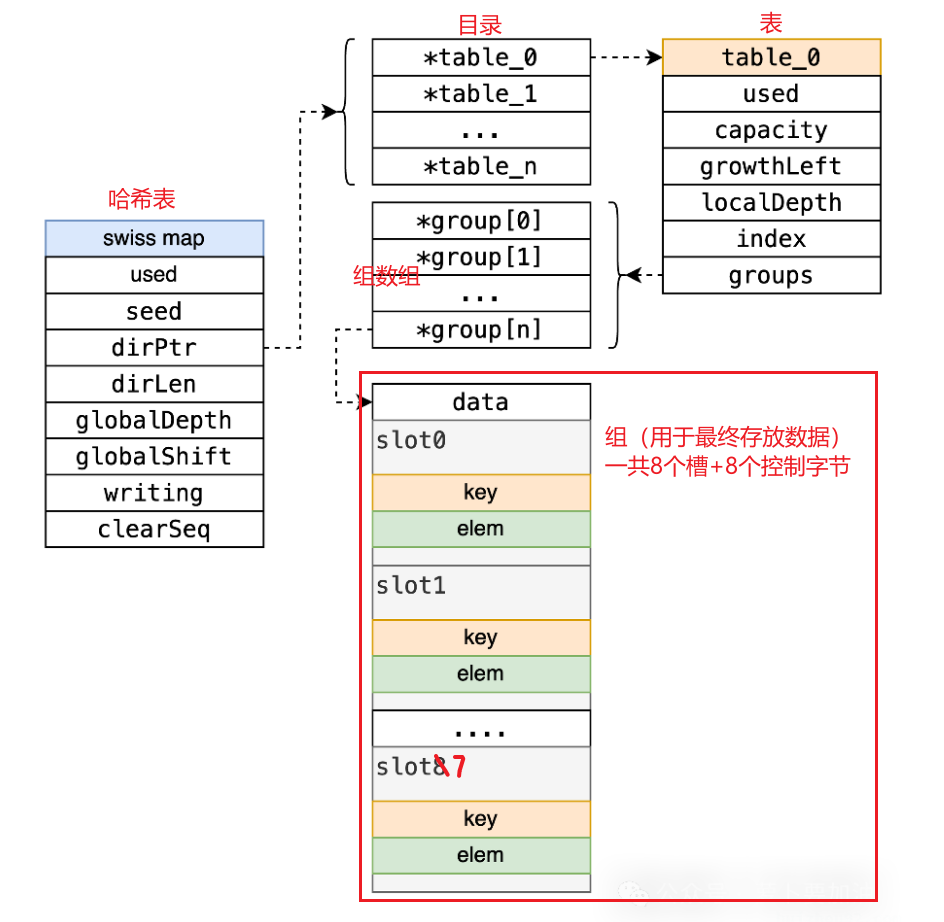
#### 1. 触发扩容的条件：87.5% 装载因子

当你在 Map 中持续插入数据，系统会监控 Table 中 Group 的使用率。

- **触发阈值**：对多组 table，平均槽位占用率接近 **$7/8$（约 87.5%）** 时，会触发针对该 table 的扩容。单组 table 与 small-map 表示有专门的边界规则。
- **注意**：这与旧版的整体扩容不同，Go 1.24 的扩容是**局部发生**的，只针对达到阈值的那个具体 Table，不影响其他未满的 Table。

---
#### 2. 扩容的两种模式

当一个 table 触发扩容时，运行时根据当前容量选择模式。当前实现给单个 table 设定的**槽位容量上限**为 1024 个槽（即 128 个 group）。装载阈值与容量上限分别回答“何时增长”和“何时分裂”。

##### 模式一：表内翻倍（In-place Growth）

**适用场景**：当前 Table 的槽位数量 `< 1024`。

此时 table 仍可通过扩大组数组完成增长。

1. **分配新表**：直接在内存中分配一个新的 Table，容量是旧 Table 的 **2 倍**。
2. **局部 rehash**：遍历旧 table 的所有 group，从控制字中识别 `full` 槽位，并将键值对按新容量重新插入。重插入时重新定位 group，并写入相应的 H2 控制字节。
3. **指针替换**：将 Directory 中指向旧 Table 的指针替换为新 Table。旧 Table 交由 GC 回收。

##### 模式二：表分裂（Table Split & Extendible Hashing）—— 核心精髓

**适用场景**：当前 Table 的槽位数量达到了上限 **1024 个槽位**。

单张 table 达到上限后，运行时将其拆分为两张 table。可扩展哈希借此将键空间继续细分，并把后续增长成本限制在局部。

**详细的分裂与 Rehash 步骤如下：**

**Step 1: 创建左右子表**

- 当前实现不会分配一个 2048 槽的表，而是分配两张新的 1024 槽 table，分别记为 `Left Table` 和 `Right Table`。
- 旧 Table 的内部属性 `localDepth`（局部深度）假设为 $k$。新建的 `Left` 和 `Right` 表的 `localDepth` 将增加为 $k+1$。

**Step 2: 数据的 Rehash 与分发**

- 系统遍历旧 Table 里的全部键值对。
- 对于每一个 key，运行时依据新增的一位目录路由信息，将其分派到两张新表之一：
    - 如果该比特位是 `0`，则将该键值对 Rehash 插入到 **Left Table**。
    - 如果该比特位是 `1`，则将该键值对 Rehash 插入到 **Right Table**。

- 这一步利用哈希位完成键空间分流；每个键仍需按新 table 的容量重新插入，以建立正确的组内探测位置。


**Step 3: Directory（目录）的升级与指针更新**

分表完成后，必须要让外层的 Directory 知道。这里分为两种子情况：

- **子情况 A（局部更新）**：如果 Directory 足够大（`globalDepth` $\ge$ `localDepth`），说明 Directory 里原本就有多个指针指向同一个旧 Table。此时，只需要把一半的指针改指给 `Left Table`，另一半改指给 `Right Table` 即可。

- **子情况 B（目录翻倍扩容）**：如果 Directory 的深度 `globalDepth` 和旧 Table 的 `localDepth` 相等。此时，原目录无法容纳新增的表，**Directory 自身必须翻倍扩容**。
    1. Directory 的 `globalDepth` 加 1，数组长度从 $2^d$ 变为 $2^{d+1}$。
    2. 将原目录的指针复制一份。
    3. 把针对刚才分裂的 Table 的指针，分别更新为指向 `Left` 和 `Right`。


> [!NOTE] 迭代器如何处理旧表
> 正常查找、插入和删除通过更新后的 directory 进入新 table。迭代器为了保持 Go 的迭代语义，可能暂时保留旧 table 的枚举顺序，并在返回键值前到新 table 复查该键的当前状态。


---

#### 3. 总结

旧版 Go map 的增长会让旧桶与新桶在渐进迁移期间并存，且超大 map 的迁移周期更长。

而在 Go 1.24 的 Swiss Table 全过程里：
1. **化整为零**：一个几百万 Key 的大 Map，物理上被切碎成了几千个最大仅占数 KB 的小 Table。
2. **受限的单次搬运量**：扩容时的 rehash 最多处理一张含 1024 个元素的 table。它将增长成本限制在固定上界，有利于控制延迟。
3. **消除冗余指针**：去除了以前的拉链溢出桶（Overflow Buckets），全靠控制字的 SIMD 并行探测来处理冲突。

总而言之，Go 1.24 的扩容过程是通过 **Extendible Hashing 控制宏观路由切分**，结合 **Swiss Table 控制微观的 Cache 亲和性**，在保持 $O(1)$ 复杂度的同时，把大型系统里 Map 造成的内存浪费压缩到了极致。

### 总结

#### 新旧版对比

结构与查找方式：并行筛选替代链式追踪
- **旧版（Go ≤1.23 / noswiss）**：数组里是**桶 bmap**；每桶固定 8 槽，放满后挂 **overflow 溢出桶链**。查找需在主桶→溢出桶上逐槽比对（借助 tophash 8 位做筛选）。装载因子达到 **13/16≈81.25%** 或溢出过多触发增量扩容（evacuation）。
- **Swiss Table（Go 1.24+）**：把数组按 **“组（group）= 8 槽”** 切分；每组多一个 **64-bit 控制字**（8 个控制字节），存槽状态与 **H2=哈希低 7 位**。查找先在一组里用控制字**一次并行比对 8 槽**（SIMD/按位），仅对 H2 命中者做真正键比对；遇到 **empty** 可“**遇空即止**”。无溢出链。官方博文与源码注释详述这一点。

增长策略：整表“双份搬家”→“按表增量 + 重排清墓碑”
- **旧版**：翻倍或同尺寸重排，靠 `oldbuckets`→`buckets` 的**增量搬迁**（访问时顺带搬）。这种设计在大表上会出现**旧表/新表双份存在**与较多随机访存（溢出链）。
- **Swiss Table**：为保持低尾延迟，把整张 map 视作若干**小表**（当前实现中单表上限为 1024 项），按 **H1（哈希高位）前缀**分配；需要扩容时只增长其中一张小表，属于**可扩展哈希**（extendible hashing）。增长或分裂时只重插 `full` 槽位，从而清除墓碑并恢复空槽。


装载因子与内存占用
- **旧版**：平均装载因子上限约 **~81%**（13/16），且溢出链会带来额外指针与不连续访存。
- **Swiss Table**：通过控制字并行筛选与组二次探测，可在较高装载下保持较短探测序列。官方报告的完整应用基准中，CPU 时间几何平均约降低 1.5%；微基准最高可快 60%。这些数字依赖键值类型、访问模式与缓存命中情况。([Go Blog：Faster Go maps with Swiss Tables](https://go.dev/blog/swisstable))


迭代与并发修改语义
- 两代实现都维持 Go 语义（顺序未指定、可修改）。Swiss Table 的实现细节是“**旧表定序，新表取值**”：增长时迭代顺着旧表挑键，但返回前到新表复查取最新值/判是否已删除。 

#### 性能提升
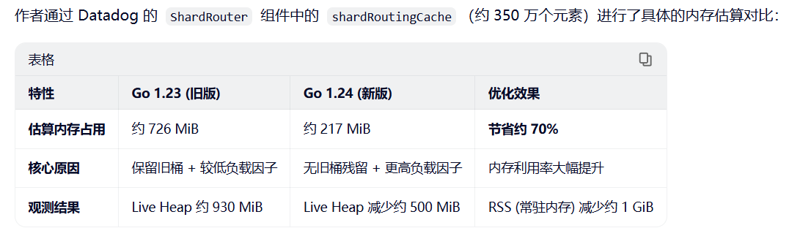

性能优势（新版相对旧版）：要点清单
1. **更少随机访存、命中更早**：同一组里对 8 个槽位做**并行 H2 匹配**，大量过滤“必不匹配”的槽，通常 **1–2 组**内即可命中/早停；旧版在溢出链上跨桶追踪更容易 cache miss。

2. **高装载因子 + 更小内存**：Swiss 结构在较高装载下仍保持较短探测序列。官方报告的微基准最高快 60%，完整应用基准的 CPU 时间几何平均约降低 1.5%；实际收益取决于键值类型、访问模式和缓存命中情况。([Go Blog：Faster Go maps with Swiss Tables](https://go.dev/blog/swisstable))

3. **增长更平滑、降低尾延迟风险**：按表扩容把一次增长的最坏搬迁量限制在**单表 1024 项**，避免旧版在超大表上的“翻倍搬迁”放大单次插入的尾时延。

4. **SIMD 友好**：控制字匹配天然适合 SIMD；Go 1.24 在 amd64 已用 8-byte SIMD 指令，并有把组放大到 16 槽进一步并行的展望（未来工作）。

5. **更好的负载退化行为**：通过**墓碑清理（rehash）** 维持“每组至少一个空位”的目标，使“遇空即止”常态化；旧版在溢出桶链长时退化更显著。 


什么时候收益最明显？
- **读多写少的大表**、**高装载**、**键/值较小可内联**、**热点访问**的场景：并行筛选与高装载直接转化为更少的 L1/L2 缺失和更低内存占用；多案例与基准均给出正向结果。

- **频繁增长/删除**的场景：按表增长 + 定期重排清墓碑，整体尾时延与稳态探测长度都更可控。
