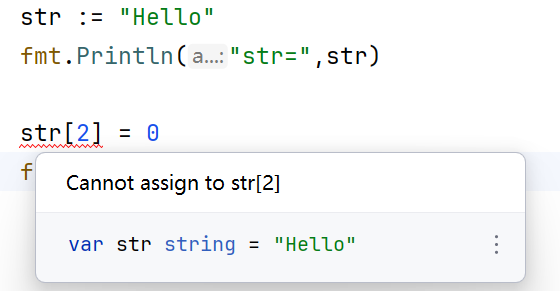
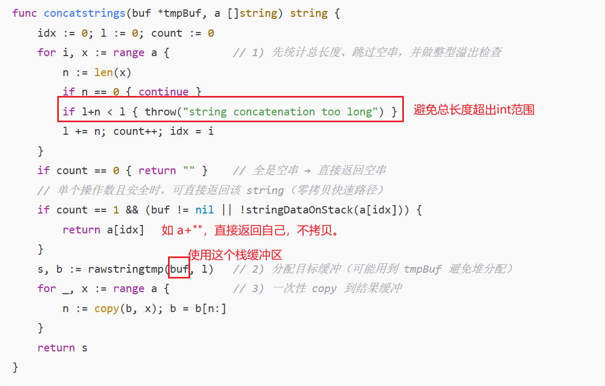
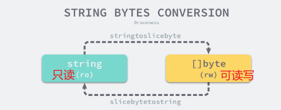

```go
str1 := "this is a string"
str2 := `this is another
string`
```

string 表示“一段（可能为空的）字节序列”，**长度为字节数**，且**不可变**（一经创建便不能修改内容）。

> [!NOTE]  字符串是不能修改的
> 很容易被忽视。
> 


每一个字符串在运行时都会使用如下的 `reflect.StringHeader` 表示，其中包含指向字节数组的指针和数组的大小：
```go
type StringHeader struct {
	Data uintptr
	Len  int
}
```

## 拼接操作

```go
"a" + "b" + "c"
s + ""
"" + ""
```

### 小段数的薄封装

编译器在前端/中端把 `x+y+z+…` 改写为 **调用运行时函数**，并根据**参与拼接的段数**选择入口：
- **2~5 段**：调用专门化入口 `runtime.concatstring2/3/4/5`；
```go
func concatstring3(buf *tmpBuf, a0, a1, a2 string) string {
    return concatstrings(buf, []string{a0, a1, a2})
}
```
- **>5 段**：把参与者打成 `[]string`，调用通用的 `runtime.concatstrings(*tmpBuf, []string)`。  
这些专门化入口今天多为**薄封装**，内部直接转调 `concatstrings`（后面贴源码）。社区也讨论过“可以移除这些薄封装，只保留 `concatstrings`”的提案与背景

> [!NOTE]  殊途同归
> 本质上都是调用的`runtime.concatstrings(*tmpBuf, []string)`
> 
> 做这样的区分（薄封装），目的是让编译器直接生成固定形态调用（**把调用点标准化、轻量化、可优化化**——让编译器、寄存器分配、逃逸分析、GC 与后端代码生成都处在一个更容易发挥性能的形态）


### concatstrings的实现



1. **长度计算**
在运行时实现里，编译器会把链式拼接（`a+b+c+…`）**扁平化成一个参数列表**传给 `concatstrings`，然后 `concatstrings` 会**先遍历一遍**把长度为 0 的字符串**跳过**，统计“非空段”的个数 `count`：
- 如果 `count == 0`（例如 `"" + ""`、或所有参与者运行时都为 `""`），直接返回 `""`。
- 如果 `count == 1`（例如 `s + ""`、`"" + s`、或其它参与者运行时为空），而且该唯一非空段满足“不逃逸或可直接复用”的条件，就**零拷贝**直接返回那一段本身。
- 也就是说，“单一非空 / 全空”并不是语法层面的“只有一个操作数”，而是**经过“跳过空串”这一步之后**在**运行时**形成的情形；`concatstrings` 专门为这种情况走快路径。
比如：
- `s + ""` → 非空段只有 `s` → 直接返回 `s`；
- `"" + ""` → 没有非空段 → 返回 `""`；
- `x + y` 但**在运行时** `x==""` → 非空段只有 `y` → 直接返回 `y`。  
    （如果编译期就知道全是常量字面量，很多时候会**直接常量折叠**，甚至不会进入运行时路径。）

2. **整形溢出检测**
`l + n < l`：`concatstrings` 会先把所有参与者的长度累加到 `l`，如果发生整型回绕（溢出），`l+n` 会小于 `l`。这样可以在极端情况下**防止分配错误大小的目标缓冲**，保证内存安全。

3. **栈缓冲区`buf`**
编译器逃逸分析能把“明显只在当前栈帧用完的结果”标成**不逃逸**，会给 `concatstrings` 传入 `*tmpBuf`（32B 的小缓冲），运行时据此**尽量用 32B 栈缓冲完成拼接**。`rawstringtmp()` 会优先把小结果放进这块**栈上缓冲**，避免堆分配。

目的是：降低 GC 压力与堆流量


## 类型转换



- `string` 是**只读的字节序列**，不能通过下标或者其他形式改变其中的数据。而 `[]byte` 中的内容是可以读写的。
- 无论是哪种转为另一种，**都需要拷贝数据！**

### `[]byte`转`string`

1. 运行时主入口：`slicebytetostring`

编译器在你写 `string(b)` 的位置**内联/插入**对 `runtime.slicebytetostring` 的调用。它的注释与主体逻辑如下：

```go
// slicebytetostring converts a byte slice to a string.
// It is inserted by the compiler into generated code.
// ptr is a pointer to the first element of the slice; n is the length.
// Buf ... not nil if the result does not escape.
func slicebytetostring(buf *tmpBuf, ptr *byte, n int) string {
    if n == 0 { return "" }                        // 空切片 → 空串
    ...
    if n == 1 {                                    // 单字节快速路径
        p := unsafe.Pointer(&staticuint64s[*ptr])
        if goarch.BigEndian { p = add(p, 7) }
        return unsafe.String((*byte)(p), 1)
    }
    var p unsafe.Pointer
    if buf != nil && n <= len(buf) {               // 小结果：放进 32B 栈缓冲
        p = unsafe.Pointer(buf)
    } else {
        p = mallocgc(uintptr(n), nil, false)       // 否则：在堆上分配
    }
    memmove(p, unsafe.Pointer(ptr), uintptr(n))    // 拷贝 n 个字节
    return unsafe.String((*byte)(p), n)            // 用这块内存组装成 string
}
```


> 关键点
> - **常规语义是“分配 + 拷贝”**：要么堆，要么借 32B 的 `tmpBuf` 放在栈上（结果不逃逸时）。
> - **极小优化**：`n==0/1` 的快路径避免不必要开销。
> - **不会做任何 UTF-8 处理**——纯字节拷贝。

2. 小块上栈：`tmpBuf` 与 `rawstringtmp`

当需要“给结果找存储”时，运行时用统一助手 `rawstringtmp`：小于 32B 且不逃逸 → **栈上**；否则 → **堆上**：

```go
const tmpStringBufSize = 32
type tmpBuf [tmpStringBufSize]byte

func rawstringtmp(buf *tmpBuf, l int) (s string, b []byte) {
    if buf != nil && l <= len(buf) {
        b = buf[:l]
        s = slicebytetostringtmp(&b[0], len(b))    // 用 b 的底层字节“组装”一个只读视图
    } else {
        s, b = rawstring(l)                        // 在堆上分配 len(l) 的存储
    }
    return
}
```

（节选）([go.dev](https://go.dev/src/runtime/string.go "- The Go Programming Language"))

> 注意：这里的 `slicebytetostringtmp` 是**内部零拷贝**手段（下节详解），只有编译器在**可证明安全**的特殊场景才会使用。

3. 内部零拷贝视图：`slicebytetostringtmp`（**仅编译器可用**）

这个函数**直接**用现有字节构造字符串（不拷贝、不分配），但伴随**严格的安全前提**，注释把用途说得很白：

```go
// ... returns a "string" referring to the actual []byte bytes.
// Callers need to ensure that the returned string will not be used
// after the goroutine modifies the original slice or synchronizes
// with another goroutine.
//
// The function is only called when instrumenting and otherwise
// intrinsified by the compiler.
//
// Some internal compiler optimizations use this function.
//   - Used for m[ string(k) ] where k is []byte ...
//   - Used for "<"+string(b)+">" concatenation where b is []byte.
//   - Used for string(b)=="foo" comparison where b is []byte.
func slicebytetostringtmp(ptr *byte, n int) string {
    ...
    return unsafe.String(ptr, n)
}
```


> 仅限编译器在上述**特定模式**下产生；**不要在业务代码中手写模拟**。否则一旦原切片随后被写入或跨 goroutine 使用，就会造成未定义行为。

---

### `[]byte`转 `string`

1. 入口：`stringtoslicebyte`

把字符串变成字节切片时，运行时会**分配新切片的底层数组**并拷贝：

```go
func stringtoslicebyte(buf *tmpBuf, s string) []byte {
    var b []byte
    if buf != nil && len(s) <= len(buf) {          // 小结果可用 32B 栈缓冲
        *buf = tmpBuf{}
        b = buf[:len(s)]
    } else {
        b = rawbyteslice(len(s))                   // 否则：在堆上分配
    }
    copy(b, s)                                     // 拷贝全部字节
    return b
}
```

（节选）([go.dev](https://go.dev/src/runtime/string.go "- The Go Programming Language"))

> 关键点
> 
> - 结果切片**可变**，与原字符串**相互独立**；因此**必须拷贝**。
>     
> - 小结果不逃逸时同样可**不上堆**（借 `tmpBuf`）。
>     

---

2. 拼接与两种转换的“联动”再看一眼（帮助你形成整体心智）

编译器把 `a + string(b) + c` **扁平化**为调用 `concatstrings(*tmpBuf, []string)`；运行时：

```go
func concatstrings(buf *tmpBuf, a []string) string {
    // 1) 统计总长、跳过空串、检查溢出
    //    l+n<l → throw("string concatenation too long")
    ...
    if count == 0 { return "" }
    if count == 1 && (buf != nil || !stringDataOnStack(a[idx])) {
        return a[idx]                               // 单一非空段：直接返回（零拷贝）
    }
    s, b := rawstringtmp(buf, l)                    // 2) 小结果可上栈
    for _, x := range a { n := copy(b, x); b = b[n:] } // 3) 顺序拷贝各段
    return s
}
```
