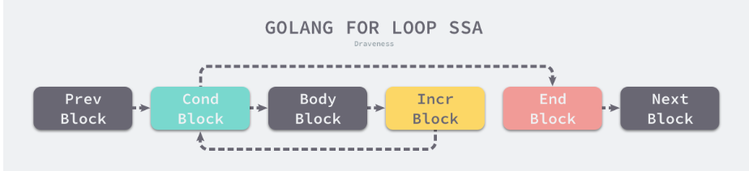
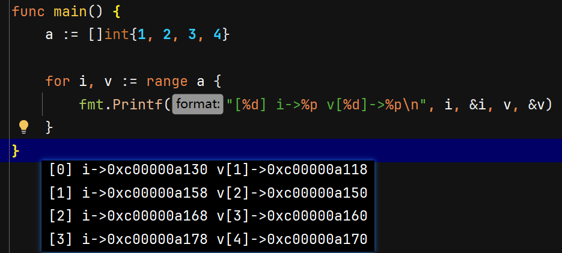
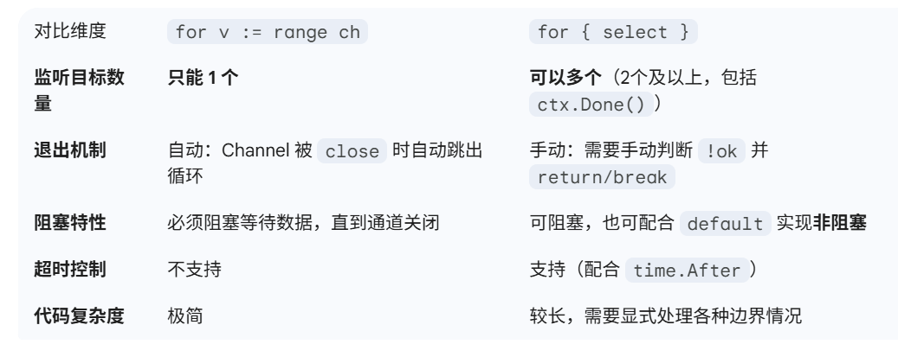

## for循环

> for-range会被编译器转换为普通的for循环


👆普通for循环的SSA代码


## for-range循环


> 以下为for-range的底层实现知识点
### 数组和切片

```go
for i,v := range slice_a {
	//...
}
```

控制逻辑：
（1）分析遍历数组和切片清空元素的情况；
（2）分析使用 `for range a {}` 遍历数组和切片，不关心索引和数据的情况（只用到了次数）；
（3）分析使用 `for i := range a {}` 遍历数组和切片，只关心索引的情况；
（4）分析使用 `for i, elem := range a {}` 遍历数组和切片，关心索引和数据的情况；


3. 在遍历开始前，Go 会将被遍历的数组或切片**赋值给一个临时变量**（对整个数组/切片浅拷贝）。
> [!NOTE]  
> 相当于在循环之前将数据**冻结**。因此`i`、`v`都是冻结时刻的值。

4. 循环次数在初始化时已通过 `len()` 确定，因此在循环体内向切片 `append` 元素是没有用的。

> [!CAUTION]  
> For-Ranage无法实现在循环中去修改原数组内容来修改循环次数。
> **但是！！！普通for：`for i := 0; i < len(s); i++`，`len(s)`会在每次判断循环条件时重新计算！！！**

5. （在1.22及之后）每个迭代都会**创建新的变量实例**。即 `for i, v := range arr` 在语义上等同于每次迭代开头隐式执行了 `i := i; v := v`。
> [!NOTE]  在1.22之前
> `range` 返回的迭代变量（如 `v`）在整个循环过程中是**同一个变量**，每次迭代只是对其重新赋值。
> 在循环中不能将`v`的指针传到外面使用，如不能`go func_1(&v)`，这样接收到的全是最新的值。
> 正确用法是使用`slice_a[i]`，而非循环变量`v`



6. **`memclr` 优化**：如果遍历是为了清空数组（`a[i] = 0`），编译器会优化为直接调用 `memclr` 系列函数快速清空内存。
7. （1.22之后）支持整数range：`for i := range 10 {}`
### 哈希表

```go
for k,v := range ht_a {
 //...
}
```
底层主要依赖 `runtime.mapiterinit`（初始化迭代器）和 `runtime.mapiternext`（获取下一个元素）这两个函数。
```go
var hiter runtime.hiter
// 1. 初始化迭代器，选择随机起点
runtime.mapiterinit(type, hash, &hiter)
for ; hiter.key != nil; runtime.mapiternext(&hiter) {
    key := *hiter.key
    val := *hiter.val
    // 循环体代码
}
```
#### 第一阶段：初始化迭代器 (`mapiterinit`)

> [!NOTE]  
> 与数组/切片不同，Map 的遍历**不会**将整个哈希表的数据复制一份。
> 
> 当编译器处理 `for range m` 时，底层会调用 `runtime.mapiterinit`。它初始化一个名为 `hiter` 的结构体，这个结构体只是一个**轻量级的迭代器指针集合**，记录了以下信息：
> - `h *hmap`: 指向原始 Map 的指针。
> - `it.startBucket/it.offset`: 随机选取的起始位置。
> - `it.heavilyChanged`: 一个版本快照，用于检测并发修改。
> 
> 因此，遍历的一直是**本体数据**。

为了保证 Go Map 遍历的**随机性**（防止开发者依赖特定顺序）：
1. **两层随机化**：通过 `fastrand()` 生成随机数，决定从哪一个分组（Group）开始遍历。即使确定了分组，也会在该分组内部 8 个槽位中随机选一个作为起点。
2. **快照状态**：迭代器会记录当前的修改版本号，如果在遍历过程中发生了非法的并发写，会触发 `panic`。
#### 第二阶段：执行迭代 (`mapiternext`)
这是最核心的步骤，利用了现代 CPU 的 **SIMD（单指令多数据）** 特性：
1. **加载控制字**：一次性将分组的 64 位控制字加载到寄存器中。
2. **高效屏蔽**：使用位运算快速跳过所有“空槽位”。
3. **获取键值**：定位到非空槽位后，直接计算内存偏移量获取键（Key）和值（Value）。
4. **跨分组跳转**：当前分组 8 个槽位处理完后，移动到下一个分组，直到回到初始随机起点。

#### 允许遍历过程中的修改行为
由于遍历的是本体，修改行为遵循以下规则：
**A. 修改/更新已有 Value**
- **行为**：允许。
- **效果**：如果你在循环内部修改了某个 Key 的 Value，且该 Key 还没被遍历到，那么遍历到它时，你会看到更新后的值。
**B. 新增 Key**
- **行为**：允许（单协程下）。
- **效果**：不确定。新插入的 Key 可能出现在你还没遍历到的分组中（会被打印），也可能因为哈希分布被放到了已经遍历过的位置（不会被打印）。
**C. 删除 Key**
- **行为**：允许（单协程下）。
- **效果**：如果在遍历到某个 Key 之前将其删除，迭代器扫描到对应槽位（Slot）时，SIMD 指令会通过**控制位 (Control Byte)** 发现该槽位已变为 `EMPTY` 或 `TOMBSTONE`，从而直接跳过。

#### 禁止并发读写
**结论：严格禁止并发读写，会直接触发 `panic`。**
Go Map 本身不是并发安全的。在 Go 1.24 中，底层通过 `hmap` 结构体中的 `flags` 字段进行保护。

在 `mapiterinit`（初始化）和 `mapiternext`（每次迭代循环）中，都会执行如下检查：
```go
// 伪代码：体现 Go 1.24 内部检测逻辑
func mapiternext(it *hiter) {
    h := it.h
    // 检查是否有其他协程正在写入
    if h.flags & hashWriting != 0 {
        fatal("concurrent map iteration and map write")
    }
    
    // ... 执行位运算匹配控制字 ...
}
```
- **检测逻辑**：当一个协程正在对 Map 进行 `Insertion`（插入）或 `Deletion`（删除）时，会将 `h.flags` 标记为 `hashWriting`。
- **触发 Panic**：如果另一个协程此时尝试 `range` 遍历（调用 `mapiternext`），它会检查到这个标记并直接终止程序。

#### 哈希表的并发遍历
| **场景**        | **推荐方案**                | **底层开销**              |
| ------------- | ----------------------- | --------------------- |
| **读极多，写极少**   | `sync.RWMutex` + 普通 Map | 几乎零额外开销，性能最强          |
| **读写频率相当且复杂** | `sync.Map`              | 内存占用较高，但避免了全表锁带来的长尾延迟 |

方案一：使用读写锁 (`sync.RWMutex`)
```go
type SafeMap struct {
    sync.RWMutex
    data map[string]int
}

func (s *SafeMap) Iterate() {
    s.RLock()         // 申请读锁
    defer s.RUnlock() 
    for k, v := range s.data {
        // 安全遍历
        fmt.Println(k, v)
    }
}
```
- **底层原理**：`RLock` 确保了在遍历期间，没有任何写操作能获取到 `Lock` 并设置 `hashWriting` 标志位。
- **Go 1.24 优势**：结合 Swiss Tables 的高性能，只要读锁占用的时间不长，这种方式在读多写少的场景下极快。

方案二：内置并发安全表 (`sync.Map`)
```go
var m sync.Map

// 遍历方法
m.Range(func(key, value any) bool {
    fmt.Println(key, value)
    return true // 返回 false 则停止遍历
})
```
Go 1.24 下的底层逻辑：
`sync.Map` 的核心是**读写分离**。它维护了两个数据结构：`read`（只读，无锁访问）和 `dirty`（加锁写入）。
1. **Read View**：遍历（`Range`）操作优先作用于 `read` 视图。
2. **原子更新**：如果 `read` 中存在该键，修改操作通过 `atomic` 完成，不干扰遍历。
3. **Read-Only 副本**：当 `dirty` 提升为 `read` 时，会创建一个稳定的快照，使得遍历操作可以完全无锁地进行。

### 字符串

当编译器处理 `for i, r := range s` 时，会将其转换为一个带有“快慢路径”优化的普通 `for` 循环。

#### **1、底层实现原理：自动 UTF-8 解码**
在编译期的 `walk` 阶段（`cmd/compile/internal/walk/range.go`），字符串的 `range` 循环会被重写为类似以下的伪代码结构：

```go
// 编译器转换后的底层伪代码
ha := s // ha 是原字符串
for hv1 := 0; hv1 < len(ha); {
    hv1t := hv1
    hv2 := rune(ha[hv1]) // 取出当前字节

    // 快路径：判断是否为单字节 ASCII 字符
    if hv2 < utf8.RuneSelf { // utf8.RuneSelf 的值是 128
        hv1++ // 索引前进 1 字节
    } else {
        // 慢路径：调用底层解码函数处理多字节 UTF-8 字符
        hv2, step := decoderune(ha, hv1)
        hv1 += step // 索引前进对应的字节数（2到4字节不等）
    }
    
    // 给开发者代码中的循环变量赋值
    i, r := hv1t, hv2
    
    // ... 执行开发者的循环体 ...
}
```

- **快路径 (Fast Path)**：Go 高度优化了纯英文/ASCII 字符串的遍历。如果当前字节小于 `utf8.RuneSelf`（即 128），说明它是单字节字符，直接将其转为 `rune`，索引 `+1`，极大地提高了执行效率。
- **慢路径 (Slow Path)**：如果遇到中文字符或 Emoji（占用 2~4 个字节），底层会调用解码函数（类似于 `utf8.DecodeRuneInString`），提取出完整的 Unicode 码点（Code Point），并将索引向前推进相应的字节数。
- **索引跳跃**：正是因为这种解码机制，遍历包含多字节字符的字符串时，**返回的索引 `i` 是不连续的**（例如遍历 "Go语言"，索引依次是 0, 2, 5）。

#### **2、异常处理：无效的 UTF-8 序列**
如果字符串中包含了损坏的或非法的 UTF-8 字节，`for-range` 并不会导致程序崩溃（Panic），而是有统一的容错处理机制：
- 它会将该非法字节解码为特殊的替换字符：**`utf8.RuneError`**（即 `\uFFFD`，通常显示为 ）。
- 同时，索引只会向前推进 **1 个字节**，然后继续尝试解码后续内容。

### channel

```go
// 4. 通道遍历演示
func demoChannel() {
	ch := make(chan string, 3)
	ch <- "任务1"
	ch <- "任务2"
	ch <- "任务3"

	// 必须关闭通道，否则下面的 for-range 在消费完数据后会永久阻塞，导致死锁
	close(ch) 

	var wg sync.WaitGroup
	// 底层相当于不断调用 runtime.chanrecv2
	for task := range ch {
		wg.Add(1)
		// 开启 Goroutine 并闭包引用循环变量 task
		go func() {
			defer wg.Done()
			// 在 Go 1.22+ 中，这里绝对安全，每个协程都会打印不同的任务
			// 如果是旧版本，这里可能会打印出三个 "任务3"
			fmt.Printf("Goroutine 处理: %s\n", task)
		}()
	}
	wg.Wait()
	fmt.Println("通道数据消费完毕，正常退出循环。")
}
```

- **阻塞等待**：如果 Channel 中没有数据且未被关闭，当前所在的 Goroutine 会陷入**阻塞**状态，让出 CPU 执行权，直到有新的数据写入。
- **安全退出（跳出循环）**：`range` 循环结束的**唯一正常条件**是：Channel 已经被 `close()`，**并且** Channel 缓冲区内的所有遗留数据都已经被消费完毕。
- **死锁陷阱（Nil Channel）**：如果尝试对一个未初始化的 `nil` Channel 进行 `range` 遍历，当前 Goroutine 会被**永久阻塞**。如果在 `main` 协程中发生，会导致致命错误（`fatal error: all goroutines are asleep - deadlock!`）。

同样的，在go1.21之后，`for v := range ch` **每一次接收到新数据，都会隐式创建一个全新的局部变量 `v`**。这使得在循环体内直接启动 Goroutine 并捕获 `v` 变得绝对安全。

#### 和select的区别

