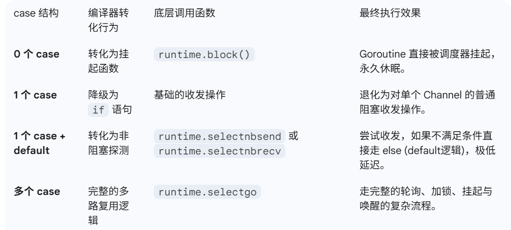
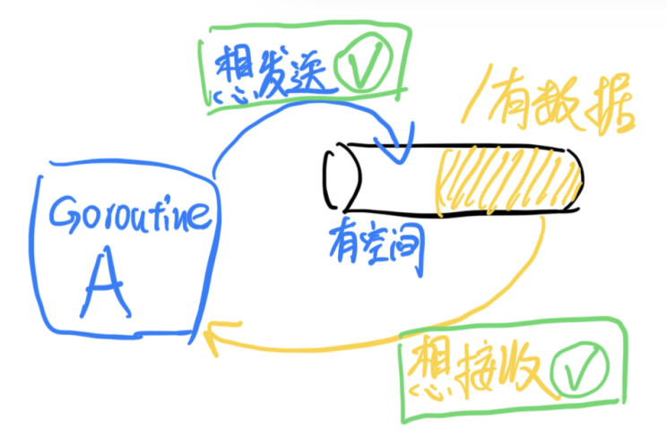
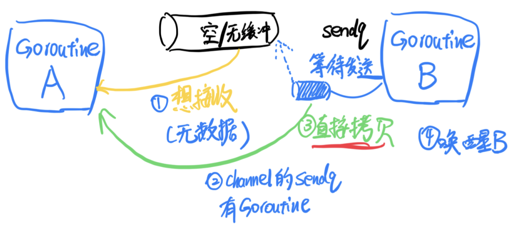
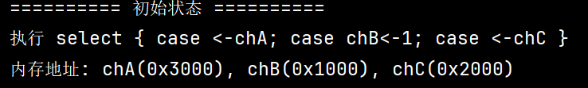
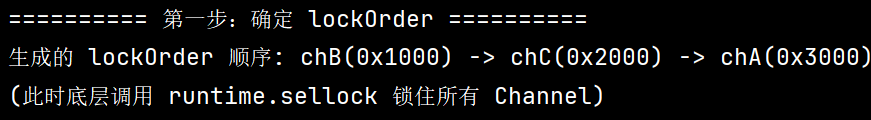
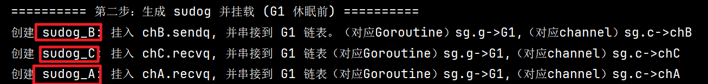
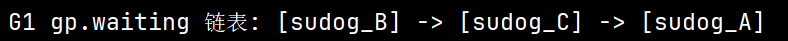
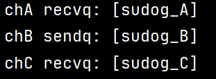
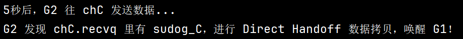
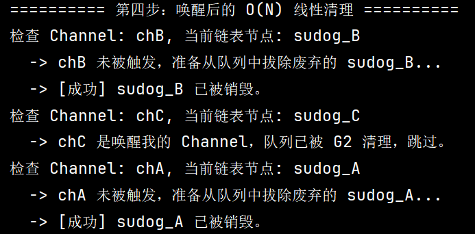

```go
select {
  case <- channel1:
    // 执行的代码
  case value := <- channel2:
    // 执行的代码
  case channel3 <- value:
    // 执行的代码
    
// 你可以定义任意数量的 case
  default:
    // 所有通道都没有准备好，执行的代码
}
```

`select` 是 Go 里对多个 Channel 收发操作做多路复用的语法，用来在多个 case 里选一个当前能执行的操作。
- 多个同时就绪会做伪随机选择来提高公平性；
- 都没就绪，有 default 就立刻走 default，没有就阻塞当前 Goroutine。
再往深一点讲实现：
- 简单的 select 会被编译器优化成普通的收发；
- 多个 case 才会进运行时的 `selectgo`：
    - 先用随机的 `pollOrder` 探活，找到就绪的就直接执行返回；
    - 找不到且没 default，就为每个 case 创建 `sudog` 挂到各自 channel 队列上然后 park；
    - 被匹配的 channel 唤醒后会清理其他队列里的 `sudog`，再进入真正命中的 case。
安全性上：
- 运行时用按 channel 地址排序的 `lockOrder` 来加锁和挂载，避免死锁；
- 醒来清理也按同一顺序线性完成，不需要查找映射，所以高效又安全。

## 基本概念
select的主要职责是**同时监听多个 Channel 的收发状态**，并在状态发生改变前阻塞当前的 Goroutine。
- **唯一操作对象**：`select` 内部的 `case` 语句只能是 Channel 的**发送**（`c <- x`）或接收（`<-c`）操作。
- **非顺序性**：与 `switch` 的顺序匹配不同，`select` 的多个 `case` 是平等的，没有严格的物理书写顺序优先级。

特点：
- **随机分发（防饥饿）**：当有多个 Channel 同时处于就绪（可读/可写）状态时，`select` 会**随机**选择一个执行。这种伪随机性是为了防止某个活跃的 Channel 长期霸占执行权，导致其他 Channel 发生“饥饿”。
- **非阻塞收发**：如果加入 `default` 分支，当所有被监听的 Channel 都没有就绪时，`select` 不会阻塞当前 Goroutine，而是直接执行 `default` 逻辑。常用于无阻塞的状态探测。
- **空 `select{}`**：直接执行 `select{}` 会让当前的 Goroutine 陷入永久休眠（死锁），通常用于在 `main` 函数末尾阻止程序退出。
- **操作 `nil` Channel**：在 `select` 中读写一个 `nil` 的 Channel 会永远阻塞。这一特性常被用于在 `for-select` 循环中动态地“屏蔽”掉某个已经处理完毕的 `case`。

## 编译期四大优化（能省则省）
Go 编译器在中间代码生成阶段（`cmd/compile/internal/gc.walkselectcases`），会根据 `case` 的数量和组成，采取“能省则省”的降级优化策略：


单一case：
```go
// 改写前
select {
case v, ok <-ch: // case ch <- v
    //...
}

// 改写后
if ch == nil {
    block()
}
v, ok := <-ch // case ch <- v
```

## 运行时的底层实现（selectgo）

> [!NOTE]  
> 当 `select` 包含多个实质性的 `case` 时，运行时会调用核心函数 `runtime.selectgo`。

`runtime.selectgo` 是处理复杂多路复用的核心。它的执行流程极其严密，分为**初始化与排序**、**循环探活（三阶段）** 两个主要部分。

### case数据结构
当 `select` 必须进入运行时逻辑时，每个 case 会被转换为底层的 `runtime.scase` 结构体：
```go
type scase struct {
	c    *hchan         // 指向底层 Channel 的指针
	elem unsafe.Pointer // 指向接收或发送数据内存地址的指针
}
```
运行时并不存在一个代表整个 `select` 的结构体，而是通过向 `runtime.selectgo` 函数传递一个包含所有 `scase` 的数组来处理。
```go
func selectgo(cas0 *scase, order0 *uint16, ncases int) (int, bool) {
	cas1 := (*[1 << 16]scase)(unsafe.Pointer(cas0))
	//...
}
```


### 1. 初始化与排序上锁（O(N log N) 操作）
为了保证绝对的公平和避免并发死锁，`selectgo` 首先会生成两个至关重要的顺序：
- **轮询顺序 (pollOrder)**：利用 `runtime.fastrandn` 打乱所有的 `case`，决定后续探活时的遍历顺序。
- **加锁顺序 (lockOrder)**：获取所有参与 `select` 的 Channel 的内存地址，按照**地址从小到大**的顺序进行排序。随后按此顺序依次锁定所有的 Channel（`runtime.sellock`），从根本上避免了多个 `select` 交叉加锁导致的死锁。

排好序后，调用 `runtime.sellock` 按照 `lockOrder` 依次锁定所有的 Channel。

先将所有参与的channel进行加锁，再按照轮训顺序加锁。

**关于加锁？**
因为一个 `select` 必须同时锁定所有的 Channel 才能进行操作，如果按代码书写顺序加锁，多个 Goroutine 交叉操作时极易引发死锁。
> [!NOTE]  
> 按地址排序加锁是解决锁顺序死锁的经典方案。

### 2. 循环探活（主循环3阶段）

#### 第一阶段：直接执行（Fast Path）
按照打乱后的 `pollOrder` 遍历所有 case，如果有**就绪的**channel，则立即进行数据的拷贝交换，然后解锁所有 Channel 并返回，执行对应的业务代码。

通常我们认为，Channel 就绪的条件是：
- **想接收数据**：缓冲区里有数据。
- **想发送数据**：缓冲区里有空位。


但 Go 认为这还不够高效。如果遇到无缓冲 Channel，或者缓冲区为空/满的极限情况，该怎么办？
**场景 A：当 `select` 里的 case 想要从 Channel 接收数据（`case <-ch:`）**
- `select` 发现这个 Channel 的缓冲区是空的（或者压根没缓冲）。
- 但它看了一眼 Channel 的 `sendq`（发送等待队列），发现上面居然挂着一个休眠的 Goroutine（即将将数据发到该channel中）！
- 这意味着什么？意味着**有一个发送方早就捧着数据等在那里了**，只是因为之前没人收，它被迫休眠了。
- **判定为就绪**：此时 `select` 会立刻认为该 Channel 已就绪。它根本不需要经过缓冲区，而是直接跑到那个休眠的 Goroutine 栈上，把数据**直接拷贝**到自己的内存里，然后唤醒那个发送方。


**场景 B：当 `select` 里的 case 想要向 Channel 发送数据（`case ch <- x:`）**
- `select` 发现缓冲区满了（或无缓冲）。
- 但它看了眼 `recvq`（接收等待队列），发现挂着一个正在苦苦等待数据的 Goroutine。
- **判定为就绪**：同样，`select` 直接把自己的数据跨栈拷贝到那个等待接收的 Goroutine 的内存地址中，然后唤醒对方。交易瞬间完成。


#### 第二阶段：挂起当前 Goroutine（阻塞等待） 
如果第一阶段遍历完，没有任何 Channel 就绪，且没有 `default` 分支：
- 当前 Goroutine 需要进入休眠。它会获取一个 `sudog` 结构体（代表一个等待节点），记录下当前 Goroutine 和要操作的元素地址。
- **关键动作**：它会将这个 `sudog` 分别加入到当前 `select` 监听的**所有** Channel 的等待队列（`sendq` 或 `recvq`）中。
- 调用 `runtime.gopark` 将当前 Goroutine 挂起，释放 M 和 P。

##### sudog操作
假设我们有一个 Goroutine（简称为 **G1**），它正在执行以下 `select` 语句：

现在，假设这三个 Channel **全都没有就绪**（没有数据、没有空位），G1 必须进入休眠。我们来一步步看 `sudog` 是如何被制造并挂载的。

**第一步：确定遍历顺序 (lockOrder)**
在挂起之前，`selectgo` 会根据内存地址从小到大生成 `lockOrder`。


**第二步：生成 sudog 并“双向挂载”**
接下来，代码进入一个 `for` 循环，**严格按照 `lockOrder` 的顺序**遍历这三个 case。
在这个过程中，G1 会为每个 Channel 动态生成一个 `sudog` 节点，并且进行“双向挂载”：既挂入 Channel 的等待队列，又串联到 G1 自身的 `waiting` 链表上。

G1 调用 gopark 陷入休眠...
现在Goroutine自己的链表、以及三个channel的队列情况如下：




####  第三阶段：唤醒与清理（Wake up）
当某个 Channel 的另一端进行了读写操作，唤醒了处于该 Channel 等待队列上的 Goroutine 时：
- Goroutine 恢复执行。此时它知道自己是被哪个 case 唤醒的。
- **清理动作**：因为之前它把自己挂在了所有参与 `select` 的 Channel 上，现在既然已经达成了一个条件，就必须遍历其他的 Channel，将自己遗留的废弃 `sudog` 从那些 Channel 的等待队列中出队并销毁。
- 最后，解锁所有 Channel，返回选中的 case 索引，继续执行外层代码。

##### sudog操作

**第三步：唤醒与“顺藤摸瓜”式清理**
假设过了 5 秒钟，另一个 Goroutine 往 `chC` 里发送了一个数据。 它发现了 `chC.recvq` 里正在休眠的 `sudog_C`，于是把数据拷贝过去，并将 G1 唤醒！


G1 醒来后的第一件事，就是要把自己当初留在 `chB` 和 `chA` 上的分身（`sudog_B` 和 `sudog_A`）赶紧撤回来，否则会引发内存泄漏或被错误地重复唤醒。

G1 再次按 `lockOrder` 顺序（`chB -> chC -> chA`）遍历，同时拿出一个指针 `sglist` 指向自己的脖子（`gp.waiting`，即 `sudog_B`）。



## 核心问题剖析

### 一、 为什么需要对 Channel 加锁？

在 `select` 的多路复用中，加锁是出于**并发安全**和**状态原子性**的绝对需要。

#### 1. 保证多通道状态探测的原子性
`select` 的第一阶段需要遍历查看所有的 Channel 是否就绪。

由于 Channel 是高度并发的数据结构，如果 `select` 不把它们锁住就去偷看它们的状态（缓冲区满不满、有没有等待的 Goroutine），很可能在你刚看完 `ch1` 准备去看 `ch2` 的瞬间，`ch1` 的状态就被其他 Goroutine 改变了。

加锁能让 `select` 在这一瞬间拥有“上帝视角”，确保它看到的所有 Channel 状态是一个静止的快照。

#### 2. 安全地跨队列挂载 sudog 
如果所有的 Channel 都没有就绪，当前 Goroutine 需要休眠。

此时它必须把自己包装成 `sudog` 等待节点，**同时塞进所有被监听 Channel 的等待队列中**。

操作 Channel 的内部队列（`sendq` 或 `recvq`）必须持有该 Channel 的锁，否则会引发严重的数据竞争和队列指针错乱。

**结合示例：如果不按统一顺序加锁会怎样？（死锁危机）** 

假设我们没有按照内存地址排序加锁，而是按照代码的书写顺序加锁：
- **协程 A 代码**：`select { case <- ch1: ... case <- ch2: ... }`
    - _A 的加锁顺序_：先锁 `ch1`，再锁 `ch2`。
- **协程 B 代码**：`select { case <- ch2: ... case <- ch1: ... }`
    - _B 的加锁顺序_：先锁 `ch2`，再锁 `ch1`。

如果协程 A 刚刚锁住了 `ch1` 还没来得及锁 `ch2`，而协程 B 刚刚锁住了 `ch2` 还没来得及锁 `ch1`。此时，A 等 B 释放 `ch2`，B 等 A 释放 `ch1`——**经典的互相等待死锁就此诞生。**

这就是为什么 `select` 在底层不仅要加锁，还必须强制生成一个 **`lockOrder`（按 Channel 在内存中的真实地址大小排序）**。无论你在代码里怎么乱序写，底层加锁顺序永远是地址从小到大，彻底从根源上斩断死锁链条。

### 二、 具体是何时、如何加锁/解锁的？

`select` 在运行时的加锁/解锁生命周期非常精妙，它伴随着 Goroutine 的“清醒-休眠-唤醒”分为两个大回合：

#### 第一回合：准备探活与休眠前
1. **统一加锁**：在确定了 `pollOrder` 和 `lockOrder` 之后，正式开始探活前。底层调用 `runtime.sellock(scases, lockorder)`，按照地址顺序依次锁住所有的 Channel。
2. **探活与挂载**：在锁的保护下，遍历一遍（如果没有就绪的），把当前 Goroutine 挂载到所有 Channel 的队列上。
3. **统一解锁并休眠**：挂载完毕后，当前 Goroutine 准备调用 `gopark` 陷入休眠。此时，底层会通过 `selparkcommit` 回调函数**统一解锁所有的 Channel**。
    - _为什么马上解锁？_ 因为如果你抱着锁睡觉，其他的 Goroutine 就永远无法往这些 Channel 里发数据或读数据来唤醒你了。

#### 第二回合：被唤醒后（清理战场）
1. **再次统一加锁**：当某个 Channel 有了动静，唤醒了当前的 Goroutine。此时 Goroutine 刚醒来，它第一件事就是**再次调用 `runtime.sellock`** 锁住所有的 Channel。
2. **清理废弃节点**：因为之前自己被挂在了所有 Channel 的队列上，现在既然被 `ch1` 唤醒了，那么挂在 `ch2`、`ch3` 上的 `sudog` 就成了废弃垃圾。清理其他 Channel 队列上的垃圾节点，同样需要持有它们的锁。
3. **最终解锁并返回**：垃圾节点出队清理完毕后，调用 `runtime.selunlock` 释放所有锁，带着接收或发送的数据，开开心心地返回用户代码。

### 三、 为什么先用 pollOrder 遍历，唤醒后用 lockOrder 遍历？

这是一个极其深思熟虑的细节设计，因为这两个顺序背负的历史使命完全不同：

#### 1. 探活时用 `pollOrder`：为了业务逻辑的“绝对公平”
- `pollOrder` 是用随机数打乱的顺序。
- 在第一阶段探活时，如果 `ch1` 和 `ch2` 同时就绪了，Go 必须保证开发者无法预测哪个 case 会被执行。如果固定顺序遍历，永远排在前面的 case 会被触发，后面的 Channel 就会产生“饥饿现象”（里面的数据永远取不出来）。
- **结论**：探活是为了决定“我要执行哪段代码”，属于业务选择，必须用打乱的 `pollOrder` 来保证随机性和公平性。

#### 2. 唤醒后用 `lockOrder`：为了底层数据结构的“契合与安全”
- 唤醒后的第三阶段，大局已定（已经知道是被哪个 Channel 唤醒的了），此时的任务不再是“选择”，而是“干底层脏活儿”——从各个队列中拔除自己残留的 `sudog` 节点。
- 在休眠前（第二阶段），Goroutine 是按照 `lockOrder` 的顺序遍历 Channel 并生成 `sudog` 链表挂载的。这意味着挂在 Goroutine 身上的 `sudog` 链表节点顺序，**天然就是 `lockOrder` 的顺序**。
- **结论**：唤醒后清理战场时，按照 `lockOrder` 去遍历，可以完美契合之前生成的链表结构，顺藤摸瓜地完成出队操作（代码中的 `sg = sglist.waitlink` 可以和 `lockOrder` 的遍历指针一一对应）。既避免了重新加锁带来的死锁风险，又让指针操作的时间复杂度降到了最低的 O(N)。