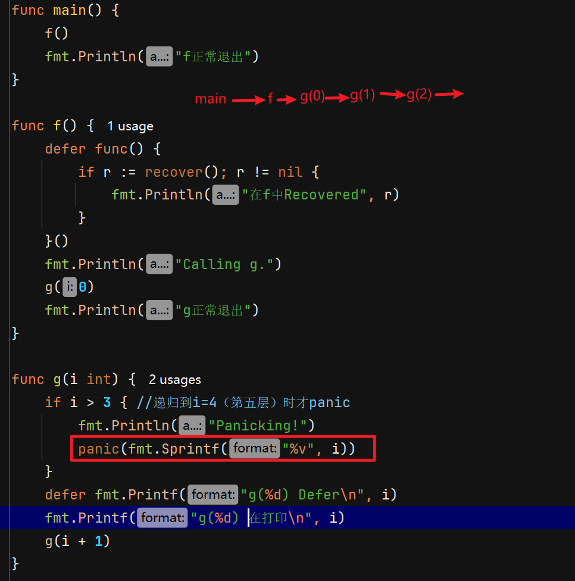
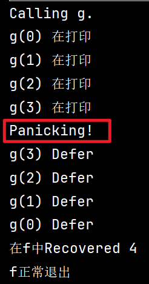
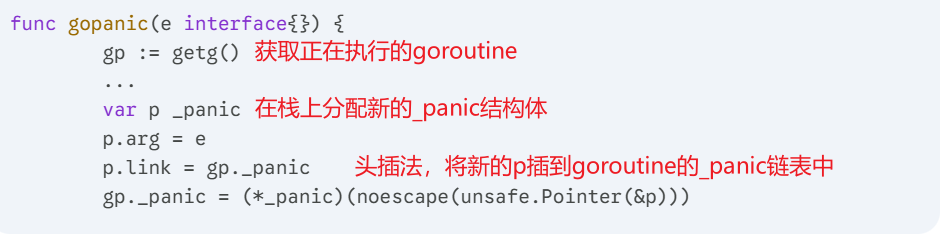
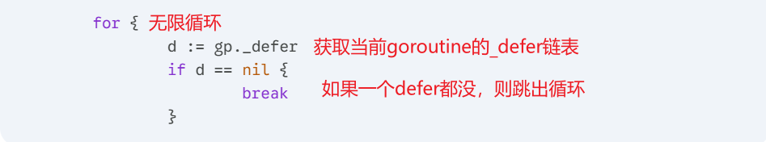
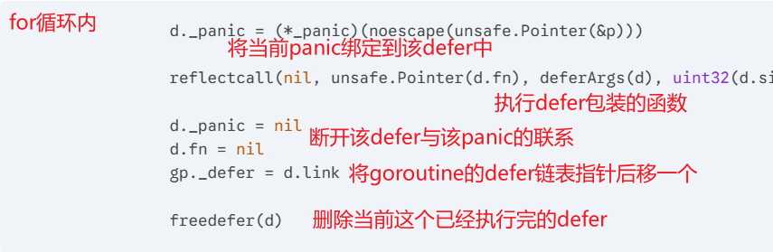
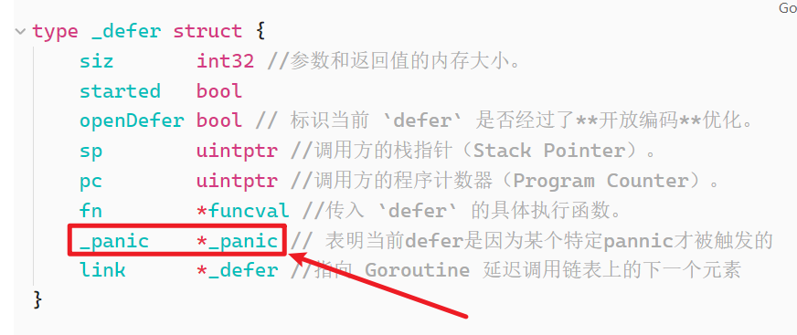
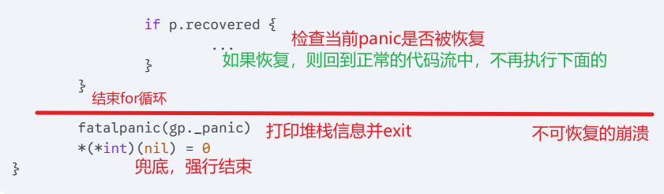
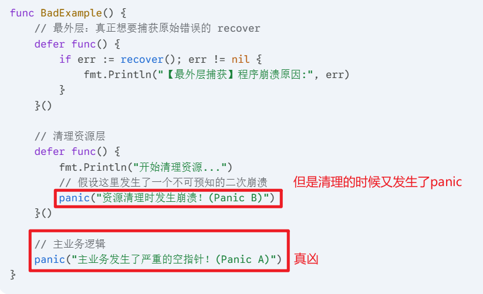
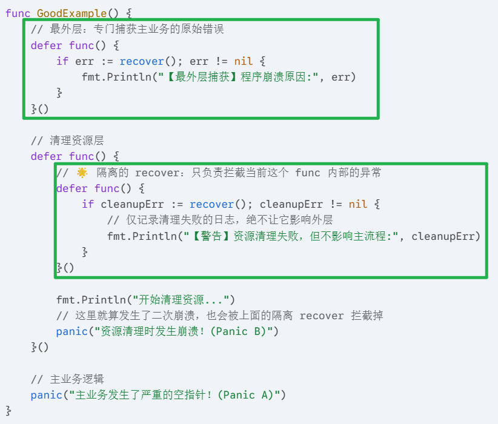
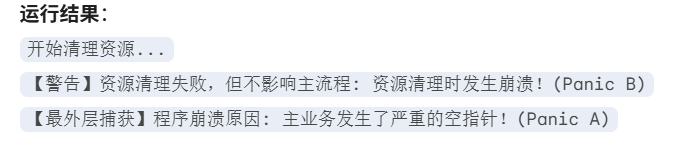

## 一、核心特性
### 1. 跨协程失效
`panic` 发生时，只会触发当前所在 Goroutine 的 `defer` 函数。多个 Goroutine 互不影响，一个 Goroutine 中的崩溃无法被另一个 Goroutine 中的 `recover` 捕获。

### 2. 失效的崩溃恢复
`recover` 函数必须直接包含在 `defer` 函数中调用才有效。如果在 `panic` 之前调用，或者在 `defer` 内嵌套的其他子函数中调用，均无法拦截崩溃。

### 3. 嵌套崩溃

> 比如：业务代码由于空指针 `panic` 了。`defer` 去关闭数据库连接，但此时数据库连接对象本身也是 `nil`，导致在 `defer` 内部又触发了一次空指针 `panic`。

`panic` 可以在 `defer` 中被多次嵌套调用，多次调用不会影响 `defer` 链表的正常展开与执行。

嵌套崩溃依然是后发生的panic先处理（Goroutine `_panic`链表特性）

### 4.  禁止 `panic(nil)`

> Go 1.20 及以前：如果开发者执行 `panic(nil)`，`recover()` 会捕获并返回 `nil`。
> 这会导致程序很难区分是“没有发生 panic”还是“发生了值为 nil 的 panic”。

Go 1.21+：Go 官方在 `gopanic` 中加入了对 `nil` 的兜底处理。

现在调用 `panic(nil)` 会引发一个内置的 `*runtime.PanicNilError`。这保证了只要程序发生 panic，合法的 `recover()` 必定返回**非 nil** 的值（若需兼容老代码，可通过环境变量 `GODEBUG=panicnil=1` 回退）。

## 二、panic底层原理

编译器会将代码中的 `panic` 关键字转换为对 `runtime.gopanic` 的调用。它是终止程序并处理延迟调用函数的核心，执行过程主要包含以下步骤：

> [!TIP]
> Goroutine 存在`_panic`指针，可以指向`_panic`结构体，该结构体可形成链表，故允许嵌套崩溃。也存在`_defer`指针，形成`_defer`链表。
> 
> defer 存在`_panic`指针，通常只指向单独的`_panic`结构体。

### 第一阶段：初始化并挂载 `_panic` 节点

1. **初始化记录**：创建一个新的 `runtime._panic` 结构体，并将其挂载到当前 Goroutine 的 `_panic` 链表最前面。

```go
type _panic struct {
	argp      unsafe.Pointer // 指向 defer 调用时参数的指针
	arg       any            // 调用 panic 传入的参数（Go 1.21起，若传入 nil 会被包装为 PanicNilError）
	link      *_panic        // 指向更早调用的 _panic 结构，形成链表
	recovered bool           // 标记当前的 panic 是否被 recover 恢复
	aborted   bool           // 标记当前的 panic 是否被强行终止
	pc        uintptr        // 程序计数器
	sp        unsafe.Pointer // 栈指针
	goexit    bool           // 标记是否是由于 runtime.Goexit 触发的
}
```


这里用到了 `noescape`，它是一个底层的编译器指令，强制告诉编译器“这个变量不会逃逸到堆上”，以此优化性能。

2. **异常值处理（Go 1.21+）**：判断传入的 `arg` 是否为无类型 `nil` 或接口的空值。如果是，运行时会将其替换为 `&runtime.PanicNilError{}`。

### 第二阶段：遍历 `_defer` 链表并执行

2. **展开 Defer 链表**：通过一个无限循环（`for`），不断从当前 Goroutine 获取最早压入栈的 `_defer` 结构。
    - 提取出 `_defer` 并执行其中的延迟调用函数（通过 `runtime.reflectcall` 或内联优化过的代码直接执行）。
    - 如果执行 `defer` 期间遇到了合法的 `recover` 调用，会将被触发的 `_panic` 结构的 `recovered` 标记为 `true`。




**`d._panic = ...`**: 将当前的 `_panic` 实例指针绑定到这个 `_defer` 结构体上。这标明了当前这个 `defer` 是因为这个特定的 `panic` 才被触发执行的。如果该refer中有recover，也可以从中获取该panic。


### 第四阶段：检查是否被恢复，或者彻底崩溃

4. **不可恢复的崩溃**：如果遍历完了所有 `_defer` 链表，`_panic.recovered` 依然为 `false`，则表明未被拦截。循环结束后，程序会调用 `runtime.fatalpanic`，此时会向控制台打印所有挂载的 panic 错误信息以及函数调用栈，然后调用 `runtime.exit(2)` 异常退出整个进程。
5. **可恢复的崩溃****： 当panic被恢复之后：
    - 当 `gopanic` 中的某次 `defer` 函数执行完毕后（可能执行了`recover`），`gopanic` 会检查当前的 `p.recovered` 是否变为了 `true`。如果为 `true`，`gopanic` 会把当前这个已被恢复的 `_panic` 节点从协程的 `_panic` 链表中剥离。
    - 接着，它从对应的 `_defer` 结构中取出发生 `defer` 调用时的**程序计数器 (`pc`)** 和**栈指针 (`sp`)**，并将它们传入 `runtime.recovery` 函数。
    - `runtime.recovery` 准备好上下文后，利用底层汇编函数 `runtime.gogo` 将程序强行跳转回 `defer` 关键字被注册的位置（即跳回到 `runtime.deferproc` 处），并让其返回值为 1。
    - 编译器注入的判断代码发现返回值为 1 时，会跳过原本因为 panic 而未能执行的代码，直接跳转至当前函数的末尾，执行 `runtime.deferreturn` 等正常收尾工作，函数正常返回，崩溃彻底被中断。


- **`if p.recovered { ... }`**: 在刚刚的 `reflectcall` 执行 `defer` 时，如果用户调用了 `recover()`，底层的 `gorecover` 函数就会把 `p.recovered` 设置为 `true`。此时这个 `if` 条件成立，内部逻辑会直接中断当前死循环，利用底层汇编把控制权强行跳回到正常的代码流中。
- **`fatalpanic(gp._panic)`**: 如果把所有的 `defer` 都跑完了，`p.recovered` 依然是 `false`（说明没人捕获异常），就会跳出循环执行这一句。`fatalpanic` 会打印所有未捕获的 panic 信息和堆栈，然后调用 `exit` 强行终止操作系统进程。
- **`*(*int)(nil) = 0`**: 这是一个非常有趣的“兜底”机制。向一个 `nil` 绝对空指针地址写入 `0`，这在操作系统层面会立即触发一个极其底层的不可捕获段错误（Segmentation fault）。它的作用是：万一前面的 `fatalpanic` 因为运行时 Bug 没有成功结束掉进程，这一行能确保程序被操作系统强行干掉，绝对不让处于异常状态的程序继续乱跑。

## 三、recover底层原理

编译器会将代码中的 `recover` 转换为对 `runtime.gorecover` 函数的调用。

但请注意，`gorecover` 自身**并不包含恢复程序控制流的逻辑**。

1. **修改标记位**： 获取当前 Goroutine 的 `_panic` 链表头节点，验证调用上下文是否合法（确保是由 `defer` 触发的，校验 `argp` 等）。如果合法，它仅仅是将当前 `_panic` 节点的 `recovered` 字段置为 `true`，并将对应的 `p.arg` 作为结果返回给调用方。

一句话总结：
`gopanic` 逐个执行 `defer` $\rightarrow$ 某个 `defer` 中的 `recover` 成功把标记设为 `true` $\rightarrow$ 该 `defer` 执行结束 $\rightarrow$ `gopanic` 看到标记为 `true`，摘除 panic 节点 $\rightarrow$ **立即停止遍历后续 defer，进行底层栈跳转恢复正常流**。

## 四、其他细节


### 1. 底层如何处理多个panic

当第一个 `panic` (称作 **Panic A**) 发生时，`gopanic` 开始遍历执行 `defer`。 如果某个 `defer` 内部又触发了第二个 `panic` (称作 **Panic B**)，底层会发生以下事情：
1. **挂载新节点**：运行时会创建一个新的 `_panic` 节点代表 Panic B，并将其作为头节点插入到 `_panic` 链表的最前面 (`Panic B -> Panic A`)。
2. **标记中止（Aborted）**：运行时会将老节点 Panic A 的 `aborted` 字段标记为 `true`。这意味着 Panic A 的处理流程被强行打断了。
3. **接管控制权**：`gopanic` 会重新开始基于 Panic B 去寻找剩下的 `defer` 执行。

### 2. `recover` 只能捕获当前作用域的最顶层 Panic

`recover` 函数的作用机制是：它只看当前 Goroutine `_panic` 链表的**表头元素**。调用一次 `recover()` 只能解决掉最新的那个 `panic`，并将其所在 `defer` 的外层函数正常返回。

> [!IMPORTANT]  
> 一个defer只能救一次命

它不会去“清空”整个链表（尽管较老的 `panic` 已经被标记为 `aborted`，随着流程恢复通常也会被一并忽略）。

这是嵌套 `panic` 最危险的地方。 如果 `defer` 中发生了新的 Panic B，并且你在更外层的地方调用了 `recover()`，**`recover()` 只会捕获到最新的 Panic B，而最初导致程序崩溃的 Panic A 会被彻底丢弃和掩盖！**
- **后果**：你看日志发现程序是因为“关闭空连接”挂掉的，修了半天，才发现真正的元凶其实是业务逻辑一开始算错了一个空指针。
- **对策**：在 `defer` 执行复杂的清理逻辑时，务必极其小心，最好在 `defer` 内部使用隔离的 `recover` 来兜底，防止清理逻辑本身的 `panic` 污染外层。

#### 隔离recover

假设主业务逻辑发生了一个致命的空指针错误，但在退出前，`defer` 去关闭一个日志文件，结果关文件时也发生了 `panic`。


最外层捕获到的全都是 `Panic B`，导致程序挂掉的真正元凶 `Panic A` 就像人间蒸发了一样！在真实的业务中，这会导致排查方向完全跑偏。

建议做法：




