## 二、同步原语与锁底层

在 Go 语言中，虽然推荐使用 Channel 进行高级别的并发同步，但在底层和对性能要求极高的场景下，传统的同步原语（锁、信号量等）依然不可或缺。它们主要用于防止多个 Goroutine 同时访问同一块内存时引发的竞争条件（Race Condition）。

Go 语言的同步原语主要分为两类：
1. **标准库基本原语 (`sync` 包)**：`Mutex`, `RWMutex`, `WaitGroup`, `Once`, `Cond`
2. **扩展原语 (`golang/sync` 扩展包)**：`errgroup.Group`, `semaphore.Weighted`, `singleflight.Group`

**基本原语 (`sync`)** 主要解决底层的并发安全问题，设计极简且高效，大量运用了 CAS 原子操作、自旋和操作系统层面的信号量调度。随着 Go 的进化，底层原语也在逐渐抛弃晦涩的内存对齐 Hack，转向 `atomic.Uint64/Int32` 等安全的现代化强类型 API，以及引入基于闭包的开箱即用的特性（如 `OnceFunc`）。

**扩展原语 (`golang/sync`)** 则是在基本原语之上的高级封装，主要解决实际业务开发中的痛点：并发任务错误统管及限流 (`errgroup`)、精细的并发资源配额限制 (`semaphore`) 以及高并发下的缓存击穿/防抖保护 (`singleflight`)

### 1. 互斥锁 (`sync.Mutex`)

互斥锁是并发编程中最基础的锁机制，保证同一时刻只有一个 Goroutine 能访问共享资源。它在内存中仅占 8 字节。
```go
var mu sync.Mutex

mu.Lock()
defer mu.Unlock()

// 临界区：访问共享数据
```
#### 核心结构与状态

```go
type Mutex struct {
    state int32  // 记录锁的当前状态
    sema  uint32 // 信号量，用于控制 Goroutine 的阻塞与唤醒
}
```

`state` 字段按位划分，记录了四个关键信息：
- `mutexLocked` (最低位): 是否被锁定。
- `mutexWoken` (第二位): 是否有被唤醒的 Goroutine。
- `mutexStarving` (第三位): 是否处于**饥饿模式**。
- `waitersCount` (剩余高位): 等待锁的 Goroutine 数量。

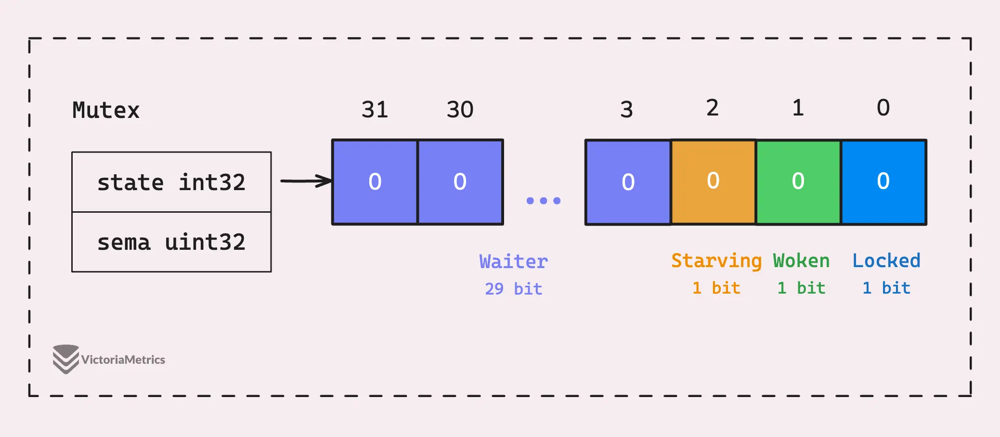

#### 两种工作模式

在**正常模式**下，锁的等待者会按照先进先出的顺序获取锁。但是刚被唤起的 Goroutine 与新创建的 Goroutine 竞争时，大概率会获取不到锁（新来的 Goroutine 已经在 CPU 上运行）。

为了减少这种情况的出现，一旦 Goroutine 超过 1ms 没有获取到锁，它就会将当前互斥锁切换**饥饿模式**，防止部分 Goroutine 被『饿死』。

在饥饿模式中，互斥锁会直接交给等待队列最前面的 Goroutine。新的 Goroutine 在该状态下不能获取锁、也不会进入自旋状态，它们只会在队列的末尾等待。如果一个 Goroutine 获得了互斥锁并且它在队列的末尾或者它等待的时间（整个排队时长）少于 1ms，那么当前的互斥锁就会切换回正常模式。

与饥饿模式相比，正常模式下的互斥锁能够提供更好地性能，饥饿模式的能避免 Goroutine 由于陷入等待无法获取锁而造成的高尾延时。

- **正常模式 (Normal)**：Goroutine 按 FIFO 排队。新来的Goroutine因为占着CPU，可直接获取到锁。
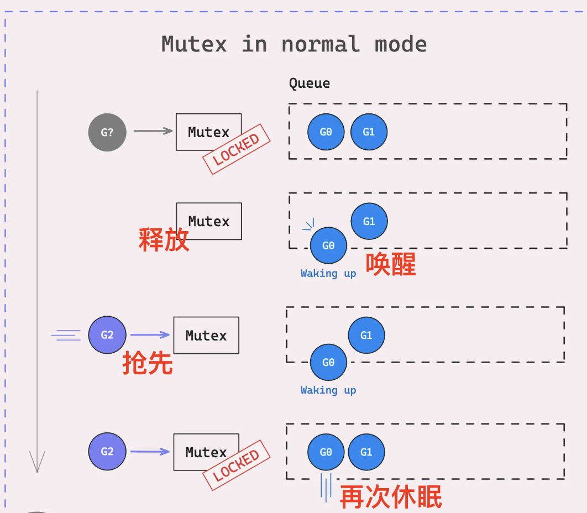
- **饥饿模式 (Starving)**：锁直接移交给队列头部的 Goroutine，新来的 Goroutine 必须排到队尾，且不能自旋。
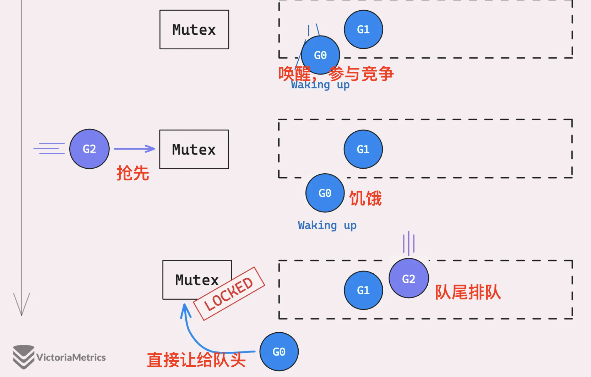


#### 加锁流程 (`Lock`)

先尝试 Fast Path (CAS 快速修改锁定标志)，若失败则进入慢路径 `lockSlow`（涉及自旋和信号量阻塞）。

当锁的状态是 0 时，将 `mutexLocked` 位置成 1：
```go
func (m *Mutex) Lock() {
    // Fast path: 假设锁完全空闲，直接通过 CAS 抢占
    if atomic.CompareAndSwapInt32(&m.state, 0, mutexLocked) {
        return
    }
    m.lockSlow() // Slow path: 自旋等待或陷入休眠
}
```
如果互斥锁的状态不是 0 时就会调用`sync.Mutex.lockSlow` 尝试通过自旋等方式等待锁的释放，该方法的主体是一个非常大 for 循环，这里将它分成几个部分介绍获取锁的过程：
1. 判断当前 Goroutine 能否进入自旋；
2. 通过**自旋**等待互斥锁的释放；
3. 计算互斥锁的最新状态；
4. 更新互斥锁的状态并获取锁；


##### （1）判断并进入“自旋”（不一定能进自旋）
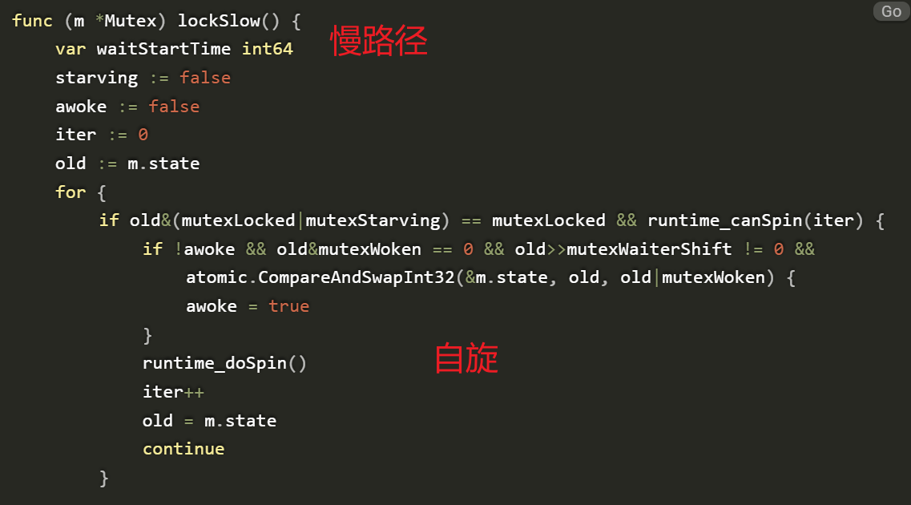
如果当前锁处于**普通锁定状态**（非饥饿模式），并且满足系统规定的严格自旋条件（如多核 CPU、自旋次数少于 4 次、存在空闲的 P 等），当前 Goroutine 就会调用 `runtime_doSpin()` 消耗 CPU 时间空转等待 。执行的是 `PAUSE` 指令 。

> [!TIP] 自旋锁 (Spinlock) vs 互斥锁 (Mutex)
> 在操作系统中，同步原语一般分为两种基本流派。一种是**自旋锁**（一直循环检测锁标记，即“忙等待” Busy Waiting），另一种是**阻塞锁**（让出 CPU，挂起线程进入睡眠，由系统稍后唤醒）。 
> 
> Go 这里的精妙之处在于它采用了**混合锁 (Hybrid Lock)** 的设计。因为操作系统的线程上下文切换（Context Switch）涉及保存寄存器、切换内存页表、使得 CPU 缓存失效等，代价极其昂贵。如果临界区极小，锁马上就会被释放，让出 CPU 反而是亏本买卖。所以，Go 先在用户态通过 `PAUSE` 指令进行短暂的乐观自旋，试图拦截这种极短的持锁窗口，以此降低系统的上下文切换开销。

在多核的 CPU 上，自旋可以避免 Goroutine 的切换，使用恰当会对性能带来很大的增益，但是使用的不恰当就会拖慢整个程序，所以 Goroutine 进入自旋的条件非常苛刻：
1. 互斥锁只有在普通模式才能进入自旋；
2. runtime.sync_runtime_canSpin 需要返回 true：
	1. 运行在多 CPU 的机器上；
	2. 当前 Goroutine 为了获取该锁进入自旋的次数小于四次；
	3. 当前机器上至少存在一个正在运行的处理器 P 并且处理的运行队列为空；

> [!NOTE]  自旋带来性能增益？
> 这句话的核心逻辑在于**“时间成本的权衡”**：用极短的 CPU 空转时间（自旋），去换取昂贵的上下文切换时间（Goroutine 的休眠与唤醒）。
> 
> 互斥锁保护的“临界区”代码通常非常短小（例如只是修改某个变量的数值、向 Map 中塞入一个指针）。这就意味着，锁被占用的时间极其短暂。如果锁只需要等待 1 微秒就会被释放，而一次 Goroutine 挂起和唤醒的调度开销需要 5 微秒，不自旋->花5us切换，自旋->耗费 1 微秒的 CPU 空转直接拿到锁继续执行。

> [!IMPORTANT]  多核 CPU 是自旋的必要前提条件
> 自旋的本质是当前Goroutine一直保持 CPU 的占用，执行紧凑的循环（例如执行 `PAUSE` 指令）持续检查锁是否被释放 。
> 
> 在多核 CPU 上，A这个核心上自旋空转的同时，B另一个核心上飞快地执行业务并马上释放了锁 。两者在时间上是并行的，自旋才有意义。

##### （2）计算未来的锁状态
自旋结束后（或者**根本不满足自旋条件**），当前 Goroutine 需要通过位运算，推算出一个它期望的“新的锁状态 (`new`)”。几个不同的条件分别会更新 `state` 字段中存储的不同信息 — `mutexLocked`、`mutexStarving`、`mutexWoken` 和 `mutexWaiterShift`。

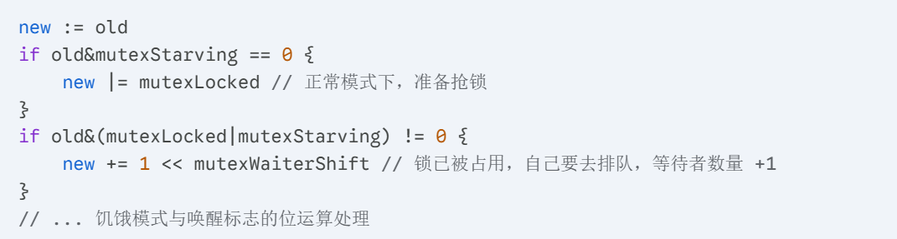

> [!TIP] 位掩码 (Bitmask) 与内存紧凑
> 操作系统内核在管理进程状态、文件描述符或硬件标志位时，为了极致的性能和节省内存，极度依赖位运算。
> 
> Go 的 Mutex 将锁的状态（是否锁定、是否唤醒、是否饥饿）以及多达几万个可能等待的协程数量，全部浓缩压缩在一个单一的 32 位整数 (`int32`) 中 。这就要求所有的状态流转必须通过严格的与 (`&`)、或 (`|`)、非 (`^`) 等位运算来完成，这是底层系统编程的典型风格。

##### （3）硬件级原子更新 (CAS)
计算了新的互斥锁状态之后，会使用 CAS 函数 `atomic.CompareAndSwapInt32` 更新状态：
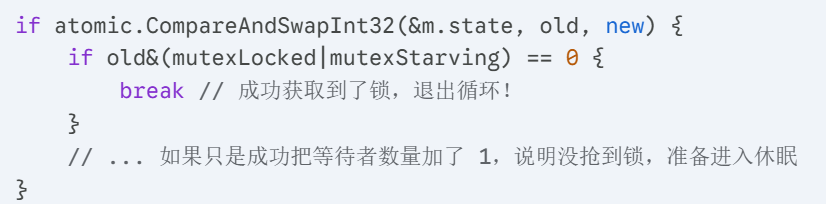
调用 `atomic.CompareAndSwapInt32`。如果现在的状态还是我之前看到的 `old`，就把它变成 `new` 。如果成功且锁之前是空闲的，说明抢锁成功，直接退出 。

> [!TIP] 原子指令
> 在多核处理器上，两个核心同时去修改同一个内存地址会产生数据撕裂。操作系统和编译器依赖底层的 CPU 指令集来解决这个问题（例如 x86 架构上的 `LOCK CMPXCHG` 指令）。
> 
> 这一步，硬件芯片会直接锁住缓存行（Cache Line）或者总线，确保读、比较、写这三个动作作为一个绝对不可分割的整体发生。这是所有高级并发机制能够成立的基石。

##### （4）休眠与信号量阻塞
如果 CAS 操作成功，但自己只是成功地把自己加入了“等待队列”（没抢到锁），此时必须让出 CPU，陷入休眠。
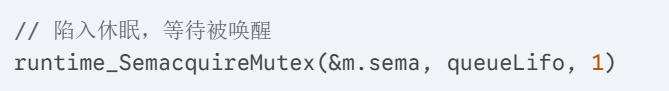
调用 `runtime.sync_runtime_SemacquireMutex`，将当前 Goroutine 挂起，加入到一个先进先出 (FIFO) 或后进先出 (LIFO) 的队列中，直到锁的持有者释放信号量将其唤醒 。

> [!TIP] 信号量 (Semaphores) 与等待队列
> 如果自旋是乐观的，那这一步就是悲观的兜底。这就如同操作系统级别的 `Futex` (Fast Userspace Mutex，Linux 下的高效互斥锁)。当用户态实在解决不了冲突时，只能求助于调度器。Go 运行时的调度器（类似于轻量级的 OS 内核）会把这个 Goroutine 的状态标记为挂起，把它从操作系统线程的运行队列（P）中摘除，放进锁自带的等待链表中，转而去执行其他健康的 Goroutine。以此保证 CPU 不会被无效浪费。


##### （5）饥饿模式评估与锁退避
当 Goroutine 被唤醒后，它会检查自己等了多久。如果当前 Goroutine 等待时间超过了 1ms，它就会判定当前锁的竞争极度不公平，于是将其打上 `mutexStarving`（饥饿）标记 。在饥饿模式下，锁一旦被释放，不会发生竞争，而是绝对精确地直接递交给队列最前面的 Goroutine 。

> [!TIP] 调度公平性与“饿死”
> 操作系统的调度算法（如 CFS 完全公平调度器）面临的核心矛盾是 **吞吐量 (Throughput)** 与 **公平性 (Fairness)**。
> - **偏向吞吐量（正常模式）**：刚释放锁立刻让给正在 CPU 上活跃的线程，缓存命中率极高，吞吐极大，但老弱病残（排在队伍最后的线程）可能会永远抢不到锁，造成“饿死”。
> - **偏向公平性（饥饿模式）**：严格按照先来后到，新来的必须排队。这保证了尾部延迟（Tail Latency）可控，避免部分请求永远超时。Go 通过在运行时动态监控等待时间，在两种策略之间进行无缝自适应切换 。

#### 解锁流程 (`Unlock`)

```go
func (m *Mutex) Unlock() {
    // 快速减去锁定标志位
    new := atomic.AddInt32(&m.state, -mutexLocked)
    if new != 0 {
        m.unlockSlow(new) // 唤醒等待者或移交锁
    }
}
```
首先通过原子的减法操作 `atomic.AddInt32`，直接把最低位的锁定标志（`mutexLocked`）扣除 。如果扣除后整个状态变成了 `0`，说明没有人在排队，也没有进入饥饿模式，解锁瞬间完成，直接返回 。如果不为 `0`，则进入 `unlockSlow` 慢路径处理 。

`sync.Mutex.unlockSlow` 会先校验锁状态的合法性 — 如果当前互斥锁已经被解锁过了会直接抛出异常 “sync: unlock of unlocked mutex” 中止当前程序。

在正常情况下会根据当前互斥锁的状态，分别处理正常模式和饥饿模式下的互斥锁：
- 正常模式下，唤醒等待队列中的 Goroutine。
- 饥饿模式下，直接将锁的所有权移交给队列的下一个等待者。等待者被唤醒后会得到锁，在这时互斥锁还不会退出饥饿状态；


### 2. 读写锁 (`sync.RWMutex`)

适用于**读多写少**的场景。

核心原则是：**读与读之间完全不互斥，但读与写、写与写之间绝对互斥** 。

为了实现这一目标，同时**绝对防止写操作被源源不断的读操作“饿死”**，Go 语言在底层采用了极为巧妙的“负数计票法”。

读场景：

```go
var mu sync.RWMutex

mu.RLock()
defer mu.RUnlock()

// 读取共享数据
```

写场景：

```go
mu.Lock()
defer mu.Unlock()

// 修改共享数据
```

#### 核心结构

_⚠️ 修正：在 Go 1.19 及以上版本中，官方引入了 `sync/atomic` 的强类型 API。`RWMutex` 内部不再直接使用裸的 `int32` 并配合繁琐的 `atomic.AddInt32`，而是全面换装了 `atomic.Int32`。_

底层直接复用了一把普通的互斥锁，并配合两个信号量和两个原子计数器

```go
type RWMutex struct {
    w           Mutex        // 复用互斥锁处理多个写操作的竞争
    writerSem   uint32       // 写等待读的信号量
    readerSem   uint32       // 读等待写的信号量
    readerCount atomic.Int32 // [最新修正] 当前正在执行的读操作数量
    readerWait  atomic.Int32 // [最新修正] 写操作到来时，还需等待多少个正在进行的读操作结束
}
```
- **`w`**: 解决“写写冲突”。同一时刻只能有一个人写 。
- **`readerCount`**: 极其关键的变量！它不仅记录当前有几个读者，**还会利用“负数”来充当写者到来的特殊标记** 。
- **`readerWait`**: 写者专属的“倒计时器” 。

- **写锁 (`Lock`)**：先锁定内部 `Mutex` 阻断其他写操作。然后将 `readerCount` 减去一个极大值（变为负数，以此阻塞后续的新读操作）。**如果此时还有未完成的旧读操作，写 Goroutine 陷入休眠等待。**
- **读锁 (`RLock`)**：通过原子的 `readerCount.Add(1)` 将读者加一。如果结果小于 0，说明有写操作正在进行或等待，读 Goroutine 陷入休眠。
- **防止写饿死**：一旦写操作发起，后续的读操作都会被阻塞，确保写操作不会被源源不断的读操作永远卡住。

#### A. 读锁原理
大部分时间系统都在处理读请求，所以读锁的获取路径必须做到极度轻量。

（1）加读锁 (`RLock`)
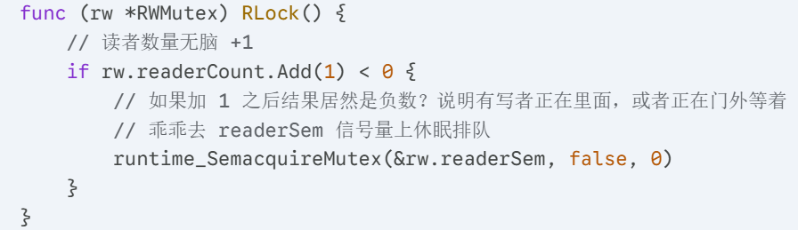
- 如果没有人写，`readerCount` 就是个正数，加 1 直接成功返回，无锁化、零阻塞 。
- 但如果 `readerCount` 变成了负数，说明有写者介入了，当前读请求必须被挂起 。

（2）解读锁 (`RUnlock`)
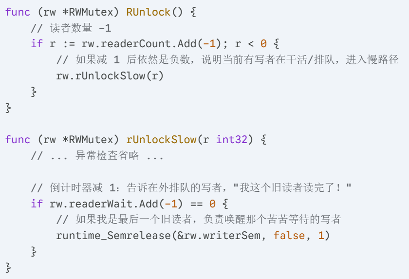
正常情况下就是简单地把数字减回去 。如果发现存在写者，就会去操作 `readerWait` 倒计时器，当倒计时归零，说明前一批读者全部撤退完毕，立刻通过信号量唤醒写者 。

#### B. 写锁原理
写锁的逻辑相对复杂，因为它需要同时搞定竞争的写者，还要应对源源不断的读者。

（1）加写锁 (`Lock`)
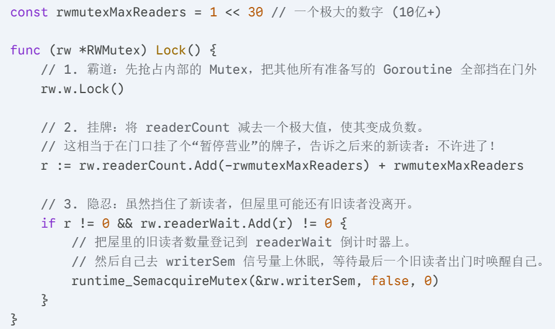

> [!TIP] 如何防止“写者饿死”？
> 如果一个系统源源不断有读请求涌入，写请求会不会永远排不上队？Go 给出了一套极其优雅的解法：**切断增量，等待存量**。 
> 
> 当写请求到达时，瞬间将 `readerCount` 扣减为巨额负数（切断新读者），然后把当前的读者数量快照转移到 `readerWait` 中（等待旧读者）。这样一来，写者最多只需要等待那一瞬间已经存在的读者执行完毕即可，完美打破了饿死僵局 。

（2）解写锁 (`Unlock`)
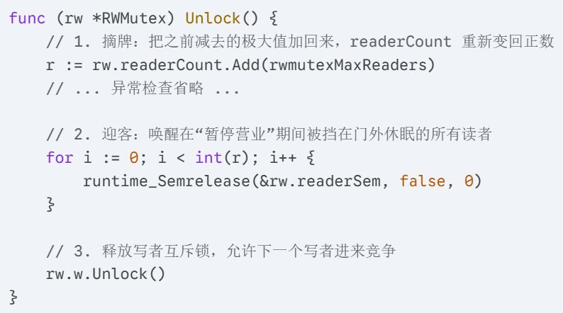
写者完工后，先恢复 `readerCount`，让系统重新接纳新的读请求 。接着，**一次性唤醒所有因为写锁而陷入休眠的读者** ，最后才释放写锁互斥量 `w` 。这也体现了 Go 对吞吐量的考量：写完之后，优先释放被积压的批量读请求。


### 3. 等待组 (`sync.WaitGroup`)

常用于主 Goroutine 等待一组子 Goroutine 完成任务（如批量 RPC 调用）。
```go
var wg sync.WaitGroup

wg.Add(1)

go func() {
	defer wg.Done()

	// 执行任务
}()

wg.Wait() // 等待所有任务完成
```
#### 核心结构

_⚠️ 修正：在 Go 1.18 之前，为了在 32 位机器上保证 64 位原子操作的内存对齐，`WaitGroup` 使用了非常 Hack 的 `state1 [3]uint32` 数组偏移法。**从 Go 1.18 开始，由于 Go 编译器正式保证了 64 位变量的内存对齐，且后续版本引入了强类型的 `atomic.Uint64`，旧的 Hack 实现被彻底废弃！**_ 最新结构非常清爽：

```go
type WaitGroup struct {
    noCopy noCopy
    
    // [最新修正] 强类型64位原子变量。
    // 高32位存储 counter (任务数)，低32位存储 waiter (等待者数)
    state atomic.Uint64 
    sema  uint32
}
```

- **`noCopy`**：这是一个空结构体，主要配合 `go vet` 工具使用 。如果你在代码里不小心写了 `wg2 := wg1`（值拷贝），编译器分析器会直接报错，防止因为锁状态被意外复制而导致死锁 。
- `state` (高 32 位 = `counter`)：记录**还有多少个子任务没有完成**。
- `state` (低 32 位 = `waiter`)：记录**有多少个主 Goroutine 在终点线调用了 `Wait()` 苦苦等待**。
- `sema`：信号量，用于阻塞和唤醒调用 Wait() 的 Goroutine。

用法：
- **`Add(delta int)`**：更新内部计数器 `counter`。当 `counter` 归零且有等待者时，通过信号量唤醒所有陷入休眠的 Goroutine。
- **`Done()`**：本质上就是 `Add(-1)`。
- **`Wait()`**：如果 `counter` 大于 0，当前 Goroutine 陷入睡眠，等待被唤醒。

#### A. 派发任务与汇报完成 (`Add` 与 `Done`)
当调用 `Add(delta)` 时，本质上是在操作高 32 位的 `counter`。
而 `Done()` 仅仅是 `Add(-1)` 的语法糖 。
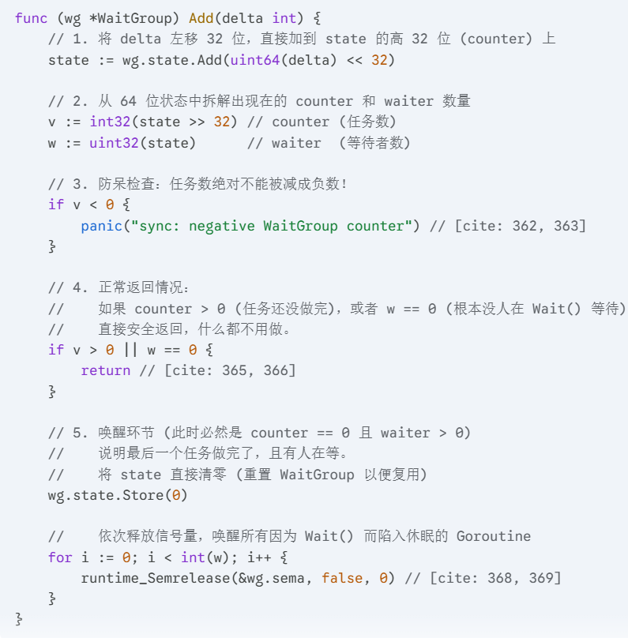

`Add` 的核心就是原子加法。当最后一个子 Goroutine 调用 `Done()`（即 `Add(-1)`）使得高 32 位的 `counter` 恰好归零时，它就负责去触发 `sema` 信号量，把所有在等待的 Goroutine 全部叫醒 。

#### B. 等待完成 (`Wait`)
主 Goroutine 派发完任务后，通常会调用 `Wait()` 陷入阻塞，直到所有任务完成 。
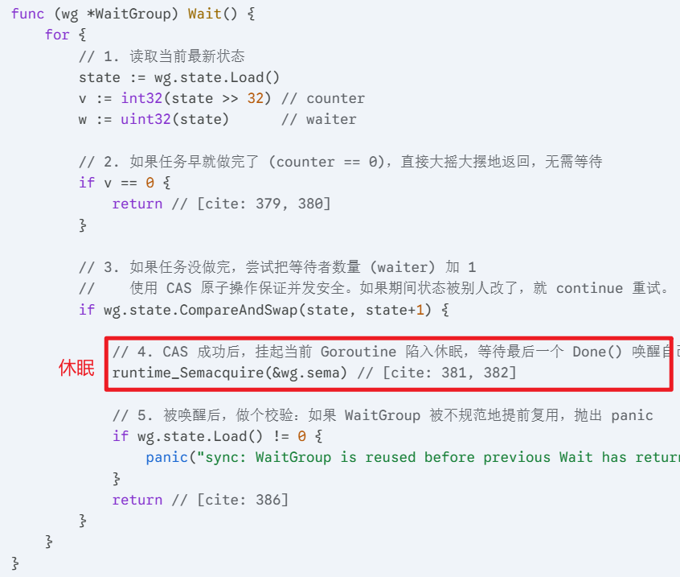

`Wait()` 是一个自旋式的检查循环。如果发现任务没做完，它就会通过 CAS 机制小心翼翼地把自己的名字写进“等待名单”（低 32 位加一），然后乖乖去休眠 。当 `counter` 归零时，睡梦中的它就会被 `Add` 函数底层的 `runtime_Semrelease` 叫醒，继续执行接下来的代码 。

#### 补充：并发屏障 (Barrier) 与倒计时锁 (CountDownLatch)

在操作系统的并发理论中，`WaitGroup` 的设计思想完美契合了以下两种经典模型：
1. **倒计时锁 (CountDownLatch)**：就如同 Java 中的 `CountDownLatch`，系统初始化一个固定数值的计数器，各个线程并发执行并递减计数器。必须等计数器彻底扣减为 0 时，主线程才能越过这道“栅栏”继续向下执行。
2. **64 位数据组装的艺术 (Data Packing)**：为什么 Go 要把 `counter` 和 `waiter` 挤在一个 64 位的整数里，而不是拆成两个独立的 `int32` 变量呢？
    - 因为如果在高并发下分两次读取两个变量（先读 `counter`，再读 `waiter`），在这两次读取的极小时间差内，数据极有可能被其他 Goroutine 篡改，导致状态不一致。
    - 将它们打包进一个 64 位变量中，配合 CPU 的 64 位指令，就可以保证**在一个原子操作周期内同时读取或修改这两个状态**。这是无锁编程（Lock-free Programming）中极高阶的技巧 **！！**

### 4. 单次执行 (`sync.Once`)

保证在程序运行期间，某段代码（函数）无论在多少个 Goroutine 中被调用，**只会被执行一次**。常见于单例模式、配置初始化。
```go
var once sync.Once

once.Do(func() {
	// 只执行一次的初始化逻辑
})
```
#### 核心机制

_⚠️ 修正：除了内部字段升级为 `atomic.Uint32`，**Go 1.21 专门为 `sync.Once` 新增了 `OnceFunc`, `OnceValue` 和 `OnceValues` 几个极度实用的辅助函数**，免去了开发者自己定义变量接收 Once 结果的麻烦。_

```go
type Once struct {
    done atomic.Uint32 // [最新修正] 使用强类型原子操作，0代表未执行，1代表已执行
    m    Mutex         // 保证并发环境下的安全
}
```

**Go 1.21 现代化的 Once 使用方式：**
传统的 `sync.Once.Do` 其实一直存在几个令开发者头疼的“暗坑”：
1. **无法返回值**：初始化数据库连接时，没法直接返回 `*DB` 和 `error`，只能在外部定义变量，通过闭包去修改，代码显得很臃肿。
2. **Panic 吞咽问题**：如果 `Once.Do` 执行的函数发生了 `panic`，`Once` 依然会认为“函数已经执行过了”。后续的 Goroutine 再调用 `Do` 时会直接放行，拿到一个完全没有初始化成功的半成品状态，引发更深层的隐藏 Bug。
3. **潜在的内存泄漏**：闭包引用的外部大对象，会因为 Once 实例的长期存活而无法被垃圾回收（GC）。

```go
// 以前我们需要手动包一层外围变量，现在可以直接生成具备缓存结果能力的闭包：
// 1. 无返回值
doOnce := sync.OnceFunc(func() { fmt.Println("Init!") })
// 2. 缓存单一返回值 (极度适合加载配置)
loadConfig := sync.OnceValue(func() string { return "config_data" })
// 3. 缓存多返回值 (适合可能返回 error 的初始化)
openDB := sync.OnceValues(func() (*DB, error) { return initDB() })
```

#### A. Once.Do() 实现
当调用 `Once.Do(f)` 时，它在底层采用了一种极其经典的并发设计模式：**双重检查锁**。为了极致的性能，它将执行路径拆分为了“快路径”和“慢路径”
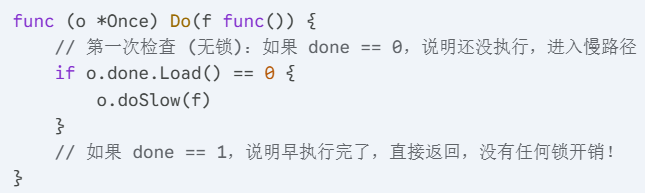
在绝大多数情况下（程序运行的 99.99% 的时间里），资源早就被初始化好了。所以这里的第一次检查纯粹依靠轻量级的原子读取。一旦发现 `done == 1`，直接跳过，性能极高。

如果在系统刚启动时，有 100 个 Goroutine 瞬间同时到达，它们在快路径里看到的 `done` 都是 `0`，于是全部涌入 `doSlow`：
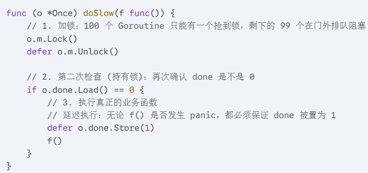

**为什么在 `doSlow` 里加了锁之后，还要再检查一次 `done == 0`？** 因为当第 1 个 Goroutine 抢到锁并执行完 `f()` 释放锁后，门外排队的第 2 个 Goroutine 会立刻抢到锁并进门。如果此时不再检查一次，第 2 个 Goroutine 就会把 `f()` 重新执行一遍，破坏了“只执行一次”的语义。

**为什么不直接用一个 CAS 原子操作搞定，非要用 Mutex 加锁？**
假设不用锁，100 个 Goroutine 同时进行 CAS，只有 1 个成功去执行 `f()`，剩下的 99 个 CAS 失败。如果它们失败后直接往下执行，此时 `f()` 可能还在进行极其耗时的网络连接初始化！那这 99 个 Goroutine 拿到的将是一个**未初始化完成的空指针**，直接引发严重的空指针异常（Panic）。 
加 Mutex 锁的根本目的，是让那 99 个来晚的 Goroutine 乖乖排队休眠，直到第 1 个 Goroutine 彻底把资源初始化完毕，它们才能醒来并安全地使用这些资源。


在 `doSlow` 函数中，Go 使用了 `defer o.done.Store(1)` 。这意味着，一旦 `f()` 开始执行，哪怕在这个函数内部发生了非常严重的 `panic`，导致初始化中途夭折，`defer` 依然会被触发，将 `done` 置为 `1`。

####   B. sync.OnceFunc 无返回值的安全包装
`OnceFunc` 返回一个只会执行传入函数 `f` 一次的函数。它的核心亮点在于**Panic 传播**和**防止内存泄漏**。
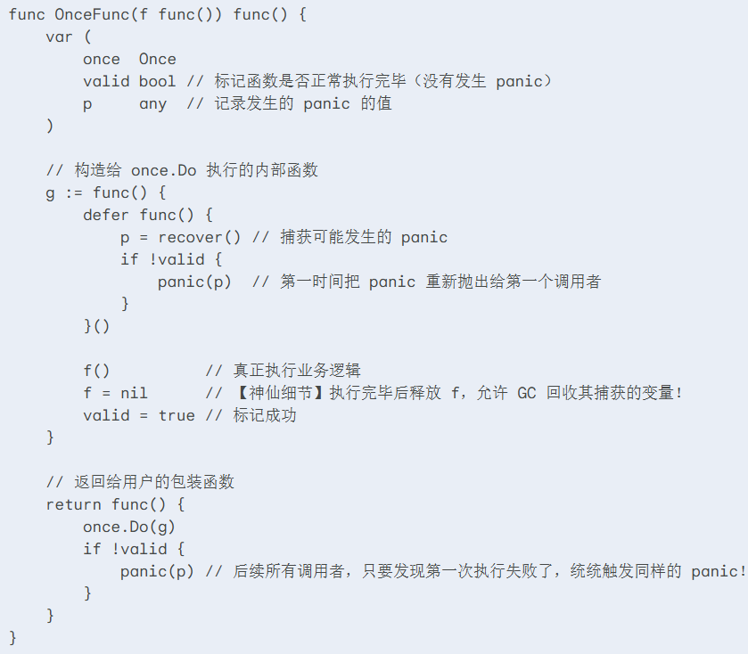
1. **解决 Panic 吞咽 (Panic Propagation)**：
    - 在传统的 `Once` 中，如果 `f()` 崩溃了，后续调用者会以为执行成功了并继续往下走。
    - 这里引入了 `valid` 布尔标志和 `p` 变量。如果 `f()` 发生了 panic，`valid = true` 就永远不会被执行。
    - **后续调用者**进入返回的闭包时，`once.Do(g)` 会在底层直接极速放行（因为 done 已为 1）。紧接着它会检查 `if !valid`，发现第一次执行失败了，于是**直接将最初捕获的 panic 值 `p` 再次抛出**！这保证了所有的调用者都能明确知道“初始化失败了”。

2. **解决内存泄漏 (`f = nil`)**：
    - `f` 通常是一个闭包，里面可能引用了大量的外部变量（比如大数组、复杂的配置结构体等）。
    - `OnceFunc` 返回的包装函数往往会被赋值给一个全局变量，长期驻留在内存中。如果它一直持有对 `f` 的引用，那 `f` 内部捕获的所有对象都**永远无法被 GC 回收**。
    - 源码中通过 `f = nil` 主动切断了引用链，一旦初始化完成，立刻释放内存。这是一个极其优雅的工程级优化！

3. **并发安全 (无锁的 happens-before 保证)**：
    - 你可能会疑惑：多个 Goroutine 访问 `valid` 和 `p` 变量，为啥不加锁？
    - 因为 `sync.Once.Do` 底层的机制保证了：`g()` 的执行完成，绝对**先发生于** 后续所有的 `once.Do(g)` 返回。所以后续 Goroutine 读到的 `valid` 和 `p` 绝对是安全且最新的，不存在数据竞争 (Data Race)。

#### C. sync.OnceValue 缓存单一返回值
`OnceValue` 完美适配**单例模式**（比如加载某个全局配置项）。利用泛型 `[T any]`，它可以缓存并返回任意类型的结果。
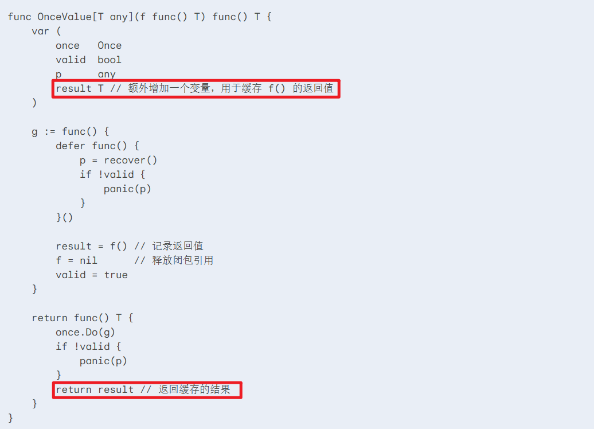
- 和 `OnceFunc` 几乎完全一致，仅仅是多了一个泛型变量 `result T`。
- 第一次执行时，将 `f()` 的结果存入 `result`；之后所有的并发调用，都会在极速跳过 `once.Do(g)` 后，直接 `return result`。实现了零侵入的懒加载与缓存。

#### C. sync.OnceValues 缓存多返回值
在真实的工程中，资源的初始化几乎总是伴随着可能发生的 `error`（比如连库、读文件、发起 HTTP 请求）。`OnceValues` 利用双泛型 `[T1, T2 any]` 完美解决了这个问题。
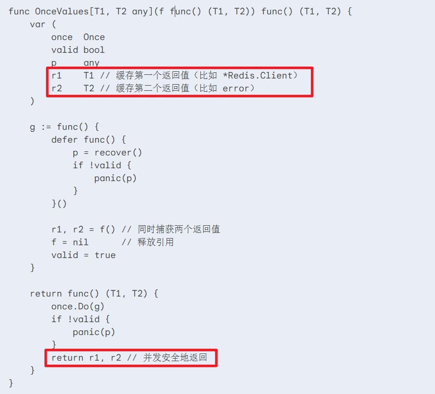

实战中，利用 `OnceValues`，原本需要手写各种 `var client *Redis` 和 `var initErr error` 再配合 `Once` 去操作的代码，现在可以极简地写成一行：

```go
// 定义一个全局的并发安全的客户端获取器
var GetRedisClient = sync.OnceValues(func() (*redis.Client, error) {
    client := redis.NewClient(&redis.Options{Addr: "localhost:6379"})
    err := client.Ping(context.Background()).Err()
    return client, err
})

func handleRequest() {
    // 任何 Goroutine 调用，只有第一次会去真正建立连接
    // 如果连不上，其他并发请求也会瞬间拿到同样的 error 并快速失败 (Fail-fast)
    client, err := GetRedisClient()
    if err != nil {
        log.Println("Redis 不可用：", err)
        return
    }
    // 使用 client...
}
```

### 5. 条件变量 (`sync.Cond`)

在很多业务场景中，一个 Goroutine 发现某个条件不满足时（比如：队列为空、数据还没准备好），如果直接用 `for {}` 死循环不断检查（忙等待），会极其浪费 CPU 资源 。

`sync.Cond` 的出现就是为了解决这个问题：**它能让 Goroutine 优雅地交出 CPU 使用权陷入休眠，直到“特定条件”满足时，再由其他人把它唤醒** 。

```go
var mu sync.Mutex
cond := sync.NewCond(&mu)

// 等待条件
cond.L.Lock()
for !ready {
	cond.Wait()
}
cond.L.Unlock()

// 唤醒一个等待者
cond.Signal()

// 唤醒所有等待者
cond.Broadcast()
```

通过一个等待链表 (`notifyList`) 保存所有陷入等待的 Goroutine。
- **`Wait()`**：将当前 Goroutine 加入链表尾部 -> 解锁 -> 陷入休眠等待唤醒 -> 唤醒后重新加锁。**（调用前必须先持锁）**
- **`Signal()`**：唤醒队列中最前面的一个 Goroutine。
- **`Broadcast()`**：广播，唤醒队列中的全部 Goroutine。

#### 核心机制
每一个 `sync.Cond` 在初始化时，都**必须强制绑定一把锁**（通常是 `sync.Mutex` 或 `sync.RWMutex`）

```go
type Cond struct {
    noCopy  noCopy      // 保证结构体不会在编译期间发生值拷贝
    L       Locker      // 绑定的互斥锁，用于保护保护条件的读取和修改
    notify  notifyList  // 核心！一个基于 Goroutine 的通知链表 
    checker copyChecker // 运行期间的拷贝检查器
}
```
这里最核心的其实是 `notifyList` 。你可以把它想象成一个 **“候车室”**。所有条件不满足、被迫休眠的 Goroutine，都会被打包成 `sudog`（Go 运行时里 Goroutine 的底层封装）并按照先后顺序排进这个链表里 。
```go
type notifyList struct {
    wait   uint32   // 当前正在等待的 Goroutine 领取的“排队号” 
    notify uint32   // 已经被叫到号、准备唤醒的“排队号”
    lock   mutex    // 保护链表本身的小锁
    head   *sudog   // 候车室队伍的头
    tail   *sudog   // 候车室队伍的尾巴
}
```


#### A. Wait() 的实现
`Wait` 方法是 `sync.Cond` 最精髓的地方。
当调用 `c.Wait()` 时，底层其实默默做了极其关键的四件事：
```go
func (c *Cond) Wait() {
    c.checker.check()
    
    // 1. 领号：去 notifyList 里登记一下，拿一个属于自己的排队小票 (ticket)
    t := runtime_notifyListAdd(&c.notify)
    
    // 2. 解锁：【极其关键】必须把绑定的互斥锁解开！
    c.L.Unlock()
    
    // 3. 休眠并进站：带着小票排进链表末尾，调用底层方法直接让出 CPU，陷入深度休眠
    runtime_notifyListWait(&c.notify, t)
    
    //休眠过程
    
    // 4. 重新加锁：当被别人唤醒，准备继续往下执行时，必须重新抢到互斥锁！
    c.L.Lock()
}
```

> [!TIP] 为什么在 `Wait` 里面一定要先 `Unlock`，醒来后再 `Lock`？
> 因为你是在“持有锁”的状态下发现条件不满足的。如果你带着锁去休眠，其他负责生产数据、修改条件的 Goroutine 就永远拿不到锁，整个系统就彻底死锁了！所以，`Wait` 必须在睡前把锁让出去，醒来后为了能安全地再次检查条件，又必须把锁抢回来 。

正确用法：
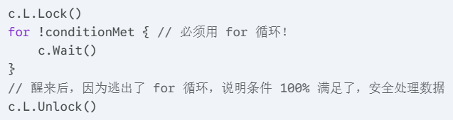
**为什么必须用 `for`？（虚假唤醒 Spurious Wakeup）** 
假设有多个 Goroutine 都在 `Wait` 等待同一个苹果（条件）。当生产者放入一个苹果并调用 `Broadcast()` 唤醒了所有人时。 
这群被唤醒的 Goroutine 会一窝蜂地去抢底层的那把互斥锁 `c.L` （第四点）。
只有最快的一个 Goroutine 能抢到锁，它顺利逃出循环，把苹果吃掉了，然后释放锁。 
此时，第二个醒来的 Goroutine 终于抢到了锁。**如果它用的是 `if`**，它就不会再次检查有没有苹果，直接顺着往下执行，结果一咬咬在了空气上（引发越界或空指针异常）。
**如果它用的是 `for`**，它会发现“苹果怎么又没了”，于是无奈地再次调用 `c.Wait()` 继续休眠 。

#### B. `Signal` 与 `Broadcast` 实现

当某个 Goroutine 辛勤工作，改变了共享状态（比如往空队列里塞入了数据），它就需要负责“吹哨”，把候车室里休眠的 Goroutine 叫醒。
- **`Signal()` (单播)**：唤醒候车室里**排在最前面、等得最久**的**一个** Goroutine 。
    - **底层逻辑**：调用 `runtime_notifyListNotifyOne`，遍历 `notifyList` 找到拿了最早排队号 (`sudog.ticket == l.notify`) 的那一个，通过 `runtime.readyWithTime` 把它塞回调度器的可运行队列中 。

- **`Broadcast()` (广播)**：唤醒候车室里的**所有** Goroutine 。
    - **底层逻辑**：调用 `runtime_notifyListNotifyAll`，把 `notifyList` 的 `head` 和 `tail` 全部清空，依次按照它们加入队列的顺序，把所有 Goroutine 全部唤醒 。


#### 具体用法

案例：3 名运动员（Worker 协程）已经在起跑线上就位，但他们不能跑，必须等待裁判（主协程）打响发令枪（改变条件并广播）。
```go
package main

import (
	"fmt"
	"sync"
	"time"
)

func main() {
	// 1. 定义一把互斥锁，并用它初始化 Cond
	var mu sync.Mutex
	cond := sync.NewCond(&mu)

	// 2. 定义一个共享的条件变量（发令枪是否打响）
	ready := false

	// 3. 安排 3 名运动员（启动 3 个 Goroutine）
	for i := 1; i <= 3; i++ {
		go func(id int) {
			// 【等待方】必须先加锁
			cond.L.Lock()
			
			// 铁律：必须用 for 循环检查条件是否满足！
			for !ready {
				fmt.Printf("运动员 %d: 还没发令，原地休眠等待...\n", id)
				// 条件不满足，交出锁并进入休眠，等待被唤醒
				cond.Wait() 
			}
			
			// 醒来且跳出 for 循环，说明 ready == true
			fmt.Printf("运动员 %d: 听到发令枪，起跑！\n", id)
			
			// 【等待方】完事后必须解锁
			cond.L.Unlock()
		}(i)
	}

	// 主协程模拟裁判准备发令
	fmt.Println("裁判: 正在检查场地，准备发令枪...")
	time.Sleep(2 * time.Second) // 睡 2 秒，确保运动员都进入 Wait 状态

	// 4. 裁判打响发令枪
	// 【通知方】修改共享变量前，也必须加锁
	cond.L.Lock()
	ready = true
	fmt.Println("裁判: 砰！发令枪响，广播唤醒所有人！")
	
	// 广播唤醒所有正在 Wait 的协程
	cond.Broadcast() 
	
	// 【通知方】修改完毕，释放锁
	cond.L.Unlock()

	// 稍作等待，让运动员跑一会，防止主协程直接退出
	time.Sleep(1 * time.Second)
}
```

- 条件变量不能单独存在，它**必须**绑定一把锁。因为“条件”（在这个例子里是 `ready` 这个布尔值）是一个共享资源，不管是读它还是改它，都必须在锁的保护下进行，否则会产生数据竞争。
- **如果调用 `Wait()` 之前没有获取互斥锁，程序会直接触发Panic**，因为`Wait()`底层在将自己加到等待队列之后，会调用`c.L.Unlock()` 解锁。而且，**读取状态、判断状态、进入休眠**，这三个动作必须是**绝对原子**的，不然会导致“丢失唤醒/虚假唤醒”：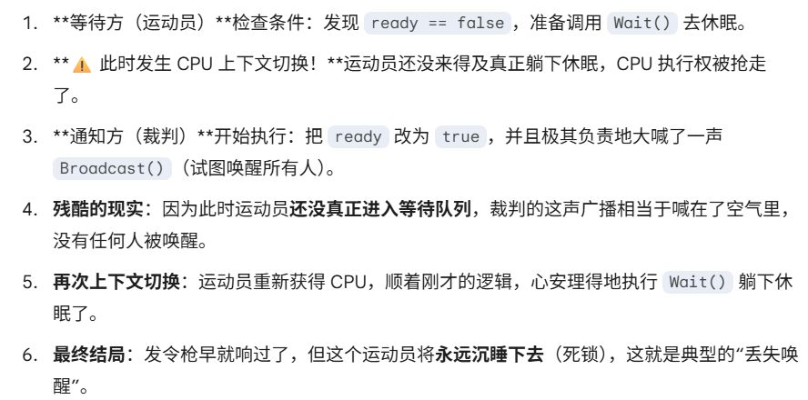

### 6. 对象池（`sync.Pool`）
`sync.Pool` 是 Go 标准库提供的一个**并发安全的临时对象池**。
- **它的核心作用：** 缓存已分配但尚未使用的对象，以便后续重用，从而减少内存分配操作，极大缓解 GC 的压力。
- **它的绝对禁忌：** **绝不能将其用作连接池（如数据库连接、网络套接字）。** 因为 `sync.Pool` 中的对象随时可能在下一次 GC 时被无声无息地回收，它不保证对象的存活时间。

> [!IMPORTANT]  
> sync.Pool性能高，主要靠 Per-P 本地缓存减少锁竞争，private 无锁访问，shared 支持工作窃取，pin 防止调度导致数据竞争，再加上 Victim Cache 平滑 GC 带来的性能抖动


#### 基础用法（适合高频借还场景）
使用 `sync.Pool` 非常简单，核心只有三个方法：`New`（初始化）、`Get`（获取对象）、`Put`（归还对象）。
```go
package main

import (
	"bytes"
	"fmt"
	"sync"
)

// 1. 定义一个全局的 Pool
var bufferPool = sync.Pool{
	// New 函数在 Get() 且池中无可用对象时被调用
	New: func() any {
		return new(bytes.Buffer)
	},
}

func main() {
	// 2. 获取对象
	buf := bufferPool.Get().(*bytes.Buffer)
	
	// 使用对象
	buf.WriteString("Hello, sync.Pool!")
	fmt.Println(buf.String())
	
	// 3. 归还对象前，务必清理状态！(重要)
	buf.Reset()
	
	// 4. 将对象放回池中
	bufferPool.Put(buf)
}
```

`sync.Pool` 之所以能做到极高的并发性能，是因为它深度绑定了 Go 的 GMP 调度模型。它尽量避免了全局锁的竞争，转而采用**本地池（Per-P）** 加**工作窃取** 的机制。

#### 核心数据结构

我们先来看看 `sync.Pool` 及其底层结构（位于 `src/sync/pool.go`）：

```go
type Pool struct {
	noCopy noCopy

	local     unsafe.Pointer // 指向 [P]poolLocal 的数组指针
	localSize uintptr        // 数组的大小（即当前 P 的数量）

	victim     unsafe.Pointer // 上一轮 GC 遗留下来的本地池
	victimSize uintptr        // victim 数组的大小

	New func() any
}

type poolLocal struct {
	poolLocalInternal
	// 避免 CPU 缓存伪共享 (False Sharing) 的内存填充
	pad [128 - unsafe.Sizeof(poolLocalInternal{})%128]byte
}

type poolLocalInternal struct {
	private any       // 只能由当前 P 使用（无锁）
	shared  poolChain // 双向链表构成的无锁环形队列。当前 P 可以 pushHead/popHead，其他 P 可以 popTail (窃取)
}
```

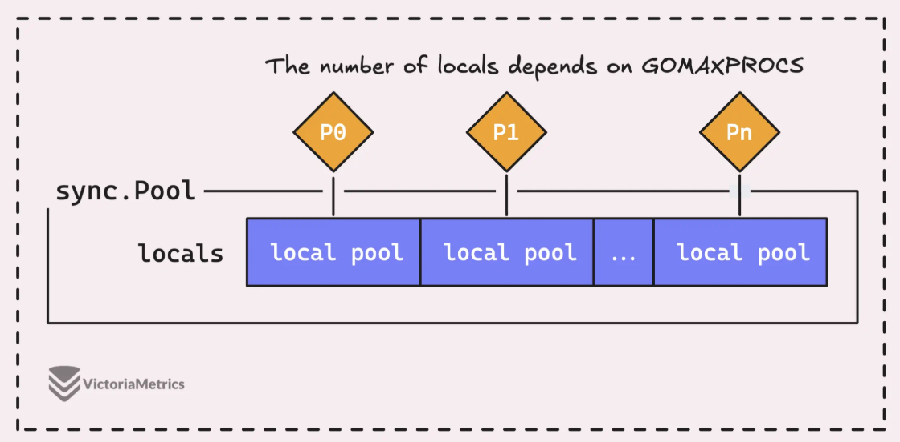
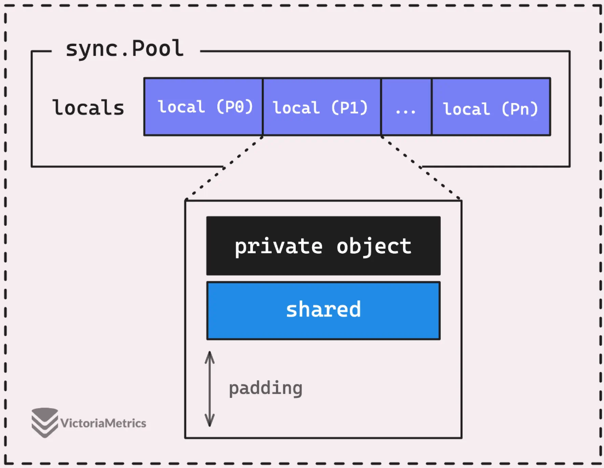

**关键设计点：**
- **`poolLocal` 数组：** 池内部维护了一个数组，Go 运行时中的每个 `P`（Processor）都对应数组中的一个 `poolLocal`。
- **`private` vs `shared`：** 
	- `private`：当前 P 的专属私有对象，存取完全无锁，速度最快。
    - `shared`：一个无锁的双向环形队列（链表）。当前 P 从头部存取，其他 P 如果自己没有可用对象，可以从你的 `shared` 尾部“偷”一个走。
- **伪共享防御 (`pad`)：** 不同的 `poolLocal` 可能会被分配在同一条 CPU 缓存行（Cache Line）上。并发修改时会导致缓存行失效（False Sharing）。通过 `pad` 填充到 128 字节，强制每个 `poolLocal` 独占缓存行，提升并发性能。

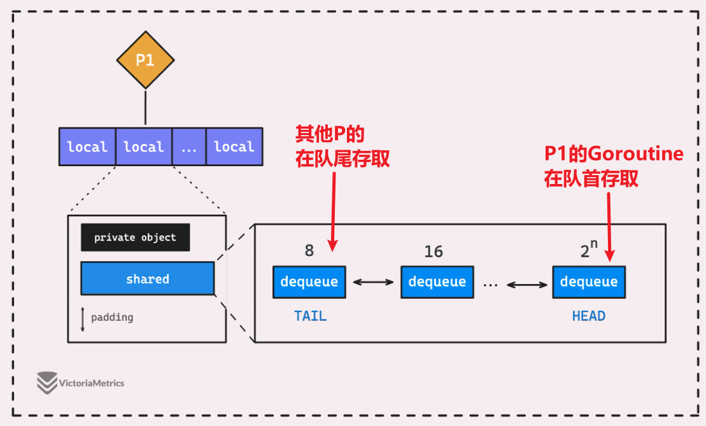
`shared` 并不是一个固定大小的数组。它是一个由多个环形缓冲区（`poolDequeue`）组成的链表。
当一个环形缓冲区满了，它会自动创建一个两倍大小的新缓冲区拼接上去（8 -> 16 -> 32 -> 64...）。这意味着即使你存入上万个对象，它也能高效地容纳，并且在同一个缓冲区内的内存是连续的，对 CPU 缓存极其友好。


#### `pin()` 与禁止抢占机制
在 GMP 模型中，**P** 代表执行上下文，维护着 Goroutine 的本地运行队列。无论有多少个并发的 Goroutine (G)，真正在同一时刻运行的 G 的数量受限于 P 的数量（由 `GOMAXPROCS` 决定）。

`sync.Pool` 利用了这一点，它的底层数据结构 `local` 是一个数组，这个数组的大小**严格等于当前 P 的数量**。
- 每个 P 在这个数组中都有一个专属的槽位，即 `poolLocal`。
- 当一个 G 需要存取对象时，`sync.Pool` 不会去操作全局的数据，而是将该 G 路由到**它当前所在的 P** 所对应的那个专属 `poolLocal` 中。

当我们在代码中调用 `Pool.Get()` 或 `Pool.Put()` 时，源码的第一步是调用内部的 `pin()` 方法。`pin()` 方法在底层调用了 Go runtime 的 `runtime_procPin()`，这个操作做了两件至关重要的事情：
1. **获取当前的 P：** 查明当前正在执行这个 Goroutine 的是哪个 P，并返回该 P 的 ID，从而定位到专属的 `poolLocal`。
2. **禁止抢占 (Disable Preemption)：** 将当前 Goroutine 牢牢“钉”在这个 P 上，暂时不允许系统将其调度走。

> [!NOTE]  为什么必须禁止抢占？
>  假设不禁止抢占：Goroutine A 在 P1 上运行，找到了 P1 的 `poolLocal`。就在它准备拿取对象的一瞬间，Go 调度器触发了抢占，把 Goroutine A 调度到了 P2 上去执行，而 P1 开始执行 Goroutine B。此时，Goroutine A 拿着 P1 的 `poolLocal` 指针，Goroutine B 也在操作 P1 的 `poolLocal`，并发冲突（Data Race）就产生了，这就必须加锁。
>  
**通过禁止抢占，`sync.Pool` 确保了在这个短暂的存取窗口内，当前 P 只有这一个 G 在操作自己的资源，从而彻底消除了最底层的并发冲突。**

> [!IMPORTANT]  
> 某个Goroutine从该对象池取对象，会查询其所述的`P`，然后该Goroutine获取其对应`P`在private中的对象（或者`shared`队首），**取对象期间**该Goroutine不会被调度到其他P上面。

#### 基于P的无锁缓存
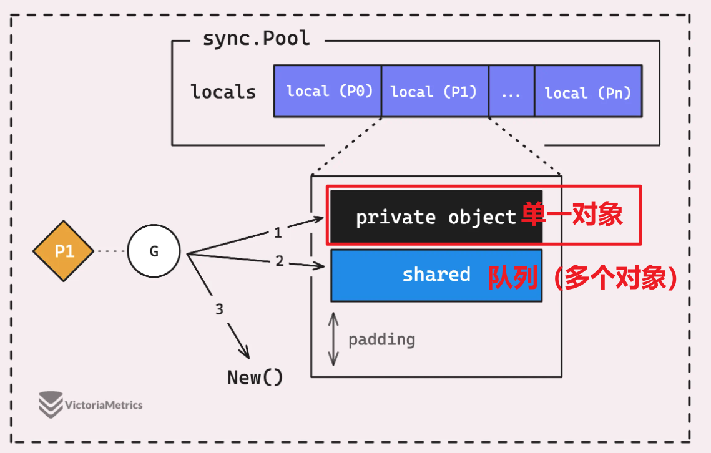

因为成功绑定了 P 且禁止了抢占，`sync.Pool` 顺理成章地构建了两级基于 P 的无锁缓存：
- **Private（当前P私有缓存）：** 每个 P 的 `poolLocal` 中都有一个 `private` 字段。因为同一时刻一个 P 只能运行一个 G，且 G 被禁止了抢占，所以对 `private` 的读写**绝对不会发生并发**。这里不需要任何锁，哪怕是原子操作（Atomic）都不需要，直接读写指针，性能极高。
- **Shared（所有P共享缓存）：** 当 `private` 为空（或已满）时，会使用 `shared` 字段。这是一个无锁的双向环形链表。
    - **当前 P 的 G**：只能在这个链表的头部（Head）进行推入（Push）和弹出（Pop）。
    - **其他 P 的 G**：只能在这个链表的尾部（Tail）进行窃取（Pop）。
    - 这种单生产者（头部）、多消费者（尾部）的设计，只需极轻量的 CAS（Compare-And-Swap）原子操作即可保证安全，避免了重型锁。

当一个 G 在**自己所属的 P 的** `private` 和 `shared` 头部**都没有找到可用对象**时，它会遍历其他**所有 P 的** `poolLocal`，尝试从它们的 `shared` 尾部偷一个对象过来。

> [!IMPORTANT]  某一个 Goroutine 需要在短时间内从池中获取**大量**对象
> 耗尽自己的 `private`（单一） -> 掏空自己的 `shared` -> 去别的 P 那里窃取 -> 最后实在借不到，只能疯狂触发 `New()`。
> 如果这个 Goroutine 批量用完了这 1000 个对象，开始疯狂 `Put()` 归还：
> 1. 第 1 个对象进入 `private`。
> 2. 剩下的 999 个对象，会**全部堆积在 P1 自己的 `shared` 队列中**。
> 
> 如果其他 P 上的 Goroutine 需要对象，它们就会纷纷跑来 P1 的尾部“窃取”，自动把由于局部高并发造成的对象堆积，再次均匀地分发到了整个系统中。

#### `Get()` 的执行流程

获取对象的流程极其精妙，它按照**从快到慢**的路径进行：
```go
func (p *Pool) Get() any {
	// 1. 将当前 goroutine 绑定到 P，并禁用抢占，返回当前 P 的 poolLocal
	l, pid := p.pin()
	
	// 2. 优先从当前 P 的 private 字段获取 (无锁)
	x := l.private
	l.private = nil
	
	if x == nil {
		// 3. private 没有，则从当前 P 的 shared 队列头部弹出一个 (无锁并发安全)
		x, _ = l.shared.popHead()
		if x == nil {
			// 4. slow path: 自己没有，去别的 P 偷，或者去 victim 缓存找
			x = p.getSlow(pid)
		}
	}
	// 解除 P 的绑定
	runtime_procUnpin()
	
	// 5. 如果全都没找到，调用 New 方法生成一个
	if x == nil && p.New != nil {
		x = p.New()
	}
	return x
}
```

**`getSlow` 内部逻辑：** 遍历所有其他的 P，调用 `shared.popTail()` 尝试从尾部窃取对象。如果一圈下来啥也没偷到，就去 `victim`（上一轮 GC 遗留的缓存）里找。

#### `Put()` 的执行流程

归还对象同样优先考虑当前 P 的效率：
```go
func (p *Pool) Put(x any) {
	if x == nil {
		return
	}
	// 1. 绑定到当前的 P
	l, _ := p.pin()
	
	// 2. 如果当前 P 的 private 是空的，直接放进 private
	if l.private == nil {
		l.private = x
	} else {
		// 3. 否则，放进当前 P 的 shared 队列头部
		l.shared.pushHead(x)
	}
	runtime_procUnpin()
}
```

#### 垃圾回收与 `Victim Cache` 机制

在 Go 1.13 之前，每次 GC 会清空 `sync.Pool`，导致 GC 后性能骤降（因为缓存全没了，需要重新大量分配）。现在的版本引入了 `victim`（牺牲者）机制。

在每次 GC 开始前，系统会调用 `poolCleanup` 函数：
```go
func poolCleanup() {
	// 1. 丢弃上一次的 victim
	for _, p := range oldPools {
		p.victim = nil
		p.victimSize = 0
	}

	// 2. 将当前的 local 降级为 victim
	for _, p := range allPools {
		p.victim = p.local
		p.victimSize = p.localSize
		p.local = nil
		p.localSize = 0
	}
	// ...
}
```

**解析：** 对象在池中实际上可以活过**两次 GC 周期**。第一次 GC 时，它从 `local` 被降级到 `victim`；只有在第二次 GC 到来前它依然没有被 `Get()` 重新激活，它才会被真正的销毁。这不仅平滑了 GC 对性能的冲击，还保证了对象不会驻留太久导致内存泄漏。

如果对象在 `victim` 里被成功 `Get()` 出来，并在使用后重新 `Put()` 回去，它就会重新进入新的 `local` 里！**这意味着，真正活跃（高频使用）的对象，永远不会被 GC 杀掉，它们会在 `local` 和 `victim` 之间不断跃迁。**

---

#### 核心注意事项（避坑指南）
1. **切勿假定对象状态（脏数据泄漏）：** 从 Pool 中拿到的对象可能是包含着上一次使用残留数据的。**在 Put 进去之前，或者 Get 出来之后，务必清理状态（如切片的 `[:0]`，`bytes.Buffer` 的 `Reset()`）。** 否则会导致业务数据串联、甚至敏感信息泄露。
2. **不要用作数据库连接池：** 就像前面提到的，GC 会清空它们，如果你把 TCP 连接放进去，连接被悄悄回收或关闭，你的程序会直接崩溃或陷入无穷的超时。
3. **大对象 vs 小对象：** `sync.Pool` 极度适合**高频分配和回收的复杂对象或大块内存（如大 Slice、JSON 编解码用的 Buffer）**。但对于极其简单的结构体，直接依赖栈分配和普通 GC 可能比调用 `sync.Pool` 更快。
4. **避免内存泄漏（对象太大）：** 如果一个 Slice 底层数组在运行中被扩容到了几百 MB，你把它 `Put` 回去，它就会一直占用大量内存直到下次 GC。最佳实践是限制放入池中的对象大小：

```go
if buf.Cap() <= MaxBufferSize {
	pool.Put(buf)
}
```

### 7. 并发 Map（`sync.Map`）

Go 中普通 `map` **不支持无同步的并发读写**。需要并发访问 Map 时，通常有两种方案：

```go
// 方案一：内置 map + 锁
type SafeMap struct {
    mu sync.RWMutex
    m  map[string]int
}

// 方案二：sync.Map
var m sync.Map
```

`sync.Map` 可以被多个 goroutine 并发使用，无需额外加锁。官方建议它主要用于两类场景：
- 一个 key **写一次、读很多次**，如缓存；
- 多个 goroutine 操作的 **key 集合基本不重叠**。

一般业务场景仍优先考虑 `map[K]V + Mutex/RWMutex`，因为类型更安全、逻辑也更容易控制。

#### 内置类型 Map

普通 Map：

```go
m := make(map[string]int)

m["a"] = 1
v := m["a"]
delete(m, "a")
```

可以安全地进行**并发只读**，但只要存在并发写，就必须进行同步。

例如：
```go
go func() {
    m["a"] = 1
}()

go func() {
    fmt.Println(m["a"])
}()
```

可能产生：

```text
fatal error: concurrent map read and map write
```

原因是一次 Map 写入并非简单地修改某个变量，它可能同时修改：

```text
哈希槽
控制信息
元素数量
表结构
扩容状态
```

如果另一个 goroutine 此时读取或写入，可能观察到 Map 的中间状态，产生数据竞争甚至破坏内部结构。

因此：

```text
并发读 + 并发读     → 可以
并发读 + 并发写     → 不安全
并发写 + 并发写     → 不安全
```

普通 Map 的典型并发方案是：

```go
type SafeMap struct {
    mu sync.RWMutex
    m  map[string]int
}

func (s *SafeMap) Load(k string) (int, bool) {
    s.mu.RLock()
    defer s.mu.RUnlock()

    v, ok := s.m[k]
    return v, ok
}

func (s *SafeMap) Store(k string, v int) {
    s.mu.Lock()
    defer s.mu.Unlock()

    s.m[k] = v
}
```

---

#### `sync.Map`

```go
var m sync.Map

m.Store("key", "value")      // 写
v, ok := m.Load("key")       // 读
m.Delete("key")              // 删除
v, loaded := m.LoadOrStore("key", "value")

m.Range(func(key, value any) bool {
	// 遍历
	return true
})
```

> 可参考：https://zhuanlan.zhihu.com/p/22878835460
##### 内部结构

最新版 Go 中，`sync.Map` 已经不再采用早期的 `read + dirty + misses` 实现，而是直接封装一个并发 **Hash-Trie**（哈希字典树）：([Go 语言](https://go.dev/src/sync/map.go?utm_source=chatgpt.com "map.go"))

```go
type Map struct {
    _ noCopy

    m isync.HashTrieMap[any, any]
}
```

因此：

```text
sync.Map
   │
   ▼
HashTrieMap
   │
   ├── indirect node
   │      ├── 16 个 child
   │      └── Mutex
   │
   └── entry
          ├── key
          ├── value
          └── overflow
```

核心内部节点类似：

```go
type indirect[K comparable, V any] struct {
    mu       Mutex
    children [16]atomic.Pointer[node[K, V]]
}
```

每层根据 key 的 hash 取 **4 bit**：

```text
hash(key)

1011 0010 1110 ...
^^^^ ^^^^ ^^^^
 L1   L2   L3
```

依次选择：

```text
root
 ↓ 1011
child[11]
 ↓ 0010
child[2]
 ↓ 1110
child[14]
 ↓
entry
```

核心思想是：

> **读操作主要使用原子指针完成无锁查找，写操作只锁住需要修改的局部 Trie 节点。**

这样可以减少全局锁竞争。([Go 语言](https://go.dev/src/internal/sync/hashtriemap.go?utm_source=chatgpt.com "hashtriemap.go"))

##### 核心机制

`Load` 过程：

```text
Load(key)
   ↓
计算 hash
   ↓
从 root 开始
   ↓
每层读取 4 bit
   ↓
atomic.Load(child)
   ↓
找到 entry
```

正常查找路径主要依赖：

```go
atomic.Pointer.Load()
```

通常不需要获取节点的 `Mutex`。

---

`Store` 过程：

```text
Store(key, value)
    ↓
计算 hash
    ↓
沿 Trie 查找目标位置
    ↓
锁住对应 indirect 节点
    ↓
重新检查目标位置
    ↓
插入 / 替换 entry
    ↓
atomic 发布新节点
```

之所以“加锁后重新检查”，是因为：

```text
第一次查找
   ↓
其他 goroutine 可能修改
   ↓
当前 goroutine 获得锁
   ↓
必须再次确认状态
```

这也是并发数据结构中常见的 **double-check** 思路。([Go 语言](https://go.dev/src/internal/sync/hashtriemap.go?utm_source=chatgpt.com "hashtriemap.go"))

如果两个 key 的 hash 前几段相同，就继续创建更深的 Trie：

```text
        indirect
            │
         child[3]
            │
        indirect
        /      \
   child[2]  child[7]
      │         │
   entry A   entry B
```

如果两个不同 key 的完整 hash 都相同，则通过 `overflow` 链处理冲突。

---

##### 基本操作及底层过程

**1. `Store`**

```go
m.Store("name", "Tom")
```

底层：

```text
hash(key)
→ 查找节点
→ 局部加锁
→ 插入或替换 entry
```

---

**2. `Load`**

```go
v, ok := m.Load("name")
```

底层：

```text
hash(key)
→ atomic 读取 Trie
→ 定位 entry
→ 返回 value
```

通常不加节点锁。

---

**3. `Delete`**

```go
m.Delete("name")
```

底层：

```text
定位 entry
→ 锁父节点
→ 删除 entry
→ 清理已经为空的 Trie 节点
```

---

**4. `LoadOrStore`**

```go
actual, loaded := m.LoadOrStore("name", "Tom")
```

语义：

```text
key 已存在
→ 返回旧值
→ loaded = true

key 不存在
→ 原子地插入新值
→ loaded = false
```

适合避免：

```go
if _, ok := m.Load(key); !ok {
    m.Store(key, value)
}
```

这种“先检查、再写入”的竞态。

---

**5. `CompareAndSwap`**

```go
m.CompareAndSwap("status", "pending", "running")
```

只有当前值为 `"pending"` 时才替换为 `"running"`：

```text
读取
 + 比较
 + 修改
```

作为一个并发安全操作完成。

---

**6. `Range`**

```go
m.Range(func(k, v any) bool {
    fmt.Println(k, v)
    return true
})
```

底层遍历 Hash-Trie。

需要注意：

> `Range` **不是 Map 的一致性快照**。

遍历期间其他 goroutine 仍然可以执行 `Store`、`Delete`。([Go Packages](https://pkg.go.dev/sync?utm_source=chatgpt.com "sync package"))

---

可以把当前 `sync.Map` 的核心机制浓缩为：

```text
              sync.Map
                  │
                  ▼
             Hash-Trie
                  │
       ┌──────────┴──────────┐
       │                     │
      Load              Store/Delete
       │                     │
 atomic pointer          局部 Mutex
       │                     │
   无锁查找          修改局部 Trie 节点
```

即：

> **原子读 + 局部锁写，通过 Concurrent Hash-Trie 降低并发访问时的锁竞争。**

#### 性能对比（mutex+map VS sync.map）

| 场景            | `map + RWMutex` |      `sync.Map` | 结果                      |
| ------------- | --------------: | --------------: | ----------------------- |
| 无并发读          |  **4.23 ns/op** |      9.00 ns/op | `MutexMap` 快约 **2.13×** |
| 无并发写          |  **9.95 ns/op** |     34.49 ns/op | `MutexMap` 快约 **3.47×** |
|               |                 |                 |                         |
| **并发只读**      |     99.33 ns/op |  **2.15 ns/op** | `sync.Map` 快约 **46.3×** |
|               |                 |                 |                         |
| 并发写：热点 key    | **76.12 ns/op** |    118.68 ns/op | `MutexMap` 快约 **1.56×** |
| 并发写：分散 key    |    143.46 ns/op | **29.88 ns/op** | `sync.Map` 快约 **4.8×**  |
|               |                 |                 |                         |
| 90% 读 / 10% 写 |     19.72 ns/op |  **8.23 ns/op** | `sync.Map` 快约 **2.40×** |
| 50% 读 / 50% 写 |     70.14 ns/op | **30.77 ns/op** | `sync.Map` 快约 **2.28×** |
| 写一次、多次读       |    101.86 ns/op |  **2.23 ns/op** | `sync.Map` 快约 **45.6×** |

低并发或热点集中时，普通 `map + Mutex/RWMutex` 通常更快，因为数据结构简单、操作路径短。随着并发度提升，`RWMutex` 的全局同步点逐渐成为瓶颈。当前 `sync.Map` 通过 HashTrie 实现无锁读取和局部写锁，使不同 key 的操作可以真正并行，因此特别适合高并发只读、写一次读多次，以及多个 goroutine 操作分散 key 的场景。热点 key 的高频写入则无法发挥这种细粒度并发优势。

**（1）没有并发时，普通 `map + RWMutex` 明显更快。**
原因很直观：不存在锁竞争时，普通 Map 的访问路径更简单，而 `sync.Map` 仍然需要执行 Hash-Trie（从根节点一路往下找）、原子操作以及相应的内部逻辑。

**（2）<mark>高并发只读</mark>是 `sync.Map` 优势最明显的场景。**
测试结果，差距达到约46倍：
```
MutexMap   ≈ 99.33 ns/op
sync.Map   ≈  2.15 ns/op
```

虽然 `RWMutex` 允许多个 reader 并行，但 `RLock/RUnlock` 本身依然需要维护共享锁状态；在大量 goroutine 高频访问时，这些共享状态会成为竞争点。


### 二、 扩展原语 (`golang/sync` 扩展包)

除了标准库，Go 还提供了更高级的并发原语。

#### 1. 错误组 (`errgroup.Group`)

在 `WaitGroup` 的基础上，增加了**错误传播**和**上下文取消 (Context Cancellation)** 的功能。非常适合并发执行多任务且需要处理错误的场景。

它专门用来处理一组并发任务，并且你需要关心这些任务**是否报错**，甚至需要在某个任务**失败时立刻中止其他任务**。

1. **同步等待：** 它内部封装了 `sync.WaitGroup` 。可以用 `g.Go()` 启动多个 Goroutine 并发执行子任务，最后用 `g.Wait()` 阻塞等待所有任务全部执行完毕 。
2. **错误传播：** 原生的 Goroutine 发生错误时，如果不通过外部的 Channel 或共享变量，主协程是拿不到报错信息的。而 `errgroup` 会自动帮你监听所有子任务。只要其中有任何一个并发任务返回了 `error`，它就会使用内部的 `sync.Once` 记录下**最早发生的那个错误** 。当所有任务结束时，`g.Wait()` 会把这个致命错误直接返回给你 ，其余后续的错误会被舍弃 。
3. **上下文取消：** `errgroup` 内部持有一个 `cancel` 函数 。当使用 `errgroup.WithContext(ctx)` 初始化它时 ：一旦有任何一个 Goroutine 报错 ，或者 `Wait()` 等待结束 ，它都会立刻触发并调用 `cancel()` 方法 。这意味着其他还在埋头干活的并发协程，只要监听了这个 `ctx.Done()`，就能立刻收到停止信号，提前结束任务，绝不浪费宝贵的 CPU 和网络 IO。

```go
var g errgroup.Group
// 准备并发推送的多个目标平台
platforms := []string{"App", "DingTalk", "SMS"}

for _, p := range platforms {
    platform := p 
    // g.Go 直接启动并发协程，并且要求传入的函数必须返回 error
    g.Go(func() error {
        // 执行实际的推送逻辑
        err := pushMessageTo(platform)
        return err // 遇到错误直接 return 即可
    })
}

// 阻塞等待。如果有平台推送失败，err 就是最先失败的那个原因
if err := g.Wait(); err != nil {
    fmt.Printf("消息推送任务发生中断: %v\n", err)
} else {
    fmt.Println("所有平台推送成功！")
}
```


_⚠️ 修正：早期的 `errgroup` 有一个巨大缺陷：如果你提交 1000 万个任务，它会瞬间拉起 1000 万个 Goroutine，极易导致 OOM。过去只能依靠引入额外的 Channel 或 Semaphore 来限流。**在 Go 1.20 中，官方终于原生支持了 `SetLimit`！**_

```go
// 新增的限流功能示例：
g, ctx := errgroup.WithContext(context.Background())
g.SetLimit(10) // 核心升级：限制最多只能有 10 个 Goroutine 同时运行

for i := 0; i < 100; i++ {
    g.Go(func() error {
        // 如果已满 10 个 goroutine，g.Go() 会阻塞等待
        return doWork()
    })
}
g.Wait()
```

内部通过新增的 `sem chan token`（一个缓冲通道）作为信号量，直接在 `Go()` 方法中实现了优雅的流控和阻塞机制。

#### 2. 权重信号量 (`semaphore.Weighted`)

当系统中的并发任务对资源的消耗是不对等的时，它能提供最细粒度的管控。

比如，一个微服务同时处理“文本解析”和“视频渲染”，前者可能只需要 1 份资源，而后者需要 50 份。原生的带缓冲 Channel 无法做到这种差异化扣减，而 `semaphore.Weighted` 可以按照不同的权重对资源访问进行严格的准入管理 。

```go
sem := semaphore.NewWeighted(3)

if err := sem.Acquire(ctx, 1); err != nil {
	return
}
defer sem.Release(1)

// 执行受并发限制的任务
```

一次获取多个权重：

```go
sem.Acquire(ctx, 2)
defer sem.Release(2)
```

（1）底层实现
```go
type Weighted struct {
    size    int64       // 信号量的上限（资源总池子的大小
    cur     int64       // 当前已经被占用的资源权重
    mu      sync.Mutex  // 互斥锁，用于保护内部状态（size, cur, waiters）并发安全
    waiters list.List   // 等待者队列，按照先后顺序存储因为资源不足而陷入休眠的 Goroutine
}
```
底层通过一个双向链表 `list.List` 来严格管理排队的 Goroutine，并通过 `sync.Mutex` 保护计数器的加减操作。

**（2）创建信号量 (`NewWeighted`)**：用于初始化一个指定最大容量的带权重信号量 。
```go
func NewWeighted(n int64) *Weighted {
    w := &Weighted{size: n} // 初始化并设定最大容量 n
    return w
}
```

**（3）阻塞获取 (`Acquire`)**：阻塞地获取指定权重 `n` 的资源。如果当前空闲资源不够，协程会被强制挂起 。
- 首先检查信号量中剩余的资源是否大于等于获取的资源，且等待队列为空。如果是，直接扣减 `cur` 并返回 。
- 如果你一次性申请的权重 `n` 甚至大过了总池子 `size`，由于永远不可能满足，会直接返回错误 。
- 资源不够时，创建一个 `waiter` 节点塞入 `waiters` 列表的末尾 。然后通过 `select` 阻塞等待调度器唤醒 。
- 它支持传入 `context.Context` 。如果排队等得太久导致 Context 超时或被取消，它会主动把自己从等待队列里踢出并返回 context 错误，有效防止大任务长时间卡死 。

**（4）非阻塞获取 (`TryAcquire`)** ：不排队、不阻塞。看一眼资源池，够就拿走返回 `true`，不够就立刻放弃返回 `false` 。加锁后，仅仅做一次判断 `s.size-s.cur >= n && s.waiters.Len() == 0` 。适用于延时极度敏感的降级或限流场景 。

**（5）释放资源 (`Release`)**：任务执行完毕后，将 `n` 份资源归还给系统 。底层实现：
- 加锁，将占用的 `cur` 减去 `n` 。
- **极其关键的防饿死机制**：它会从头到尾严格按照 **FIFO（先进先出）** 的顺序遍历 `waiters` 等待队列 。
- 如果剩余资源够唤醒排在队首的 Goroutine，就把它从链表里移出，并通过关闭通道（`close(w.ready)`）唤醒它 。
- 如果剩余资源**不够唤醒队首的协程**，它会**立刻 `break` 终止遍历**，直接返回 。它绝对不会跳过队首这个“需要大量资源的大任务”，去偷偷唤醒排在后面只需要少量资源的小任务。这就从根本上避免了“大任务永远等不到足够资源被饿死”的极端情况 。

（6）使用案例
用一个限制并发转码的后台服务作为案例。服务器总负载能力（权重）为 10，普通任务消耗 2，高清任务消耗 5。
```go
package main

import (
	"context"
	"fmt"
	"golang.org/x/sync/semaphore"
	"sync"
	"time"
)

func main() {
	// 初始化一个最大权重为 10 的信号量
	// 相当于系统最多同时提供 10 份处理能力
	sem := semaphore.NewWeighted(10)
	var wg sync.WaitGroup

	// 模拟 5 个不同的并发任务
	tasks := []struct {
		id     int
		weight int64
	}{
		{id: 1, weight: 2}, // 轻量任务
		{id: 2, weight: 5}, // 重度任务 (高清转码)
		{id: 3, weight: 2}, // 轻量任务
		{id: 4, weight: 5}, // 重度任务 (此时资源不够，必须排队等待)
		{id: 5, weight: 2}, // 轻量任务
	}

	for _, task := range tasks {
		wg.Add(1)
		go func(tID int, weight int64) {
			defer wg.Done()

			// 设置一个 3 秒超时的 Context，防止死等
			ctx, cancel := context.WithTimeout(context.Background(), 3*time.Second)
			defer cancel()

			fmt.Printf("[任务 %d] 申请 %d 份资源...\n", tID, weight)
			
			// 阻塞尝试获取对应权重的资源
			if err := sem.Acquire(ctx, weight); err != nil {
				fmt.Printf("[任务 %d] 获取资源失败 (可能超时): %v\n", tID, err)
				return
			}

			// 成功获取资源，开始处理业务
			fmt.Printf("[任务 %d] 成功获取资源，开始执行！\n", tID)
			time.Sleep(2 * time.Second) // 模拟业务执行耗时

			// 执行完毕，必须释放对应权重的资源！
			sem.Release(weight)
			fmt.Printf("[任务 %d] 执行完毕，释放 %d 份资源\n", tID, weight)
		}(task.id, task.weight)
	}

	// 阻塞主协程，等待所有任务结束
	wg.Wait()
	fmt.Println("所有任务处理完毕！")
}
```

#### 3. 请求防抖/单飞 (`singleflight.Group`)

`singleflight.Group` 是一种能够抑制对下游服务进行多次重复请求的同步原语 。

在标准的 **“旁路缓存”** 架构中，当我们要查询某个数据时，通常先查 Redis。如果 Redis 没有数据（缓存未命中/缓存过期），再去查 MySQL，查到后再回写 Redis。 

但在大流量的高并发场景下，如果某个极其热门的 Key 突然过期（即发生**缓存击穿**），瞬间会有成千上万个请求同时发现 Redis 里没数据，于是这上万个请求会像洪流一样同时打向数据库，导致数据库瞬间被压垮 。

`singleflight.Group` 就是为了解决这个问题而生的。当有大量相同的请求（相同的 Key）并发涌入时，它能保证**只有第一个请求会真正去访问数据库，其余的请求全部在原地排队等待** 。等第一个请求拿到结果后，直接把结果共享给所有等待的请求。

```go
var g singleflight.Group

v, err, shared := g.Do("key", func() (any, error) {
	// 相同 key 的并发请求只执行一次
	return loadData(), nil
})
```

异步用法：

```go
ch := g.DoChan("key", func() (any, error) {
	return loadData(), nil
})

res := <-ch
```

##### （1）底层实现

`singleflight` 的底层结构非常简单，它通过一把互斥锁和一张哈希映射表来实现对并发请求的管理 。

```go
type Group struct {
    mu sync.Mutex       // 保护映射表 m 的互斥锁
    m  map[string]*call // 记录当前正在“飞行中”的请求，Key 通常是业务的查询参数
}

// call 代表一次真正在执行的函数调用
type call struct {
    wg    sync.WaitGroup // 核心！用于阻塞后续所有重复的请求
    val   interface{}    // 记录真正执行的函数返回的结果
    err   error          // 记录真正执行的函数返回的错误
    dups  int            // 统计一共有多少个重复请求被拦截并共享了这次结果
    chans []chan<- Result // 用于 DoChan 异步方法的通道列表
}
```

#####  （2）`Do` 方法
`Do` 是 `singleflight` 最常用的同步阻塞方法。

- **加锁与检查**：首先获取 `Group` 的互斥锁 `mu`，然后检查 `map` 中是否已经存在这个 `key` 对应的 `call` 。
- **命中重复请求（等待）**：
    - 如果发现 `key` 已经存在，说明已经有协程去数据库查了。
    - 将该 `call` 的 `dups` 计数器加一（记录多拦截了一个请求） 。
    - 释放互斥锁，然后调用 `c.wg.Wait()` **陷入阻塞休眠** 。
    - 当被唤醒时，直接返回 `call` 里的 `val` 和 `err` 。

- **首次请求（放行与执行）**：
    - 如果 `map` 中不存在这个 `key`，说明当前协程是“第一个吃螃蟹的人”。
    - 初始化一个新的 `call` 指针，调用 `c.wg.Add(1)`（准备让后面来的人等） 。
    - 把这个 `call` 放进 `map` 中，然后释放互斥锁 。
    - **调用内部方法 `doCall` 执行真正的业务逻辑 `fn()`** 。

- **执行完毕与广播 (`doCall`)**：
    - 在 `doCall` 内部，运行业务函数 `fn()`，并把结果赋值给 `c.val` 和 `c.err` 。
    - **核心动作**：调用 `c.wg.Done()`。这会瞬间唤醒所有刚才因为 `Wait()` 而陷入休眠的重复请求，它们醒来后就能安全地读取到 `c.val` 和 `c.err` 了 。
    - 最后，再次加锁，把这个 `key` 从 `map` 中删除，表示这轮请求彻底结束 。

##### （2）案例分析：模拟缓存击穿保护

下面这个案例模拟了 10 个并发请求同时去查询同一个数据（模拟缓存失效瞬间的洪峰）。如果没有 `singleflight`，数据库会被查询 10 次；有了它，数据库只会被查询 1 次。

```go
package main

import (
	"fmt"
	"golang.org/x/sync/singleflight"
	"sync"
	"time"
)

// 模拟数据库查询操作 (极度耗时)
func queryDatabase(id string) (string, error) {
	fmt.Printf(">>> 真实打向数据库: 正在执行繁重的 SQL 查询，获取数据 ID: %s <<<\n", id)
	time.Sleep(2 * time.Second) // 模拟数据库耗时
	return fmt.Sprintf("Data_For_%s", id), nil
}

func main() {
	var g singleflight.Group
	var wg sync.WaitGroup

	// 模拟 10 个客户端并发请求查询同一个 ID："user_1001"
	requestCount := 10
	wg.Add(requestCount)

	for i := 1; i <= requestCount; i++ {
		go func(clientID int) {
			defer wg.Done()

			fmt.Printf("客户端 %d 发起请求...\n", clientID)

			// 使用 SingleFlight 包装数据库查询操作
			// 参数1: 业务去重的 Key (通常用请求参数拼接)
			// 参数2: 真正执行获取数据的闭包函数
			v, err, shared := g.Do("query_user_1001", func() (interface{}, error) {
				return queryDatabase("user_1001")
			})

			if err != nil {
				fmt.Printf("客户端 %d 查询失败: %v\n", clientID, err)
				return
			}

			// shared 变量代表这个结果是不是和其他协程共享的（即自己是不是蹭了别人的查询结果）
			fmt.Printf("客户端 %d 拿到结果: %v (是否为共享结果: %v)\n", clientID, v, shared)
		}(i)
	}

	wg.Wait()
	fmt.Println("所有客户端请求处理完毕！")
}
```

##### （3）注意事项
在使用 `singleflight` 时，有几个业务中极易踩坑的点需要特别注意 ：

1. **一损俱损（错误共享）**：如果第一个去查数据库的协程因为网络抖动报了错，那么在排队的所有几十个协程，**都会立刻拿到一模一样的错误** 。在某些重试机制要求极高的场景下，这可能导致大面积的请求连环失败。

2. **长时间阻塞**：如果闭包里的业务函数 `fn` 发生了死锁或者执行得非常慢，会导致所有排队等这个 Key 的请求全部被卡死。

3. **Forget 机制**：如果某个请求的延时确实很久，为了防止后续的新请求一直堆积，可以使用 `g.Forget(key)` 方法。它能让这个 Key 从 `map` 中提前被删掉，这样接下来的新请求就不会再去等那个老慢虫，而是会重新发起一次新的函数调用 。

