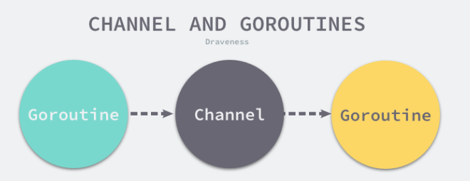
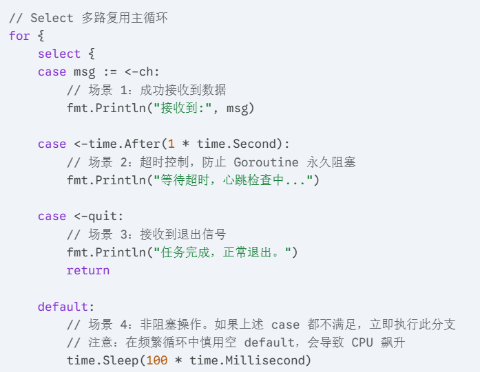
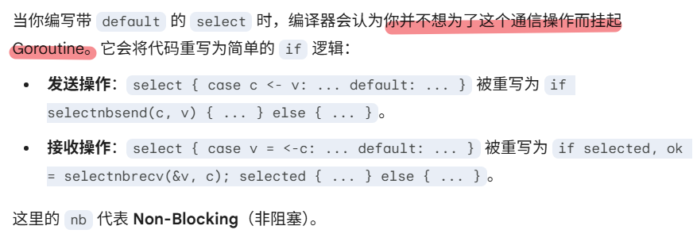

## `nil Channel` 与已关闭 Channel 对照表

| 场景                    | `nil Channel` | 已关闭 Channel            |
| --------------------- | ------------- | ---------------------- |
| 发送 `ch <- v`          | 永久阻塞          | 立即 panic               |
| 接收 `<-ch`             | 永久阻塞          | 先读完缓冲；随后立即得到零值         |
| 接收 `v, ok := <-ch`    | 永久阻塞          | 缓冲耗尽后：零值，`ok == false` |
| 关闭 `close(ch)`        | panic         | 再次关闭会 panic            |
| `range ch`            | 永久阻塞          | 读完缓冲后正常结束              |
| `len(ch)` / `cap(ch)` | 都是 0          | 容量不变，长度是未读缓冲元素数        |
| `select` 中的接收 case    | 永远禁用          | 永远就绪                   |
| `select` 中的发送 case    | 永远禁用          | 被选中后 panic             |
正常开放时,有人配对就正常返回,没人配对就阻塞。nil channel 就是传送带根本没装上,所以读写都只能一直等,不会 panic,只是永远没有对象能完成这次通信而已。已关闭的 channel 是传送带被正式封口:接收还能用来把剩余的数据取完,取完后立刻给零值和 false,但再发送就会 panic,因为关闭是在郑重承诺不再产生新值,这时再写就是违反约定,运行时用 panic 把错误直接暴露出来。

最好记的方法是四句话:“开放就正常配对,配不到就阻塞;nil 就不存在,只能等;**关闭还能读,读到结束为止;关闭不能写,一写就炸**。”通常也由发送方负责关闭,接收方只读并根据 ok 判断结束就行了。

## 1. 核心设计

Go 语言中最常见的、也是经常被人提及的设计模式就是：不要通过共享内存的方式进行通信，而是应该通过通信的方式共享内存。在很多主流的编程语言中，多个线程传递数据的方式一般都是共享内存，为了解决线程竞争，我们需要限制同一时间能够读写这些变量的线程数量，然而这与 Go 语言鼓励的设计并不相同。

虽然我们在 Go 语言中也能使用共享内存加互斥锁进行通信，但是 Go 语言提供了一种不同的并发模型——**通信顺序进程（Communicating sequential processes，CSP）**。Goroutine 和 Channel 分别对应 CSP 中的实体和传递信息的媒介，Goroutine 之间会通过 Channel 传递数据。



Channel的特性：
- **强类型安全**：编译期检查传递数据的类型。
- **同步与阻塞**：无缓冲管道提供强同步保证；有缓冲管道提供异步解耦能力。
- **先入先出 (FIFO)**：严格保证数据的入队与出队顺序，即便在高度并发的竞争下。
- **Happens-Before 保证**：Channel 的发送操作一定发生在对应的接收操作完成之前。

### 1. 先进先出
目前的 Channel 收发操作均遵循了先进先出的设计，具体规则如下：
- 先从 Channel 读取数据的 Goroutine 会先接收到数据；
- 先向 Channel 发送数据的 Goroutine 会得到先发送数据的权利；

FIFO 是 Channel 的核心语义，确保了并发环境下的公平性。在 Go 中，FIFO 体现在两个维度：**数据流向**与**协程唤醒顺序**。

## 二、数据结构

Go 语言的 Channel 在运行时使用 `runtime.hchan` 结构体表示 。我们在 Go 语言中创建新的 Channel 时，实际上创建的都是如下所示的结构 ：

> [!NOTE]  底层使用循环队列作为缓冲区

```go
type hchan struct {
    qcount   uint           // Channel 中的元素个数
    dataqsiz uint           // Channel 中的循环队列的长度
    buf      unsafe.Pointer // Channel 的缓冲区数据指针
    elemsize uint16         // 当前 Channel 能够收发的元素大小
    closed   uint32         // Channel 是否关闭的标志
    elemtype *_type         // 当前 Channel 能够收发的元素类型
    sendx    uint           // Channel 的发送操作处理到的位置
    recvx    uint           // Channel 的接收操作处理到的位置
    recvq    waitq          // 由于缓冲区空间不足而阻塞的接收 Goroutine 列表
    sendq    waitq          // 由于缓冲区空间不足而阻塞的发送 Goroutine 列表

    lock mutex              // 用于保护成员变量的互斥锁
    
    // --- Go 1.25+ 新增特性字段 ---
    bubble *synctest.bubble // 确定性测试（Synctest）关联的气泡环境
}
```

`runtime.hchan` 结构体中的五个字段 `qcount`、`dataqsiz`、`buf`、`sendx`、`recvx` 构建了底层的**循环队列** ：
- **`qcount`**：记录当前 Channel 中剩余的元素个数 ；
- **`dataqsiz`**：记录循环队列的长度，即 `make(chan int, 10)` 中的 10 ；
- **`buf`**：指向存储缓冲数据的连续内存空间的指针 ；
- **`sendx`** 与 **`recvx`**：记录发送和接收操作在循环队列中的索引位置 ；

除此之外，`sendq` 和 `recvq` 存储了当前 Channel 由于缓冲区空间不足而阻塞的 Goroutine 列表 。这些等待队列使用双向链表 `runtime.waitq` 表示，链表中所有的元素都是 `runtime.sudog` 结构 ：

```go
type waitq struct {
    first *sudog // 队列头部
    last  *sudog // 队列尾部
}
```

`runtime.sudog` 表示一个在等待列表中的 Goroutine，该结构中存储了两个分别指向前后 `runtime.sudog` 的指针以构成链表，并记录了待发送或接收数据的内存地址 。


在最新的 Go 版本中，`hchan` 的结构演进主要服务于**可观测性**与**测试确定性**：

1. `synctest.bubble` 的引入

这是近年 Go 运行时最大的变动之一。

- **剖析**：当开启 `GOEXPERIMENT=synctest` 时，Channel 会感知它所属的“气泡（Bubble）”。
- **作用**：在分布式系统模拟测试中，如果一个 Goroutine 在 Channel 上阻塞，运行时会通过 `bubble` 字段追踪此状态。当气泡内所有 Goroutine 都阻塞时，系统会自动推进虚拟时间，从而实现对超时、死锁等并发逻辑的秒级确定性测试，解决了传统测试难以复现竞态的问题。

2. Lock Rank (锁等级) 系统
虽然 `hchan` 中的 `lock` 字段定义未变，但在 `makechan` 初始化时，现在会显式注册锁等级。
- **剖析**：运行时内部维护了一套严格的加锁顺序表。
- **作用**：如果在复杂的逻辑中（如嵌套 Select 或跨 Channel 操作）出现了违反顺序的加锁行为，运行时会在开发阶段直接抛出异常，防止 PDF 第 3 页提到的“有锁队列”在临界区过大时产生不可察觉的死锁。

3. 对泛型（Generics）的完全适配

`elemtype` 现在指向的 `_type` 完美支持了动态生成的泛型实例。
- **剖析**：无论 Channel 的元素是具体的 `int` 还是泛型约束 `[T any]`，底层内存分配均已优化为根据泛型元数据进行精确计算，确保了类型安全性。

## 三、创建管道

在 Go 语言中，所有 Channel 的创建都会经过 `make` 关键字。编译器在编译阶段会将 `make(chan int, 10)` 表达式转换成 `OMAKE` 类型的节点，随后在类型检查和 SSA 中间代码生成阶段，根据参数的具体情况将其重写为对 `runtime.makechan` 或 `runtime.makechan64` 的调用。

`runtime.makechan64` 仅仅是一个简单的包装函数，它会**检查缓冲区大小是否超过了 `int` 类型的最大范围**，如果大小合法，则最终仍会调用核心函数 `runtime.makechan`。

下面我们结合最新的源码，逐步拆解 `runtime.makechan` 的执行流程：

### 1. 类型与对齐检查

```go
func makechan(t *chantype, size int) *hchan {
    elem := t.Elem

    // 编译器通常会检查，但运行时为了安全会再次校验元素大小
    if elem.Size_ >= 1<<16 {
        throw("makechan: invalid channel element type")
    }
    // 检查 hchan 结构体大小是否符合 8 字节对齐，且元素对齐要求不超限
    if hchanSize%maxAlign != 0 || elem.Align_ > maxAlign {
        throw("makechan: bad alignment")
    }
```

在函数开始处，运行时首先确保 Channel 存储的元素类型合法。`elem.Size_` 被限制在 $2^{16}$ 以内。同时，为了保证内存访问效率，系统要求 `hchan` 结构体及元素必须符合 8 字节（`maxAlign`）对齐规则。

### 2. 内存计算与溢出校验

```go    mem, overflow := math.MulUintptr(elem.Size_, uintptr(size))
    if overflow || mem > maxAlloc-hchanSize || size < 0 {
        panic(plainError("makechan: size out of range"))
    }
```

这里使用了最新的 `math.MulUintptr` 函数来计算缓冲区所需的总内存 `mem`。这相比于旧版本的简单乘法，能更安全地检测 `uintptr` 溢出。如果计算结果溢出、超过最大分配限制或 `size` 为负数，程序将直接触发 Panic。

### 3. 内存分配策略（核心逻辑）

这是 `makechan` 最关键的部分，根据 Channel 是否带缓冲区以及元素是否包含指针，采用了三种不同的分配方案：

```go    var c *hchan
    switch {
    case mem == 0:
        // 情况一：无缓冲 Channel 或元素大小为 0（如 struct{}）
        c = (*hchan)(mallocgc(hchanSize, nil, true))
        // 竞态检测器使用该位置进行同步
        c.buf = c.raceaddr()
    case !elem.Pointers():
        // 情况二：元素不包含指针（如 int, float, bool）
        // 在一次 malloc 调用中同时分配 hchan 头部和缓冲区
        c = (*hchan)(mallocgc(hchanSize+mem, nil, true))
        c.buf = add(unsafe.Pointer(c), hchanSize)
    default:
        // 情况三：元素包含指针（如 string, slice, map, pointer）
        // 必须分开分配，以方便 GC 扫描缓冲区中的指针
        c = new(hchan)
        c.buf = mallocgc(mem, elem, true)
    }
```

- **情况一**：如果 `mem == 0`，意味着这是同步 Channel（`make(chan T)`）或者 Channel 的元素类型不占用空间（如 `struct{}`）。此时只需分配 `hchan` 结构体本身。
- **情况二**：如果元素类型不含指针，为了极致的性能优化，运行时会将 `hchan` 头部和整个缓冲区 `buf` 分配在一块**连续内存**中。这样做可以显著减少垃圾回收（GC）的扫描压力，并提高 CPU 缓存行命中率。
- **情况三**：如果元素类型包含指针，`hchan` 结构体和缓冲区则会被**分开分配**。这是因为缓冲区 `buf` 需要根据 `elem` 类型信息进行垃圾回收扫描，而 `hchan` 结构体本身是由运行时内部管理的。

### 4. 字段初始化与新特性注入

```go    c.elemsize = uint16(elem.Size_)
    c.elemtype = elem
    c.dataqsiz = uint(size)

    // 注入 synctestBubble 特性
    if b := getg().bubble; b != nil {
        c.bubble = b
    }
    // 初始化互斥锁并分配锁等级
    lockInit(&c.lock, lockRankHchan)

    return c
}
```

最后，函数初始化 `hchan` 的基本字段。值得注意的是最新版本引入的两个重要变化：
1. **`synctest.bubble` 绑定**：它通过 `getg().bubble` 检查当前 Goroutine 是否处于一个“测试气泡”中。如果是，则将该气泡上下文注入 Channel。这使得在编写并发测试时，可以实现确定性的调度和死锁检测。
2. **`lockRankHchan` 锁等级**：调用 `lockInit` 时指定了锁的等级。这是运行时死锁检测系统的一部分，用于确保多个锁在被持有时遵循严格的层级顺序，从而在开发阶段就能捕获复杂的死锁问题。


在最新版本的 `makechan` 中，我们可以观察到两个明显的技术演进方向：

1. 确定性并发模拟 (Synctest Bubbles)
新引入的 `bubble` 字段允许 Channel 挂钩到确定性测试框架中。在传统的 Go 测试中，由于 Goroutine 的调度具有随机性，竞态和死锁往往难以稳定复现。通过 `bubble` 特性，运行时可以在一个隔离的“气泡”环境中接管时间推进和信号分发。如果一个气泡内的所有 Goroutine 都阻塞在带有相同 `bubble` 标记的 Channel 上，系统可以精准地判定是否存在逻辑死锁，或者自动步进虚拟时间来触发超时。

2. 基于锁等级的防御性编程
`lockInit(&c.lock, lockRankHchan)` 的出现标志着 Go 运行时锁管理机制的成熟。通过给 Channel 的互斥锁分配特定的 `lockRank`，运行时可以实时监控加锁链路。例如，如果代码尝试在持有一个高等级锁的同时去获取 Channel 锁（低等级），检测器会立即报错。这为底层高并发代码的正确性提供了强有力的工具链支持。


通过对 `makechan` 源码的深入分析，我们可以总结出 Go 管道设计的核心哲学：

1. **内存局部性优先**：在 `!elem.Pointers()` 情况下将头部与数据区合并分配，体现了对硬件缓存的高效利用。这种“紧凑布局”减少了指针跳转，直接提升了数据传输性能。
2. **安全胜过一切**：通过 `math.MulUintptr` 和详尽的对齐、溢出检查，运行时在分配内存的第一步就拦截了所有可能的底层攻击或错误。
3. **对测试友好**：将 `synctest` 逻辑深度集成到数据结构初始化中，说明 Go 团队认为“可测试性”是核心数据结构设计时必须考虑的一等公民。
4. **职责明确的分配方案**：根据元素是否含指针选择不同的 `mallocgc` 策略，精准平衡了垃圾回收扫描效率与运行时内存布局的灵活性。

## 四、发送数据

当我们在 Go 代码中编写 `ch <- i` 时，编译器会将其解析为 `OSEND` 节点。在最新的编译器实现中，这一操作最终会演变为对 `runtime.chansend1` 的调用，并进一步进入核心函数 `runtime.chansend`。发送数据的过程是并发编程中最精妙的逻辑之一，它需要在性能（无锁快速路径）与正确性（复杂的阻塞唤醒）之间取得完美平衡。

### 1. 预检与确定性环境检查

在正式操作前，运行时首先处理零值 Channel 并校验测试环境：
```go
func chansend(c *hchan, ep unsafe.Pointer, block bool, callerpc uintptr) bool {
	//如果管道为nil
    if c == nil {
        if !block { return false }
        // 阻塞发送到 nil channel 会永久挂起
        gopark(nil, nil, waitReasonChanSendNilChan, traceBlockForever, 2)
        throw("unreachable")
    }

    // --- 新特性：Synctest 隔离检查 ---
    if c.bubble != nil && getg().bubble != c.bubble {
        fatal("send on synctest channel from outside bubble")
    }
```
在函数的入口处，都会首先检查 Channel 是否为 `nil`。
如果检测到 `c == nil`，逻辑如下：
- **非阻塞调用**（如带有 `default` 的 `select`）：函数会立即返回 `false`。
- **标准阻塞调用**：运行时会直接调用 `gopark` 函数。

正常情况下，当一个 Channel 阻塞时，运行时会创建一个 `sudog` 结构，并将其放入 `hchan` 结构体中的 `sendq` 或 `recvq` 队列中，等待被其他协程唤醒 。

然而，因为 Channel 是 `nil`，**底层的 `hchan` 结构体根本不存在** 。
- 没有 `hchan`，就没有存储等待者（Waiters）的队列。
- 既然没有地方存放你的“唤醒证”（`sudog`），那么任何其他的 Goroutine 都无法在内存中找到你，更不可能调用 `goready` 来重新唤醒你 。

在 `gopark` 调用中，传入的参数是 `nil, nil`，且等待原因是 `waitReasonChanSendNilChan`（发送给空管道）。
- `gopark` 的作用是将当前 Goroutine 的状态从 `_Grunning` 改为 `_Gwaiting`，并将其从处理器的运行队列中移除。
- 由于没有锁（Mutex）可以解锁，也没有回调函数可以触发，这个协程就像是被关进了一个没有门窗的房间，而钥匙（唤醒逻辑）从未被制造出来。

最新的 **Synctest** 特性在此处强制执行了“气泡隔离”：如果 Channel 属于某个测试气泡，但发送者不在该气泡内，系统会立即抛出致命错误，防止跨环境的非确定性干扰。

### 2. Fast Path：无锁快速失败
为了提升性能，Go 实现了一个无需获取锁的快速路径，用于处理非阻塞发送（如 `select` 中的 `default`）：

```go    if !block && c.closed == 0 && full(c) {
        return false
    }
```

**分析**：这里利用了原子读取的顺序性。如果 Channel **没关且已满**，直接返回 `false`。这种设计避免了高并发下频繁争抢 `hchan.lock` 带来的开销。

### 3. 直接发送（Direct Handoff）

如果此时已经有接收者在等待（`recvq` 不为空），则直接将数据“递”给对方，这是效率最高的情况：

```go    lock(&c.lock) // 进入临界区
	
	//在持有锁的第一时间，必须校验 Channel 是否已被关闭。
	//如果不在这里检查，后续可能会将数据误发给一个
	//已经停止工作的 Channel，导致数据一致性崩溃
    if c.closed != 0 {
        unlock(&c.lock)
        panic(plainError("send on closed channel"))
    }

	//尝试从等待接收的队列头部取出一个 Goroutine。
	//如果 `sg != nil`，说明正好有一个接收者蹲在门口“张着嘴”等数据。
    if sg := c.recvq.dequeue(); sg != nil {
        // 找到等待中的接收者，越过缓冲区直接拷贝数据
        send(c, sg, ep, func() { unlock(&c.lock) }, 3)
        return true
    }
```
上锁是因为`hchan` 结构体中的 `qcount`、`sendx`、`recvq` 等字段在并发环境下必须是原子操作的。通过获取这把互斥锁，确保同一时刻**只有一个 Goroutine 能修改这个 Channel 的状态**。这把锁在初始化时被分配了 `lockRankHchan`。这是运行时为了防止多个锁之间产生死锁而设立的层级保护机制。

如果找到了接收者，就会调用这个底层的 `send` 函数。
- **越过缓冲区**：即使是带缓冲的 Channel，只要有人在等，数据就会**绕过缓冲区**，直接从发送方的栈拷贝到接收方的栈（通过 `sendDirect` 实现）。
- **性能优化**：这种做法避免了“数据先入缓存，接收者再从缓存拿”的两次拷贝过程，极大降低了内存延迟。
- **闭包解锁**：注意传入的 `func() { unlock(&c.lock) }`。`send` 函数会在数据完成拷贝、唤醒接收者（通过 `goready`）的过程中，在最合适的时机释放这把锁，以最大化并发效率。

> [!NOTE]  为什么先检查 `recvq` 而不是 `buf`？
> 这是 Go 调度器的一个核心哲学：**尽快满足等待者**。 
> 
> 如果一个协程已经在阻塞等待了，说明系统当前的吞吐量受限于接收速度。通过“直接交付”，发送方不仅完成了任务，还瞬间让一个处于休眠状态的接收者具备了继续执行的条件（Runnable 状态）。
> 
> 这种设计减少了数据在内存中的停留时间，也减少了调度器的轮询次数。
### 4. 缓冲区入队
如果**没人在等**，但**缓冲区还有空间**，则将数据放入循环队列：
```go    if c.qcount < c.dataqsiz {
        qp := chanbuf(c, c.sendx) // 计算缓冲区索引地址
        typedmemmove(c.elemtype, qp, ep) // 内存拷贝
        c.sendx++
        if c.sendx == c.dataqsiz { c.sendx = 0 } // 环形回归
        c.qcount++
        unlock(&c.lock)
        return true
    }
```

**分析**：这是典型的生产者模型逻辑。通过 `typedmemmove` 确保类型安全地将数据从当前栈拷贝到 `hchan` 的 `buf` 指向的堆内存中。

- **内存复用**：通过循环数组（Circular Buffer）的设计，Go 实现了内存的闭环复用。只要仓库不满，你就可以一直转圈存放，无需频繁申请或释放内存 。
- **解耦与缓冲**：缓冲区起到了“蓄水池”的作用。它允许发送方（生产者）在接收方（消费者）还没空处理时先忙完自己的事，从而平滑处理瞬时流量高峰。
- **零 GC 干扰**：使用 `typedmemmove` 表明 Go 对内存安全有着偏执的追求。即便是在这种追求性能的底层路径，依然要确保每一条数据的移动都处于 GC 的严密监控下 。

### 5. 阻塞与挂起（阻塞发送的核心）

当上述条件都不满足时，发送者必须进入等待队列并交出 CPU 执行权：

```go    gp := getg()//获取当前正在执行的 Goroutine 指针
    mysg := acquireSudog() // 获取并打包 sudog
    ////将要发送的数据地址 `ep` 保存到 `sudog` 中 。
    //注意：这里只存指针，实际数据还在你的栈上，直到被别人取走
    mysg.elem.set(ep)
    mysg.g = gp // Goroutine和Channel建立双向绑定
    mysg.c.set(c) // Goroutine和Channel建立双向绑定
    gp.waiting = mysg //在 Goroutine 结构体上记录它正在等待的任务，这主要用于垃圾回收（GC）期间的栈追踪 。
    c.sendq.enqueue(mysg) //将打包好的 `sudog` 加入到 Channel 的发送等待队列尾部

    // --- 新特性：栈伸缩安全与 Synctest 状态 ---
    gp.parkingOnChan.Store(true) //为当前 Goroutine 挂起一个“正在停车”的标志 。
    reason := waitReasonChanSend
    if c.bubble != nil {
        reason = waitReasonSynctestChanSend
    }
    gopark(chanparkcommit, unsafe.Pointer(&c.lock), reason, traceBlockChanSend, 2)
```

**分析**：这里是变动最大的地方。`parkingOnChan.Store(true)` 告诉垃圾回收器，这个 Goroutine 正在准备挂起，此时不要尝试伸缩（Shrink）它的栈。同时，`gopark` 传入了一个回调 `chanparkcommit`，它会在 Goroutine 真正挂起后才释放锁，确保了状态切换的原子性。

> [!NOTE]  Go 的协程栈是可以动态收缩（Shrink）
> 如果你正准备休眠，而 GC 此时尝试收缩你的栈，可能会导致 `mysg.elem` 指向的地址失效。
> 
> 通过`parkingOnChan.Store(true)`，设置此标志后，任何想要操作该协程栈的第三方（如 GC）都必须先获取 Channel 的锁，从而确保了在挂起过程中的**内存绝对安全** 。

最后一步`gopark`是真正的“交出 CPU”。
- **`chanparkcommit` 动作**：这是一个回调函数。它会在当前 Goroutine 停止运行、状态改为 `_Gwaiting` 之后，在另一个系统线程上执行 。它的核心任务是调用 `unlock(&c.lock)` 释放 Channel 锁 。
- **为什么不直接解锁？**：如果在 `gopark` 前解锁，可能出现“还没睡着就被别人唤醒”的竞态条件。通过 `chanparkcommit` 延迟解锁，保证了**“先挂起，再释放锁”**的原子性语义 。

### 🚀 新特性深度剖析

在 Go 1.25/1.26 的源码中，我们可以看到针对现代高并发场景的几项重大改进：

1. **栈伸缩安全增强 (`parkingOnChan` & `activeStackChans`)**： 在旧版本中，当一个 Goroutine 正在把自己放入 Channel 等待队列时，如果此时发生 GC 触发栈伸缩，可能会导致指针失效。最新的代码引入了 `parkingOnChan` 原子变量。在 `chanparkcommit` 执行期间，它会设置 `activeStackChans = true`。这像是一个动态的“施工标志”，强制 GC 必须先获取 Channel 锁才能处理该 Goroutine 的栈，彻底解决了深层次的内存安全隐患。
2. **虚拟时间推进 (`waitReasonSynctestChanSend`)**： 如果 Channel 开启了 **Synctest**，阻塞的原因会标记为 `SynctestChanSend`。这不仅仅是一个标签，它允许调度器感知到：如果当前测试气泡内所有活跃的协程都阻塞了，说明可以安全地“拨快”虚拟时钟，从而瞬间触发原本需要等待数秒的 `time.After` 逻辑。

---

### 💡 凝练设计思想

发送数据的逻辑体现了 Go 团队对**“通信优于共享”**理念的工业级实现：

- **极简的 FIFO 原则**：无论是直接发送还是入队，都严格遵循先来后到的公平性。
- **内存拷贝的最小化**：通过 `sendDirect` 实现栈到栈的直连，最大限度减少了对内存总线的压力。
- **防御式锁设计**：虽然 `hchan` 是有锁的，但通过 Fast Path 和 `chanparkcommit` 的精妙配合，锁的持有时间被压缩到了极致。
- **静态与动态的结合**：编译器负责生成的 `chansend1` 提供了静态的调用契约，而运行时的 `sudog` 结构体则通过复用池（`acquireSudog`）提供了高效的动态阻塞管理。

> [!IMPORTANT]  发送逻辑的成功，本质上是让复杂的线程间通信在用户态通过简单的内存拷贝和协程调度逻辑得以实现。

## 五、接收数据

在 Go 语言中，从 Channel 接收数据通常有两种形式：单值接收 `v := <-ch` 或双值接收 `v, ok := <-ch`。

在编译器底层，这两种写法分别对应 `runtime.chanrecv1` 和 `runtime.chanrecv2`，而它们最终都会调用核心处理函数 `runtime.chanrecv`。

接收数据的逻辑与发送逻辑高度对称，其本质是处理“谁先到达”的问题：是接收者先到（发现 Channel 为空），还是发送者先到（数据已在缓冲区或发送队列中等待）。


我们将根据最新的 `runtime/chan.go` 源码，深度拆解接收操作的执行序列。

#### 1. 空管道与测试隔离预检

```go
func chanrecv(c *hchan, ep unsafe.Pointer, block bool) (selected, received bool) {
    if c == nil {
        if !block { return }
        // 阻塞接收 nil channel 会导致永久挂起
        gopark(nil, nil, waitReasonChanReceiveNilChan, traceBlockForever, 2)
        throw("unreachable")
    }

    // --- 新特性：测试气泡（Synctest）安全检查 ---
    if c.bubble != nil && getg().bubble != c.bubble {
        fatal("receive on synctest channel from outside bubble")
    }
```

**分析**：首先处理异常情况。如果 Channel 是 `nil` 且为阻塞接收，协程将直接挂起且永远不会被唤醒。值得注意的是最新的 **Synctest** 检查：如果 Channel 属于某个测试气泡，但接收协程不在其中，运行时会抛出致命错误。这确保了确定性测试环境下，外部并发干扰不会破坏测试结果。

#### 2. 快速路径：无锁预检优化

为了减少锁竞争，Go 针对非阻塞接收（如 `select` 中的 `default` 模式）提供了一个极致的优化路径：

```go    if !block && empty(c) {
        if atomic.Load(&c.closed) == 0 {
            return // Channel 未关且为空，直接返回
        }
        // 二次确认：处理在检查 empty 和 closed 瞬间发生的并发发送
        if empty(c) {
            if ep != nil { typedmemclr(c.elemtype, ep) } // 管道已关且为空，清理目标内存并返回
            return true, false
        }
    }
```

**分析**：这一步通过原子操作检查 Channel 是否为空且未关闭。如果条件成立，说明当前接收不可能成功，直接返回而不必去抢那把昂贵的 `hchan.lock`。

#### 3. 临境区检查与关闭处理

当程序决定继续执行时，会进入加锁的临界区：

```go    lock(&c.lock)

    if c.closed != 0 {
        if c.qcount == 0 {
            unlock(&c.lock)
            if ep != nil { typedmemclr(c.elemtype, ep) } // 管道已关且无残留数据，返回零值
            return true, false
        }
        // 注意：即使管道关闭，若缓冲区还有数据，仍需优先读取数据
    }
```

**分析**：如果 Channel 已经关闭，且缓冲区内没有数据，接收方会获得该类型的零值，且 `received` 标志（即 `ok`）为 `false`。

#### 4. 直接接收：唤醒等待的发送者

如果发送队列 `sendq` 不为空，说明当前 Channel 处于“供过于求”或“同步对接”状态：

```go    if sg := c.sendq.dequeue(); sg != nil {
        // 发现等待的发送者，调用 recv 函数
        recv(c, sg, ep, func() { unlock(&c.lock) }, 3)
        return true, true
    }
```

**分析**：这是最精彩的路径。在 `recv` 函数内部，有两种处理方式：

- **无缓冲 Channel**：直接通过 `recvDirect` 从发送者的栈拷贝数据到接收者的栈。
- **带缓冲且已满**：先从缓冲区头部（`recvx`）取走数据给接收者，再将发送者队列头的数据存入缓冲区尾部。这样做既满足了接收者，也释放了一个发送者。

#### 5. 缓冲区读取

如果没人等着发数据，但缓冲区里有存货：

```go    if c.qcount > 0 {
        qp := chanbuf(c, c.recvx) // 定位缓冲区数据地址
        if ep != nil { typedmemmove(c.elemtype, ep, qp) } // 拷贝到接收者
        typedmemclr(c.elemtype, qp) // 清理掉缓冲区旧数据
        c.recvx++
        if c.recvx == c.dataqsiz { c.recvx = 0 } // 环形索引回归
        c.qcount--
        unlock(&c.lock)
        return true, true
    }
```

**分析**：标准的 FIFO 逻辑。数据从缓冲区被搬移到接收方的目标地址，并相应地更新 Channel 的计数器和索引。

#### 6. 阻塞挂起：进入休眠状态

如果既没数据发，缓冲区也空了，接收者只能原地等待：

```go    gp := getg()
    mysg := acquireSudog()
    mysg.elem.set(ep)
    c.recvq.enqueue(mysg) // 将自己放入接收等待队列

    // --- 新特性：状态标记与测试集成 ---
    gp.parkingOnChan.Store(true) 
    reason := waitReasonChanReceive
    if c.bubble != nil {
        reason = waitReasonSynctestChanReceive
    }
    gopark(chanparkcommit, unsafe.Pointer(&c.lock), reason, traceBlockChanRecv, 2)
```

**分析**：接收方创建一个 `sudog` 代理自己，存入 `recvq`。随后调用 `gopark` 让出执行权。在挂起前，`parkingOnChan` 原子变量被设为 `true`，防止 GC 在此时移动栈。如果是 **Synctest** 环境，阻塞原因被设为特定值，以便测试框架自动推进时间。

---

### 🚀 最新特性深度剖析

1. **确定性测试（Synctest Bubbles）的闭环**：
    在 `chanrecv` 中，`bubble` 字段的检查确保了并发逻辑的物理隔离。当一个气泡内的 Goroutine 在 Channel 上阻塞时，其原因被标记为 `waitReasonSynctestChanReceive`。这意味着在测试环境中，我们不再需要真实的 `time.Sleep`。当调度器发现所有协程都因为等待 Channel 或时间而阻塞时，它会瞬间推进“虚拟时钟”，使得原本需要几秒的通信逻辑在毫秒内完成测试。
2. **栈操作的极致安全（Parking On Chan）**：
    最新版本强化了 `gp.parkingOnChan` 的使用。在 Goroutine 挂起的短暂窗口期内，如果发生栈扩缩容，可能会导致 `ep` 指针失效。通过原子存储状态并配合 `chanparkcommit` 回调解锁，Go 运行时确保了在整个状态转换期间，任何尝试修改栈的第三方（如扫描器）都必须与 Channel 锁同步。

---

### 💡 凝练设计思想

- **双重保障的“零值”语义**：在 Channel 关闭后且无残留数据时返回零值，并配合 `received` 标志。这种设计允许开发者通过 `if v, ok := <-ch; !ok` 优雅地检测上游生产者的生命周期，而不必担心程序 Panic。
- **同步与异步的和谐统一**：无论是直接从发送方拿数据，还是从缓冲区拿数据，对于接收方的 API 调用者来说都是透明的。底层的 `recv` 函数巧妙地封装了这两者之间的差异，保证了极致的性能。
- **资源的高效复用**：通过 `acquireSudog` 复用池和 `typedmemclr` 及时清理内存，反映了 Go 运行时在处理海量并发连接时，对内存碎片和垃圾回收压力的高度警惕。

接收数据的核心逻辑体现了 Go 的理念：**通过严谨的状态机转换（Empty -> Data -> Wait），将复杂的异步交互收敛为简单可靠的同步操作。**

## 六、关闭管道

关闭管道是一个看似简单、实则充满风险的操作。在 Go 语言中，关闭操作由内置关键字 `close` 触发，编译器将其转换为对 `runtime.closechan` 函数的调用。关闭管道不仅是改变一个状态位，更是一次涉及所有相关协程（Goroutine）的状态“大清算”。

结合最新的 `chan.go` 源码，我们将深入分析关闭管道时发生的每一行逻辑。

#### 1. 边界检查与测试环境隔离

在真正动刀之前，运行时必须确保操作的合法性：

```go
func closechan(c *hchan) {
    if c == nil {
        panic(plainError("close of nil channel"))
    }
    
    // --- 新特性：Synctest 隔离性校验 ---
    if c.bubble != nil && getg().bubble != c.bubble {
        fatal("close of synctest channel from outside bubble")
    }
```

**分析**：
- **Nil 检查**：关闭一个 `nil` 管道会立即触发 Panic。
- **隔离校验**：这是最新版本引入的强约束。如果管道属于一个特定的测试气泡（Synctest Bubble），那么发起关闭操作的协程必须也处于同一个气泡内。这种“圈地管理”防止了非确定性测试环境中的非法资源释放。

#### 2. 加锁与状态切换

```go    lock(&c.lock)
    if c.closed != 0 {
        unlock(&c.lock)
        panic(plainError("close of closed channel"))
    }

    c.closed = 1
```

**分析**：
- **二次关闭异常**：重复关闭同一个管道会引发 Panic。
- **原子置位**：在锁的保护下，将 `closed` 字段设为 1。这一步是整个操作的临界点：一旦置位，后续所有的 `send` 操作都会立即 Panic，而所有的 `recv` 操作将准备接收零值。

#### 3. 清算接收者队列（recvq）

管道关闭后，所有还在等待数据的接收者都必须被唤醒：

```go    var glist gList
    for {
        sg := c.recvq.dequeue() // 从等待接收队列取出 sudog
        if sg == nil {
            break
        }
        if sg.elem.get() != nil {
            typedmemclr(c.elemtype, sg.elem.get()) // 清理掉目标内存中的残留
            sg.elem.set(nil)
        }
        gp := sg.g
        gp.param = unsafe.Pointer(sg)
        sg.success = false // 标记为接收失败（意味着拿到的是零值）
        glist.push(gp) // 加入待唤醒列表
    }
```

**分析**：运行时遍历 `recvq`，将每一个等待的协程都标记为 `success = false`。这意味着当这些协程醒来时，它们能通过第二个返回值 `ok` 知道管道已经关闭。

#### 4. 清算发送者队列（sendq）

这通常是由于逻辑设计不当导致的情况——管道关闭时竟然还有人在尝试发送：

```go    for {
        sg := c.sendq.dequeue() // 从等待发送队列取出 sudog
        if sg == nil {
            break
        }
        sg.elem.set(nil)
        gp := sg.g
        gp.param = unsafe.Pointer(sg)
        sg.success = false // 标记为发送失败
        glist.push(gp)
    }
```

**分析**：同样将这些发送者加入唤醒列表。**注意**：这些发送者醒来后，由于检测到管道已关闭，会直接触发 Panic。

#### 5. 集中唤醒

```go    unlock(&c.lock) // 释放管道锁

    // 统一触发调度，将所有受影响的协程设为可运行状态
    for !glist.empty() {
        gp := glist.pop()
        gp.schedlink = 0
        goready(gp, 3)
    }
}
```

**分析**：为了减小锁的粒度，运行时先释放 `hchan.lock`，然后再通过 `goready` 逐个唤醒 `glist` 中的协程。这是一个非常成熟的并发优化策略：避免在持有锁的情况下执行耗时的调度操作。

---

### 🚀 最新特性深度剖析

1. **测试气泡的物理隔离 (Synctest Fatal)**：
    最新版本的 `closechan` 不再仅仅依赖逻辑检查，而是引入了 `fatal` 级别的气泡检查。这背后的思考是：在复杂的分布式或微服务模拟测试中，管道关闭往往标志着一个生命周期的结束。如果跨越了气泡边界进行关闭，说明代码存在严重的并发所有权混乱。这种直接抛出致命错误的做法，能强迫开发者在开发阶段就理清资源的所有权。
    
2. **调度链表的批处理 (gList)**：
    现代 Go 运行时在处理大量唤醒任务时，通过 `gList` 这种简单的单链表结构进行批处理。这种方式避免了在循环中多次触碰全局调度锁，提高了在大规模并发管道关闭时的系统稳定性。
    

---

### 💡 凝练设计思想

- **不对称性哲学**：为什么关闭后接收者拿零值，而发送者要 Panic？
    - 因为接收者是“被动”的，它需要知道上游何时结束；而发送者是“主动”的，向一个已关闭的管道发送数据，本质上是严重的程序逻辑错误。这种“厚此薄彼”的设计极大地保护了数据的完整性。

- **状态的单向性**：管道的 `closed` 状态是不可逆的。一旦关闭，永不重启。这种简化的状态机极大地降低了运行时维护的复杂度和出错概率。

- **锁的极简持有周期**：通过 `gList` 缓存待唤醒协程，将“状态修改”与“协程唤醒”在时间上解耦，确保了管道锁的持有时间尽可能的短。

通过这一系列的解析，你应该能体会到，管道的关闭不仅仅是一个操作，它是一场经过严密组织的、旨在维持系统最终一致性的“葬礼”。


## 七、Channel 使用指南

### 1. 基础操作与声明

Channel 必须使用 `make` 函数初始化后才能使用，否则其零值为 `nil` 。

| **操作**     | **语法**                      | **说明**                      |
| ---------- | --------------------------- | --------------------------- |
| **声明并初始化** | `ch := make(chan int, cap)` | `cap=0` 为无缓冲，`cap>0` 为有缓冲 。 |
| **发送数据**   | `ch <- data`                | 将数据写入管道 。                   |
| **接收数据**   | `val,ok := <-ch`            | 从管道读取数据 。                   |
| **关闭管道**   | `close(ch)`                 | 告知接收方不再有新数据发送 。             |
| **单向声明**   | `chan<- int` / `<-chan int` | 仅发送 / 仅接收，常用于函数参数约束。        |

### 2. 无缓冲 vs. 有缓冲
- **无缓冲 (Unbuffered)**：发送者与接收者必须同时准备好，否则会阻塞，体现了“强同步”语义 。
- **有缓冲 (Buffered)**：只要缓冲区未满，发送方就不会阻塞；只要缓冲区不空，接收方就不会阻塞 。

### 3. 进阶用法模式

#### A. 使用 range 优雅循环

`range` 会不断从 Channel 接收数据，直到管道被 `close`。

```go
for val := range ch {
    // 处理 val
}
```

#### B. Select 多路复用
`select` 允许 Goroutine 等待多个通信操作。
- **非阻塞读写**：通过 `default` 分支实现 。
- **超时控制**：结合 `time.After` 避免永久阻塞。


1. 伪随机选择：如果同时有多个 `case` 准备好了（例如 `ch` 有数据且 `quit` 也有信号），`select` 会**随机**选择一个执行。这种设计是为了防止“饥饿”现象。如果没有随机性，第一个 `case` 可能会永远优先执行，导致后面的任务得不到处理。
2. 非阻塞实现的真相：编译器会将带有 `default` 分支的 `select` 转换为对 `selectnbsend` 或 `selectnbrecv` 的调用。这两者本质上是调用 `chansend` 或 `chanrecv` 并将 `block` 参数设为 `false`。这意味着它们会尝试获取锁，如果发现 Channel 没准备好，会立即释放锁并返回 `false`，而不是挂起 Goroutine。


3. selectDone 原子操作：在 `chan.go` 的 `dequeue` 逻辑中，如果一个 Goroutine 因为 `select` 被唤醒，会有一个 `sgp.g.selectDone.CompareAndSwap(0, 1)` 的操作。这确保了即便该 Goroutine 正在多个 Channel 的等待队列中，也只有一个 Channel 的操作会最终成功。一旦 CAS 成功，它就会从其他 Channel 的等待队列中移除。

开发注意事项：
- **Nil Channel 陷阱**：在一个 `select` 中，如果某个 `case` 的 Channel 是 `nil`，那么这个 `case` 永远不会被选中。你可以利用这一点，通过将 Channel 置为 `nil` 来动态地“禁用”某个 `case`。
- **死锁预防**：如果没有任何 `case` 准备好且没有 `default`，`select` 将会导致当前 Goroutine 进入阻塞状态。
- **Synctest 适配**：在最新的 Go 1.26 测试环境中，如果你在 `synctest.Run` 中使用 `select` 配合 `time.After`，测试框架会自动感知阻塞并推进虚拟时间，不再需要等待真实的物理时间。

#### C. 确定性测试 (Go 1.25+ 新特性)

正如你在 `chan.go` 源码中看到的 `bubble` 字段，现在可以使用 `synctest` 包来测试 Channel 逻辑。
- **用法**：在测试中使用 `synctest.Run` 运行代码块。
- **优势**：当 Channel 阻塞时，框架会自动推进虚拟时间，无需使用真实的 `time.Sleep`。

### 4. 异常行为

在开发中，Channel 的异常行为是最高频的考点。请务必记住下表：

| **场景**               | **状态** | **行为**                              |
| -------------------- | ------ | ----------------------------------- |
| **向 nil channel 发送** | 未初始化   | **永久阻塞**                            |
| **从 nil channel 接收** | 未初始化   | **永久阻塞**                            |
| **向已关闭 channel 发送**  | 已关闭    | **Panic** (send on closed channel)  |
| **再次关闭已关闭 channel**  | 已关闭    | **Panic** (close of closed channel) |
| **关闭 nil channel**   | 未初始化   | **Panic** (close of nil channel)    |
| **从已关闭 channel 接收**  | 已关闭    | 返回零值，且第二个参数 `ok` 为 `false`          |

### 5. 设计原则与避坑建议
- **谁发送，谁关闭**：通常由发送方负责关闭管道，防止接收方读取到不完整的逻辑，也避免发送方触发 Panic。
- **不要通信通过共享内存**：优先考虑通过 Channel 传递数据所有权，而不是加锁保护全局变量 。
- **防止 Goroutine 泄露**：如果发送方阻塞在没有接收者的 Channel 上，该 Goroutine 将永远无法退出。
- **Channel 长度检查**：`len(ch)` 只能获取瞬时长度，在并发环境下作为逻辑判断依据通常是不安全的。

---

**既然你在做 CineSync 的后端架构设计，需要我为你提供一个基于 `select` 和 `context` 的标准“生产者-消费者”并发控制模版吗？**