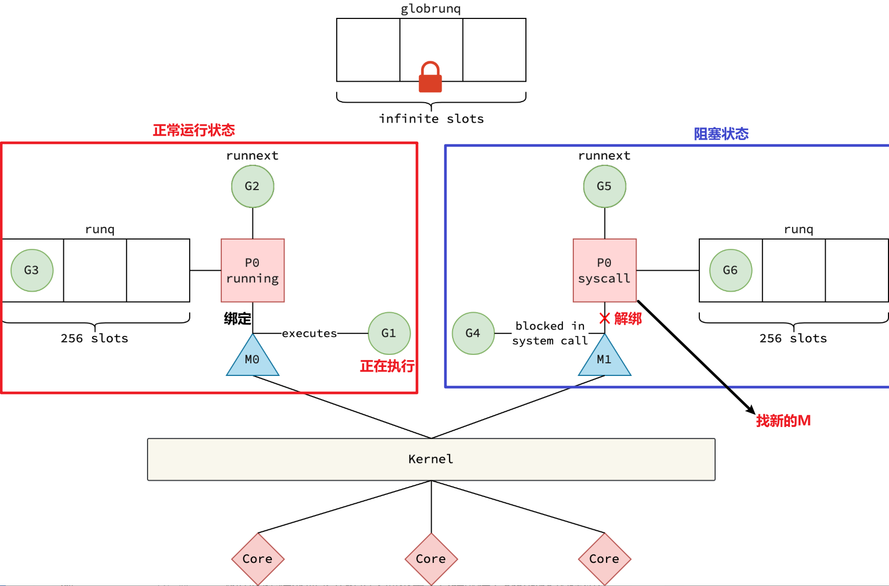
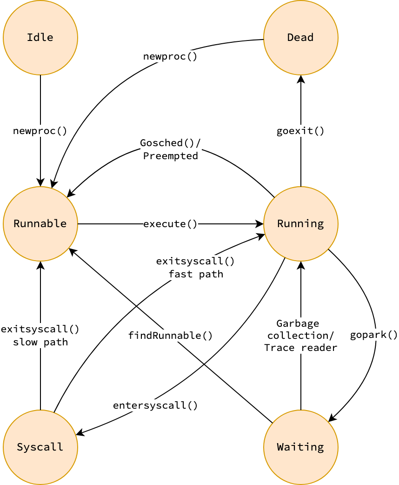
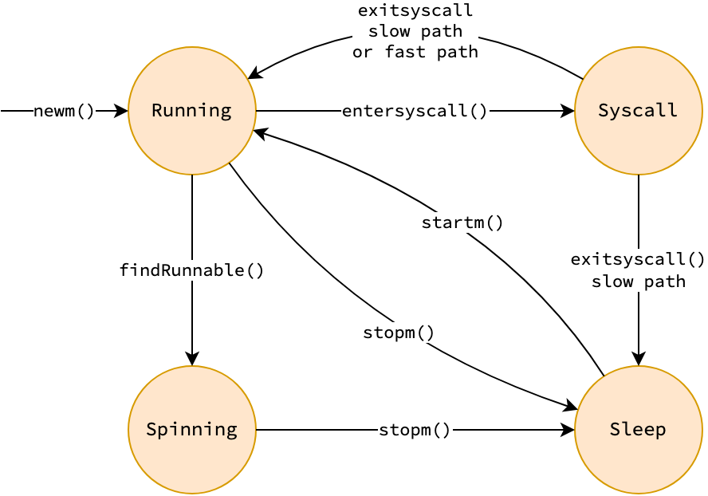
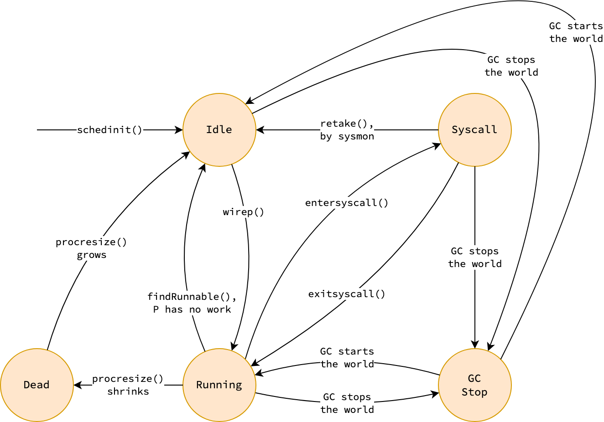
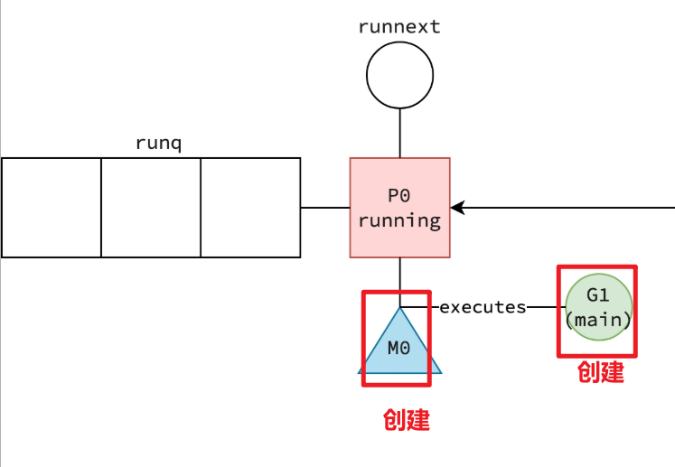
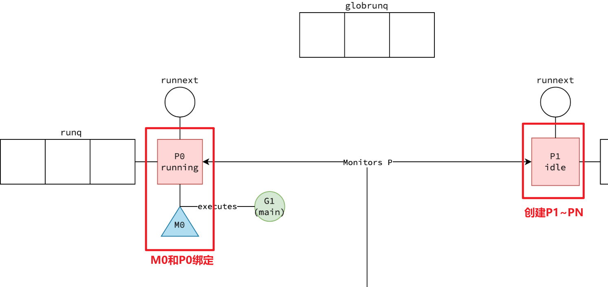
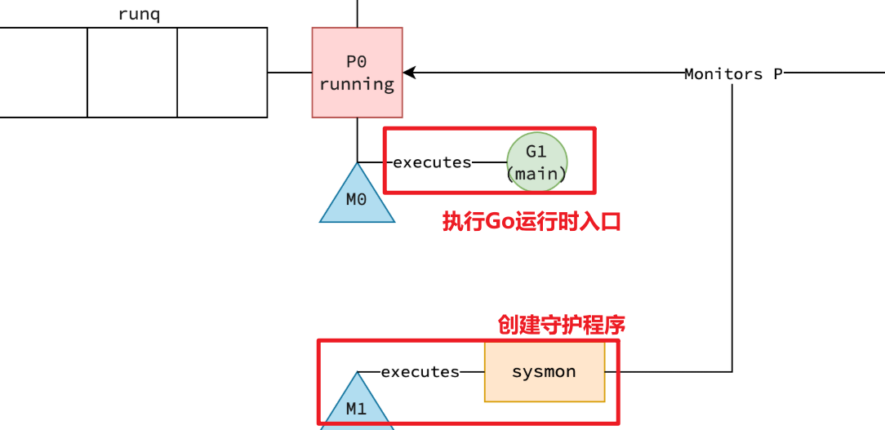
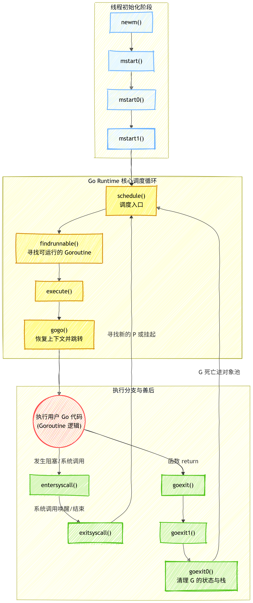

Go 的并发模型是围绕 goroutine 的概念构建的，goroutine 是由 Go 运行时在**用户空间**管理的轻量级用户线程。Go 提供了很多实用的同步原语，如 channels，以帮助开发者轻松编写并发代码。它还利用了一些非同寻常的技术，使得 I/O 密集型程序变得非常高效。

## 回顾：操作系统进程和线程
简明准确总结：

|对象|本质|共享|专属|
|---|---|---|---|
|**进程（Process）**|资源分配的基本单位|—|独立拥有资源|
|**线程（Thread）**|CPU 调度执行的基本单位|进程资源|自己的执行状态|

### 进程拥有的资源（线程共享）

同一个进程内的线程共享：
- **代码段（Code Segment）**
- **数据段（Data Segment）**
- **堆（Heap）**
- **全局变量**
- **打开的文件描述符**
- **地址空间**
- **信号处理方式**
- **动态链接库**

### 每个线程独有的资源

每个线程拥有：
- **线程 ID（TID）**
- **程序计数器 PC（当前执行位置）**
- **寄存器集合**
- **线程栈（Stack）**
- **线程局部存储 TLS**
- **调度状态**

一句话记忆：

> **进程负责资源隔离，线程负责执行；同一进程的线程共享进程资源，但拥有自己的执行上下文。**

---

可视化：

```
                 进程 Process
        ┌────────────────────────┐
        │                        │
        │   共享资源             │
        │   ┌────────────────┐   │
        │   │ 代码段          │   │
        │   │ 数据段          │   │
        │   │ 堆 Heap         │   │
        │   │ 文件描述符      │   │
        │   │ 地址空间        │   │
        │   └────────────────┘   │
        │                        │
        │  ┌──────────┐          │
        │  │ 线程 T1  │          │
        │  │ PC       │          │
        │  │ 寄存器    │          │
        │  │ 栈 Stack │          │
        │  └──────────┘          │
        │                        │
        │  ┌──────────┐          │
        │  │ 线程 T2  │          │
        │  │ PC       │          │
        │  │ 寄存器    │          │
        │  │ 栈 Stack │          │
        │  └──────────┘          │
        │                        │
        └────────────────────────┘
```

再压缩成面试版：

> **进程 = 一个独立资源容器；线程 = 进程中的执行流。线程共享进程的内存和资源，但每个线程有独立的栈、寄存器和程序计数器。**


## 一、GMP 模型 



- **G（Goroutine）**：一个 goroutine，即**待执行/正在执行的 Go 代码及其运行状态**，是一段执行流,它保存着程序计数器、堆栈指针和它的调度信息。
- **M（Machine）**：**操作系统线程（OS thread）**，是真正承载代码执行的线程，runtime 中由 `m` 表示。M 可以执行 Go 代码、runtime 代码、系统调用，也可以处于空闲状态。
- **P（Processor）**：**执行 Go 代码所必需的调度资源和上下文（调度和资源容器）**，P 上主要是本地调度和分配相关的东西,比如可运行 G 的队列、mcache、定时器、GC 状态。G 的现场,像 PC、SP 这些。

G 是任务，M 是执行任务的 OS 线程，P 是 M 执行 Go 代码所需的资源与执行权。

调度器做的核心事情，就是把三者匹配起来：
> **P 从可运行的 G 中选择一个，交给与 P 绑定的 M 执行。**

> [!NOTE]  M:P:N 调度模型
> `M`为内核级线程，`P`为用户级线程。`P`管理着`G`的队列，带着它们找内核级线程`M`来执行。


（1）全局运行队列 (globrunq)
- **infinite slots（无限槽位）**：全局运行队列没有容量限制，通常由链表实现。当逻辑处理器的本地队列满载时，多余的 Goroutine 会被放入此处。
- **必须加锁**：代表访问全局队列必须加锁。任何内核线程（M）在尝试从全局队列中存取 Goroutine 时，都需要获取该锁，这在多核高并发场景下会有一定的性能开销。

（2）本地运行队列与极速插槽 (runq & runnext)
图中的逻辑处理器 P 维护了两个用于存储就绪 Goroutine 的结构：
- **runq (256 slots)**：本地运行队列，是一个固定容量为 256 的环形数组。固定大小和数组结构能够提供极佳的 CPU 缓存局部性（Cache Locality），并且 P 访问自己的本地队列时是无锁的。新创建的Goroutine放在本地队列，满了才放在全局队列。
- **runnext**：最高优先级的单一插槽。当当前 Goroutine 创建或唤醒了一个新的 Goroutine 时，这个新的 Goroutine 会优先被放入 `runnext`。当 M 获取下一个要执行的任务时，会优先检查并执行 `runnext` 中的任务。

（3）左侧：正常调度流 (Running 状态)
左侧展示了一个处于正常运转状态的并发单元：
- **M0 与 P0 绑定**：内核线程 M0 成功绑定了逻辑处理器 P0，P0 处于 `running`（运行中）状态。
- **执行态**：M0 正在实际执行 Goroutine `G1`。
- **就绪态**：P0 的 `runnext` 插槽中准备好了 `G2`，本地队列 `runq` 中有 `G3` 正在排队。只要 `G1` 执行完毕或让出 CPU，`M0` 就会立刻无缝衔接执行 `G2`。

（4）右侧：系统调用与剥离机制 (Syscall 状态)

右侧展示了 Go 调度器应对 I/O 阻塞的核心机制（Handoff 机制）：
- **陷入内核**：`M1` 在执行 `G4` 时，发起了一个阻塞的系统调用（Blocked in system call）。此时 `M1` 被操作系统挂起，无法再执行任何 Go 代码。
- **红色的叉 (❌ 解绑)**：这是整张图最核心的动作。为了不让 `P1` 及其本地队列里的 `G5` 和 `G6` 跟着 `M1` 一起陪葬傻等，Go 运行时（通常是通过后台的 `sysmon` 守护线程）会强行将 `P1` 与阻塞的 `M1` **解绑**。
- **P 的状态流转**：此时 `P1` 的状态被标记为 `syscall`（随后会被流转并移交给其他空闲的 `M`）。这样一来，`P1` 带着它的 `runnext` 和 `runq` 就可以在新线程上继续发光发热，完全屏蔽了底层 I/O 阻塞带来的性能损失。

（5）底层硬件映射 (Kernel & Cores)

最下方展示了 `M`（Machine）跨越操作系统边界（Kernel）映射到物理核心（Core）的过程。Go 调度器在用户态完成了调度的重头戏，而最终的指令依然依赖内核将其分配到真实的 CPU 核心上运算。
图的底部展示了从用户态到内核态的跨越：
- **Kernel（内核）**：M（Machine）本质上是对操作系统内核线程的抽象。
- **Core（物理核心）**：内核调度器最终负责将这些底层线程分配到实际的 CPU 物理核心（菱形图标）上进行运算。

### Goroutine (g)

在 Go 语言中，每当执行 `go func()` 语句时，运行时（Runtime）就会在底层实例化一个 `g` 结构体（简称 `G`）。`G` 是 Goroutine 的物理载体，它不仅封装了待执行的业务逻辑（函数指针），还完整保存了该协程的运行状态、执行栈以及寄存器上下文环境。

#### 1. 数据结构：`runtime.g` 与 `gobuf`

`g` 结构体庞大且精妙。我们将其最核心的字段抽离出来，按功能模块进行逐一拆解：

```go
type g struct {
	// 1. 栈相关字段：记录该 goroutine 的栈空间范围
	stack       stack   // offset known to runtime/cgo
	stackguard0 uintptr // offset known to liblink (用于抢占和栈溢出检查)
	stackguard1 uintptr // offset known to liblink (用于 C 栈)

	// 2. 核心调度信息：保存上下文切换时的寄存器状态
	sched          gobuf
	
	// 3. 关联的 M：当前正在执行该 G 的内核线程
	m              *m      // current m; offset known to arm liblink
	
	// 4. Goroutine 的状态与 ID
	atomicstatus   atomic.Uint32 // 当前状态 (如 _Gidle, _Grunnable, _Grunning, _Gwaiting 等)
	goid           uint64        // goroutine 的唯一 ID

	// 5. 调度与阻塞相关
	schedlink      guintptr // 指向全局或 P 本地队列中的下一个 g
	waitsince      int64    // g 被阻塞的大约时间
	waitreason     waitReason // g 被阻塞的原因 (如 channel receive, sleep 等)

	// 6. 抢占标志
	preempt        bool // 抢占标记，若为 true 则在下次函数调用时让出 CPU
	preemptStop    bool // 抢占并停止 (用于 GC STW)
	
	// 7. 绑定线程：调用 runtime.LockOSThread() 时绑定的 m
	lockedm        muintptr 
    
    // ... 省略大量 GC、CGO、Panic/Recover、Timer 等相关字段
}

// gobuf 用于保存 goroutine 的执行上下文
type gobuf struct {
	sp   uintptr // 栈指针 (Stack Pointer)
	pc   uintptr // 程序计数器 (Program Counter)，指向下一条要执行的指令
	g    guintptr // 指向拥有此上下文的 goroutine
	ctxt unsafe.Pointer // 闭包上下文
	ret  uintptr // 系统调用的返回值
	lr   uintptr // 链接寄存器 (用于 ARM 等架构)
}
```
#### 2. 核心字段深度解析

- **动态栈 (`stack` & `stackguard0`)：突破线程栈大小限制的法宝** 不同于操作系统线程动辄几 MB 的固定栈，Go 的协程初始栈极小（通常仅为 2KB）。`stack` 字段精准记录了当前栈空间的上下界。
    - **栈扩容机制**：在每次函数调用的入口，编译器插入的序言（Prologue）代码会对比当前的真实栈指针（SP）与 `stackguard0`。一旦发现剩余空间不足，就会触发底层扩容逻辑，开辟一块翻倍的内存，并将旧栈数据平滑拷贝过去。
    - **巧妙的抢占拦截**：当调度器想要“协作式”抢占一个正在疯狂运算的 `G` 时，会故意将它的 `stackguard0` 修改为一个极大的特殊值（如 `stackPreempt`）。这样一来，当该 `G` 下一次发生函数调用时，必定会触发“栈溢出”的假象，从而乖乖跌入运行时的拦截函数中，被迫让出 CPU。

- **上下文切换的秘密 (`sched`)：为何协程如此轻量？** `gobuf` 是 Go 调度器实现微秒级切换的核心。当一个 `G` 因为 I/O 阻塞、操作 Channel 或被抢占而失去 CPU 时，当前的寄存器状态（主要是 `sp` 栈指针和 `pc` 程序计数器）会被快照保存在 `sched` 字段中。 相比于 OS 线程切换时需要陷入内核态并保存海量的寄存器状态，Goroutine 的挂起仅仅是在用户态保存这屈指可数的几个变量。当 `G` 再次被调度时，调度器只需将 `sched` 中的值塞回 CPU 寄存器，程序就能“神奇”地从上次断开的代码行继续执行。
- **链式调度 (`schedlink`)：** 在调度器的各种运行队列（如 `P` 的本地队列、全局队列）中，`G` 并不是存在数组里的，而是通过 `schedlink` 这个指针首尾相连，形成一个极度轻量且易于拆装的单向链表。

#### 3. 极速回收机制 (Freelist)

Goroutine 也是内存中的对象，如果频繁创建和销毁，会给垃圾回收器（GC）带来极大的压力。 为此，Go 运行时引入了**对象复用机制**。当一个 Goroutine 执行完毕后，它绝不会被立刻销毁释放，而是转为 `Dead` 状态，并被“洗净”后放入当前处理器 `P` 的空闲列表（Freelist）中备用。如果 `P` 的缓存池满了，多余的死亡 `G` 会被移交至全局空闲列表。 当下一次你的代码执行 `go func()` 时，调度器会优先从这个池子里捞出一个“干净”的旧 `G` 重新赋能。这种零分配的回收机制，使得 Goroutine 的并发启动成本低到几乎可以忽略不计。

#### 4. Goroutine 状态机流转

从生到死，`G` 的 `atomicstatus` 会在以下几个核心状态中穿梭：

| **核心状态**     | **内部枚举表示**   | **详细剖析**                                                      |
| ------------ | ------------ | ------------------------------------------------------------- |
| **Idle**     | `_Gidle`     | 刚刚被分配出内存空间，尚未完成底层数据和运行环境的初始化。                                 |
| **Runnable** | `_Grunnable` | 万事俱备，已处于运行队列（本地或全局）中，正排队等待被分配给空闲的 `M`。                        |
| **Running**  | `_Grunning`  | 正在被内核线程 `M` 实际执行，持有 CPU 时间片。                                  |
| **Syscall**  | `_Gsyscall`  | 正在执行底层的系统调用（如文件读写）。此时不再执行 Go 用户代码，且会释放原本占用的处理器 `P`。           |
| **Waiting**  | `_Gwaiting`  | 处于被动挂起状态（如等待 Channel 响应、等待锁释放、被 `time.Sleep` 暂停）。此时不占用任何队列资源。 |
| **Dead**     | `_Gdead`     | 执行已彻底结束（或刚刚从池中取出初始化）。它正躺在空闲列表中，等待被下一次 `go` 语句唤醒复用。            |




### Machine (m)

无论是用户业务代码、调度器底层逻辑，还是垃圾回收器，**所有的 Go 代码**最终都运行在由操作系统管理的内核线程上。

为了在 GMP 模型中高效管理这些线程，Go 运行时引入了 `m` 结构体来对内核线程进行抽象，其运行时的实例通常简称为 **`M` (Machine)**。
```go
type m struct {

    // 当前 M 正在运行的 goroutine
    // 通常是用户 G；如果执行 runtime 代码则可能是 g0
    curg *g

    // 当前 M 对应的 g0
    // 每个 M 独占一个 g0，用于执行 runtime 调度代码
    g0 *g

    // 当前 M 绑定的 P
    // M 必须拥有 P 才能执行 Go 代码
    // syscall 或阻塞时可以暂时没有 P
    p puintptr

    // runtime 在极少数场景下
    //比如线程启动或退出时,g0 自己留的一个恢复点
    sched gobuf

    // OS 线程 ID
    // 对应底层线程
    procid uint64

    // M 的状态相关锁
    // 防止多个线程同时修改 M 状态
    locks int32

    // 是否处于自旋状态
    // spinning 表示正在寻找可运行 G
    spinning bool

    // 是否正在执行 cgo 调用
    incgo bool

    // 是否锁定到某个 goroutine
    // runtime.LockOSThread 使用
    lockedg guintptr

    // M 的本地缓存
    // 例如分配器 mcache
    mcache *mcache

    // 当前 M 的线程本地存储 TLS
    // 用于快速获取当前 g/m/p
    tls [6]uintptr

    // 当前 M 的异步抢占状态
    // 用于 goroutine 抢占调度
    preemptGen uint32
}
```


#### 1. 核心上下文引用

在 `M` 的生命周期中，它动态维护着几个极其重要的上下文引用：
- **当前任务**：始终指向当前正在执行的 Goroutine (`G`)。
- **绑定处理器**：在执行 Go 代码时，绑定当前的逻辑处理器 (`P`)。
- **系统调用暂存**：当陷入系统调用时，记录进入调用前刚刚解绑的上一个 `P`。
- **启动预分配**：在 `M` 刚被创建准备启动时，记录即将绑定的下一个 `P`。

#### 2. 双栈机制与特殊的 `g0`
尤为关键的是，每个 `M` **都有**一个特殊的 Goroutine——**`g0`**。`g0` 运行在内核为线程分配的**系统栈**上（大小固定）。 

常规 Goroutine 的栈是动态扩展和缩减的，但“执行栈扩缩容”这一动作本身，必须在一个绝对安全且容量充足的栈上进行。因此，每当 `M` 需要执行底层敏感操作（如协程栈扩缩容、垃圾回收、挂起协程等）时，执行流就会从用户协程的动态栈**切换到 `g0` 的系统栈**，并在 `g0` 的上下文中安全完成这些操作。

#### 3. 生命周期与状态流转

与 Goroutine 需要排队等待不同，线程 `M` 一旦创建就会立即执行调度逻辑，因此其初始状态即为运行态（Running）。调度器会确保当 `M` 被创建或唤醒时，总有空闲的 `P` 供其绑定以执行 Go 代码。

在实际运行中，`M` 会经历以下复杂的调度场景：
- **系统调用剥离**：当 `M` 因执行系统调用而陷入内核阻塞时，它会主动与绑定的 `P` 分离（详见“处理系统调用”章节）。这个闲置出来的 `P` 随后会被其他空闲线程接管，以保证队列中的任务不被耽误。
- **自旋窃取 (Spinning)**：如果 `M` 从本地队列、全局队列以及 `netpoll` 中都找不到可运行的 `G`，它不会立刻放弃，而是进入**自旋状态**，尝试去其他 `P` 的队列中“窃取”任务。为了避免过度浪费 CPU，Go 严格限制了自旋的规模：只有当自旋的 `M` 数量少于繁忙 `P` 数量的一半时，`M` 才被允许进入自旋。
- **休眠挂起**：当 `M` 穷尽一切手段依然无事可做时，它并不会被直接销毁，而是进入休眠状态。直到后续产生新的调度需求（详见“寻找可运行的 Goroutine”章节），它才会被另一个 `P` 唤醒并重新投入工作。




#### 4. 数量动态变化

M 因为系统调用、cgo 调用被阻塞,手里的 P 又不能闲着,这时候 Runtime 可能会新建一个 M 来接手这个 P,继续跑其他 G。

反过来,空闲太多的时候,Runtime 也会让多余的 M 休眠甚至消亡,所以 M 是会根据阻塞和负载动态变化的

### Processor (p)

在 Go 语言的 GMP 模型中，`p` 结构体在概念上是对物理 CPU 核心的抽象，它提供了执行 Goroutine 所必需的**上下文环境**与**底层资源**。

`p` 的实例通常被简称为 **`P`**，它们在 Go 程序启动的引导阶段（Bootstrap）就被全量创建出来。
```go
type p struct {
    // P 的唯一编号
    // 范围：[0, GOMAXPROCS-1]
    id int32


    // 当前绑定的 M
    // 一个 P 同时只能绑定一个 M
    m muintptr

    // P 本地运行队列
    // 存放等待执行的 G
    // M 从这里获取 G 执行
    runq [256]guintptr

    // 本地运行队列的头索引
    runqhead uint32

    // 本地运行队列的尾索引
    runqtail uint32


    // 当前正在运行的 G
    // 与 M.curg 对应
    // 表示这个 P 当前执行的 goroutine
    // （源码中通过调度关系维护）
    
    // P 的空闲 G 列表
    // 用于快速复用 goroutine 结构
    gFree struct {
        gList
        n int32
    }

    // 每个 P 独有的内存分配缓存
    // 小对象分配时优先从这里获取
    // 注意：mcache 属于 P，不属于 M
    mcache *mcache

    // 定时器相关
    // P 维护自己的 timer 堆
    timers []*timer

    // 网络轮询相关状态
    // 与 netpoll 协作
    // 保存等待网络事件的 G
    netpollWaiters uint32

    // GC 标记阶段相关状态
    // P 参与垃圾回收工作
    gcAssistTime int64

    // 抢占相关标记
    // 用于调度器判断是否需要抢占当前 G
    preempt bool

    // 是否处于安全点
    // GC stop-the-world 时使用
    gcStopTime int64
}
```
虽然底层操作系统可能为你创建数量极为庞大的内核线程（在 Go 1.24 中，线程数 `M` 默认上限可达 10,000 个），但逻辑处理器 `P` 的数量通常很小，且**严格等于 `GOMAXPROCS` 的设定值**。无论这些 `P` 当前处于何种运行状态，系统内 `P` 的总数是绝对恒定的。

#### 1. 本地运行队列

为了最大程度降低多个线程去“全局运行队列”抢任务时引发的锁竞争，每个 `P` 都维护着自己的**本地运行队列 (Local Run Queue)**。这个本地队列并非一个简单的数据结构，而是由两个精心设计的组件构成：

- **`runnext`（无锁最高优先级插槽）**：
    这并不是一个队列，而是一个只能容纳**单一 Goroutine** 的特权插槽。它专为极致的性能优化而生。
    - **防竞争设计**：当调度器允许其他处理器（如 `P1`）过来执行“工作窃取 (Work Stealing)”时，`P1` 最多会尝试 3 次从当前 `P` 的 `runq` 中偷取任务；只有当这 3 次全部落空时，它才会被允许去触碰 `runnext`。这意味着，当 `P` 自身需要取下一个 Goroutine 执行时，直接从 `runnext` 拿取几乎不会与其他线程产生竞争。

- **`runq`（常规环形队列）**：
    这是一个基于数组实现的、固定大小（256 个槽位）的**环形队列**。
    - **固定大小与数组底座**：保障了极佳的 CPU 缓存局部性 (Cache Locality)，并彻底消除了动态扩容带来的内存分配开销。即便 256 个槽位塞满也无需担忧，因为多出来的 Goroutine 会被安全地溢出转移到“全局运行队列”作为后备。
    - **环形设计 (Circular)**：使得队列的 Push 和 Pop 操作都能在 O(1) 的时间复杂度内完成，完全不需要在内存中移动内部元素。


#### 2. 资源管理前端

`P` 不仅管任务调度，它还是各类底层资源的第一接管人：

- **无锁内存池 (`mcache` & `pageCache`)**：
    - **`mcache`**：作为 TCMalloc（Thread-Caching Malloc）模型的前端，它是 `P` 专属的微小对象内存分配池。因为一个 `P` 在同一时刻只被一个 `M` 独占，所以 Goroutine 从 `mcache` 申请内存是**完全无锁**的，性能极高。
    - **`pageCache`**：它允许内存分配器在不获取全局堆锁 (Heap Lock) 的情况下，**直接批量拉取内存页** (Memory Pages)。在超高并发场景下，这是避免全局内存锁争用的关键点。当 mcache **没有可用的 mspan需要申请新的 span、Goroutine 栈扩容、大对象分配**等等。这些场景都可能需要“按页分配内存”,这时就会优先从 P 的 pageCache 无锁获取,避免每次都去全局 mheap 抢锁。这和 Linux 内核的文件 Page Cache 不是一回事,只是名字相似。

- **高精度定时器管理 (Timer Management)**：
    为了让 Go 程序优雅且精准地处理 `Sleep`、超时控制 (Timeouts) 和定时任务 (Intervals)，每个 `P` 都在本地维护了一个基于**最小堆 (Min-heap)** 的定时器数据结构。堆顶永远存放着最快要到期的那个定时器。
    每当 `P` 在寻找下一个可运行的 Goroutine 时，它都会顺手检查堆顶的定时器是否已经到期。如果到期，`P` 会将与该定时器绑定的 Goroutine 唤醒，并塞入自己的本地运行队列中等待执行。

#### 3. Processor 的状态机流转

在 GMP 模型中，处理器 `P` 的生命周期会在以下几个核心状态中流转（部分过渡状态已作简化）：

| **状态标识**                  | **核心描述**                                                                                     |
| ------------------------- | -------------------------------------------------------------------------------------------- |
| **Idle (`_Pidle`)**       | **闲置状态**。当前没有执行任何 Go 运行时代码或用户代码，静静躺在全局空闲列表中等待被唤醒。                                            |
| **Running (`_Prunning`)** | **运行状态**。已与某个线程 `M` 成功绑定，并且正在马不停蹄地执行用户的 Go 代码。                                               |
| **Syscall (`_Psyscall`)** | **系统调用状态**。其关联的线程 `M` 刚刚陷入了底层的系统调用。此时该 `P` 会被标记为系统调用状态，为随时被其他空闲线程“抢走接管”做准备。                  |
| **GCStop (`_Pgcstop`)**   | **垃圾回收挂起**。由于垃圾回收器触发了 STW (Stop-The-World)，该 `P` 及其绑定的 `M` 被全局强行冻结停止。                        |
| **Dead (`_Pdead`)**       | **死亡状态**。不再被使用。通常发生在程序运行时通过 `runtime.GOMAXPROCS()` 动态缩小了逻辑处理器数量时，多出来的 `P` 会被置为死亡状态等待未来可能被复用。 |



**状态的动态演进流转：**
1. **启动与运行**：在 Go 程序刚启动时，所有的 `GOMAXPROCS` 个处理器最初都处于 **Idle** 状态。当某个内核线程 `M` 成功认领了一个 `P` 来执行用户代码时，该 `P` 瞬间跃迁至 **Running** 状态。
2. **陷入系统调用**：如果当前正在执行的协程 `G` 发起了一个阻塞的系统调用，为了不白白浪费计算资源，`P` 会立刻被调度器从该线程 `M` 上强行剥离，并转入 **Syscall** 状态。
3. **系统调用的善后**：
    - 如果这个系统调用耗时过长，后台守护进程 `sysmon`（非协作式抢占机制的核心）会强行夺走这个 `P`，将其状态先切回 **Idle**，随后火速移交给另一个空闲线程 `M1`，此时 `P` 再次回到 **Running** 状态继续发光发热。
    - 如果系统调用很快结束，原本的 `M` 醒来后会尝试重新绑定刚刚被剥离的 `P`。如果成功，`P` 从 Syscall 恢复为 **Running**。
4. **全局暂停与销毁**：当触发强力垃圾回收引发 STW 时，所有活跃的 `P` 都会被冻结，切入 **GCStop** 状态；当系统恢复 (Start-The-World) 时，它们会恢复之前的状态。如果在程序运行期间，开发者动态调低了 `GOMAXPROCS` 的数量，多余出来的冗余 `P` 会被标记为 **Dead** 状态；当然，如果后续再次调高该值，这些 Dead 状态的 `P` 会被重新复活使用。

> [!NOTE]  STW (Stop-The-World)
> 它是垃圾回收（GC）过程中的一种机制。在 STW 期间，底层运行时（Runtime）会**强行暂停所有正在执行用户业务代码的线程**，此时整个程序对外的响应仿佛“时间静止”。
> 
> 核心是为了**内存数据的一致性**。如果 GC 在一边扫描和回收垃圾，而用户代码还在一边频繁修改对象之间的引用关系（比如把一个即将被回收的对象，又挂载到了一个活跃对象上），就会导致 GC 发生致命的错乱（如误删有用数据）。因此，必须在特定阶段“冻结”内存状态。


## 二、程序的引导与启动

要想让 Go 调度器正常运转，必须在程序的引导阶段（Bootstrap）完成其初始化。整个启动流程可以划分为以下几个核心阶段：


> [!IMPORTANT]  
> 引导过程，是直接**由 M0 这个系统线程在跑**的并**运行在 G0 的系统栈**上面。

1. **汇编入口初始化**
	- 程序从汇编入口开始执行。
	- 创建 **M0**：
	    - M0 是程序启动时绑定的第一个 OS 线程。
	- 创建 **G0**：
	    - G0 是 M0 专属的 runtime goroutine。
	    - 用于执行调度器、GC 等 runtime 代码。
	    - 不执行用户代码。
	- 初始化 TLS（Thread Local Storage）：
	    - 将当前 M、G 等信息写入 TLS。
	    - 后续通过汇编指令可以快速获取当前执行上下文。

2. **runtime 初始化**（在G0的栈上运行runtime.schedinit）
	- 进入 Go runtime 初始化阶段。
	- 初始化：
	    - 内存分配器（mheap 等）
	    - GC
	    - 调度器全局状态
	    - 网络轮询器等。
	- 创建 P：
	    - 根据 `GOMAXPROCS` 创建 P。
	    - 默认创建 P0 ~ P(n-1)。
	    - P 代表执行 Go 代码所需的调度资源。
	- M0 绑定 P0：
	    - M 必须绑定 P 才能执行 Go 代码。
	    - P0 状态从 idle 变为 running。

> [!NOTE]  
> 当需要执行 Runtime 底层逻辑时,M 会把栈指针切到 G0 的系统栈,在那上面跑一段代码,跑完再切回去。整个过程中没有换 M,很多时候也没有真正调度 G,只是栈切换。

3. **创建第一个 Goroutine**
	- runtime 创建第一个普通 G——G1：执行 runtime.main()

4. **启动系统监控 sysmon**
	- runtime 创建独立 M 执行 `sysmon`。
		特点：
		- sysmon 不绑定 P。
		- 不参与普通 G 的调度。
		- 长期运行在后台。
		
		主要职责：
		- 检测长时间运行的 G。
		- 发起抢占请求（preemption）。
		- 监控系统调用阻塞。
		- 管理定时器。
		- 协助网络轮询。

5. **进入调度循环**
	- M0 调用 `mstart` 进入 M 的运行入口。
	- M0最终进入调度循环：schedule()
		调度器开始工作：流程：
		1. P 从本地 run queue 获取 G。
		2. M 执行该 G。
		3. G 阻塞、结束或被抢占后：
		    - 保存 G.sched。
		    - 回到调度循环。
		    - P 再选择新的 G。

6. **进入用户代码**
    - G1 执行 `runtime.main`。主要工作：
		- 执行 runtime 初始化任务。
		- 启动垃圾回收相关逻辑。
		- 执行所有包的 `init()` 函数。
    - 最后调用用户定义的 `main.main()`。
    - 用户程序正式开始运行。


一句话总结：
> **M0 + G0 完成 runtime 启动 → 初始化调度器和 P0 → 创建 G1 执行 runtime.main → 启动 sysmon → 调度器运行 → 执行用户 main.main。**


### 1. 汇编入口初始化（`rt0_go`）

调度器的生命周期始于底层的汇编函数 `runtime·rt0_go`。在这个极早期的阶段，系统会完成两件最核心的基础建设：

- **创建 `M0` 和 `G0`**：`M0` 代表操作系统分配的**主线程**；而 `G0` 是分配给 `M0` 的系统栈协程，专用于执行底层的调度和内存管理逻辑。
- **配置 TLS**：系统会为主线程设置**线程局部存储 (Thread-local Storage, TLS)**，并将 `G0` 的内存地址妥善存入其中。这样一来，后续的底层代码随时可以通过汇编指令极速获取当前的执行上下文（即 `getg` 操作）。

> [!NOTE]  线程局部存储
> 它允许在多线程程序中定义一种**“特殊的全局变量”**：这种变量在代码层面看起来像是一个全局变量，但**每一个运行的线程都会在底层拥有该变量的独立副本**。
> 在多线程编程中，我们通常面临两难的选择：
>- **普通全局变量**：被进程内的所有线程共享。如果多个线程同时读写，就会产生数据竞争。为了安全，必须使用锁，但这会导致线程排队等待，严重拖慢程序的并发性能。
 >   
> - **普通局部变量**：存储在函数的栈帧中，只在函数内部有效。一旦函数执行完毕，变量就销毁了，无法在跨函数的长调用链路中共享状态。
> 
> **TLS 提供了完美的折中方案**：它提供了跨函数的全局访问能力，但又将作用域严格限制在“当前线程”内部。线程 A 修改了 TLS 变量，对线程 B 毫无影响，因此**完全不需要加锁**，访问速度极快。

### 2. runtime 初始化（`schedinit`）

随后，引导程序会调用汇编函数 `runtime·schedinit`（其对应的 Go 源码位于 `runtime.schedinit`）。 该函数负责执行一系列庞杂的初始化工作。
- 其中最关键的动作是调用 `procresize`。它会严格按照环境变量 `GOMAXPROCS` 的大小，预先**分配并初始化对应数量的逻辑处理器 `P`**，并将它们全部置为 **Idle (空闲)** 状态。 
- 紧接着，主线程 `M0` 会主动与首个处理器 `P0` 进行**绑定**。此时，`P0` 的状态正式从 Idle 跃迁为 **Running (运行中)**，标志着执行引擎已准备就绪。

### 3. 创建第一个 Goroutine（G1）+ 启动系统监控 sysmon

- 引擎就绪后，系统会创建**主 Goroutine**（G1） 来执行 `runtime.main` 函数。这里需要严格区分：`runtime.main` 是 Go 运行时的内部入口点，而我们开发者自己编写的 `main` 函数，在底层实际上被称为 `main_main`。 
- 在 `runtime.main` 执行期间，会专门孵化出一个独立的内核线程来启动 **`sysmon` (System Monitor)** 守护程序，它游离于 `P` 的调度之外，是前文所述“非协作式抢占”和系统调用监控的核心幕后推手。

### 4. M0 开始调度执行+进入用户 main 函数

一切就绪，主线程调用 `mstart` 开始在 `M0` 上正式运转，开启永不休止的**调度循环 (Schedule Loop)**，并将主 Goroutine 捞起投入执行。 在 `runtime.main` 走完最后的内部初始化流程后，控制权终于被移交给用户定义的 `main_main` 函数——此时，你编写的 Go 代码才真正开始奔跑。

> **💡 值得注意的是：** 主线程 `M0` 并非主协程的“专属座驾”。如果在执行过程中主协程因系统调用或阻塞在 Channel 上，`M0` 会像其他普通线程一样，果断放下主协程，去寻找并执行队列中的其他可运行 Goroutine。

---

### 启动态全局快照总结

我们可以为 Go 程序刚刚启动、步入 `main` 函数那一刻拍一张“全局快照”。假设当前环境的 `GOMAXPROCS = 2`：

- **Goroutine**: 存在 1 个主 Goroutine 正在聚光灯下执行 `main` 函数逻辑。
    
- **Thread (M)**: 存在 2 个活跃的内核线程。一个是主线程 `M0`；另一个是专为运行 `sysmon` 而单独创建的线程 `M1`。
    
- **Processor (P)**: `P0` 正在与 `M0` 协作执行主协程，处于 **Running** 状态；而另一个处理器 `P1` 尚未分配到任务，安静地处于 **Idle** 状态等待被唤醒。
    

_(注：实际上在引导阶段，运行时还会悄悄孵化出几个用于内存管理的后台协程，比如并发标记、清扫和拾荒协程等，但这属于垃圾回收器的范畴，不在此过度展开。)_

## 三、创建Goroutine

在 Go 语言中，我们只需要一个极其简单的 API 就能启动一个并发执行单元：`go func() { ... }()`。然而在极简的语法糖之下，Go 运行时（Runtime）在底层做了大量复杂的工作。

实际上，`go` 关键字在编译阶段会被转化为对 Go 运行时函数 `runtime.newproc` 的调用。该函数全权负责新 Goroutine 的创建与调度准备，它在底层主要完成以下 **三件核心任务**：
1. 初始化 Goroutine 对象。
2. 将其放入当前正在执行代码的处理器 `P` 的运行队列中。
3. 尝试唤醒另一个空闲的处理器 `P1` 以提升并发吞吐量。

### 1. 初始化 Goroutine

当 `newproc` 被调用时，出于性能考量，它**并不会直接向操作系统申请新内存**，而是首先尝试从空闲列表（Freelist）中获取一个处于 `Dead` 状态的废弃 Goroutine 加以**复用**。只有在无空闲 `G` 可用时，才会真正分配创建一个新的 `G`。

新创建的 `G` 会被分配一个极小的初始栈——仅有 **2KB**（由运行时常量 `stackMin` 定义）。 此外，调度器会进行一项非常巧妙的“栈伪装”操作：它会**将底层清理函数 `goexit` 的地址压入 `G` 的调用栈底**。这意味着，当你的业务函数执行完毕并尝试 `return` 时，程序实际上会“跳转”到 `goexit` 函数中，去自动执行 Goroutine 的资源清理与状态重置逻辑。 初始化完成后，`G` 的状态会从 `Dead` 跃迁为 `Runnable`（可运行态），标志着它已整装待发，随时可以被调度执行。

### 2. 将 Goroutine 放入运行队列

正如前文所述，每个逻辑处理器 `P` 的本地运行队列由两部分组成：最高优先级的 `runnext` 插槽，以及环形队列 `runq`。

当新的 Goroutine 创建完毕后，**它会被第一优先塞入 `runnext` 中**（因为新协程往往与当前环境有极高的数据局部性）。
- 如果此时 `runnext` 已经被之前创建的另一个协程 `G1` 占用了，调度器会把旧的 `G1` “踢”进后方的 `runq` 中，让新的 `G` 鸠占鹊巢。
- 如果此时连 `runq` 也完全满了（达到了 256 的容量上限）怎么办？为了防止当前 `P` 负载过重，调度器会触发一次 **“减负与溢出”操作**：它会将刚刚被踢出来的 `G1`，连同本地 `runq` 中 **一半** 的 Goroutine 打包在一起，统统转移到**全局运行队列 (Global Run Queue)** 中，交由其他较闲的 `P` 去分担。


### 3. 唤醒空闲处理器

既然创建了新的并发任务，我们自然希望系统能最大化地发挥多核并发优势。因此，当前运行的线程会通过底层的 `futex` 系统调用，尝试唤醒另一个处于休眠状态的处理器 `P`。

调度器会检查全局的空闲处理器列表。如果发现有闲置的 `P`，它会唤醒一个处于睡眠中的内核线程 `M`（或者干脆克隆创建一个新的 `M`）来与该 `P` 绑定。这个刚被唤醒的线程会立刻进入**调度循环 (Schedule Loop)**，开始四处寻找可运行的 Goroutine 并执行它（寻找逻辑详见“寻找可运行的 Goroutine”章节）。

当然，程序的绝对并发上限是由 `GOMAXPROCS`（活跃处理器的数量）决定的。如果当前所有的处理器都已经处于全速运转的繁忙状态，即使你源源不断地 `go` 出新协程，调度器也不会再去唤醒或创建更多的新线程了。

### 4. 流程总览

结合上述步骤，我们可以推演一个简单的程序启动场景： 假设 `GOMAXPROCS` 设置为 2，并且 `main` 函数除了在一个循环里疯狂 `go func()` 之外什么也不做。 起初，主线程 `M0` 绑定着 `P0` 在全速创建 Goroutine。随着新任务入队，系统检测到了闲置的处理器 `P1`。由于这些 Goroutine 纯粹是 CPU 密集型操作（没有发起阻塞系统调用），系统会精准地**只额外创建一个**底层线程 `M2`，将其与 `P1` 绑定，来共同消化这些源源不断产生的新协程。

## 四、寻找可运行的 Goroutine

在 Go 调度器中，内核线程 `M` 的核心职责之一就是寻找合适的、可运行的 Goroutine，以最大程度地减少协程饥饿。
这套寻找逻辑被封装在 `findRunnable` 函数中，它是整个**调度循环 (Schedule Loop)** 的关键驱动力。

线程 `M` 会严格按照以下顺序展开搜索，一旦在某个步骤找到了可运行的 `G`，就会立即停止搜索并去执行它：
1. **追踪协程**：检查负责 Trace (执行追踪) 的协程是否可用。
2. **GC 协程**：检查垃圾回收 (GC worker) 协程是否需要运行。
3. **【防饥饿】全局队列 (1/61 概率)**：每发生 61 次调度，强制去全局运行队列检查一次。
4. **本地队列**：检查当前绑定的逻辑处理器 `P` 的本地运行队列。
5. **全局队列**：再次检查全局运行队列。
6. **就绪的 I/O (`netpoll`)**：检查网络轮询器，看是否有因 I/O 事件就绪而被唤醒的协程。
7. **【工作窃取】**：尝试从其他处理器 `P1` 的本地队列中“偷”协程过来。
8. **GC 协程兜底**：再次检查垃圾回收协程的可用性。
9. **全局队列兜底**：如果 `M` 当前处于自旋 (spinning) 状态，进行最后一次全局运行队列的检查。

---

### 1. 核心机制深度解析

为了保证极高的并发效率，`findRunnable` 内部并非简单的按序检查，而是暗藏了许多性能优化策略：
- **运行时内部任务优先 (步骤 1, 2, 8)** Trace 和垃圾回收是 Go 运行时的内部基石。虽然它们对用户不直接可见，但把它们放在极高的优先级，是为了保证整个运行时环境的健康稳定，允许 GC 与常规用户代码高效并发执行。
- **全局队列的批量获取 (步骤 3, 5, 9)** 当 `M` 决定去全局队列拿任务时，它**绝不会只拿一个**。为了分摊锁开销，它会尝试**批量获取 (Batching)**。
    - **批次大小计算**：`(global_queue_size / GOMAXPROCS) + 1`。
    - **限制条件**：拿取的数量不能超过系统设定的最大参数，且**绝不会超过当前 `P` 本地队列容量的一半**。
    - 拿取完成后，它会弹出 1 个 `G` 直接返回执行，把剩下的统统塞进自己 `P` 的本地队列。这种批处理设计极大地降低了全局锁的争用频率，并实现了多核间的负载均衡。

- **本地队列的优先插槽 (步骤 4)** 在检查本地队列时，`M` 会优先偷瞄 `runnext` 插槽。如果 `runnext` 非空，直接将里面的 `G` 拿走执行；如果为空，才会去常规的环形队列 `runq` 中出队任务。

- **工作窃取的最强策略 (步骤 7)** 这是整个寻找过程中最复杂、也最具侵略性的一步。`M` 会最多尝试 **4 次** 从其他随机的处理器 `P1` 那里窃取工作：
    - **前 3 次尝试**：它表现得相对“克制”，只尝试从 `P1` 的常规队列 `runq` 中偷走**一半**的 `G` 转移到自己的 `runq` 中。
    - **第 4 次尝试**：如果前三次都空手而归，它就会“急眼”了——不仅会去偷 `runq`，还会直接对 `P1` 最宝贝的 `runnext` 插槽下手，只要有任务统统偷走。


---

### 2. 找不到任务怎么办？(Timers 与 休眠)

如果线程 `M` 跑完了上述 9 个步骤依然一无所获，它并不会立刻原地销毁，而是进入兜底的等待机制：

1. **挂起等待定时器 (`netpoll`)** `findRunnable` 不仅负责找任务，还负责唤醒那些陷入睡眠的协程。如果没有现成的任务，`M` 会在 `netpoll` 上阻塞等待，直到最近的一个**定时器 (Timer)** 到期（例如某个因为 `time.Sleep` 而休眠的协程）。 _为什么定时器会和 `netpoll` 扯上关系？_ 因为 Go 现代的定时器系统深度依赖底层 `netpoll` 的超时机制（例如 Linux 下的 `epoll_wait`），利用 I/O 多路复用同时实现了网络阻塞和精准计时。当 `netpoll` 返回时，`M` 会重新进入调度循环，再次开始找任务。

2. **彻底深度休眠 (`stopm`)** 如果当前 `P` 连哪怕一个挂起的定时器都没有，彻底闲置了，那么 `P` 会被剥离并放入全局的空闲列表 (Idle list)。而失去 `P` 的线程 `M` 会调用 `stopm` 函数，通过操作系统原语将自己彻底挂起进入深度睡眠。 它会一直睡下去，直到有其他活跃的线程（通常是因为程序里执行了新的 `go func()`）将它重新唤醒，再次投入调度循环的怀抱。

## 五、调度循环

在 Go 运行时的底层源码中，`schedule` 函数是整个并发引擎跳动的心脏。它的唯一职责就是**寻找并执行下一个可运行的 Goroutine**。

### 1. 调度的触发时机

内核线程 `M` 并不是无时无刻都在调度，`schedule` 函数通常会在以下几种关键场景被触发调用：
- **线程初始化**：当一个新的底层线程 `M` 被创建或唤醒并准备好投入工作时。
- **主动让权**：当协程代码中显式调用了 `runtime.Gosched()`。
- **被动调度**：当 Goroutine 因等待锁、Channel 或网络 I/O 而被挂起（Parked），或者运行时间过长被系统强行抢占（Preempted）时。
- **系统调用结束**：当 Goroutine 完成了一次底层的系统调用，重新切回用户态时。

### 2. 上下文切换：从挑选到执行

挑选合适 Goroutine 的过程参考 `findRunnable` 九步搜索法。

一旦调度器锁定了一个目标 `G`：
- 它的状态就会从 `Runnable`（就绪态）跃迁为 `Running`（运行态）。
- 内核线程 `M` 会调用底层的汇编函数 **`gogo`**。`gogo` 函数负责将 `G` 保存的寄存器现场恢复到 CPU 中，并跳转到业务代码的程序计数器（PC）位置，Goroutine 由此开始真正执行。

### 3. 闭环的秘密：为什么称之为“循环”？

既然代码交给了用户逻辑去执行，调度器是怎么拿回控制权，并让这个过程循环起来的呢？

“创建 Goroutine”一节中提到，初始化时调度器会偷偷把 `goexit` 函数的地址压入协程的调用栈底。

因此，当 Goroutine 的业务代码执行完毕并 `return` 时，控制流会自然“跌入” `goexit` 函数中。 `goexit` 最终会引导至内部的 **`goexit0`** 函数。

`goexit0` 负责为这个结束的协程“收尸”：剥离状态、清理资源、将其重置为 `Dead` 状态并扔回 `P` 的空闲池。

**最关键的是：清理完成后，`goexit0` 会在内部再次调用 `schedule` 函数。**

这就形成了一个完美的闭环：`schedule` -> `gogo` -> 业务代码执行 -> `goexit0` -> 再次 `schedule`。线程 `M` 就这样在这个无尽的循环中，不知疲倦地搬运和执行着协程。

### 4. 进程如何退出？

如果所有的底层线程（包括主线程 `M0`）都深陷在这个永无止境的调度循环中找活干，那我们的程序到底是怎么正常退出的呢？

秘密隐藏在主协程执行的入口函数 `runtime.main` 中。 我们作为开发者编写的 `main` 函数，在运行时底层实际上被称为 `main_main`。主协程在执行时，会先执行 `runtime.main` 的前置准备，随后调用我们的 `main_main`。 **当我们的 `main_main` 函数执行完毕返回时，外层的 `runtime.main` 会毫不犹豫地直接触发操作系统层面的 `exit(0)` 系统调用。**

`exit(0)` 会被内核接管，直接暴力强杀当前进程下的所有线程。这就从底层完美解释了 Go 语言中的一个经典现象：**为什么主函数一旦执行结束，程序就会瞬间退出，而绝对不会去理会那些通过 `go` 关键字刚刚孵化、甚至还在队列里排队未执行的子协程。**

## 六、抢占调度

Go采用协作式抢占+非协作式异步抢占相结合的机制。

**协作式抢占作为首选机制**。
- **低开销**：当一个 Goroutine 正常运行且频繁调用其他函数时，触发编译器插入的栈检查代码（对比 `stackguard0`）是非常轻量级的，几乎没有额外的上下文切换负担。
- **安全点 (Safe Point)**：在函数调用的入口点发生抢占，此时寄存器状态明确，非常利于垃圾回收器（GC）进行准确的根对象扫描。


**非协作式抢占，非首选：**
成本相对较高（需要操作系统介入、发送信号、触发内核中断、保存厚重的信号上下文等）。
只有当协作式抢占**失效**时（例如遇到了没有任何函数调用的、纯粹的 CPU 密集型死循环），异步抢占才会出场

### 1. 为什么需要抢占？

在 GMP 模型中，内核级线程 `M` 只能顺序执行绑定在处理器 `P` 上的 Goroutine。如果一个 `G` 包含一个纯 CPU 运算的死循环（例如没有发起系统调用、没有读写 Channel、也没有调用任何函数），它就会死死霸占着当前的 `P` 和 `M`。

这会导致严重的后果：
- 同一个 `P` 本地队列里的其他 `G` 会被“饿死”（Starvation）。
- 如果这种死循环发生得多了，甚至会导致垃圾回收器（GC）无法发出 STW（因为 STW 需要所有 `P` 都到达安全点，而死循环的 `G` 永远不会主动停下），最终导致整个程序假死。

后台守护线程`sysmon` 来实际执行抢占机制。`sysmon` 不绑定任何 `P`，直接运行在操作系统线程上，它会定期巡视所有的 `P`。一旦发现某个 `G` 连续运行超过了 **10 毫秒**（`forcePreemptNS`），就会对其发起抢占“追杀令”。

---

### 2. 第一阶段：协作式抢占 (Go 1.2 ~ 1.13)

早期的 Go 引入的是基于“栈溢出检查”的**协作式抢占**。

**具体机制：**

1. **下达指令**：当 `sysmon` 发现 `G` 运行超过 10ms，它会将该 `G` 的内部字段 `stackguard0`（正常情况下记录的是栈的下界边界）强行修改为一个极其巨大的特殊常量 `stackPreempt`。
2. **埋伏拦截**：Go 编译器会在每个函数的入口处（Prologue 序言部分）自动插入一段汇编指令，用于检查当前栈指针（SP）是否超过了 `stackguard0`。
3. **乖乖就范**：当这个 `G` 下一次**调用任何函数**时，栈检查指令触发。由于 `stackguard0` 已经被改成了那个巨大的假地址，检查必定失败。
4. **交出控制权**：底层误以为是“栈空间不足”，跳转到 `runtime.morestack` 去扩容，Go 运行时便能在此时“偷天换日”，拦截该协程，将其状态改为 `Runnable` 塞回全局队列，并让出 `P`。

**致命缺陷：** 它之所以叫“协作式”，是因为它**极其依赖 `G` 主动发生函数调用**。如果开发者写了一个内部没有任何函数调用的纯粹的死循环：

```go
func main() {
    go func() {
        for { 
            // 纯粹的四则运算，没有任何函数调用
            i++ 
        }
    }()
    // ...
}
```

那么编译器就不会插入栈检查指令，`sysmon` 把 `stackguard0` 改出花来也没用。这个 `G` 永远不会被抢占。

---

### 3. 第二阶段：基于信号的异步抢占 (Go 1.14 至今)

为了彻底解决上述的“无赖死循环”问题，Go 1.14 引入了具有里程碑意义的**非协作式异步抢占**。它不再眼巴巴地指望协程主动配合，而是借助**操作系统级别的硬件中断信号**来实现霸王硬上弓。

**硬核流程拆解：**
1. **锁定目标**：`sysmon` 同样发现某个 `G` 执行超过了 10ms。
2. **发射信号**：`sysmon` 查到该 `G` 所绑定的底层内核线程 `M` 的线程 ID，然后直接发起系统调用（如 Linux 下的 `tgkill`），向该线程发送 **`SIGURG`** 信号。
    - _(注：为什么选 `SIGURG`？因为它是 Linux 里的“紧急套接字数据”信号，通常在应用程序里极少被实际使用，拿来做抢占信号不容易和业务逻辑冲突。)_

3. **内核中断**：操作系统内核收到信号后，会立刻强制中断 `M` 当前正在执行的代码，并保存当前的执行上下文（寄存器、PC 等），然后跳转到 Go 运行时预先注册好的信号处理函数 `sigtramp` 中。

4. **篡改程序计数器 (Hijack PC)**： 这是异步抢占最核心、最精妙的一步。在信号处理函数 `doSigPreempt` 中，Go 运行时会检查该 `G` 是否可以被安全抢占。如果可以，运行时会**直接修改内核压入栈中的那个“中断返回地址”（Program Counter, PC）**。 它将原本要返回去继续执行死循环的指令地址，篡改成了 Go 运行时内部的一个异步抢占函数 `asyncPreempt` 的地址。

5. **强行缴械**：当操作系统的信号处理函数执行完毕并返回时，线程 `M` 并没有回到原来的死循环，而是**身不由己地跳进了 `asyncPreempt` 函数**。

6. **重排调度**：在 `asyncPreempt` 中，运行时会保存好当前 `G` 的所有业务寄存器状态（把它打包进前面提到过的 `gobuf` 中），调用 `gopark` 或 `goschedImpl` 将其状态从 `Running` 切为 `Runnable` 并扔回全局队列。最后，调用 `schedule()` 开启下一轮循环，去执行其他亟待处理的协程。

## 七、系统调用

系统调用是内核提供的基础服务（如文件读写、网络连接等）。尽管 Go 的标准库提供了高级抽象，开发者极少直接交互，但理解系统调用的底层机制，对于深入掌握 Go Runtime、标准库原理以及性能调优至关重要。结合 Go 特有的 M:P:N 调度模型，其系统调用的处理机制尤为精妙。
### 1. 分类

在 Go Runtime 中，系统调用主要通过两个包装函数触发：`RawSyscall` 和 `Syscall`。
- **`RawSyscall`（原始调用）**：
    - **适用场景**：执行耗时极短且预期稳定的操作（如获取进程 ID 或当前时间）。
    - **特点**：不涉及调度介入，Goroutine (G)、线程 (M) 和 逻辑处理器 (P) 之间的绑定关系保持不变。

- **`Syscall`（受控调用）**：
    - **适用场景**：执行耗时不可控的操作（如文件 I/O、HTTP 请求）。
    - **特点**：为防止长时间阻塞导致资源浪费，Runtime 会介入协调 G、M、P，以确保系统的高效响应。
    - **底层实现**：`Syscall` 内部实际调用了 `RawSyscall`，但在调用前后注入了额外的调度逻辑：

```go
func Syscall(trap, a1, a2, a3 uintptr) (r1, r2 uintptr, err Errno) {
	runtime_entersyscall() // 调度介入：调用前
	r1, r2, err = RawSyscall6(trap, a1, a2, a3, 0, 0, 0)
	runtime_exitsyscall()  // 调度介入：调用后
}
```

### 2. `Syscall` 的调度机制

调度逻辑主要由编译期绑定的 `runtime.entersyscall` 和 `runtime.exitsyscall` 负责。

**调用前（`entersyscall`）：状态保存与解绑**

1. **状态切换**：当前 G 放弃 CPU，状态从 `running` 变更为 `syscall`，并保存执行上下文（栈指针、程序计数器等）。
2. **M-P 分离**：线程 M 与逻辑处理器 P 暂时解绑，P 的状态也切换为 `syscall`。

**后台监控与处理器移交（Handoff）**

- **`sysmon` 介入**：后台监控线程 `sysmon` 会持续扫描处于 `syscall` 状态的 P。
- **P 移交**：如果一个 P 停留在 `syscall` 状态超过 **10ms**，`sysmon` 会触发“处理器移交（Processor Handoff）”。它会为该 P 绑定一个新的线程 M1，以继续执行其他就绪的 G，此时 P 恢复为 `running` 状态。
- **M-G 继续阻塞**：由于内核只认线程，原内核线程 M 继续代表原 G 执行系统调用并保持阻塞，直到调用完成。（M和G一起走一边执行）

- _(注：如果 P 处于 `syscall` 且未被 `sysmon` 接管，其他线程无法使用该 P。在大量并发系统调用的场景下可能导致程序停滞。这也是 Dgraph 数据库曾将 `GOMAXPROCS` 硬编码为 128 以提升并发磁盘 I/O 的原因。)_


**调用后（`exitsyscall`）：恢复执行** 系统调用完成后，调度器会根据资源可用性选择两条路径：

- **Fast Path（快速路径）**：尝试为刚完成调用的 G 寻找一个可用的 P（优先寻找未被抢占的原 P，其次寻找其他处于 `idle` 状态的 P）。若找到，G 恢复为 `running` 状态并继续执行。
- **Slow Path（慢速路径）**：如果当前没有空闲的 P，G 会被放入**全局运行队列（Global Run Queue）** 等待调度。同时，当前线程 M 会调用 `stopm` 函数挂起休眠，等待被唤醒参与后续的调度循环。