> [!NOTE]  笔记
> - 当垃圾收集器释放对象时，它们并不立刻回到操作系统。运行时有一个 **scavenger** 后台线程，负责定期将长时间未用的 span 页用 `MADV_FREE`/`MADV_DONTNEED`（Unix）或 `VirtualFree`（Windows）归还给 OS：虚拟地址保留，物理页释放，下次写入时 OS 再按需补充物理页。
> - **三色不变性**：用来保证在并发情况下，垃圾不会被错误回收。强：黑不指白。弱：黑可指白，但要有灰指。
> - **屏障技术**：用来强制保证三色不变性。**插入写屏障**：黑指白，白变灰。**删除写屏障**：不指白，白涂灰。
> - **混合写屏障**：**栈全黑，“新对象全黑” + “删老指针变灰” + “加新指针变灰”** 完美地堵死了所有在并发状态下可能导致“黑指白”的漏洞。
> - GC过程：[5. GC过程](#5-gc过程)


内存管理一般包含三个不同的组件，分别是**用户程序（Mutator）**、**分配器（Allocator）** 和**收集器（Collector）**，当用户程序申请内存时，它会通过内存分配器申请新内存，而分配器会负责从堆中初始化相应的内存区域。

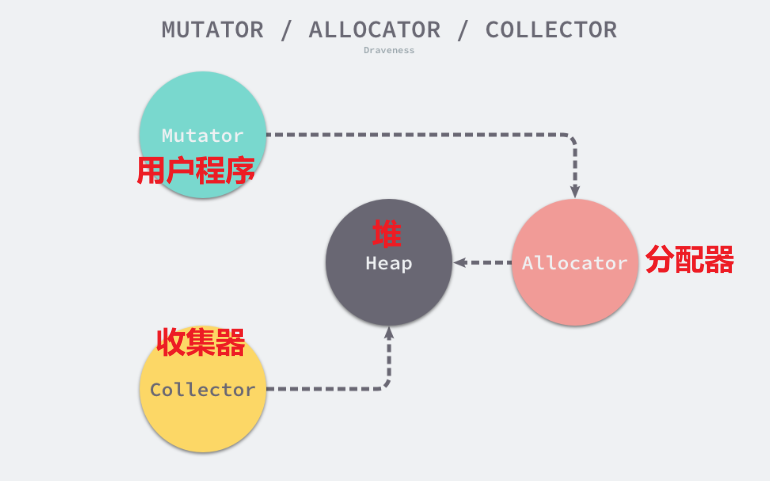

## 一、内存分配/堆空间管理

> [!NOTE]  和操作系统中的“内存分配”区分
> 操作系统中的：
> - 连续分配管理（单一连续、固定分区分配、动态分区分配）
> - 基本分页管理
> - 基本分段
> 
> 高级编程语言（如 Go、Java 等）的运行时在管理堆内存时，本质上就是在一个从操作系统“批发”来的巨大虚拟内存块上，自己内部又实现了一套轻量级的“微型操作系统内存管理系统”。

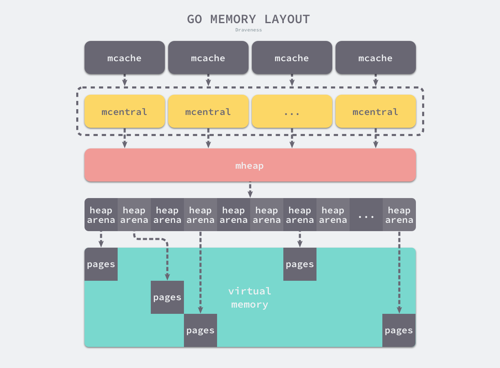

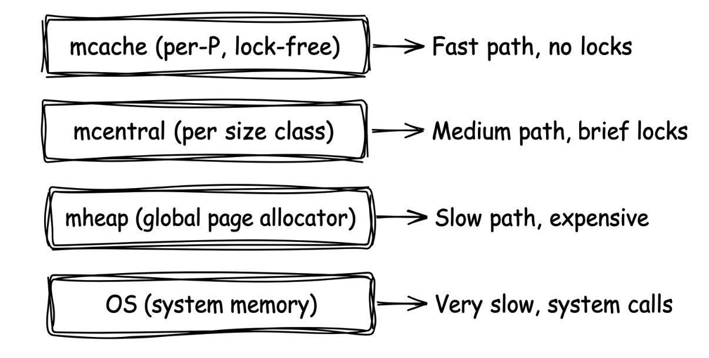

### 1. heapArena

在 Go 1.10 以前，Go 语言在启动时，会向操作系统直接预留一大块**连续的虚拟内存**。
- **三大区域**：这块连续内存被严格划分为三个区域：
	- 512MB 的 `spans`（存储内存管理单元指针）
	- 16GB 的 `bitmap`（标识对象是否空闲的位图）
	- 512GB 的 `arena`（真正的堆区，存储对象）。
- **致命痛点**：这种设计建立在**堆区内存必须是连续的**这一假设之上。当只是纯粹写 Go 代码时没问题，计算地址偏移量也非常快。但是，一旦在 C 和 Go 混合使用（Cgo）的场景下，C 语言的二进制文件可能会占用 Go 想要预留的地址，导致分配的内存地址发生冲突，进而引发堆初始化和扩容失败，直接导致程序崩溃。此外，512GB 的硬性上限在某些极端大数据场景下也捉襟见肘。

稀疏内存是 Go 语言在 1.11 中提出的方案，不仅能**移除堆大小的上限**，还能**解决 C 和 Go 混合使用时的地址空间冲突**问题。
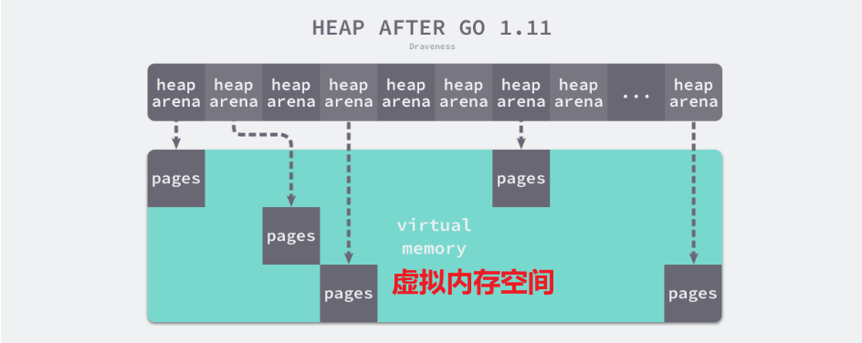

运行时不再要求一块完整连续的 512GB 空间，而是使用一个**二维数组**来管理所有内存。这个数组中存放的，就是 Go 内存空间的基本切分单位：`runtime.heapArena`。

```go
type heapArena struct {
	_ sys.NotInHeap
	bitmap       [heapArenaBitmapBytes]byte
	spans        [pagesPerArena]*mspan
	pageInUse    [pagesPerArena / 8]uint8
	pageMarks    [pagesPerArena / 8]uint8
	pageSpecials [pagesPerArena / 8]uint8
	checkmarks   *checkmarksMap
	zeroedBase   uintptr
}
```

- **`_ sys.NotInHeap`**
    - **作用**：这是一个特殊的类型标记。它明确告诉 Go 编译器和垃圾回收器，`heapArena` 这个结构体实例绝对**不能**被分配在 Go 自身的受管堆上。它们通常是通过底层系统调用（如 `mmap`）直接从操作系统获取内存来存放的。
- **`spans [pagesPerArena]*mspan`**
    - **作用**：指针数组，建立了**内存页Page** 到**内存管理单元`mspan`** 的映射关系。
    - **细节**：
        - **已分配的 span**：该 span 涵盖的所有页的索引，都会指向这个具体的 `*mspan`。
        - **空闲的 span**：为了性能，只有该 span 的**第一页**和**最后一页**的索引会指向它（内部页可能指向任意值，不去维护它以节省开销）。
        - **从未分配的页**：对应的指针为 `nil`。
    - **并发控制**：修改此数组需要获取 `mheap.lock` 锁；但如果确定某个索引对应的 span 是在使用中（in-use）或栈 span，可以无锁读取。
    
- **`pageInUse [pagesPerArena / 8]uint8`**
    - **作用**：一个状态位图（Bitmap），用来快速标记哪些 span 目前正处于 `mSpanInUse`（使用中）状态。
    - **细节**：虽然按页数来分配位图大小，但为了节省更新成本，**只有每个 span 的第一页对应的那个比特位是有效的**。读写这个位图都需要使用原子操作（Atomic）。
    
- **`pageMarks [pagesPerArena / 8]uint8`**
    - **作用**：垃圾回收（GC）专属的标记位图。用于指示哪些 span 里面包含了被标记为“存活”的对象。
    - **细节**：与 `pageInUse` 类似，只使用 span 首页对应的比特位。它的核心目的是在 GC 的清扫阶段（Sweeping）能快速跳过那些有存活对象的 span，或者迅速找到完全没有任何存活对象、可以被一波带走释放的空闲 span。
        
- **`pageSpecials [pagesPerArena / 8]uint8`**
    - **作用**：特殊对象状态位图。标记哪些 span 包含了“特殊”对象（最常见的就是绑定了析构器 Finalizer 的对象）。
    - **细节**：只要往 span 里添加或移除最后一个特殊对象时，都会原子性地更新这个首位比特。这让 GC 在标记阶段能快速定位到需要特殊处理的对象所在的区域。
        
- **`pageUseSpanInlineMarkBits [pagesPerArena / 8]uint8`**
    - **作用**：内联标记位图。这是一种内存和性能的优化手段。
    - **细节**：它用来指示某个 span 是否将标记位（`spanInlineMarkBits`）直接内联存储在了它自身内存空间的顶部。通常只有大小正好为 1 页（8KB）的 span 才会触发这种空间布局优化。

- **`checkmarks *checkmarksMap`**
    - **作用**：纯粹用于调试（Debug）状态的字段。
    - **细节**：只有在启动参数中开启了特定的 GC 调试开关（如 `debug.gccheckmark > 0`）时才会被使用，记录二次检查的状态以排查并发 GC 的 Bug。日常生产环境中通常不生效。

- **`zeroedBase uintptr`**
    - **作用**：记录该 Arena 管理的这块内存中，**第一个尚未被使用过（因此绝对是零值）的页**的相对基地址。
    - **细节**：因为刚从操作系统申请出来的虚拟内存页默认是全零的。Go 的页分配器又是严格按照地址顺序寻找可用内存的。有了这个指针，分配器在分配新内存时，只需比较地址与 `zeroedBase` 的关系，就能瞬间决定是否需要调用底层函数去手动清零（`memclr`）。这是一个极其精巧的分配性能优化点。

以 Linux x86-64 架构为例：
- **矩阵维度**：在这个架构上，二维数组的一维大小是 1，而二维大小高达 **4,194,304**。
- **总内存上限**：既然有 4,194,304 个 `heapArena`，且每个管理 64MB 内存，那么整个堆区最多可以管理 $4194304 \times 64\text{MB} = 256\text{TB}$ 的虚拟内存。这比之前的 512GB 跃升了好几个数量级。
- **元数据开销**：管理这么庞大的矩阵，本身也是需要消耗内存的。因为每一个指针占用 8 字节空间，这四百多万个指针组成的元信息数组，总共会占用大约 **32MB** 的常驻内存。


> [!TIP]
> 每次 Go 运行时需要更多内存，它都会调用操作系统的原语——Linux/macOS 上是 `mmap`，Windows 上是 `VirtualAlloc`。系统调用代价高昂，所以 Go 的策略是**一次性向 OS 申请大块虚拟地址空间，再自己管理细分**。
> 
> 运行时一次向 OS 申请64MB内存，但不**会马上占用全部**，需要时再实际分给Go程序。

### 2. 页Page和内存管理单元mSpan
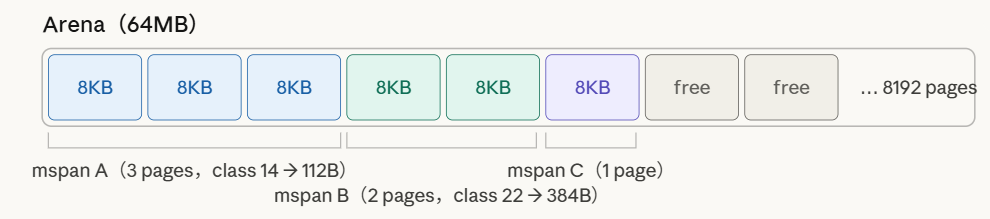

Go 在 mheap 层以 page 为最小维护粒度，一个 64MB 的 arena 被划分为 8192 字节（8KB）大小的 **page（页）**。这是 Go 运行时自己定义的页，与操作系统通常 4KB 的页不同。页是分配器内部工作的基本单元——需要多少页、哪些页空闲、哪些在用。

页不是凭空管理的——整个地址空间的页状态由 `pageAlloc` 这个结构统一追踪。它的核心是一棵**基数摘要树（radix summary tree）**，这是 Go1.14 引入的重大改进。
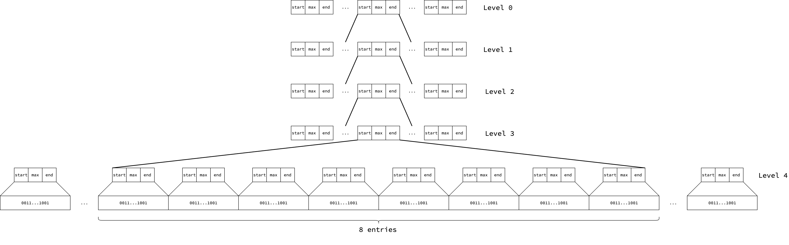
**pallocSum：三字段压缩进一个 uint64**
- 摘要树中每个节点存储一个 `pallocSum`（`uint64`）。设计者将三个字段紧凑打包：每个字段 21 bit，三个字段共 63 bit，加上 1 个特殊标志位共 64 bit。`start` 表示该区域头部有多少连续空闲 page；`end` 表示尾部有多少连续空闲 page；`max` 表示内部最大连续空闲 page 段。如果 `max == 2²¹` 则区域全空闲，使用最高位表示该特殊情况。全满的区域 `pallocSum == 0`，可以用单次 load 和零比较快速跳过。 
- 每个叶节点对应一个 chunk（512 page，4MB）；每层扫描 8 个 entry，恰好占满一条 64 字节的 L1 缓存行——这是刻意设计的，让搜索的内层循环最大程度命中缓存。 
**pallocBits：chunk 内的位图**
- 每个 chunk 对应一个 `pallocBits`，本质是 8 个 `uint64` 共 512 bit，每 bit 代表一个 page（1 = 在用，0 = 空闲）。整个 arena（64MB）包含 8192 个 page，需要 16 个 chunk 的位图，每个位图 64 字节，16 个合计 1KB——极其紧凑。
- 每个 P 还有一个 `pageCache`，记录一个 64 page 对齐块（512KB）的 64 bit 空闲位图。请求 span 时先查 `pageCache`；若请求 ≥ 16 page，则直接走全局 `pageAlloc.find`，因为缓存命中率太低。

**mspan**是连接 page 管理层与对象分配层的桥梁。

`mspan` 是一个结构体，持有**某段连续页面**的元数据，包括起始地址、页数、已分配对象数等。当我们说"span"时，指的是它所代表的内存区域；当说"mspan"时，指的是描述该区域的结构体本身。

### 3.  三级缓存机制

- **堆内存本体只有一份**，属于整个 Go 进程，由 **mheap 统一管理**。
- **mheap**：全局堆管理器，负责管理所有内存。
- **mcentral**：按对象大小分类管理 `span`，作为 mheap 和 mcache 之间的中间层。
- **mcache**：每个 **P 独有的本地缓存**，保存可快速分配的 span，减少锁竞争。

关系：
```
mheap（全局堆）
    |
    | 分配 span
    ↓
mcentral（按大小分类的 span 管理）
    |
    | 提供缓存
    ↓
mcache（每个 P 一个，本地快速分配）
```
一句话：
> **堆内存属于 mheap，mcentral 和 mcache 只是对堆内存的分级管理和缓存；mcache 不保存堆本体，只缓存分配资源。**


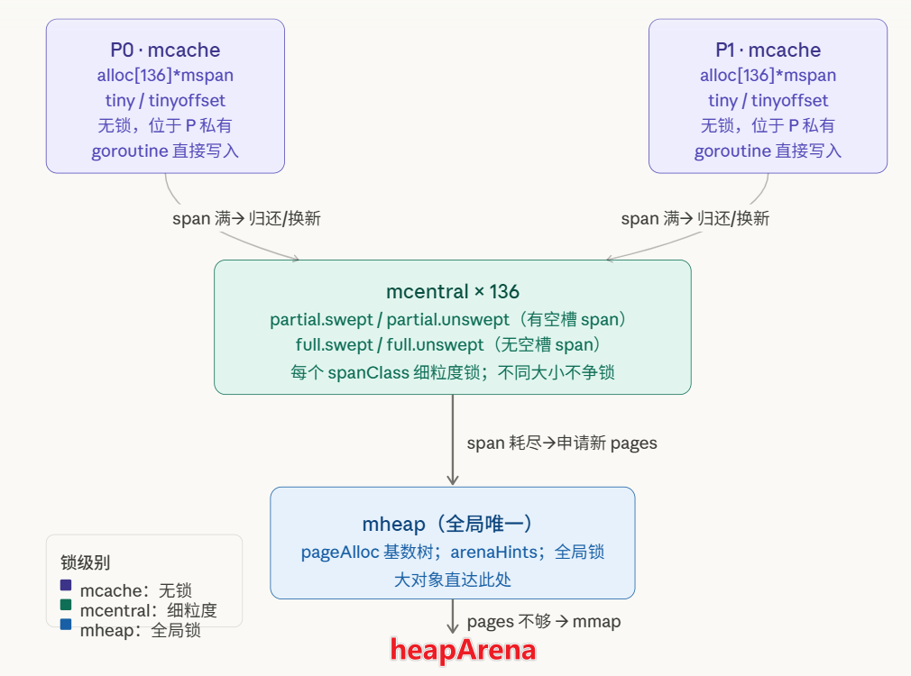
#### 线程缓存mcache（第一级，无锁）

mcache 是三级缓存中离 goroutine 最近的一层。

**mcache 挂在 P 上，不挂在 M 上。** 
>这是一个刻意的历史演变。早期版本的 mcache 挂在 OS 线程（M）上，导致进行系统调用时 M 被阻塞，M 的 mcache 却白白占着内存——一个 mcache 最多可以持有 2MB 内存，而阻塞在系统调用的 M 根本不需要它。

Go 1.1 引入逻辑处理器 P 之后，mcache 被迁移到 P 上。当 M 进入系统调用，P（连同它的 mcache）会立刻被另一个 M 接管，mcache 的利用率大幅提升。
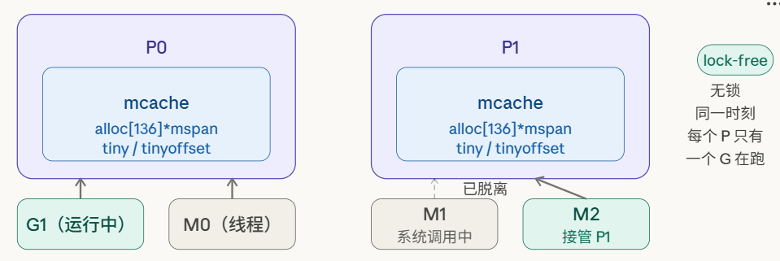
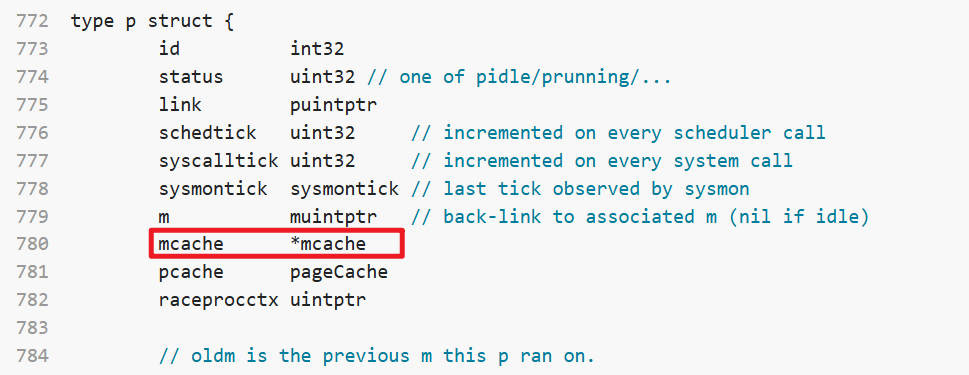
每个 P 拥有一个私有的 mcache，内含 136 个指向 mspan 的指针（每个 span class 各一个）。当某个 goroutine 需要分配内存时，直接在当前 P 的 mcache 上操作，**不需要任何锁**——因为同一时刻每个 P 只有一个 goroutine 在运行。

`mcache` 结构体的源码注释开头就写明：无需加锁，因为它是每个 P 私有的（per-P）。整个结构体存在于非 GC 管理内存（`sys.NotInHeap`）中，这意味着 mcache 本身不会被 GC 扫描——其中持有的堆指针（如 `tiny`）需要在 mark termination 阶段手动清除。

`alloc` 数组是 mcache 的主体：136 个指向 mspan 的指针，按 spanClass（0–135）索引。

初始化时每个槽都指向全局唯一的 `emptymspan`——一个哨兵对象，表示"当前 span 为空，需要 refill"。

#### 中心缓存mcentral（第二级，细粒度锁）

mheap 维护 136 个 mcentral 实例，每个对应一个 spanClass。每个 mcentral 内部有两大类 span 集合：`partial`（有空闲槽）和 `full`（无空闲槽），各自再分为 `swept`（已清扫）和 `unswept`（未清扫）两个子集，共 4 组
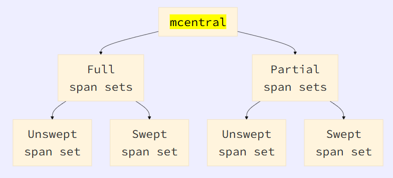

当某个 span class 的 mspan 填满时，mcache 将其归还给 mcentral 并索取一个有空闲槽的新 span。这需要**加锁**，但极为短暂(ns)——仅是交换一个 span 的操作。由于每个 span class 有独立的 mcentral，分配不同大小对象的 goroutine 之间不会互相争锁。

> [!NOTE]  锁的粒度：为什么"细粒度"
> 每个 mcentral 有自己的独立锁。分配 size class 22（384B）的对象和分配 size class 5（16B）的对象完全走不同的 mcentral，操作不同的 spanSet——两者之间没有任何锁竞争。只有同时大量分配**同一种大小**的对象才会在同一个 mcentral 上产生锁争用，而这在实际程序中极为少见。

每个 mcentral 内部维护两类 span 集合：partial（有空闲对象）和 full（无空闲对象），各自再细分为 swept（已清扫）和 unswept（未清扫）两个子集，共四组。

#### 页堆mheap（第三级，全局锁）

mheap 是整个分配体系的根

当 mcentral 没有可供分发的 span 时，它向 mheap 申请新的 page 来构建 span。mheap 是**全局页分配器**，整个进程只有一个，访问它需要**全局锁**。这是慢路径，涉及在 pageAlloc 基数树中搜索空闲页，可能触发向 OS 申请新 arena，以及初始化新 span。但因为上面两层吸收了大部分请求，这一步很少发生。

> [!NOTE]  全局锁的真实影响
> mheap 的全局锁是整个内存分配体系中唯一的全局争用点。实际工程中观察到的争用案例显示：当 sweep 后 span 完全为空需要归还 mheap 时，必须持全局锁；在 96 核机器上，这一操作可导致 `mheap_.lock` 的持锁时间达到总 CPU 时间的 30% 以上。
> 
> 这也是为什么三级体系的前两层（mcache 和 mcentral）要尽全力吸收请求——每一次能在 mcache 快路径解决的分配，都是一次避免触碰 mheap 全局锁的胜利。

#### 三层之间的协作
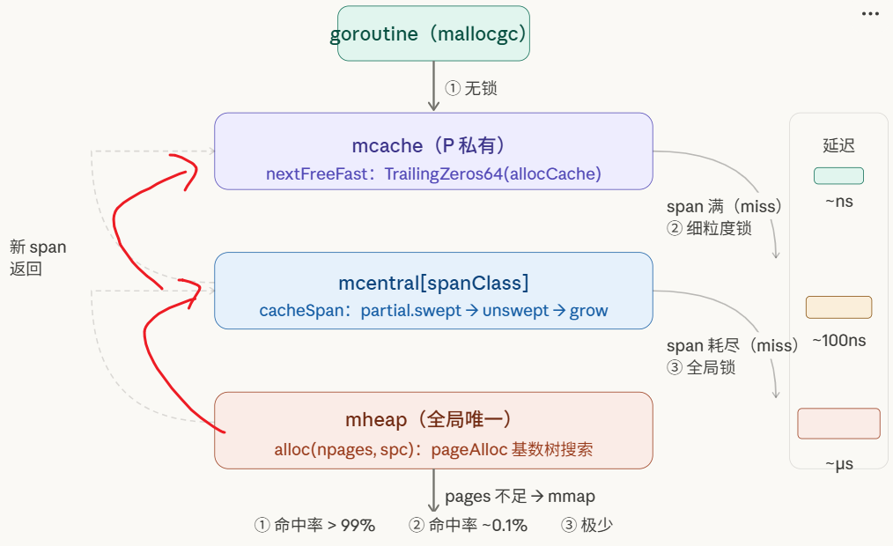

三级体系的设计哲学是**将锁的代价与访问频率反向匹配**：
- 最频繁的路径（mcache 快路径）完全无锁，代价仅一次位运算；
- 次频繁路径（mcentral）用细粒度锁且临界区极短；
- 最慢路径（mheap）虽是全局锁，但被前两层吸收后触发频率极低，总代价摊销到几乎可以忽略。

### 4. 三种对象的分配路径（Tiny/Small/Large）

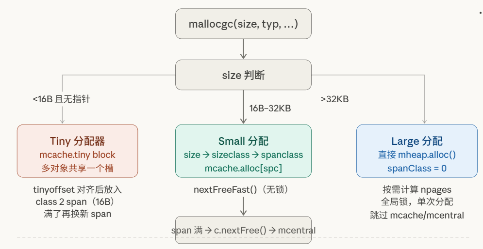

当我们的 Go 代码中 `new` 了一个对象时，分配过程就水到渠成了：

1. **微对象（小于 16 字节，不含指针）**： 直接在当前线程的 `mcache` 中的微分配器（Tiny Allocator）里拼凑分配，以极高的空间利用率塞进 16 字节的内存块中。
2. **小对象（16 字节到 32 KB 之间）**：
    - 测算对象大小，确定它属于哪一个**跨度类**（mcache → mcentral → mheap）。
    - 去当前线程的 **`mcache`** 货架上找对应的 `mspan` 集装箱，如果有空位，直接无锁拿走。
    - 如果 `mcache` 空了，去 **`mcentral`** 。
    - 如果 `mcentral` 也空了，去找大管家 **`mheap`** 申请新的 `mspan`。
3. **大对象（大于 32 KB）**： 太大，不经过 `mcache` 和 `mcentral` 任何缓存，直接粗暴地找大管家 **`mheap`** 分配所需页数的内存。

① 将大小向上取整到 size class，在 P 的 mcache 中对应 mspan 的空闲 bitmap 找到槽，直接分配——全程无锁；
② 若 mspan 无空槽，从 mcentral 的对应 size class span 列表取得新 mspan——代价是一次锁，但摊销了锁的成本；
③ 若 mcentral 的 span 列表为空，从 mheap 申请一批 page 构造新 span；
④ 若 mheap 空或无足够连续 page，向操作系统申请不少于 1MB（一个 arena）的新 page 组——摊销了与 OS 通信的成本。

绝大多数分配止步于第①步；第②③④步发生频率依次递减，这正是整套设计在高并发下仍能保持高吞吐的根本原因。

## 二、内存状态机与归还 OS

运行时管理的地址空间区域在任意时刻处于以下四种状态之一：
- **None**（未保留未映射，默认状态）
- **Reserved**（运行时持有，但访问会触发 fault，不计入进程内存占用）
- **Prepared**（已保留，无物理内存支持，访问行为未定义）
- **Ready**（可安全访问）。

`sysAlloc` 将 OS 选择的区域从 None 转为 Ready；`sysFree` 将任意状态转为 None。 

关于内存归还 OS：
当垃圾收集器释放对象时，它们并不立刻回到操作系统。

运行时有一个 **scavenger** 后台线程，负责定期将长时间未用的 span 页用 `MADV_FREE`/`MADV_DONTNEED`（Unix）或 `VirtualFree`（Windows）归还给 OS：虚拟地址保留，物理页释放，下次写入时 OS 再按需补充物理页。

## 三、进程虚拟内存空间
当操作系统为一个 Go 程序创建进程时，会划分出一个完整的虚拟内存地址空间。结合本文内容，它们的整体拼图是这样的：

```
高地址 (High Address) 
+====================================================================+
|                      操作系统内核空间 (OS Kernel Space)            |
+====================================================================+
|   栈区 (Stack)                                                     |
|   (整体向下增长 ↓ )                                                |
|                                                                    |
|   +------------------------------------------------------------+   |
|   | Goroutine 1 栈 (独立栈，遵循 LIFO 后进先出)                |   |
|   +------------------------------------------------------------+   |
|   | Goroutine 2 栈 (独立栈，遵循 LIFO 后进先出)                |   |
|   +------------------------------------------------------------+   |
|   | ... (成千上万个协程栈)                                     |   |
|   +------------------------------------------------------------+   |
|      * 重点联系：这些 G 栈的初始内存，其实是由底层的 Heap 提供！   |
+--------------------------------------------------------------------+
|                                                                    |
|                            ...                                     |
|                       (未映射/保留区域)                            |
|                            ...                                     |
|                                                                    |
+--------------------------------------------------------------------+
|   堆区 (Heap)                                                      |
|   (整体向上增长 ↑ )                                                |
|                                                                    |
|   +------------------------------------------------------------+   |
|   |                      heapArena                             |   |
|   |        (最高可达 256TB 的二维稀疏矩阵，绝对主角)           |   |
|   |                                                            |   |
|   |  [ mspan ]  [ mspan ]  [ mspan ]  [ mspan ]  [ mspan ]     |   |
|   |                                                            |   |
|   |  * 包含多级缓存架构：mcache -> mcentral -> mheap           |   |
|   |  * 切分出去的内存不仅用于对象分配，还用作 Goroutine 初始栈 |   |
|   +------------------------------------------------------------+   |
+--------------------------------------------------------------------+
|   数据段 / BSS 段 (Data / BSS Segment)                             |
|                                                                    |
|   * Data: 存放已初始化的全局变量和静态变量                         |
|   * BSS:  存放未初始化的全局变量和静态变量                         |
+--------------------------------------------------------------------+
|   代码段 (Text Segment)                                            |
|                                                                    |
|   * 存放编译后的 Go 机器指令                                       |
|   * 权限：只读 (Read-Only)、不可变                                 |
+====================================================================+
低地址 (Low Address)
```

- **代码段（Text Segment）**：存放编译后的机器指令。不可变，只读。
- **数据段 / BSS 段（Data/BSS Segment）**：存放全局变量和静态变量。
- **栈区（Stack）**：向下增长（地址减小）。虽然不由本文的“内存分配器”管理，但 Go 语言非常特殊：Go 的每个协程（Goroutine）都有自己独立的栈。**重点联系**：在 Go 语言中，Goroutine 的初始栈其实也是从底层的堆内存中切出来的，只不过一旦切出来作为栈使用后，其内部的管理就遵循栈的 LIFO（后进先出）规则了。
- **堆区（Heap）**：向上增长（地址增大）。**这就是本文的绝对主角**。我们在前文讨论的最高可达 256TB 的二维稀疏矩阵（`heapArena`）、所有的 `mspan` 和多级缓存，全部都盘踞在这个区域。

> [!TIP] `.bss`= block starting symbol **块起始符号**
> **块起始符号** 是指目标文件、可执行文件或汇编语言代码中用于存放**已声明但尚未赋值的静态分配变量**的部分。

既然局部变量大多在栈上分配，那什么时候才会用到我们刚才学的那些复杂的堆内存分配器呢？这引出了 Go 语言中极为重要的一个概念，它是连接栈和堆的桥梁——**逃逸分析（Escape Analysis）**。
- 当你在函数里 `new` 了一个对象，或者声明了一个局部变量，Go 编译器会首先评估：这个变量在函数 return 之后，还会被外面用到吗？
- **如果不被用到（未逃逸）**：编译器就会把它安放在**栈**上。函数一结束，栈指针一抬，内存瞬间回收，根本不需要惊动 `mcache` 和 `mheap`，也没有垃圾回收（GC）的开销。
- **如果被外面用到了（发生逃逸，比如返回了局部变量的指针）**：编译器就会判定它不能放在栈上（否则函数结束后内存就失效了）。此时，这个变量就会“逃逸”到**堆**上。**一旦来到堆上，它就立刻落入了本文所讲的 `mallocgc` 函数的管辖范围**，开始经历测算大小、进入微对象/小对象/大对象分配逻辑、寻找 `mspan` 的全过程。

## 四、对操作系统内存管理的借鉴

#### 1. 多级缓存架构 (Multi-level Caching)
- **操作系统中的做法**：现代计算机体系结构利用了 CPU L1/L2/L3 缓存到主存（RAM）再到磁盘的多级缓存结构，越靠近 CPU 的缓存速度越快、容量越小，且由单个核心独享以避免竞争。
- **Go 语言的借鉴**：Go 语言明确借鉴了这种机制，Go 引入了三个层级来分级管理内存：
    - **线程缓存（`mcache`）**：绑定在每个独立的线程上，满足绝大多数分配需求，因为不涉及多线程，所以不需要使用互斥锁来保护内存，极大减少了锁竞争带来的性能损耗。
    - **中心缓存（`mcentral`）**：作为线程缓存的补充，属于全局结构，访问它需要加锁。
    - **页堆（`mheap`）**：最底层的全局组件，当中心缓存也不足时，直接在页堆中分配或向操作系统申请。

#### 2. 分页管理思想 (Paging Mechanism)
- **操作系统中的做法**：操作系统为了彻底解决外部碎片，将虚拟内存和物理内存都划分为固定大小的“页”（通常是 4KB），按页进行映射和分配。
- **Go 语言的借鉴**：Go 语言内部也是以“页”为单位进行大块内存管理的。虽然 Go 里的页大小是 8KB，且文档特别说明“这里的页不是操作系统中的内存页，它们是操作系统内存页的整数倍”，但其核心管理逻辑是一致的。Go 的基础内存管理单元 `mspan` 就是用来管理 `npages` 个大小为 8KB 的页的。当结构体管理的内存不足时，运行时也是以页为单位向页堆申请内存。

#### 3. 地址空间与状态机管理 (Virtual Memory States)
- **操作系统中的做法**：操作系统内核在分配虚拟内存时，会将内存标记为不同的状态（如已保留、已提交等），延迟物理内存的真实分配，从而提高效率（即按需分配）。

- **Go 语言的借鉴**：Go 语言在用户态构建了一个“操作系统的内存管理抽象层”。它将运行时管理的地址空间严格划分为四种状态机：
    - `None`：内存没有被保留或者映射。
    - `Reserved`：运行时持有该地址空间，但访问会导致错误（提前占坑，但不实际分配物理内存）。
    - `Prepared`：内存被保留，可以快速转换到 Ready 状态。
    - `Ready`：可以被安全访问。 Go 通过封装 Linux 的 `mmap`、`madvise` 等系统调用，在用户态精准模拟了操作系统对虚拟内存状态的精细控制。


#### 4. 专有对象分配器 (类 Slab 分配器)
- **操作系统中的做法**：Linux 内核中有一种著名的内存分配机制叫 Slab 分配器，专门用于分配内核中经常使用的固定大小的数据结构（如进程描述符），以消除内部碎片并提高分配速度。
- **Go 语言的借鉴**：Go 语言借鉴了 TCMalloc（Thread-Caching Malloc）的设计，将对象根据大小分类，实施不同的分配策略。Go 在内部维护了 67 种不同的**跨度类（spanClass）**，每一种跨度类都会预先计算好并只存储特定大小的对象（比如类别 1 存 8 字节，类别 2 存 16 字节）。这种“根据固定大小隔离分配”的策略，其哲学与操作系统的 Slab 分配器如出一辙。

## 五、垃圾回收

要搞懂这三个概念，我们可以把**垃圾回收（Garbage Collection, GC）** 想象成一场“大扫除”。

我们的内存里有很多对象（物品），有的还在用（存活），有的已经不用了（垃圾）。如果程序停下来让我们慢慢扫，那很简单；但现代程序的难点在于：**清洁工在打扫卫生的同时，房间里的主人（你的程序）还在不停地搬东西**。

为了在这个乱局中安全地把垃圾清理掉，还不误扔有用的东西，计算机科学家们发明了这套理论。

---

### 1. 三色抽象
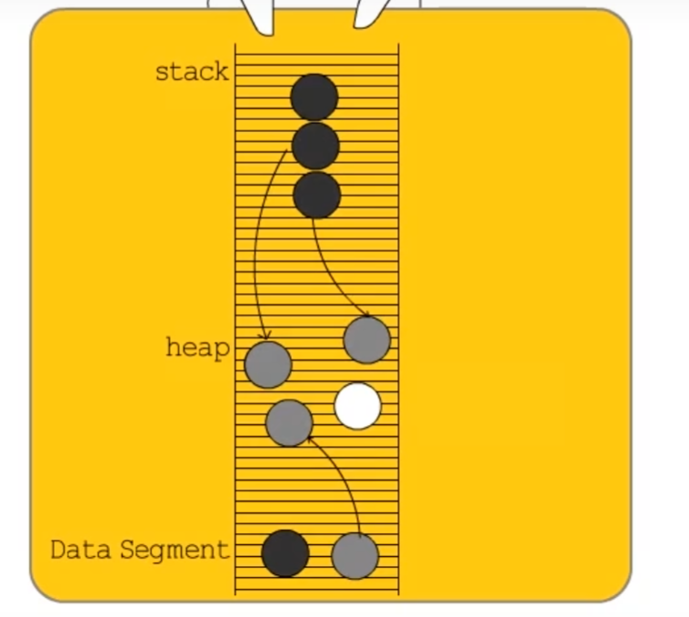

为了区分哪些东西检查过了，哪些没检查，清洁工给所有的物品打上三种颜色的标签：
- ⚪ **白色（未访问）：** 初始状态。所有物品一开始都是白色的。如果在打扫结束时它还是白色的，那它就是没人要的垃圾，会被扔掉。
- 🔘 **灰色（待处理）：** 清洁工看到了这个物品，知道它有用，但是**还没来得及检查它里面装了什么**（比如一个对象引用了其他对象）。灰色就像是一个“待办事项清单”。
- ⚫ **黑色（安全存活）：** 清洁工不仅确定这个物品有用，而且**已经把它里面的所有东西都检查过了一遍**。黑色代表绝对安全，且黑色物品绝对不会被当成垃圾清理。

**大扫除的流程非常简单：**

1. 一开始，所有东西都是**白色**的。
2. 清洁工从程序的“根节点”（比如全局变量、当前运行的函数栈）出发，找到直接关联的物品，把它们涂成**灰色**。
3. 清洁工从灰色清单里拿出一个物品：
    - 把它引用的其他白色物品涂成**灰色**。
    - 把它**自己涂成黑色**。
4. 重复第3步，直到只剩下**黑色（已检查）和白色（未检查）**。
5. 最后，剩下的**白色**全当垃圾扔掉。

> 这个流程会把一些实际有用的误判为垃圾。所以需要后文的**三色不变性+混合写屏障。**

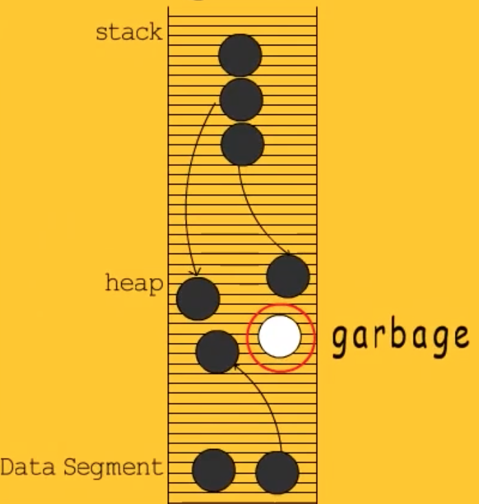

---

### 2. 三色不变性（黑指白问题）

> 并发标记必须满足的安全条件，避免误回收活对象

如果程序暂停运行（STW, Stop The World），上面这套流程完美无缺。但是如果你想**并发大扫除**（清洁工和主人同时活动），就会发生**致命的误扔事件**。

**灾难场景：**
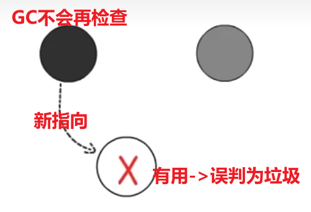
1. 清洁工把物品 A 涂成了**黑色**（A 检查完了）。
2. 清洁工正准备检查**灰色**的 B，B 目前连着**白色**的 C。
3. 就在这时，主人突然修改了引用！他让 **黑色的 A 连上了 白色的 C**，并且 **断开了 灰色 B 到 白色 C 的连接**。
4. 悲剧发生了：清洁工不会再去检查黑色的 A 了，而灰色的 B 也不再连着 C。大扫除结束时，有用的 C 依然是白色的，被当成垃圾无情销毁！


为了防止这种悲剧，科学家提出了**三色不变性**规则，只要遵守其中任意一条，就能保证不扔错东西：

#### 强三色不变性
- **强三色不变性（一刀切）：** 强制规定**黑色物品绝对不能直接指向白色物品**。只要我不允许黑指白，上面的灾难场景第3步就无法发生。

#### 弱三色不变性（go的混合写屏障满足）
- **弱三色不变性（留后路）：** 允许黑色物品指向白色物品，但前提是**必须有另外一个灰色物品在直接/间接指向这个白色物品**。这样就算黑指白了，清洁工顺着那个灰色的线索，迟早还能找到这个白色的，把它救下来。


---

### 3. 屏障技术

> 用来实现“三色不变式”

规则定好了，怎么强制程序遵守规则呢？这就需要**屏障技术**。

这里的“屏障”不是物理上的墙，而是一段**拦截代码**。你可以把它想象成过高速公路的“收费站”或者给指针赋值时的“钩子（Hook）”。

当程序在运行过程中想要**修改指针**（也就是搬东西、改变引用关系）时，触发写屏障（Write Barrier），拦截这个动作，做点手脚来维护上面的“三色不变性”。

常见的两种写屏障策略：

- **插入写屏障（Dijkstra 屏障）（黑指白，白涂灰）：**
	- 
    - **做法：** 当一个黑色对象准备指向一个白色对象时，屏障实施拦截，把那个白色对象**涂成灰色**。将**有存活可能的对象都标记成灰色**以满足强三色不变性。
    - **效果：** 满足了“强三色不变性”。既然白变灰了，就不存在黑指白的问题了。

- **删除写屏障（Yuasa 屏障）（不指白，白涂灰）：**
	- 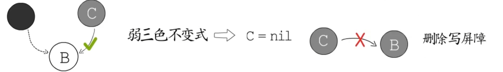
    - **做法：** 当任何对象准备断开对一个白色对象的引用时，屏障实施拦截，把那个白色对象**涂成灰色**。
    - **效果：** 满足了“弱三色不变性”。不管这个白色对象接下来会被谁接手，我都先把它变灰，确保它在这个回合绝对不会被当垃圾扔掉（宁可放过，绝不杀错）。

### 4. 混合写屏障

在 Go 里，内存分为**栈**和**堆**。
- **栈**：存放局部变量，函数的调用极其频繁，变量的创建和销毁极快。
- **堆**：存放全局变量或者生命周期较长的对象。

如果我们在**栈**上也开启写屏障，每次修改变量都要执行一段屏障代码，程序的运行速度会被严重拖垮。因此，**Go 决定不在栈上开启写屏障，写屏障只针对堆上的指针修改生效。**

但在 Go 1.5 时代，因为栈上没有屏障，为了防止前面提到的“误杀好人”的情况，Go 不得不在三色标记的最后阶段，**强制暂停整个程序（STW）**，把栈上的对象全部重新扫描一遍。

为了彻底消灭最后那段重新扫描栈的 STW 时间，Go 引入了结合“插入写屏障”和“删除写屏障”优点的**混合写屏障**（Go 1.8 至今）。

它的核心思想可以用伪代码简单概括为两步：
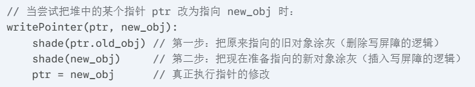

具体来说，在开启 GC 的那一刻，Go 会严格执行以下 **四条核心规则**：
1. **栈上对象全变黑：** GC 一开始，先把当前栈上的所有可达对象全部标记为**黑色**。这意味着栈上的对象被认为是绝对安全的，后续不需要再重新扫描。
2. **新建对象直接变黑：** 在 GC 运行期间，程序如果新创建了任何对象（无论是分配在栈上还是堆上），直接默认标记为**黑色**。
3. **被删除引用的对象变灰（删老指针变灰）：** 当堆上的一个指针被修改，它原本指向的那个**旧对象**会被立刻涂成**灰色**。就算这个旧对象随后被完全抛弃，这一轮 GC 也先保它一命（满足弱三色不变性），等下一轮 GC 再清理。
4. **被添加引用的对象变灰（加新指针变灰）：** 当堆上的一个指针被修改，它准备指向的那个**新对象**也会被立刻涂成**灰色**。这样就算这个新对象原本是白色的，也不会因为没有屏障的栈的操作而被意外回收。

混合写屏障带来了什么？
- **“新对象全黑” + “删老指针变灰” + “加新指针变灰”** 完美地堵死了所有在并发状态下可能导致“黑指白”的漏洞。
- 最爽的是，因为栈一开始就全黑了，而且栈上不用开屏障，**GC 结束时再也不需要 STW 去重新扫描栈了！** 这使得现代 Go 语言的 GC 暂停时间极短，通常在 **微秒级别（通常小于 1ms）**。这对于对延迟极其敏感的后端服务架构来说，是一个巨大的优势。

### 5. GC过程

> [!NOTE]  STW总结
> 只有在**准备阶段**（强制结束上一轮、开混合写屏障+启动）、**完成标记阶段**（关闭混合写屏障、启动清理、计算下一轮水位）存在极短的STW。中间的标记阶段无STW。

#### 1. 清扫终止—— 极短 STW
（Sweep Termination）
在开始新一轮大扫除之前，系统必须确保上一轮的垃圾已经被彻底清扫干净了。
- **动作：** 触发极其短暂的 STW。
- **目的：** 检查并强制结束上一轮未完成的清扫工作。由于清扫通常是并发在后台完成的，这个阶段通常快到可以忽略不计。

#### 2. 标记准备—— 极短 STW
（Mark Setup）
这是正式大扫除前的“封场”和“发装备”阶段。
- **动作：** 依然处于 STW 状态。
- **核心工作：**   
	- **开启混合写屏障：** 通知所有正在运行的 Goroutine，从现在开始，任何人搬动堆里的对象，都必须遵守屏障的规则（该变灰的变灰）。
    - 启动后台的标记协程（Mark Workers），准备好计分板。

- **耗时：** 通常在 **10~30 微秒** 之间。屏障一旦开启，STW 立刻结束，业务代码继续狂奔。

#### 3. 并发标记—— 与业务并发运行
（Concurrent Marking）
这是 GC 耗时最长、也是最核心的阶段。它完全和你的业务代码同时运行。

- **动作：** 不停顿程序（No STW）。
- **核心工作：** 后台的 Mark Workers 从根对象（全局变量、Goroutine 栈）出发，使用三色标记法顺藤摸瓜，把所有存活的对象涂黑。
- **关键机制：Mutator Assist（辅助标记）**
    - **问题：** 如果业务代码（Mutator）疯狂分配新内存，产生垃圾的速度超过了后台清洁工的标记速度，怎么办？内存岂不是要撑爆？
    - **对策：** Go 调度器会强行“抓壮丁”。如果系统发现某个 Goroutine 分配内存太猛，就会暂停它的业务执行，强迫它先去帮清洁工干一会儿标记的活儿，然后再放它回去处理业务。
    - **实战意义：** 在高并发的后端服务中，如果你发现某个接口偶尔出现不明原因的**延迟毛刺**，往往就是因为这个 Goroutine 被抓去当“壮丁”（Mark Assist）了。减少内存的堆分配，就能直接减少这种毛刺。

辅助标记在底层是通过一套极其精密的“信用与债务”系统来运转的：
- **背上债务：** 当一个业务协程申请分配 `N` 字节的内存时，系统会根据当前的 GC 压力，计算出它必须完成相应比例的标记工作量（也就是“债务”）。
- **强制打工：** 如果该协程的“信用额度”不足以支付这个债务，它就会被强制暂停当前的业务逻辑，转而去执行 `gcAssistAlloc` 函数。它会从全局的 GC 工作队列中“偷”一部分标记任务来做（比如去扫描几个对象，把它们涂黑）。
- **还清债务：** 只有当它完成了足够的标记工作，还清了债务，Go 调度器才会放它回去，让它继续执行原本的业务代码。

> [!IMPORTANT]  如何减少辅助标记？
> 既然理解了辅助标记是因为**在 GC 期间分配内存过快**引起的，那么优化的核心思路就非常清晰了：**减少堆内存的分配**。
>
> - **对象复用（sync.Pool）：** 对于频繁创建和销毁的临时对象（比如字节缓冲区 `[]byte`），使用 `sync.Pool` 将其缓存起来。复用对象意味着不需要申请新内存，自然就不会触发辅助标记。
  >   
> - **预分配容量：** 在初始化 Slice 或 Map 时，如果能预估大小，一定要使用 `make(type, size, capacity)` 提前分配好足够的容量，避免运行期间动态扩容产生的额外堆分配。
>     
> - **避免内存逃逸：** 写出“对编译器友好”的代码，让本该在栈上的变量留在栈上。栈上的分配和销毁成本极低，且完全不占用 GC 的额度，更不会触发辅助标记。

#### 4. 标记终止—— 极短 STW
（Mark Termination）
经过漫长的并发标记，工作接近尾声，需要做最后的收尾和对账。
- **动作：** 再次触发短暂的 STW。
- **核心工作：**
    - **关闭混合写屏障：** 危险期已过，主人搬东西不再需要登记。
    - 唤醒后台清扫协程Sweep Workers。
    - 计算下一次触发 GC 的目标内存水位（GC Pacer 控制器）。
- **耗时：** 同样在 **几十微秒** 级别。


#### 5. 并发清扫—— 与业务并发运行
（Concurrent Sweeping）
垃圾已经被精准定位（所有白色的对象），现在到了把物理空间还给操作系统的时刻。
- **动作：** 不停顿程序（No STW）。
- **核心工作：** 后台的 Sweep Workers 开始将白色对象占用的内存块标记为可用，归还给 Go 的内存分配器。如果业务协程在申请新内存时发现没有现成的空闲块，也会被触发去顺手清扫一部分内存（类似于“懒清扫”）。


## 六、栈空间管理

栈区的内存一般**由编译器自动分配和释放**，其中存储着函数的入参以及局部变量，这些参数会随着函数的创建而创建，函数的返回而消亡，一般不会在程序中长期存在，这种线性的内存分配策略有着极高地效率，但是工程师也往往**不能控制栈内存的分配**，这部分工作基本都是由编译器完成的。

栈寄存器是 CPU 寄存器中的一种，它的主要作用是跟踪函数的调用栈，Go 语言的汇编代码包含 BP 和 SP 两个栈寄存器，它们分别存储了栈的**基址指针**和**栈顶的地址**，栈内存与函数调用的关系非常紧密，我们在函数调用一节中曾经介绍过栈区，BP 和 SP 之间的内存就是当前函数的调用栈。
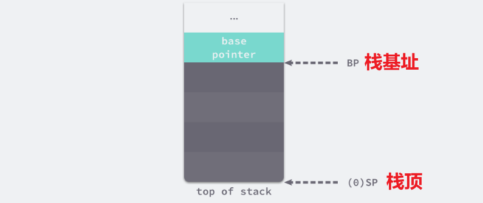

在最新版本的 Go 中，每个 Goroutine 被创建时，Go 运行时只会给它分配一个极小的连续内存区域作为初始栈，大小仅为 **2KB**。

因为起步极小，所以创建成本极低。这就是为什么你可以毫不犹豫地写出 `go func()`，而不用太担心内存爆炸。但这 2KB 显然不够深层函数调用或者存放稍微大一点的局部变量，所以 Go 必须具备一种“按需扩容”的超能力。

### 1. 扩容（连续栈）

>在 Go 1.3 之前，Go 采用的是“分段栈（Segmented Stacks）”。当 2KB 不够用时，就在别的地方再申请一块内存，用一个链表把旧栈和新栈连起来。但这带来了一个致命问题：**热分裂（Hot Split）**。如果程序在一个循环里恰好在栈的边界处不断地调用和返回函数，就会疯狂地触发新栈的分配和释放，导致性能断崖式下跌。

为了彻底解决这个问题，从 Go 1.4 开始直到最新版本，Go 全面采用了**连续栈**。

连续栈可以解决分段栈中存在的两个问题，其核心原理是每当程序的栈空间不足时，初始化一片更大的栈空间并将原栈中的所有值都迁移到新栈中，新的局部变量或者函数调用就有充足的内存空间。


连续栈的核心思想非常简单粗暴，但底层实现极其硬核。当 Goroutine 发现自己的 2KB 栈快用完时，它会进行一次“搬家”：

1. **容量检测：** Go 编译器会在每个函数的入口处（Prologue）自动插入一段隐蔽的汇编指令。每次调用函数前，先检查当前的栈顶指针是否越过了栈底的安全线。
2. **申请新家：** 如果发现空间不够，Goroutine 会触发栈扩容，直接向系统申请一块**当前栈大小 2 倍**（比如 2KB 变 4KB，4KB 变 8KB）的全新连续内存。
3. **数据拷贝：** 把旧栈里的所有数据，原封不动地按字节拷贝到新栈里。
4. **核心——指针调整：** 这是连续栈技术中最难的一步。因为栈搬家了，内存地址全变了！如果你的代码里有指针指向栈里的某个局部变量，扩容后这个指针就成了指向废弃内存的野指针。
    - 为了解决这个问题，Go 运行时的垃圾回收器（GC）和栈管理模块高度耦合。Go 内部维护了极其精确的**栈映射（Stack Map）**。
    - 在拷贝完数据后，Go 会根据 Stack Map 找出栈中所有的指针，自动计算出新的偏移量，**把所有指向旧栈的指针全部偷偷修改为指向新栈**。

5. **释放旧家：** 搬家完成，业务代码继续执行，仿佛什么都没发生过，旧的栈内存被回收。

### 2. 缩容

这个缩容的工作，交给**垃圾回收器（GC）** 来顺手完成：

- 在 GC 的标记阶段，清洁工不仅会清理堆内存，还会顺便检查每个 Goroutine 栈的使用情况。
- 如果发现一个 Goroutine 当前实际使用的栈空间，**不到其分配总容量的 25%**。
- GC 就会给它分配一个 **原来一半大小** 的新栈（比如从 64KB 缩减到 32KB），然后把数据拷贝过去，同样执行指针调整。

## 七、手动内存管理

Go 是一门带有垃圾回收（GC）的语言，因此在常规开发中，程序员并不需要（也无法）像 C/C++ 那样使用 `malloc` 和 `free` 进行绝对意义上的“手动内存管理”。

但是，在追求高性能的场景下，Go 程序员确实会使用一系列手段来**干预、控制和优化**内存分配，这在某种程度上起到了“手动管理”的作用。这种控制对于 Go 程序的性能调优不仅是**有帮助的，甚至是决定性的**。


### 1. 在 Go 中如何进行“手动”内存管理？

Go 程序员对内存的控制主要体现在 **“减少分配”** 和 **“控制分配位置”** 上：

#### 1. 控制堆栈分配

在 Go 中，分配在栈（Stack）上的内存会在函数返回时自动销毁，不需要 GC 介入，开销极小；而分配在堆（Heap）上的内存则需要 GC 来清理，开销较大。

- **手动控制方式：** 程序员可以通过运行 `go build -gcflags="-m"` 来查看变量是否“逃逸”到了堆上。为了优化性能，开发者会刻意重构代码（例如传递值而不是指针，或者避免将局部变量的指针存入全局结构中），以确保对象留在栈上，从而完全避开 GC 压力。

#### 2. 对象池化（`sync.Pool`）

这是 Go 中最常见的“手动复用”内存的方式。
- **手动控制方式：** 对于频繁创建和销毁的大对象（如较大的 `byte` 切片、复杂的结构体），将其放入 `sync.Pool` 中。用完后通过 `pool.Put()` 放回，下次需要时通过 `pool.Get()` 获取。这相当于程序员自己在应用层维护了一个内存池，极大地减轻了 GC 标记和清除的工作量。


#### 3. 内存预分配与切片/映射控制

- **手动控制方式：** 在使用 `slice` 或 `map` 时，如果能预估容量，必须使用 `make([]T, 0, capacity)` 提前分配好底层数组。这避免了在数据增长时底层数组面的多次扩容（申请新内存 -> 拷贝数据 -> 废弃老内存留给 GC）。

#### 4. 极端手段：`unsafe` 包与 `cgo`

- **手动控制方式：** Go 提供了 `unsafe.Pointer`，允许开发者绕过类型系统直接操作内存指针。此外，如果通过 `cgo` 调用 C 代码，开发者可以真正地使用 C 的 `malloc` 分配堆外内存（Off-heap memory）。这部分内存完全不受 Go GC 控制，必须由程序员手动调用 C 的 `free` 来释放。

#### 5. 内存竞技场（Memory Arenas - Go 1.20 引入的实验性功能）

- **手动控制方式：** `arena` 包允许程序员分配一块连续的巨大内存，并在其中分配各种对象。当这批对象不再使用时，可以直接“一键释放”整个 arena。这种按区域（Region-based）的手动管理方式在构建复杂请求上下文（如数据库查询树）时能带来巨大的性能提升。

#### 6. GC 旋钮调优（`GOGC` 与 `GOMEMLIMIT`）

- 通过设置 `GOGC` 环境变量来调节触发 GC 的频率，或者使用 Go 1.19 引入的 `GOMEMLIMIT` 设置软内存上限。这也是程序员干预内存生命周期的宏观手段。

---

### 2. 这些控制对调优有帮助吗？

**帮助极大。在 Go 的高阶调优中，有一句名言：“最好的 GC 就是没有 GC”。**

1. **降低 CPU 消耗：** Go 的 GC 虽然延迟极低（Sub-millisecond），但它是一个并发的标记-清除（Mark-Sweep）过程，**非常吃 CPU 资源**。在高吞吐量（如每秒处理数万请求的网关）应用中，频繁分配对象会导致 GC 占用高达 20%-30% 的 CPU 算力。通过上述“手动”手段减少堆分配，可以直接将这些算力还给业务逻辑。

2. **减少延迟毛刺（Latency Spikes）：** 尽管 Go 强调低暂停，但在 STW（Stop-The-World）阶段和辅助标记（Mark Assist）阶段，业务协程（Goroutine）的执行仍会被拖慢。严格控制内存可以使系统的 P99 延迟更加平滑。

3. **提升缓存命中率：** 连续的内存预分配和栈内存分配，更符合 CPU Cache 友好的数据局部性（Data Locality）原则。


---

### 3. Go vs. C++ vs. Java 的内存管理哲学对比

这三种语言代表了内存管理的三种不同流派：

| **特性**      | **C++ (极致的控制)**                            | **Java (极致的自动化)**                            | **Go (务实的折中)**                                  |
| ----------- | ------------------------------------------ | -------------------------------------------- | ----------------------------------------------- |
| **核心机制**    | 手动管理 (`new`/`delete`, 智能指针, RAII)。无 GC。    | 强大的分代垃圾回收器 (G1, ZGC等)。JVM 掌管一切。              | 非分代的并发标记清除 GC，结合编译期的逃逸分析。                       |
| **内存布局控制**  | **极强。** 数据在内存中如何排列完全由程序员决定（栈、堆、对齐方式）。      | **极弱。** 一切对象皆引用（指针），对象在堆上的位置由 JVM 决定和移动。     | **较强。** 支持值类型嵌套结构体（Value semantics），内存可连续排列。    |
| **调优方向**    | 解决内存泄漏、野指针，优化自定义内存分配器 (tcmalloc/jemalloc)。 | JVM 参数调优，选择合适的 GC 算法，调整新生代/老年代比例。            | 优化代码逻辑以减少逃逸，使用 `sync.Pool` 复用，减少堆分配。            |
| **GC 延迟**   | 无 GC 暂停。                                   | 吞吐量极高，但以前容易出现较长的 Stop-The-World（ZGC 改善了这一点）。 | 暂停时间极短（低延迟优先），但 GC 期间会消耗较多 CPU。                 |
| **程序员心智负担** | **高。** 必须时刻关注对象生命周期和所有权。                   | **低。** 只管 new，基本不用管释放（除非引发 OOM）。             | **中等。** 平时可以当作带有 GC 的语言写，遇到性能瓶颈时再利用工具抓取逃逸和复用内存。 |

**总结来说：**

- **C++** 给了你一辆手动挡跑车，性能上限最高，但操作失误就会车毁人亡（段错误/内存泄漏）。
- **Java** 是一辆配置豪华的自动挡房车，JVM 帮你搞定绝大多数路况，但你想拆开引擎盖自己调火花塞却很难。
- **Go** 则是一辆带有“运动模式”的自动挡轿车。日常驾驶你可以完全依赖 GC 轻松上路；但在赛道（高并发/高性能瓶颈）上，你可以切入手动拨片（逃逸分析、`sync.Pool`、结构体值类型），获得接近 C++ 的操控感和性能。
