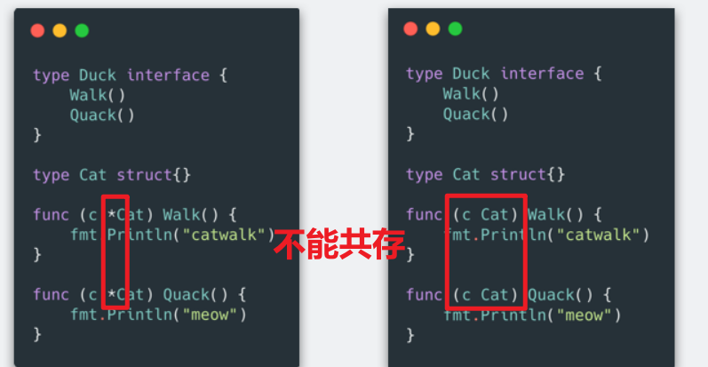
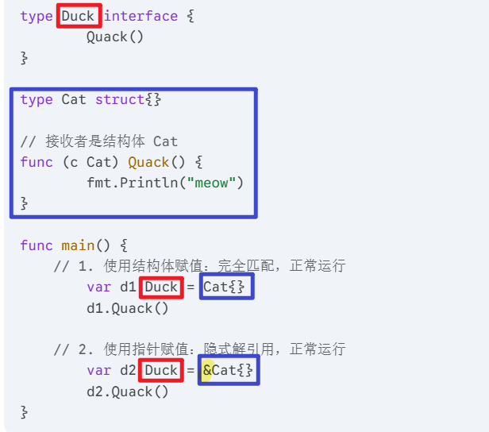
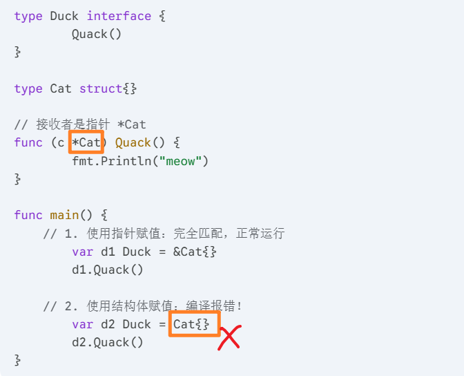
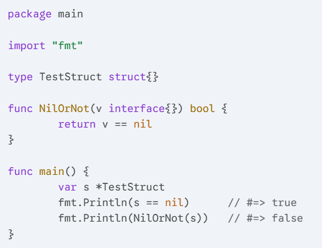
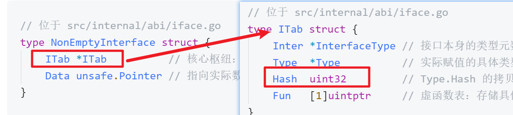
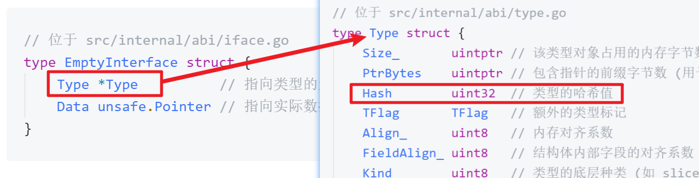
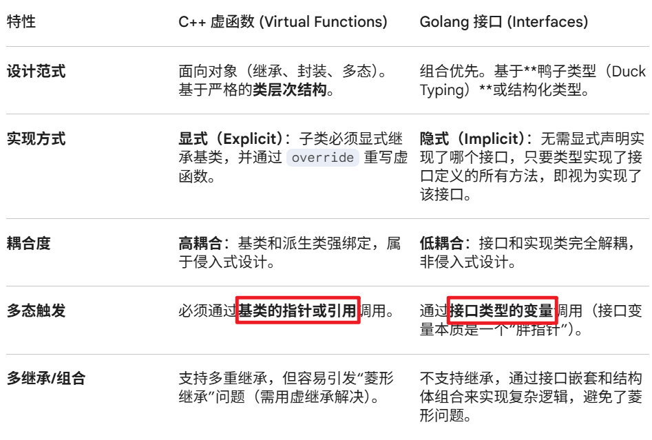
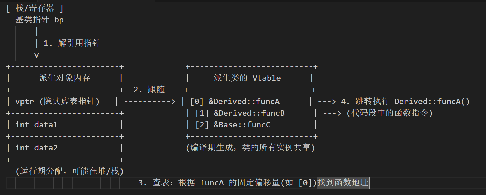
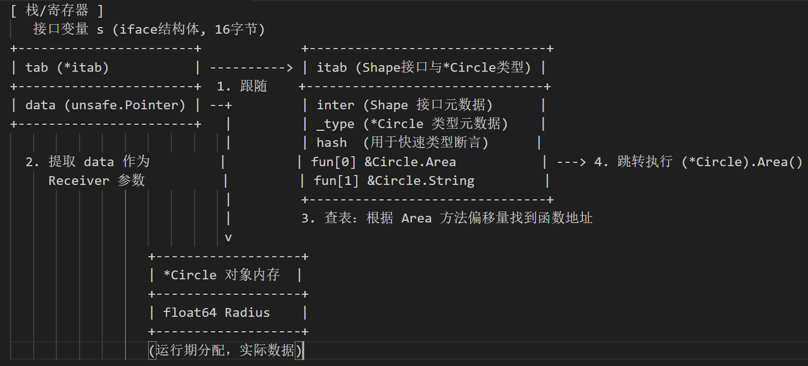

> [!NOTE]  笔记
> - 可以使用结构体或使用指针作为接收者来实现方法；方法接收者为指针，只能由结构体指针赋值；方法接收者为结构体，使用结构体和指针（自动解引用）都可赋值。
> - 将实现了接口的结构体转换为接口类型的时候，传地址`var c Duck = &Cat{Name: "draven"}`性能最佳，传值`var c Duck = Cat{Name: "draven"}`会发生逃逸和拷贝。


接口的本质是引入一个新的中间层，调用方可以通过接口与具体实现分离，解除上下游的耦合，上层的模块不再需要依赖下层的具体模块，只需要依赖一个约定好的接口。

相比其他语言，Go的接口是隐式实现的，实现了接口中声明的函数，则实现了接口。

## 一、概述

### 1. 分类
Go 语言使用 `runtime.iface` 表示**带有方法**的接口，使用 `runtime.eface` 表示**不包含任何方法**的接口 interface{}，两种接口虽然都使用 interface 声明，但是由于后者在 Go 语言中很常见，所以在实现时使用了特殊的类型。

需要注意的是，与 C 语言中的 `void *` 不同，`interface{}` 类型**不是任意类型**。如果我们将类型转换成了 `interface{}` 类型，变量在运行期间的类型也会发生变化，获取变量类型时会得到 `interface{}`。

```go
package main

func main() {
	type Test struct{}
	v := Test{}
	Print(v)
}

func Print(v interface{}) {
	println(v)
}
```

### 2. 指针和接口



Go 语言的编译器会在结构体类型和指针类型都实现一个方法时报错 “method redeclared”。

#### 案例一：使用“结构体”实现接口


当把指针 `&Cat{}` 赋值给接口并调用方法时，Go 语言编译器会**隐式地对变量解引用**，获取到指针指向的结构体，然后再执行对应的方法。这就像 C 语言里的 `d->Walk()` 会先找到对应的数据一样。

#### 案例二：使用“结构体指针”实现接口
当接口方法的接收者是**结构体指针**时，只有使用指针赋值才能通过编译，使用结构体赋值会报错。

如果运行上面的代码，第二种情况会报类似这样的错误：`Cat does not implement Duck (Quack method has pointer receiver)`。

**为什么结构体赋值会失败？**
核心点：**Go 语言在传递参数时都是传值的**。 

当你使用 `Cat{}` 初始化接口变量并调用 `Quack()` 时，会发生值拷贝。因为 `Quack` 方法需要一个 `*Cat` 指针作为接收者，编译器不会“无中生有”地为你创建一个新的指针去指向这个拷贝出来的结构体。即使编译器勉强创建了一个新指针，这个指针指向的也是一份全新的拷贝副本，而不是最初调用该方法的原始结构体，这违背了使用指针通常是为了修改原数据的初衷。

> [!TIP]
> 用指针作为方法接收者去实现接口，本意可能是想在方法内修改结构体的值。
> 但如果此时传的为结构体，那么按照值拷贝，方法内修改的则会是临时结构体的值，与初衷违背。

> [!NOTE]  
> - 如果用**结构体**实现了接口，那么**结构体**及其**指针**都算实现了该接口。
> - 如果用**指针**实现了接口，那么只有**该指针类型**才算实现了该接口。


### 3. nil指针赋值给接口

> [!NOTE]  Go 语言的接口类型不是任意类型
> 一个值为 nil 的指针赋值给接口后，接口变量就不再是 nil 了



产生这种现象的根本原因在于**隐式的类型转换**。

1. **接口的内部结构**：在 Go 语言底层，一个接口变量不仅仅存储了数据本身的值，还存储了该数据的**类型信息**。
2. **触发隐式转换**：当我们把变量 `s` 传入 `NilOrNot` 函数时，或者进行接口变量赋值时，`*TestStruct` 类型会被隐式转换成 `interface{}` 类型。
3. **携带了类型信息**：转换后的接口变量中，不仅包含了转换前变量的值（也就是 `nil`），还记录了变量的类型信息（即 `TestStruct`）。
4. **接口判断 nil 的规则**：一个接口只有在**值和类型都为 nil** 的情况下，它本身才等于 `nil`。既然转换后的变量已经包含了具体的类型信息（`TestStruct`），那么这个接口变量就不再等于 `nil` 了。

> [!IMPORTANT]  接口只有在值和类型都为nil的情况下，本身才等于nil。

### 4. Any
`any` 是在 Go 1.18 版本（引入泛型时）加入的一个新关键字。

**它的本质非常简单：`any` 就是 `interface{}` 的别名。** 如果你去看 Go 的内置源码（`builtin/builtin.go`），你会看到这样极其简单的一行定义：

```go
type any = interface{}
```

**`any` 的特性：**
- **包容万物**：因为它代表不包含任何方法的空接口，所以 Go 里面的**任何类型**（无论是 `int`、`string`、还是你自定义的复杂结构体）都隐式地实现了 `any`。
- **代码更简洁**：写 `any` 比写 `interface{}` 少了 8 个字符，而且没有烦人的花括号，代码可读性大幅提升。
- **泛型的好帮手**：在 Go 的泛型编程中，`any` 经常被用作最基础的类型约束，表示“允许传入任何类型”。

这个问题我们可以从两个层面来对比：

#### 层面一：`any` vs `interface{}` (空接口)

**没有区别。** 它们在编译后生成的底层数据结构完全一模一样，都是我们前面提到的只包含类型和数据指针的结构（旧版称 `runtime.eface`，新版对应 `abi.EmptyInterface`）。你可以把 `any` 当作是 `interface{}` 的“现代版缩写”。

#### 层面二：`any` vs 包含方法的接口 (如文档里的 `Duck` 接口)

**区别很大，它们在底层走的是完全不同的数据结构路线：**

- **约束力不同**：`any` 没有任何方法约束，任何东西都能塞进去；而像 `Duck` 这样的接口，必须要求赋值的类型实现了 `Quack()` 方法。
- **底层结构不同**：
    - `any` 使用的是**空接口结构 (`eface` / `EmptyInterface`)**，它非常轻量，只保存基础类型元数据和数据指针。
    - 带有方法的接口使用的是**非空接口结构 (`iface` / `NonEmptyInterface`)**。它不但要保存数据指针，还需要维护一个复杂的 `ITab`（接口表），里面包含了哈希值用于快速类型断言，以及一个用于动态派发的**虚函数表**（`fun` 数组）。

**总结一下：** 现在的 Go 代码中，只要你想表达“这里可以接受任意类型”，请毫不犹豫地使用 `any` 替换掉以前的 `interface{}`。但如果你需要调用某个特定的方法，那你依然需要定义一个包含该方法的传统接口。

## 二、数据结构

在 Go 语言中，接口依然根据是否包含方法被严格分为两类，底层分别对应两种不同的结构体设计：
1. **空接口 (`interface{}` 或 `any`)**：不包含任何方法。
2. **非空接口**：包含一组确定方法的接口。

---

### 1. 空接口 (Empty Interface)

在早期的版本中，空接口由 `runtime.eface` 表示，占用 16 字节。在最新的 Go 源码中，`runtime.eface` 的结构依然存在，但其类型信息已经直接关联到了 `abi` 包，同时在 `internal/abi` 中也提供了一个更明确的官方结构体描述：

```go
// 位于 src/internal/abi/iface.go
type EmptyInterface struct {
	Type *Type          // 指向类型的元数据 (abi.Type)
	Data unsafe.Pointer // 指向实际数据的底层指针
}
```

空接口的结构非常纯粹：
- **`Type`** 告诉你“这是什么类型的数据”。
- **`Data`** 告诉你“这个数据在内存中的具体位置”。

正因为这种包容性的设计，Go 语言中的任意具体类型（如 `int`、`string` 或你自定义的结构体）在赋值给空接口时，都可以被无缝打包进这个只有两个指针的容器中。

---

### 2. 非空接口 (Non-Empty Interface)

当我们使用带有方法的接口（如上一节中的 `Duck`）时，由于需要在运行时进行方法的动态派发（Dynamic Dispatch），它的底层结构会比空接口稍显复杂。

旧版中它被称为 `runtime.iface`，现在同样由 ABI 进行了标准化定义：

```go
// 位于 src/internal/abi/iface.go
type NonEmptyInterface struct {
	ITab *ITab          // 核心枢纽：接口表结构体指针
	Data unsafe.Pointer // 指向实际数据的底层指针
}
```

可以看到，包含方法的接口不再直接保存基础类型指针 `*Type`，而是将其替换为了一个更庞大的 `*ITab` 结构体。

#### 核心组件：ITab 结构体

`abi.ITab`（对应旧版的 `runtime.itab`）是连接“接口类型”与“具体实现类型”的桥梁。每次你将一个具体类型赋值给接口时，编译器和运行时就会合作生成或获取这样一个实例：

```go
// 位于 src/internal/abi/iface.go
type ITab struct {
	Inter *InterfaceType // 接口本身的类型元数据 (比如 Duck)
	Type  *Type          // 实际赋值的具体类型的元数据 (比如 Cat)
	Hash  uint32         // Type.Hash 的拷贝，用于类型断言的快速对比
	Fun   [1]uintptr     // 虚函数表：存储具体类型实现的方法指针
}
```

**关键字段深度解析**：

- **`Inter` 与 `Type`**：它们分别记录了这对“契约关系”的双方。
- **`Hash`**：这个字段将具体类型的哈希值提到了最外层结构中。当我们在代码中执行类型断言（如 `switch c.(type)` 里的 `case *Cat:`）时，汇编层面实际上就是拿目标类型的哈希与这个 `ITab.Hash` 进行极其快速的整形数值比较，从而避免了昂贵的类型深度对比。
- **`Fun`**：这是支撑 Go 语言动态派发的基石。虽然源码里把它声明为一个长度仅为 1 的数组，但实际上在内存分配时，这是一块**动态长度**的连续空间。它按接口定义的方法顺序，依次存储了具体类型对应的真实函数内存地址。如果运行到此发现 `Fun[0] == 0`，则代表该类型并未完全实现接口方法。

---

### 3. 所有类型的基石：abi.Type

无论我们使用的是空接口 `EmptyInterface` 还是非空接口里的 `ITab`，它们最终追踪的类型底座都是 `abi.Type`（旧版为 `runtime._type`）。这是 Go 语言统一抽象的运行时类型表示：

```go
// 位于 src/internal/abi/type.go
type Type struct {
	Size_       uintptr // 该类型对象占用的内存字节数 (为内存分配提供依据)
	PtrBytes    uintptr // 包含指针的前缀字节数 (用于指导垃圾回收器 GC 扫描)
	Hash        uint32  // 类型的哈希值
	TFlag       TFlag   // 额外的类型标记
	Align_      uint8   // 内存对齐系数
	FieldAlign_ uint8   // 结构体内部字段的对齐系数
	Kind_       uint8   // 类型的底层种类 (如 slice, map, struct, pointer 等)
	// ... 更多用于比较 (Equal) 和内存管理的底层字段
}
```

通过引入 `internal/abi` 包，Go 团队彻底规范了这些基础结构的内存布局，这不仅让垃圾回收（GC）变得更加高效，也为未来的编译器优化（如更好的内联策略和寄存器传参）铺平了道路。

## 三、类型转换

### 1. 指针类型转换：轻量级的打包

当我们使用指针初始化接口时，例如：

```go
var c Duck = &Cat{Name: "draven"}
c.Quack()
```

这个转换过程非常高效，主要包含以下几个步骤：

1. **内存分配**：编译器会调用类似 `runtime.newobject` 的函数，在堆上为 `Cat` 结构体分配一片内存空间，并返回指向这片空间的指针。
2. **字段初始化**：将字符串 `"draven"` 的地址和长度设置到这片内存中。
3. **接口打包（关键步）**：编译器在编译期就已经生成了表示 `*Cat` 和 `Duck` 关系的 `ITab` 指针（在汇编中通常表示为 `go.itab.*"".Cat,"".Duck`）。运行时，Go 只需要将这个 `ITab` 指针和刚刚分配的 `*Cat` 指针打包在一起，就形成了一个完整的接口变量。

**现代特性**：在最新的基于寄存器的 ABI 中，这个打包好的接口变量（包含两个指针）通常会直接存放在寄存器中，直接通过寄存器提取 `ITab.Fun[0]` 中的方法指针并执行调用，省去了大量压栈出栈的操作。

### 2. 结构体类型转换：隐式的堆分配与拷贝

当我们使用结构体直接初始化接口时，情况就大不相同了：

```go
var c Duck = Cat{Name: "draven"}
c.Quack()
```

由于接口的底层结构要求 `Data` 必须是一个**指针**，而我们传入的是一个**值（结构体本身）**，Go 语言为了让接口能安全地持有这个值，必须在底层做额外的工作：

1. **栈上初始化**：首先，`Cat` 结构体通常会在当前函数的**栈**上完成初始化。
2. **触发转换函数**：编译器会将 `ITab` 的地址和指向栈上 `Cat` 结构体的指针作为参数，传入运行时的转换函数（如 `runtime.convT2I` 或其现代变体）。
3. **分配与拷贝（开销所在）**：这个转换函数内部会发生什么呢？它会根据类型大小，使用 `mallocgc` 在堆上申请一片全新的内存空间。然后，使用 `typedmemmove` 将栈上的 `Cat` 数据完整地**拷贝**到这片新的堆内存中。
4. **生成接口**：最后，将 `ITab` 指针和指向堆上新数据的指针打包成接口并返回。


> [!NOTE]  推荐使用指针去实现接口和赋值
> - **指针**赋值给接口：这仅仅是两个现成指针的组合，操作极为迅速。
> - **结构体**赋值给接口：这会导致**隐式的堆内存分配（逃逸）** 以及**数据的拷贝**。
> 
> 因为结构体传值不仅在普通函数调用时会有拷贝开销，在赋值给接口时，还会额外引发一次堆内存的分配和拷贝，这无疑增加了垃圾回收器（GC）的压力。

## 四、类型断言

类型断言（Type Assertion）做的事情正好相反：**它是把一个接口类型“拆包”并还原成具体类型的过程**。

根据接口本身是否包含方法，底层的断言过程分为两种情况：

### 1. 非空接口（带有方法的接口）

假设我们有一个非空接口 `Duck`，并且内部实际存储的是 `*Cat` 指针。当我们使用 `switch c.(type)` 或 `c.(*Cat)` 尝试将其转换回 `*Cat` 时：

```go
func main() {
	var c Duck = &Cat{Name: "draven"}
	switch c.(type) {
	case *Cat:
		cat := c.(*Cat)
		cat.Quack()
	}
}
```

在底层的汇编实现中，Go 语言编译器采用了一种非常聪明的 **$O(1)$ 常数级检查策略**，而不是去对比冗长的类型名称字符串：

1. **提取哈希值**：运行时会通过寄存器快速访问接口变量底层的 `ITab` 结构体，并提取出其中的 `Hash` 字段。我们在前面的“数据结构”小节讲过，这个字段缓存了具体类型的唯一 32 位哈希值。

2. **高速对比**：编译器会在编译期计算出目标类型（`*Cat`）的哈希值。生成的汇编指令（如 `CMPL`）会将目标类型的哈希与接口变量中的 `ITab.Hash` 进行直接的数值比较。
    - **如果相等**：说明接口里装的确实是 `*Cat`。程序会跳转到对应的分支，把接口底层的数据指针（`Data`）提取出来放入寄存器或栈顶，赋值给新变量，并顺利调用 `Quack` 方法。
    - **如果不等**：说明类型不匹配，程序会跳过该分支（在普通的 `v, ok := c.(*Cat)` 语法中，则会将 `ok` 设为 `false` 并直接返回）。
        

### 2. 空接口（`any` 或 `interface{}`）

当使用空接口（最新版本推荐写为 `any`）进行类型断言时，底层的处理逻辑稍微有一点点不同，但也同样高效：

```go
func main() {
	var c any = &Cat{Name: "draven"}
	switch c.(type) {
	case *Cat:
		cat := c.(*Cat)
		cat.Quack()
	}
}
```



由于空接口底层的 `EmptyInterface` 结构体并没有 `ITab`（接口表），所以它不需要经过中间层。
- 运行时会直接从空接口结构的第一个字段取出目标类型的元数据指针（现代 Go 中的 `abi.Type`，即原文档中的 `eface._type`）。
- 然后直接读取 `Type.Hash` 字段，与期望的目标类型哈希值进行比较。
- 匹配成功后，同样提取 `Data` 指针完成“拆包”。

---
### 核心总结

无论 Go 语言的版本如何更迭，**类型断言的本质就是一次轻量级的 32 位整形哈希值比对**。得益于现代 Go 的寄存器 ABI，这一过程避免了旧版本中频繁的栈内存读写（如 `SP+24`、`SP+32` 的操作），使得动态类型的识别速度得到了进一步的压榨和提升。

## 五、动态派发

**动态派发**是指在程序运行期间，根据对象的实际类型来决定调用哪个具体方法的过程。在 Go 语言中，当我们通过接口变量调用方法时，如果编译器在编译期无法确定具体的底层类型，就会在运行时触发动态派发。

我们可以通过原文档中的经典对比来看看它的工作方式：

```go
func main() {
	var c Duck = &Cat{Name: "draven"}
	c.Quack()         // 1. 接口调用：触发运行时的动态派发
	c.(*Cat).Quack()  // 2. 具体类型调用：编译期确定，直接调用
}
```

### 1. 现代 ABI 下的动态派发过程

在旧版本中，接口的打包和方法调用高度依赖栈（Stack）操作，你会看到大量的 `SP+48`、`SP+56` 这样的汇编指令。

而在最新的 Go 版本中，编译器会尽可能利用 CPU 寄存器（如 `AX`, `BX`, `CX`）来传递接口的 `ITab` 和 `Data`。

当执行 `c.Quack()` 时，底层的核心步骤依然分为三步，但执行效率更高了：

1. **获取方法指针**：程序从接口变量的 `ITab`（接口表）中，通过偏移量找到 `Fun` 数组（虚函数表）。因为 `Duck` 接口只有一个方法，所以提取的是 `Fun[0]` 中保存的 `Cat.Quack` 函数的具体内存地址。
2. **准备接收者 (Receiver)**：将接口变量中的 `Data` 指针（也就是指向 `Cat` 结构体的指针）提取出来。在现代 Go 中，这个指针通常会被直接放入特定的寄存器（如 `AX`），而不是像老版本那样拷贝到栈顶 `(SP)`。
3. **执行调用**：通过汇编指令 `CALL` 结合寄存器中保存的函数地址，触发具体的方法逻辑。

相比之下，当我们执行 `c.(*Cat).Quack()`（或直接使用具体类型调用）时，因为编译器在编译阶段就已经明确知道目标函数是 `*Cat.Quack`，所以汇编代码会直接写死目标地址进行 `CALL`，跳过了查找 `ITab.Fun` 的过程。

### 2. 性能基准测试与核心启示

查找虚函数表（`ITab.Fun`）到底会带来多少性能损耗？原文档提供的基准测试给出了非常清晰的答案。

**场景一：使用指针实现接口（推荐方式）**

- **直接调用**：每次调用约需 ~3.03ns。
- **动态派发**：每次调用约需 ~3.58ns。
- **结论**：动态派发的指令会带来大约 ~18% 的额外性能开销（在开启编译器优化后，这个开销会降至 ~5% 左右）。在绝大多数业务场景下，这种纳秒级的额外开销完全可以忽略不计。

**场景二：使用结构体实现接口（性能杀手）**

- **直接调用**：每次调用约需 ~3.09ns。
- **动态派发**：每次调用飙升至 ~6.98ns，额外消耗了 ~125% 的时间！

**为什么结构体会这么慢？** 这印证了我们上一节提到的核心问题：Go 语言在函数调用时是**传值**的。 巨大的性能差异并不单纯是因为动态派发本身变慢了，而是因为把结构体（值类型）打包进接口、以及在动态调用方法时，发生了**结构体参数的深拷贝**。动态派发的过程只是无情地放大了参数拷贝带来的负面影响。

---
### 总结

无论 Go 语言的编译器怎么优化，接口底层的三板斧始终没变：
1. **类型转换**：打包 `ITab` 和 `Data`。
2. **类型断言**：比对 `ITab.Hash`。
3. **动态派发**：查找 `ITab.Fun` 并发起调用。

同时，这也留给我们一个非常宝贵的工程实践经验：**为了避免不必要的内存分配和拷贝开销，应当尽量避免使用结构体类型实现接口，优先使用指针类型**。

## 六、和C++虚函数的对比
C++的虚函数和Golang的接口（Interface）都是实现**运行期多态** 的核心机制，但由于两门语言的设计哲学不同，它们在语言特性、底层数据结构和内存布局上存在显著的差异。


### 1. 语言特性对比



### 2. 底层数据结构与实现机制

#### C++ 虚函数：Vptr 与 Vtable

C++ 的动态多态是通过**虚函数表（Vtable）** 和**虚表指针（Vptr）** 实现的。

- **虚函数表**：在编译期生成。对于每个包含虚函数的类，编译器会为其生成一个由函数指针组成的数组（即 Vtable）。这些指针指向该类中对应的虚函数实现。**Vtable 是类级别的，类的所有实例共享同一个 Vtable**。
- **虚表指针**：在运行期，当类的对象被实例化时，编译器会在对象的内存模型中隐式插入一个指针（Vptr）。**Vptr 是对象级别的，指向该类对应的 Vtable**。

#### Golang 接口：iface 与 itab

Golang 的接口变量在底层是一个包含了两个指针的结构体（通常被称为“胖指针”）。对于带有方法的接口，底层结构为 `iface`（对于空接口 `interface{}`，底层为 `eface`）。

`iface` 的数据结构定义如下（位于 runtime 包）：

```go
type iface struct {
    tab  *itab           // 指向 itab 的指针（包含接口类型信息和方法表）
    data unsafe.Pointer  // 指向实际对象的指针
}
```

- **data**：指向实际被包裹的数据实例。
- **tab (itab)**：Interface Table。这是一个非常核心的结构，它不仅包含了接口的静态类型信息（`interfacetype`）和动态类型信息（`_type`），还包含了一个函数指针数组（`fun`），这个数组保存了**特定类型实现特定接口**的方法地址。
    

---

### 3. 内存布局对比

#### C++ 对象的内存布局

在 C++ 中，`vptr` 存在于对象本身的内存空间中（通常在对象的起始位置，以优化寻址速度），后面紧跟着对象的成员变量。

当你通过基类指针调用虚函数 `basePtr->virtualFunc()` 时，实际发生的寻址过程是：

1. 解引用 `basePtr` 找到对象内存。
2. 读取对象内存开头的 `vptr`。
3. 通过 `vptr` 找到类的 `Vtable`。
4. 在 `Vtable` 中加上固定的偏移量（编译期决定），找到具体的函数地址并执行。

#### Golang 接口的内存布局

在 Golang 中，接口变量本身占据两个机器字长（在 64 位系统上是 16 字节）。它并不修改原始对象内部的内存布局，而是作为一个**容器**包裹了原始对象。

当你调用 `interfaceVar.Method()` 时，寻址过程是：
1. 访问接口变量的 `tab` 指针，找到 `itab`。
2. 在 `itab` 的 `fun` 数组中，通过偏移量找到具体的函数方法地址。
3. 将接口变量的 `data` 指针作为接收者（Receiver）参数传递给该函数并执行。

_注：Golang 的 `itab` 是在编译期或运行期按需生成的。编译器会尽可能在编译期生成确定的 `itab`，如果涉及动态类型转换（如类型断言），则会在运行期计算并将其缓存。_

---

### 4. 性能差异分析

- **调用开销**：两者都涉及间接的函数调用（指针解引用）。C++ 的 `vptr -> vtable -> function` 和 Go 的 `iface.tab -> fun -> function` 路径长度相似。在极其苛刻的性能场景下，C++ 由于内存布局更紧凑（vptr 内置于对象中），缓存命中率（CPU Cache Line）往往略高于 Go 的接口调用。

- **内存分配**：
    - C++ 的多态通常通过指针（如 `std::unique_ptr`）操作，对象在哪分配（堆或栈）由开发者决定。
    - Golang 在将具体类型赋值给接口时，**经常会触发堆内存分配（逃逸分析）**。因为接口需要一个指针指向数据，如果原数据在栈上且赋值给了接口，编译器为了保证生命周期，通常会将其逃逸到堆上。这是 Go 接口性能优化的一个常见瓶颈点。